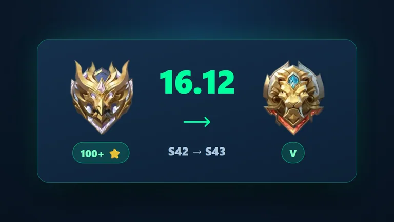
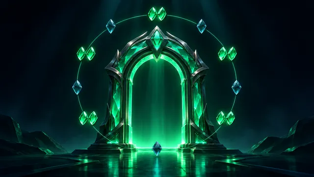

FAQ

# Mobile Legends boost questions

Answers to the most common questions about our service

Didn't find an answer? Message us on Telegram

### How long does the boost take?

Timing depends on the route, boost type, player availability and account requirements. The calculator estimate is preliminary. Confirm the start time and expected timing with support before paying.

### Who carries out the boost?

The player is assigned for your route and format. Before paying, ask about their game experience and confirm terms with support.

### Can I follow the process?

Yes, you can watch the process through the stream option in MLBB by logging in beforehand on your second account.

### Is email access required?

Under the service rules, account boosting does not require email access. Sharing game account access still carries risks. With party play you play yourself without sharing access with the assigned player.

### How are orders placed and paid for?

Orders are arranged through Telegram. First confirm the route, player, price and timing, then read the offer and payment terms. Confirm full or partial prepayment terms before transferring funds.

### Can the booster be replaced?

Contact support if you have concerns about your order. Player replacement and next steps are handled under the service terms.

### Can I get banned for boosting?

Account sharing and game services may conflict with the game’s rules. Absence of sanctions is not guaranteed. Read the disclaimer and security terms before ordering.

### Still have questions?

We're ready to answer any question you have on Telegram. Don't hesitate to reach out!

## Still have questions?

Message us on Telegram to discuss your question

[Message us](https://t.me/Cla1ve) [Telegram bot](https://t.me/cla1ve_boost_bot?start=site)

Guides

## Detailed answers

Ranks, placement and season end — with tables and numbers.

[Meta**Tier list, November 2026**Strongest heroes and bans from official statisticsOpen](https://boostmlbb.ru/en/news/mlbb-meta-tier-list/) [Article**Ranks in order**All tiers, stars and Mythic thresholdsOpen](https://boostmlbb.ru/en/news/mlbb-ranks-in-order/) [Article**Season 42 end**Expected date and where your rank dropsOpen](https://boostmlbb.ru/en/news/mlbb-season-end-rank-reset/) [Guide**Mythic placement**10 matches, double wins and priceOpen](https://boostmlbb.ru/en/guides/mythic-placement.html)
