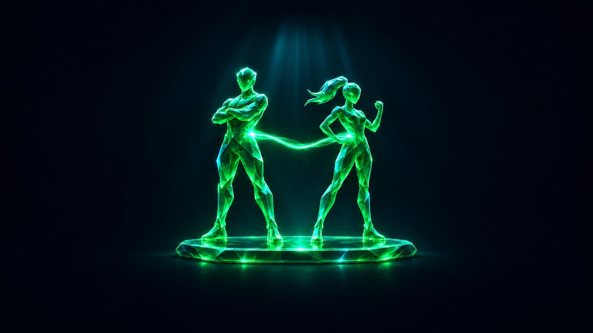
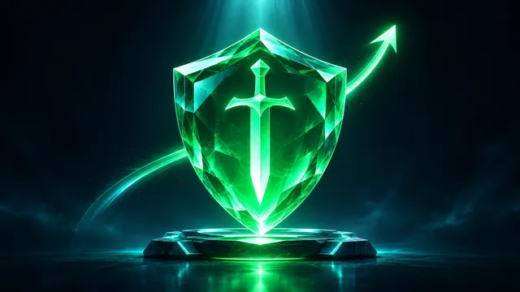
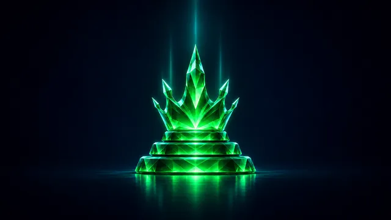
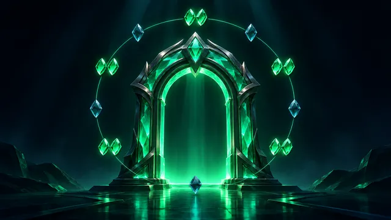

[Home](https://boostmlbb.ru/en/) / [Services](https://boostmlbb.ru/en/services.html)

Party or account

# Party boost or account boost

In a party you play yourself with the booster. In an account boost the booster plays on your account.

[Calculate party](https://boostmlbb.ru/en/order.html?type=party)[Message on Telegram](https://t.me/cla1ve_boost_bot?start=site)

### Account boost

-   The booster plays on your account.
-   Needs a login to the game account, not your email.
-   Faster and cheaper: from 55 ₽ per star.

[Calculate](https://boostmlbb.ru/en/order.html?type=standard)

### Party boost

-   You play yourself on one team with the booster.
-   Your account stays with you.
-   Costs more: from 95 ₽ per star, and you set the time.

[Calculate party](https://boostmlbb.ru/en/order.html?type=party)

## Party price per star

The Party rate is highlighted, with the account boost for comparison.

### Warrior, Elite

Account55 ₽/⭐

Role60 ₽/⭐

Hero65 ₽/⭐

Party95 ₽/⭐

[Calculate order](https://boostmlbb.ru/en/order.html?type=party)

### Master, GM

Account80 ₽/⭐

Role85 ₽/⭐

Hero105 ₽/⭐

Party120 ₽/⭐

[Calculate order](https://boostmlbb.ru/en/order.html?type=party)

### Epic

Account95 ₽/⭐

Role100 ₽/⭐

Hero120 ₽/⭐

Party185 ₽/⭐

[Calculate order](https://boostmlbb.ru/en/order.html?type=party)

### Legend

Account95 ₽/⭐

Role100 ₽/⭐

Hero120 ₽/⭐

Party185 ₽/⭐

[Calculate order](https://boostmlbb.ru/en/order.html?type=party)

### Mythic placement

Account165 ₽/win

Role185 ₽/win

Hero205 ₽/win

Party335 ₽/win

[Calculate order](https://boostmlbb.ru/en/order.html?type=party)

### Mythic

Account120 ₽/⭐

Role135 ₽/⭐

Hero145 ₽/⭐

Party240 ₽/⭐

[Calculate order](https://boostmlbb.ru/en/order.html?type=party)

### Honor

Account120 ₽/⭐

Role135 ₽/⭐

Hero145 ₽/⭐

Party255 ₽/⭐

[Calculate order](https://boostmlbb.ru/en/order.html?type=party)

### Glory

Account125 ₽/⭐

Role140 ₽/⭐

Hero155 ₽/⭐

Party295 ₽/⭐

[Calculate order](https://boostmlbb.ru/en/order.html?type=party)

### Immortal

Account135 ₽/⭐

Role145 ₽/⭐

Hero175 ₽/⭐

Party320 ₽/⭐

[Calculate order](https://boostmlbb.ru/en/order.html?type=party)

## How to choose

[**You want to play**Choose party: you play, the booster is with you.](https://boostmlbb.ru/en/order.html?type=party)[**No time to play**Account boost: the booster plays the route for you.](https://boostmlbb.ru/en/order.html?type=standard)[**You need one hero**Hero boost: the whole route on one hero.](https://boostmlbb.ru/en/boost/hero.html)

Before sharing an account read the [security recommendations](https://boostmlbb.ru/en/security.html) and the [refund terms](https://boostmlbb.ru/en/refund.html).

## Compare prices for your rank

Price the same route as an account boost and in a party.

[Calculate the price](https://boostmlbb.ru/en/order.html?type=party)

## Frequently asked questions

How is a party boost different from an account boost?

In a party you play yourself on one team with the booster and keep your account. In an account boost the booster plays on your account.

Why does party cost more?

The booster plays at your time and carries the game with you, so a star costs more: from 95 ₽ versus 55 ₽ for an account boost.

Do I share account details in a party?

No. You log in yourself and invite the booster to your group.

MLBB Boost editorial team · Updated 22 November 2026

Related

## Other formats

Hero boost, Mythic and placement.

[Service**Hero MMR boost**Rank and rating of your heroOpen](https://boostmlbb.ru/en/boost/hero.html) [Service**Mythic boost**Star prices in Honor, Glory and ImmortalOpen](https://boostmlbb.ru/en/boost/mythic.html) [Guide**Mythic placement**10 matches, double wins and priceOpen](https://boostmlbb.ru/en/guides/mythic-placement.html) [Article**Ranks in order**All tiers, stars and Mythic thresholdsOpen](https://boostmlbb.ru/en/news/mlbb-ranks-in-order/)
