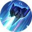

[Tier list](https://boostmlbb.ru/en/heroes/)[Items](https://boostmlbb.ru/en/items/)[Skins](https://boostmlbb.ru/en/skins/)[News & guides](https://boostmlbb.ru/en/news/)

[Tier list](https://boostmlbb.ru/en/heroes/)

# Alpha

C

FighterEXP LaneJungle

Win rate

48.1%

Pick rate

0.8%

Ban rate

0.2%

[Overview](https://boostmlbb.ru/#overview)[Build](https://boostmlbb.ru/#build)[How to play](https://boostmlbb.ru/#howto)[Skills](https://boostmlbb.ru/#skills)[Counters](https://boostmlbb.ru/#draft)[Skins](https://boostmlbb.ru/#skins)[Lore](https://boostmlbb.ru/#lore)

## Overview

### Attributes

-   Durability**60**
-   Offense**40**
-   Control**70**
-   Difficulty**10**

-   Charge
-   Damage

### Win rate by rank, 30 days

1.  **50.2%**Epic
2.  **49.0%**Legend
3.  **48.5%**Mythic
4.  **49.0%**Honor
5.  **48.0%**Glory

Dashed line: 50% win rate

### More fighters on this lane

[Freya](https://boostmlbb.ru/en/heroes/freya.html)[Aulus](https://boostmlbb.ru/en/heroes/aulus.html)[Paquito](https://boostmlbb.ru/en/heroes/paquito.html)[Sun](https://boostmlbb.ru/en/heroes/sun.html)[Lukas](https://boostmlbb.ru/en/heroes/lukas.html)[Suyou](https://boostmlbb.ru/en/heroes/suyou.html)[Cici](https://boostmlbb.ru/en/heroes/cici.html)[Sora](https://boostmlbb.ru/en/heroes/sora.html)

### Places in the rankings

-   [Best MLBB junglers**21 of 37**](https://boostmlbb.ru/en/heroes/best-jungle.html)
-   [Best MLBB fighters**26 of 44**](https://boostmlbb.ru/en/heroes/best-fighter.html)

## Build

Build 1Build 2Build 3

Win rate

55.0%

Pick rate

2.4%

#### Core items

-   [

    

    War Axe

    ](https://boostmlbb.ru/en/items/war-axe.html)
-   [

    

    Sky Piercer

    ](https://boostmlbb.ru/en/items/sky-piercer.html)
-   [

    

    Queen's Wings

    ](https://boostmlbb.ru/en/items/queens-wings.html)

#### Spell

Vengeance

#### Emblem and talents

Fighter

-   

    Thrill

-   

    Seasoned Hunter

-   

    Impure Rage

Win rate

58.3%

Pick rate

1.8%

#### Core items

-   [

    

    War Axe

    ](https://boostmlbb.ru/en/items/war-axe.html)
-   [

    

    Sky Piercer

    ](https://boostmlbb.ru/en/items/sky-piercer.html)
-   [

    

    Queen's Wings

    ](https://boostmlbb.ru/en/items/queens-wings.html)

#### Spell

Vengeance

#### Emblem and talents

Fighter

-   

    Thrill

-   

    Festival of Blood

-   

    Killing Spree

Win rate

60.2%

Pick rate

1.2%

#### Core items

-   [

    

    War Axe

    ](https://boostmlbb.ru/en/items/war-axe.html)
-   [

    

    Blade of Despair

    ](https://boostmlbb.ru/en/items/blade-of-despair.html)
-   [

    

    Queen's Wings

    ](https://boostmlbb.ru/en/items/queens-wings.html)

#### Spell

Vengeance

#### Emblem and talents

Fighter

-   

    Thrill

-   

    Festival of Blood

-   

    Impure Rage

## How to play Alpha

### Alpha combos

#### Teamfight

1.  Ult
2.  2
3.  1
4.  Attack

In teamfights, use Alpha's Ultimate to charge toward enemy's key target, and use his 2nd Skill, follow up with his 1st Skill to slow them and continuously dish out damage to the locked-on targets with Basic Attacks.

#### Laning

1.  1
2.  2
3.  Attack

In the laning phase, slow the enemy with Alpha's 1st Skill, then hit them with his 2nd Skill to have Beta to lock on to them. Finish with Basic Attacks while Beta fires at the locked-on target.

### When strongest

Stronger late: 49.8% after minute 20. Do not take risks early, farm and fight together with your team.

1.  **43.8**10–12
2.  **46.2**12–14
3.  **48.1**14–16
4.  **48.8**16–18
5.  **49.3**18–20
6.  **49.8**20+

Win rate % by match length in minutes, all ranks. Dashed line: 50%

### Level-up priority

1.  Spear of Alpha
2.  Force Swing
3.  Rotary Impact

## Skills

Passive**Beta, Advance!**Skill 1**Rotary Impact**Skill 2**Force Swing**Ultimate**Spear of Alpha**

Passive

### Beta, Advance!

When Alpha uses a skill, Beta will be summoned to attack. Enemies that are hit by Beta 2 time(s) will be Locked On.

**Locked On:** After Alpha deals damage to the target, Beta will fire a laser at them, dealing 60 (+50% Total Physical Attack) (+8 × hero level) True Damage and briefly applying a powerful slow effect.

This skill only deals 75% damage to Creeps.

Skill 1

### Rotary Impact

Cooldown **4 Mana Cost: 50 s**

Alpha unleashes an energy wave in the target direction, dealing 100 (+90% Extra Physical Attack) Physical Damage to enemies in its path and slowing them by 40% for 1s.

Beta then strafes enemies along the same path, dealing 60 (+30% Extra Physical Attack) True Damage.

Skill 2

### Force Swing

Cooldown **6 Mana Cost: 45 s**

After a short delay, Alpha swings his blade in the target direction, dealing 180 (+100% Total Physical Attack) Physical Damage to enemies in a fan-shaped area and recovering 80 (+40% Extra Physical Attack) HP for the first enemy hit (healing decays by 40% for each additional enemy hit).

Beta then strafes enemies in the same area, dealing 60 (+30% Total Physical Attack) True Damage.

Ultimate

### Spear of Alpha

Beta dives to the target location, dealing 100 (+20% Extra Physical Attack) Physical Damage to enemies hit and stunning them for 1s. Alpha then leaps towards the same location, knocking enemies in his path airborne and carrying them to the landing location. Alpha then slams down, dealing 250 (+100% Extra Physical Attack) Physical Damage and slowing the enemies by 40% for 1.5s.

Beta then attacks the same area 5 times, dealing 15 (+30% Extra Physical Attack) True Damage each time.

## Alpha counters

### Who counters Alpha

[Phoveus](https://boostmlbb.ru/en/heroes/phoveus.html)[Odette](https://boostmlbb.ru/en/heroes/odette.html)[Saber](https://boostmlbb.ru/en/heroes/saber.html)[Barats](https://boostmlbb.ru/en/heroes/barats.html)[Fredrinn](https://boostmlbb.ru/en/heroes/fredrinn.html)

### Who Alpha counters

[Chang'e](https://boostmlbb.ru/en/heroes/change.html)[Lancelot](https://boostmlbb.ru/en/heroes/lancelot.html)[Lylia](https://boostmlbb.ru/en/heroes/lylia.html)[Benedetta](https://boostmlbb.ru/en/heroes/benedetta.html)[Hanzo](https://boostmlbb.ru/en/heroes/hanzo.html)

## Alpha skins

[Revenant of RosesSupreme · 2025](https://boostmlbb.ru/en/skins/alpha/revenant-of-roses.html)[Mecha-King PerseusExquisite · 2024](https://boostmlbb.ru/en/skins/alpha/mecha-king-perseus.html)[General VoidGrand · 2023](https://boostmlbb.ru/en/skins/alpha/general-void.html)[Star EnforcerExceptional · 2023](https://boostmlbb.ru/en/skins/alpha/star-enforcer.html)[Crimson WarriorExceptional · 2020](https://boostmlbb.ru/en/skins/alpha/crimson-warrior.html)[Sea GladiatorCommon · 2018](https://boostmlbb.ru/en/skins/alpha/sea-gladiator.html)[Fierce DragonCommon · 2017](https://boostmlbb.ru/en/skins/alpha/fierce-dragon.html)[Onimusha CommanderExquisite · 2017](https://boostmlbb.ru/en/skins/alpha/onimusha-commander.html)[Edict of the Sands](https://boostmlbb.ru/en/skins/alpha/edict-of-the-sands.html)

[All 9 Alpha skins: prices and how to get them](https://boostmlbb.ru/en/skins/alpha.html)

## Lore

> A pure cyborg made by Laboratory 1718.

[Read the full story ↗](https://play.mobilelegends.com/lore/hero/alpha)Official Mobile Legends site [Hero stats on the game site ↗](https://www.mobilelegends.com/hero/detail?heroid=28)

**Rank up on Alpha**The calculator shows the price

[Calculate price](https://boostmlbb.ru/en/order.html?type=hero)

## Frequently asked questions

Who counters Alpha in MLBB?

Over the last 30 days the toughest opponents are Phoveus, Odette, Saber, Barats and Fredrinn.

How do you play Alpha?

Level "Force Swing" first and take the ultimate whenever it is available. Stronger late: 49.8% after minute 20. Do not take risks early, farm and fight together with your team. Teamfight combo: In teamfights, use Alpha's Ultimate to charge toward enemy's key target, and use his 2nd Skill, follow up with his 1st Skill to slow them and continuously dish out damage to the locked-on targets with Basic Attacks.

What is Alpha’s win rate right now?

48.14% at Mythical Glory over the last 7 days and 48.85% across all ranks over 30 days, as of 25 November 2026.

What role and lane does Alpha play?

Fighter, played in the EXP Lane or in the jungle.

Is Alpha strong in the current meta?

Tier C, #86 of 133 heroes and #26 among fighters. The tier counts how often the hero is picked and banned and how well it wins at Mythical Glory over 7 days: banned in 0.2% of matches, 48.1% win rate. In professional games over the last month the hero is drafted in 1.3% of them.

What is the best build for Alpha?

The most popular ranked build: War Axe, Sky Piercer and Queen's Wings as core items, the Fighter emblem with Thrill, Seasoned Hunter and Impure Rage, and Vengeance. It wins 54.96% of matches.
