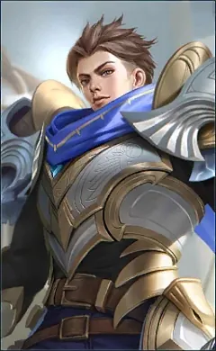

[Tier list](https://boostmlbb.ru/en/heroes/)[Items](https://boostmlbb.ru/en/items/)[Skins](https://boostmlbb.ru/en/skins/)[News & guides](https://boostmlbb.ru/en/news/)

[Tier list](https://boostmlbb.ru/en/heroes/)

# Alucard

C

FighterAssassinJungle

Win rate

49.4%

Pick rate

0.4%

Ban rate

0.1%

[Overview](https://boostmlbb.ru/#overview)[Build](https://boostmlbb.ru/#build)[How to play](https://boostmlbb.ru/#howto)[Skills](https://boostmlbb.ru/#skills)[Counters](https://boostmlbb.ru/#draft)[Skins](https://boostmlbb.ru/#skins)[Lore](https://boostmlbb.ru/#lore)

## Overview

### Attributes

-   Durability**50**
-   Offense**50**
-   Control**10**
-   Difficulty**30**

-   Chase
-   Damage

### Win rate by rank, 30 days

1.  **48.8%**Epic
2.  **49.0%**Legend
3.  **49.1%**Mythic
4.  **48.6%**Honor
5.  **49.1%**Glory

Dashed line: 50% win rate

### More fighters on this lane

[Freya](https://boostmlbb.ru/en/heroes/freya.html)[Aulus](https://boostmlbb.ru/en/heroes/aulus.html)[Paquito](https://boostmlbb.ru/en/heroes/paquito.html)[Sun](https://boostmlbb.ru/en/heroes/sun.html)[Lukas](https://boostmlbb.ru/en/heroes/lukas.html)[Suyou](https://boostmlbb.ru/en/heroes/suyou.html)[Dyrroth](https://boostmlbb.ru/en/heroes/dyrroth.html)[Alpha](https://boostmlbb.ru/en/heroes/alpha.html)

### Places in the rankings

-   [Best MLBB junglers**31 of 37**](https://boostmlbb.ru/en/heroes/best-jungle.html)
-   [Best MLBB fighters**36 of 44**](https://boostmlbb.ru/en/heroes/best-fighter.html)
-   [Best MLBB assassins**25 of 29**](https://boostmlbb.ru/en/heroes/best-assassin.html)

## Build

Build 1Build 2

Win rate

59.7%

Pick rate

12.8%

#### Core items

-   [

    

    War Axe

    ](https://boostmlbb.ru/en/items/war-axe.html)
-   [

    

    Endless Battle

    ](https://boostmlbb.ru/en/items/endless-battle.html)
-   [

    

    Blade of Despair

    ](https://boostmlbb.ru/en/items/blade-of-despair.html)

#### Spell

Retribution

#### Emblem and talents

Assassin

-   

    Thrill

-   

    Seasoned Hunter

-   

    Temporal Reign

Win rate

59.2%

Pick rate

5.7%

#### Core items

-   [

    

    Hunter Strike

    ](https://boostmlbb.ru/en/items/hunter-strike.html)
-   [

    

    War Axe

    ](https://boostmlbb.ru/en/items/war-axe.html)
-   [

    

    Endless Battle

    ](https://boostmlbb.ru/en/items/endless-battle.html)

#### Spell

Retribution

#### Emblem and talents

Assassin

-   

    Thrill

-   

    Weapons Master

-   

    Temporal Reign

## How to play Alucard

### Alucard combos

#### Teamfight

1.  Ult
2.  Attack
3.  1
4.  Attack
5.  2
6.  Attack
7.  Ult

In teamfights, Alucard can cast his ULTIMATE to increase Lifesteal and mark enemies and then switch between 1st Skill and 2nd Skill to follow Basic Attacks. Finally, use his ULTIMATE again for reaping kills.

#### Laning

1.  1
2.  Attack
3.  2
4.  Attack

In the laning phase, Alucard can use his 1st Skill to deal damage and slow enemies first, and follow it with Basic Attacks for strikes. Then, he can use his 2nd Skill and follow it with Basic Attacks for more strikes.

### When strongest

Stronger late: 51.4% at 18–20 minutes. Do not take risks early, farm and fight together with your team.

1.  **46.2**10–12
2.  **49.2**12–14
3.  **50.3**14–16
4.  **50.9**16–18
5.  **51.4**18–20
6.  **51.4**20+

Win rate % by match length in minutes, all ranks. Dashed line: 50%

### Level-up priority

1.  Fission Wave
2.  Whirling Smash
3.  Groundsplitter

## Skills

Passive**Pursuit**Skill 1**Groundsplitter**Skill 2**Whirling Smash**Ultimate**Fission Wave**

Passive

### Pursuit

After each skill cast, Alucard's next Basic Attack allows him to dash to the target and deal (+125% Total Physical Attack) Physical Damage.

**Demon Hunter:** Alucard deals 110% damage to creeps.

Skill 1

### Groundsplitter

Cooldown **8.5 s**

Alucard jumps to the target area and slashes, dealing 270 (+85% Extra Physical Attack) Physical Damage to enemies within the area and slowing them by 40% for 2s.

Skill 2

### Whirling Smash

Cooldown **6 s**

Alucard launches a whirling slash, dealing 345 (+120% Extra Physical Attack) Physical Damage to nearby enemies.

Ultimate

### Fission Wave

Cooldown **40 s**

**Passive:** Alucard permanently gains 10% Hybrid Lifesteal.

**Active:** Alucard absorbs the energy of enemies in the target area, reducing their Movement Speed by 30% and by 10. He gains 10 for each enemy hero hit and reduces the cooldown of his other skills to 50% for 6s.

**Use Again:** Alucard releases a powerful shockwave forward, dealing 400 (+200% Extra Physical Attack) Physical Damage.

## Alucard counters

### Who counters Alucard

[Natalia](https://boostmlbb.ru/en/heroes/natalia.html)[Sun](https://boostmlbb.ru/en/heroes/sun.html)[Mathilda](https://boostmlbb.ru/en/heroes/mathilda.html)[Saber](https://boostmlbb.ru/en/heroes/saber.html)[Harith](https://boostmlbb.ru/en/heroes/harith.html)

### Who Alucard counters

[Tigreal](https://boostmlbb.ru/en/heroes/tigreal.html)[Thamuz](https://boostmlbb.ru/en/heroes/thamuz.html)[Barats](https://boostmlbb.ru/en/heroes/barats.html)[Fredrinn](https://boostmlbb.ru/en/heroes/fredrinn.html)[Khufra](https://boostmlbb.ru/en/heroes/khufra.html)[Akai](https://boostmlbb.ru/en/heroes/akai.html)

## Alucard skins

[Demon's BaneExceptional · 2025](https://boostmlbb.ru/en/skins/alucard/demon-s-bane.html)[Obi-Wan KenobiGrand · 2021](https://boostmlbb.ru/en/skins/alucard/obi-wan-kenobi.html)[Lightborn - StrikerDeluxe · 2019](https://boostmlbb.ru/en/skins/alucard/lightborn-striker.html)[Empire AgentCommon · 2019](https://boostmlbb.ru/en/skins/alucard/empire-agent.html)[Obsidian BladeSupreme · 2019](https://boostmlbb.ru/en/skins/alucard/obsidian-blade.html)[Romantic FantasyExceptional · 2018](https://boostmlbb.ru/en/skins/alucard/romantic-fantasy.html)[ViscountExceptional · 2017](https://boostmlbb.ru/en/skins/alucard/viscount.html)[Child of the FallExquisite · 2017](https://boostmlbb.ru/en/skins/alucard/child-of-the-fall.html)[Fiery InfernoCommon · 2017](https://boostmlbb.ru/en/skins/alucard/fiery-inferno.html)[Lone HeroCommon · 2016](https://boostmlbb.ru/en/skins/alucard/lone-hero.html)

[All 10 Alucard skins: prices and how to get them](https://boostmlbb.ru/en/skins/alucard.html)

## Lore

> Demon hunter who detests the darkness.

[Read the full story ↗](https://play.mobilelegends.com/lore/hero/Alucard)Official Mobile Legends site [Hero stats on the game site ↗](https://www.mobilelegends.com/hero/detail?heroid=7)

**Rank up on Alucard**The calculator shows the price

[Calculate price](https://boostmlbb.ru/en/order.html?type=hero)

## Frequently asked questions

Who counters Alucard in MLBB?

Over the last 30 days the toughest opponents are Natalia, Sun, Mathilda, Saber and Harith.

How do you play Alucard?

Level "Whirling Smash" first and take the ultimate whenever it is available. Stronger late: 51.4% at 18–20 minutes. Do not take risks early, farm and fight together with your team. Teamfight combo: In teamfights, Alucard can cast his ULTIMATE to increase Lifesteal and mark enemies and then switch between 1st Skill and 2nd Skill to follow Basic Attacks. Finally, use his ULTIMATE again for reaping kills.

What is Alucard’s win rate right now?

49.37% at Mythical Glory over the last 7 days and 48.93% across all ranks over 30 days, as of 25 November 2026.

What role and lane does Alucard play?

Fighter and assassin, played in the jungle.

Is Alucard strong in the current meta?

Tier C, #111 of 133 heroes and #36 among fighters. The tier counts how often the hero is picked and banned and how well it wins at Mythical Glory over 7 days: banned in 0.1% of matches, 49.4% win rate. In professional games over the last month the hero is drafted in 0.0% of them.

What is the best build for Alucard?

The most popular ranked build: War Axe, Endless Battle and Blade of Despair as core items, the Assassin emblem with Thrill, Seasoned Hunter and Temporal Reign, and Retribution. It wins 59.72% of matches.
