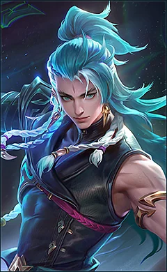
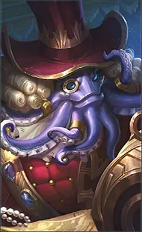

[Tier list](https://boostmlbb.ru/en/heroes/)

# Bane

C

FighterMageEXP LaneJungle

Win rate

51.6%

Pick rate

0.3%

Ban rate

0.1%

[Overview](https://boostmlbb.ru/#overview)[Build](https://boostmlbb.ru/#build)[How to play](https://boostmlbb.ru/#howto)[Skills](https://boostmlbb.ru/#skills)[Counters](https://boostmlbb.ru/#draft)[Skins](https://boostmlbb.ru/#skins)[Lore](https://boostmlbb.ru/#lore)

## Overview

### Attributes

-   Durability**50**
-   Offense**60**
-   Control**40**
-   Difficulty**40**

-   Push
-   Burst

### Win rate by rank, 30 days

1.  **52.4%**Epic
2.  **51.6%**Legend
3.  **51.5%**Mythic
4.  **51.7%**Honor
5.  **51.5%**Glory

Dashed line: 50% win rate

### More fighters on this lane

[Freya](https://boostmlbb.ru/en/heroes/freya.html)[Aulus](https://boostmlbb.ru/en/heroes/aulus.html)[Paquito](https://boostmlbb.ru/en/heroes/paquito.html)[Sun](https://boostmlbb.ru/en/heroes/sun.html)[Suyou](https://boostmlbb.ru/en/heroes/suyou.html)[Lukas](https://boostmlbb.ru/en/heroes/lukas.html)[Cici](https://boostmlbb.ru/en/heroes/cici.html)[Sora](https://boostmlbb.ru/en/heroes/sora.html)

### Places in the rankings

-   [Best MLBB junglers**25 of 37**](https://boostmlbb.ru/en/heroes/best-jungle.html)
-   [Best MLBB mages**25 of 32**](https://boostmlbb.ru/en/heroes/best-mage.html)
-   [Best MLBB fighters**31 of 44**](https://boostmlbb.ru/en/heroes/best-fighter.html)

## Build

Build 1Build 2Build 3

Win rate

50.5%

Pick rate

2.5%

#### Core items

-   [

    

    Hunter Strike

    ](https://boostmlbb.ru/en/items/hunter-strike.html)
-   [

    

    War Axe

    ](https://boostmlbb.ru/en/items/war-axe.html)
-   [

    

    Sea Halberd

    ](https://boostmlbb.ru/en/items/sea-halberd.html)

#### Spell

Flicker

#### Emblem and talents

Assassin

-   

    Thrill

-   

    Seasoned Hunter

-   

    Lethal Ignition

Win rate

52.8%

Pick rate

1.9%

#### Core items

-   [

    

    Sea Halberd

    ](https://boostmlbb.ru/en/items/sea-halberd.html)
-   [

    

    Hunter Strike

    ](https://boostmlbb.ru/en/items/hunter-strike.html)
-   [

    

    War Axe

    ](https://boostmlbb.ru/en/items/war-axe.html)

#### Spell

Flicker

#### Emblem and talents

Assassin

-   

    Rupture

-   

    Master Assassin

-   

    Lethal Ignition

Win rate

51.6%

Pick rate

1.3%

#### Core items

-   [

    

    Sea Halberd

    ](https://boostmlbb.ru/en/items/sea-halberd.html)
-   [

    

    War Axe

    ](https://boostmlbb.ru/en/items/war-axe.html)
-   [

    

    Malefic Roar

    ](https://boostmlbb.ru/en/items/malefic-roar.html)

#### Spell

Flicker

#### Emblem and talents

Assassin

-   

    Rupture

-   

    Seasoned Hunter

-   

    Lethal Ignition

## How to play Bane

### Bane combos

#### Teamfight

1.  2
2.  Ult
3.  Attack
4.  2
5.  Attack
6.  1
7.  Attack

In teamfights, use Bane's 2nd Skill to close in and catch multiple enemies with his Ultimate. Use an enhanced Basic Attack when the enemies are knocked airborne, then use his 2nd Skill and another enhanced Basic Attack. Finally, use his 1st Skill and enhanced Basic Attack to chase and finish off the enemy.

#### Laning

1.  2
2.  Attack
3.  1
4.  Attack
5.  2
6.  Attack

In the laning phase, use Bane's 2nd Skill to get close to the enemy and hit them with an enhanced Basic Attack. Then use his 1st Skill to slow the enemy followed by another enhanced Basic Attack. And end with his 2nd Skill again with another enhanced Basic Attack.

### When strongest

Even through the game, from 47.4% to 51.6%. Pick fights by your items rather than the clock.

1.  **51.6**10–12
2.  **49.2**12–14
3.  **47.4**14–16
4.  **48.1**16–18
5.  **49.6**18–20
6.  **49.9**20+

Win rate % by match length in minutes, all ranks. Dashed line: 50%

### Level-up priority

1.  Deadly Catch
2.  Crab Claw Cannon
3.  Sea Ink

## Skills

Passive**Shark Bite**Skill 1**Crab Claw Cannon**Skill 2**Sea Ink**Ultimate**Deadly Catch**

Passive

### Shark Bite

Bane infuses his weapon with a stack of Power of Tide each time he uses a skill (up to 2 stacks). Each of his subsequent Basic Attacks consumes a stack to deal (+95% Total Physical Attack) (+ 4 (+0.4 × hero level)% target's ) Physical Damage to nearby enemies.

Skill 1

### Crab Claw Cannon

Cooldown **8 Mana Cost: 30 s**

Bane fires his Crab Claw Cannon in the target direction, dealing 150 (+160% Total Physical Attack) Physical Damage to the first enemy hit and then 150% damage to a random enemy behind them (prioritizes enemy heroes). Enemies hit are slowed by 10 (+10% Total Magic Power)% for 1s.

Every 100 Bane possesses reduces this skill's cooldown by an additional 8%.

Skill 2

### Sea Ink

Cooldown **7.5 Mana Cost: 50 s**

Bane swallows a cup of sea ink, recovering HP equal to 200 (+150% Total Magic Power) + 5 (+1.5% Total Magic Power)% of his , and gaining 50% Movement Speed that decays over 2.5s.

**Use Again:** Bane spits corrosive ink in a fan-shaped area, dealing 140 (+130% Total Magic Power) Magic Damage (up to 200% with charging time).

Every 100 Bane possesses reduces this skill's cooldown by an additional 7%.

Ultimate

### Deadly Catch

Cooldown **40 Mana Cost: 120 s**

Bane summons a school of sharks to charge in the target direction, dealing 700 (+80% Total Physical Attack) (+150% Total Magic Power) Magic Damage to enemies hit, knocking them airborne for 0.6s, and slowing them by 75% (decays over 3s).

This skill deals 40% damage to turrets.

## Bane counters

### Who counters Bane

[Phoveus](https://boostmlbb.ru/en/heroes/phoveus.html)[Baxia](https://boostmlbb.ru/en/heroes/baxia.html)[Khufra](https://boostmlbb.ru/en/heroes/khufra.html)[Odette](https://boostmlbb.ru/en/heroes/odette.html)[Belerick](https://boostmlbb.ru/en/heroes/belerick.html)

### Who Bane counters

[Novaria](https://boostmlbb.ru/en/heroes/novaria.html)[Lolita](https://boostmlbb.ru/en/heroes/lolita.html)

## Bane skins

[Lord of Scalding SeasExceptional · 2025](https://boostmlbb.ru/en/skins/bane/lord-of-scalding-seas.html)[Soul DefilerDeluxe · 2023](https://boostmlbb.ru/en/skins/bane/soul-defiler.html)[Underworld OutlawCommon · 2022](https://boostmlbb.ru/en/skins/bane/underworld-outlaw.html)[WarlordCommon · 2019](https://boostmlbb.ru/en/skins/bane/warlord.html)[Deep Sea MonsterCommon · 2018](https://boostmlbb.ru/en/skins/bane/deep-sea-monster.html)[Castle MasterDeluxe · 2016](https://boostmlbb.ru/en/skins/bane/castle-master.html)

[All 6 Bane skins: prices and how to get them](https://boostmlbb.ru/en/skins/bane.html)

## Lore

> Cruel pirate leader, Franco's sworn enemy.

[Read the full story ↗](https://play.mobilelegends.com/lore/hero/Bane)Official Mobile Legends site [Hero stats on the game site ↗](https://www.mobilelegends.com/hero/detail?heroid=11)

**Rank up on Bane**The calculator shows the price

[Calculate price](https://boostmlbb.ru/en/order.html?type=hero)

## Frequently asked questions

Who counters Bane in MLBB?

Over the last 30 days the toughest opponents are Phoveus, Baxia, Khufra, Odette and Belerick.

How do you play Bane?

Level "Crab Claw Cannon" first and take the ultimate whenever it is available. Even through the game, from 47.4% to 51.6%. Pick fights by your items rather than the clock. Teamfight combo: In teamfights, use Bane's 2nd Skill to close in and catch multiple enemies with his Ultimate. Use an enhanced Basic Attack when the enemies are knocked airborne, then use his 2nd Skill and another enhanced Basic Attack. Finally, use his 1st Skill and enhanced Basic Attack to chase and finish off the enemy.

What is Bane’s win rate right now?

51.61% at Mythical Glory over the last 7 days and 51.62% across all ranks over 30 days, as of 27 November 2026.

What role and lane does Bane play?

Fighter and mage, played in the EXP Lane or in the jungle.

Is Bane strong in the current meta?

Tier C, #98 of 133 heroes and #31 among fighters. The tier counts how often the hero is picked and banned and how well it wins at Mythical Glory over 7 days: banned in 0.1% of matches, 51.6% win rate. In professional games over the last month the hero is drafted in 0.0% of them.

What is the best build for Bane?

The most popular ranked build: Hunter Strike, War Axe and Sea Halberd as core items, the Assassin emblem with Thrill, Seasoned Hunter and Lethal Ignition, and Flicker. It wins 50.46% of matches.
