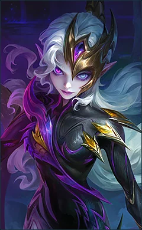

[Tier list](https://boostmlbb.ru/en/heroes/)[Items](https://boostmlbb.ru/en/items/)[Skins](https://boostmlbb.ru/en/skins/)[News & guides](https://boostmlbb.ru/en/news/)

[Tier list](https://boostmlbb.ru/en/heroes/)

# Baxia

D

TankJungleRoam

Win rate

46.0%

Pick rate

0.1%

Ban rate

0.1%

[Overview](https://boostmlbb.ru/#overview)[Build](https://boostmlbb.ru/#build)[How to play](https://boostmlbb.ru/#howto)[Skills](https://boostmlbb.ru/#skills)[Counters](https://boostmlbb.ru/#draft)[Skins](https://boostmlbb.ru/#skins)[Lore](https://boostmlbb.ru/#lore)

## Overview

### Attributes

-   Durability**100**
-   Offense**30**
-   Control**60**
-   Difficulty**30**

-   Support
-   Damage

### More tanks on this lane

[Carmilla](https://boostmlbb.ru/en/heroes/carmilla.html)[Belerick](https://boostmlbb.ru/en/heroes/belerick.html)[Atlas](https://boostmlbb.ru/en/heroes/atlas.html)[Alice](https://boostmlbb.ru/en/heroes/alice.html)[Gloo](https://boostmlbb.ru/en/heroes/gloo.html)[Minotaur](https://boostmlbb.ru/en/heroes/minotaur.html)[Khufra](https://boostmlbb.ru/en/heroes/khufra.html)[Tigreal](https://boostmlbb.ru/en/heroes/tigreal.html)

### Places in the rankings

-   [Best MLBB junglers**37 of 37**](https://boostmlbb.ru/en/heroes/best-jungle.html)
-   [Best MLBB tanks**25 of 25**](https://boostmlbb.ru/en/heroes/best-tank.html)
-   [Best MLBB roamers**34 of 34**](https://boostmlbb.ru/en/heroes/best-roam.html)

## Build

Build 1Build 2Build 3

Win rate

51.8%

Pick rate

4.0%

#### Core items

-   [

    

    Antique Cuirass

    ](https://boostmlbb.ru/en/items/antique-cuirass.html)
-   [

    

    Radiant Armor

    ](https://boostmlbb.ru/en/items/radiant-armor.html)
-   [

    

    Immortality

    ](https://boostmlbb.ru/en/items/immortality.html)

#### Spell

Retribution

#### Emblem and talents

Tank

-   

    Thrill

-   

    Seasoned Hunter

-   

    Concussive Blast

Win rate

54.9%

Pick rate

3.6%

#### Core items

-   [

    

    Cursed Helmet

    ](https://boostmlbb.ru/en/items/cursed-helmet.html)
-   [

    

    Chastise Pauldron

    ](https://boostmlbb.ru/en/items/chastise-pauldron.html)
-   [

    

    Radiant Armor

    ](https://boostmlbb.ru/en/items/radiant-armor.html)

#### Spell

Retribution

#### Emblem and talents

Tank

-   

    Vitality

-   

    Seasoned Hunter

-   

    Concussive Blast

Win rate

55.1%

Pick rate

3.5%

#### Core items

-   [

    

    Cursed Helmet

    ](https://boostmlbb.ru/en/items/cursed-helmet.html)
-   [

    

    Chastise Pauldron

    ](https://boostmlbb.ru/en/items/chastise-pauldron.html)
-   [

    

    Radiant Armor

    ](https://boostmlbb.ru/en/items/radiant-armor.html)

#### Spell

Retribution

#### Emblem and talents

Tank

-   

    Thrill

-   

    Seasoned Hunter

-   

    Concussive Blast

## How to play Baxia

### Baxia combos

#### Teamfight

1.  1
2.  Ult
3.  2
4.  Attack

In teamfights, first activate Baxia's 1st Skill, then use his Ultimate to speed up. After running into an enemy, use his 2nd Skill followed by Basic Attacks to deal damage.

#### Laning

1.  1
2.  2
3.  Attack

In the laning phase, roll into the enemy with Baxia's 1st Skill and follow up with his 2nd Skill and Basic Attacks.

### When strongest

Even through the game, from 46.3% to 47.8%. Pick fights by your items rather than the clock.

1.  **47.2**10–12
2.  **46.3**12–14
3.  **47.8**14–16
4.  **47.2**16–18
5.  **47.7**18–20
6.  **47.3**20+

Win rate % by match length in minutes, all ranks. Dashed line: 50%

### Level-up priority

1.  Tortoise’s Puissance
2.  Shield of Spirit
3.  Baxia-Shield Unity

## Skills

Passive**Baxia Mark**Skill 1**Baxia-Shield Unity**Skill 2**Shield of Spirit**Ultimate**Tortoise’s Puissance**

Passive

### Baxia Mark

Baxia activates the "Baxia Mark" permanently, reducing the final damage received by 15 (+1 × hero level).

At the same time, Baxia will reduce the Shield and HP Regen of enemies hit by his skills by 40% for 4s.

Skill 1

### Baxia-Shield Unity

Cooldown **18 Mana Cost: 100 s**

Baxia retracts himself into his shield and accelerates forward. When hitting an enemy unit, he will deal 300 (+60% Total Magic Power) Magic Damage to it and nearby enemies, stunning the target for 0.8s and slightly knocking nearby enemies back.

During the process of accelerating forward, use this skill again to launch Baxia upward so that he can cross obstacles and enemy minions. When leaping up, if there is an enemy hero under Baxia, he will strike this hero, dealing 375 (+75% Total Magic Power) Magic Damage to this hero and nearby enemies, stunning the target hit for 1.5s, and slightly knocking other nearby enemy targets back.

Skill 2

### Shield of Spirit

Cooldown **7 Mana Cost: 20 s**

Baxia throws out his shield, dealing 120 (+100% Total Magic Power) (+ 5% target's ) Magic Damage to enemies along the way, marking them for 5s, and slowing them by 50% for 1s. The shield disappears upon hitting the first enemy hero or creep.

Baxia can cast the skill again in a short while. If an enemy hero or creep is hit by the skill, the skill's cooldown will be reduced to 15%.

Ultimate

### Tortoise’s Puissance

Cooldown **40 Mana Cost: 150 s**

Baxia holds his shield to the front and begins sprinting frantically, gaining 30% extra Movement Speed for 10s while leaving a lava path behind. Enemies on the path will take 40 (+30% Total Magic Power) Magic Damage and be slowed by 15% for 0.5s every 0.5s.

For the duration, the Damage Reduction effect from Baxia Mark is increased to 200%.

## Baxia counters

### Who counters Baxia

[Obsidia](https://boostmlbb.ru/en/heroes/obsidia.html)[Alice](https://boostmlbb.ru/en/heroes/alice.html)[Saber](https://boostmlbb.ru/en/heroes/saber.html)[Lukas](https://boostmlbb.ru/en/heroes/lukas.html)[Minsitthar](https://boostmlbb.ru/en/heroes/minsitthar.html)

### Who Baxia counters

[Nolan](https://boostmlbb.ru/en/heroes/nolan.html)[Clint](https://boostmlbb.ru/en/heroes/clint.html)[Kaja](https://boostmlbb.ru/en/heroes/kaja.html)[X.Borg](https://boostmlbb.ru/en/heroes/x-borg.html)[Karrie](https://boostmlbb.ru/en/heroes/karrie.html)[Bane](https://boostmlbb.ru/en/heroes/bane.html)[Luo Yi](https://boostmlbb.ru/en/heroes/luo-yi.html)

## Baxia skins

[Dauntless ShieldExceptional · 2024](https://boostmlbb.ru/en/skins/baxia/dauntless-shield.html)[Black TortoiseCommon · 2023](https://boostmlbb.ru/en/skins/baxia/black-tortoise.html)[Ba-tenderExceptional · 2021](https://boostmlbb.ru/en/skins/baxia/ba-tender.html)[Badass RollerCommon · 2020](https://boostmlbb.ru/en/skins/baxia/badass-roller.html)[Wild TotemCommon · 2019](https://boostmlbb.ru/en/skins/baxia/wild-totem.html)[Aegis of Honor](https://boostmlbb.ru/en/skins/baxia/aegis-of-honor.html)

[All 6 Baxia skins: prices and how to get them](https://boostmlbb.ru/en/skins/baxia.html)

## Lore

> The Mystic Tortoise of the Oriental Fighters, a shield-wielding, unstoppable wheel of flames.

[Read the full story ↗](https://play.mobilelegends.com/lore/hero/Baxia)Official Mobile Legends site [Hero stats on the game site ↗](https://www.mobilelegends.com/hero/detail?heroid=87)

**Rank up on Baxia**The calculator shows the price

[Calculate price](https://boostmlbb.ru/en/order.html?type=hero)

## Frequently asked questions

Who counters Baxia in MLBB?

Over the last 30 days the toughest opponents are Obsidia, Alice, Saber, Lukas and Minsitthar.

How do you play Baxia?

Level "Shield of Spirit" first and take the ultimate whenever it is available. Even through the game, from 46.3% to 47.8%. Pick fights by your items rather than the clock. Teamfight combo: In teamfights, first activate Baxia's 1st Skill, then use his Ultimate to speed up. After running into an enemy, use his 2nd Skill followed by Basic Attacks to deal damage.

What is Baxia’s win rate right now?

45.95% at Mythical Glory over the last 7 days and 45.81% across all ranks over 30 days, as of 27 November 2026.

What role and lane does Baxia play?

Tank, played in the jungle or on roam.

Is Baxia strong in the current meta?

Tier D, #133 of 133 heroes and #25 among tanks. The tier counts how often the hero is picked and banned and how well it wins at Mythical Glory over 7 days: banned in 0.1% of matches, 46.0% win rate. In professional games over the last month the hero is drafted in 1.3% of them.

What is the best build for Baxia?

The most popular ranked build: Antique Cuirass, Radiant Armor and Immortality as core items, the Tank emblem with Thrill, Seasoned Hunter and Concussive Blast, and Retribution. It wins 51.76% of matches.
