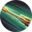

[Home](https://boostmlbb.ru/en/) / [Heroes](https://boostmlbb.ru/en/heroes/)

Tier B

# Beatrix

Marksman · Gold Lane

**#52 of 133 by win rate**All ranks · 30 days to 23 November 2026

Win rate

50.35%

Pick rate

0.65%

Ban rate

0.41%

Finisher · Damage · Difficulty 70/100

[Build](https://boostmlbb.ru/#build)[Counters and teammates](https://boostmlbb.ru/#draft)[Skills](https://boostmlbb.ru/#skills)[Win rate by rank](https://boostmlbb.ru/#ranks)[Lore](https://boostmlbb.ru/#lore)

## Build

Most picked in ranked · Gold Lane

Core items

Blade of DespairMalefic GunSea Halberd

Emblem and talents

MarksmanRuptureWeapons MasterLethal Ignition

Battle spell

Flicker

Wins with this build **51.69%**Picked in **5.92%** of matches

Alternative builds (2)

Core items

Blade of DespairMalefic GunSea Halberd

Emblem and talents

MarksmanSwiftWeapons MasterWeakness Finder

Battle spell

Flicker

Wins with this build **54.51%**Picked in **3.25%** of matches

Core items

Blade of DespairMalefic GunSea Halberd

Emblem and talents

MarksmanSwiftWeapons MasterQuantum Charge

Battle spell

Flicker

Wins with this build **55.98%**Picked in **5.07%** of matches

## Counters and teammates

### Counters

[Estes](https://boostmlbb.ru/en/heroes/estes.html)[Hanabi](https://boostmlbb.ru/en/heroes/hanabi.html)[Belerick](https://boostmlbb.ru/en/heroes/belerick.html)[Edith](https://boostmlbb.ru/en/heroes/edith.html)[Minotaur](https://boostmlbb.ru/en/heroes/minotaur.html)

### Strong against

[Selena](https://boostmlbb.ru/en/heroes/selena.html)[Granger](https://boostmlbb.ru/en/heroes/granger.html)[Chou](https://boostmlbb.ru/en/heroes/chou.html)[Moskov](https://boostmlbb.ru/en/heroes/moskov.html)[Kaja](https://boostmlbb.ru/en/heroes/kaja.html)[Irithel](https://boostmlbb.ru/en/heroes/irithel.html)

### Teammates

Win rate gain when playing together

[Harith+5.59 pp](https://boostmlbb.ru/en/heroes/harith.html)[Diggie+4.56 pp](https://boostmlbb.ru/en/heroes/diggie.html)[Baxia+2.42 pp](https://boostmlbb.ru/en/heroes/baxia.html)[Fredrinn+2.20 pp](https://boostmlbb.ru/en/heroes/fredrinn.html)

## Skills

Level-up priority · Renner's Apathy → Masterful Gunner → Tactical Reposition

Passive**Mechanical Genius**

Beatrix's talent for mechanics allowed her to produce 4 weapons of truly awe-inspiring firepower.
Renner Basic Attack - Longshot: Fires a powerful shot in the target's direction, dealing (+365% Total Physical Attack) - (+400% Total Physical Attack) Physical Damage to the first target hit (75% damage against creeps). This shot can be dodged or blocked by others.
Beatrix cannot Crit. She converts every 1% Crit Chance into 2 .
She gains Spell Vamp equal to 100% of her Lifesteal.

Skill 1**Masterful Gunner**

**Cooldown 12 s**

Passive: Beatrix can carry 2 weapons at once, increasing her by 5.
Active: Beatrix takes 0.5s to swap her primary weapon with the secondary weapon, gaining a new Basic Attack and Ultimate.

Skill 2**Tactical Reposition**

Beatrix rolls forward while fully reloading her current weapon.

Skill 3**Renner's Apathy**

Beatrix calmly sets up Renner on the battlefield and takes aim. When releasing the skill, she deals 700 (+280% Total Physical Attack) Physical Damage to the first enemy hit.
Beatrix can aim for up to 8s, and she can cancel it early to reduce the cooldown by 50%.
This shot can penetrate Minions and only deals 75% damage to non-hero units.

Ultimate**Need Backup**

Having escaped battle for 3s, Beatrix can call for her butler Morgan to provide her with a backup weapons crate.
Beatrix must then choose two from the crate to serve as her primary and secondary weapons.
Her weapon selection is interrupted if she commits any action or is controlled during this period.

## Win rate by rank

-   Epic**51.00%**
-   Legend**49.92%**
-   Mythic**49.35%**
-   Mythical Honor**50.15%**
-   Mythical Glory**50.74%**

## Lore

A confident inventor girl.

[Read the lore](https://play.mobilelegends.com/lore/hero/Beatrix)[Hero card](https://www.mobilelegends.com/hero/detail?heroid=105)[MLBB Wiki](https://mobile-legends.fandom.com/wiki/Beatrix)

[Hero boost pricing](https://boostmlbb.ru/en/order.html?type=hero)

## Frequently asked questions

Who counters Beatrix in MLBB?

Over the last 30 days the toughest opponents are Estes, Hanabi, Belerick, Edith and Minotaur.

What is Beatrix’s win rate right now?

50.35% over the last 30 days across all ranks and 50.74% in Mythical Glory, as of 23 November 2026.

What role and lane does Beatrix play?

Marksman, played in the Gold Lane.

Is Beatrix strong in the current meta?

Tier B: #52 of 133 heroes by 30-day win rate and #8 among marksmen.

What is the best build for Beatrix?

The most popular ranked build: Blade of Despair, Malefic Gun and Sea Halberd as core items, the Marksman emblem with Rupture, Weapons Master and Lethal Ignition, and Flicker. It wins 51.69% of matches.
