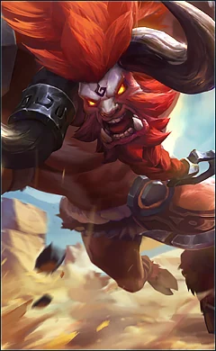

[Tier list](https://boostmlbb.ru/en/heroes/)[Items](https://boostmlbb.ru/en/items/)[News & guides](https://boostmlbb.ru/en/news/)

# Beatrix

C

MarksmanGold Lane

Win rate

50.5%

Pick rate

0.8%

Ban rate

0.4%

[Overview](https://boostmlbb.ru/#overview)[Build](https://boostmlbb.ru/#build)[How to play](https://boostmlbb.ru/#howto)[Skills](https://boostmlbb.ru/#skills)[Counters](https://boostmlbb.ru/#draft)[Lore](https://boostmlbb.ru/#lore)

## Overview

### Attributes

-   Durability**30**
-   Offense**80**
-   Control**10**
-   Difficulty**70**

-   Finisher
-   Damage

### Win rate by rank, 30 days

1.  **51.0%**Epic
2.  **49.9%**Legend
3.  **49.3%**Mythic
4.  **50.1%**Honor
5.  **50.7%**Glory

Dashed line: 50% win rate

### More marksmen on this lane

[Obsidia](https://boostmlbb.ru/en/heroes/obsidia.html)[Bruno](https://boostmlbb.ru/en/heroes/bruno.html)[Clint](https://boostmlbb.ru/en/heroes/clint.html)[Brody](https://boostmlbb.ru/en/heroes/brody.html)[Hanabi](https://boostmlbb.ru/en/heroes/hanabi.html)[Moskov](https://boostmlbb.ru/en/heroes/moskov.html)[Claude](https://boostmlbb.ru/en/heroes/claude.html)[Miya](https://boostmlbb.ru/en/heroes/miya.html)

### Places in the rankings

-   [Best MLBB marksmen**13 of 23**](https://boostmlbb.ru/en/heroes/best-marksman.html)

## Build

Build 1Build 2Build 3

Win rate

51.7%

Pick rate

5.9%

#### Core items

-   [

    

    Blade of Despair

    ](https://boostmlbb.ru/en/items/blade-of-despair.html)
-   [

    

    Malefic Gun

    ](https://boostmlbb.ru/en/items/malefic-gun.html)
-   [

    

    Sea Halberd

    ](https://boostmlbb.ru/en/items/sea-halberd.html)

#### Spell

Flicker

#### Emblem and talents

Marksman

-   

    Rupture

-   

    Weapons Master

-   

    Lethal Ignition

Win rate

56.0%

Pick rate

5.1%

#### Core items

-   [

    

    Blade of Despair

    ](https://boostmlbb.ru/en/items/blade-of-despair.html)
-   [

    

    Malefic Gun

    ](https://boostmlbb.ru/en/items/malefic-gun.html)
-   [

    

    Sea Halberd

    ](https://boostmlbb.ru/en/items/sea-halberd.html)

#### Spell

Flicker

#### Emblem and talents

Marksman

-   

    Swift

-   

    Weapons Master

-   

    Quantum Charge

Win rate

54.5%

Pick rate

3.3%

#### Core items

-   [

    

    Blade of Despair

    ](https://boostmlbb.ru/en/items/blade-of-despair.html)
-   [

    

    Malefic Gun

    ](https://boostmlbb.ru/en/items/malefic-gun.html)
-   [

    

    Sea Halberd

    ](https://boostmlbb.ru/en/items/sea-halberd.html)

#### Spell

Flicker

#### Emblem and talents

Marksman

-   

    Swift

-   

    Weapons Master

-   

    Weakness Finder

## How to play Beatrix

### Beatrix combos

#### Teamfight

1.  3
2.  1
3.  3
4.  Attack
5.  2
6.  Attack

For teamfights, we recommend using Bennett as Beatrix's primary weapon and Nibiru as her secondary weapon. During a teamfight, Beatrix can use Bennett's Ultimate to strike the enemy team. Then she can use her 1st Skill to switch to Nibiru, and cast Nibiru's Ultimate to attack the enemy. She can finish off the enemy heroes with her Basic Attacks and her 2nd Skill.

#### Laning

1.  Attack
2.  2
3.  Attack
4.  1
5.  Attack

In the laning phase, we recommend using Renner as Beatrix's primary weapon and Wesker as her secondary weapon. She can use Renner's ranged Basic Attack to poke the enemy, and her 2nd Skill to reload and fire again. She can then switch to Wesker to finish off the target enemy.

### When strongest

Even through the game, from 49.3% to 52.7%. Pick fights by your items rather than the clock.

1.  **52.7**10–12
2.  **50.1**12–14
3.  **49.3**14–16
4.  **49.7**16–18
5.  **50.3**18–20
6.  **50.6**20+

Win rate % by match length in minutes, all ranks. Dashed line: 50%

### Level-up priority

1.  Renner's Apathy
2.  Masterful Gunner
3.  Tactical Reposition

## Skills

Passive**Mechanical Genius**Skill 1**Masterful Gunner**Skill 2**Tactical Reposition**Skill 3**Renner's Apathy**Ultimate**Need Backup**

Passive

### Mechanical Genius

Beatrix's talent for mechanics allowed her to produce 4 weapons of truly awe-inspiring firepower.

**Renner Basic Attack - Longshot:** Fires a powerful shot in the target's direction, dealing (+365% Total Physical Attack) - (+400% Total Physical Attack) Physical Damage to the first target hit (75% damage against creeps). This shot can be dodged or blocked by others.

Beatrix cannot Crit. She converts every 1% Crit Chance into 2 .

She gains Spell Vamp equal to 100% of her Lifesteal.

Skill 1

### Masterful Gunner

Cooldown **12 s**

**Passive:** Beatrix can carry 2 weapons at once, increasing her by 5.

**Active:** Beatrix takes 0.5s to swap her primary weapon with the secondary weapon, gaining a new Basic Attack and Ultimate.

Skill 2

### Tactical Reposition

Beatrix rolls forward while fully reloading her current weapon.

Skill 3

### Renner's Apathy

Beatrix calmly sets up Renner on the battlefield and takes aim. When releasing the skill, she deals 700 (+280% Total Physical Attack) Physical Damage to the first enemy hit.

Beatrix can aim for up to 8s, and she can cancel it early to reduce the cooldown by 50%.

This shot can penetrate Minions and only deals 75% damage to non-hero units.

Ultimate

### Need Backup

Having escaped battle for 3s, Beatrix can call for her butler Morgan to provide her with a backup weapons crate.

Beatrix must then choose two from the crate to serve as her primary and secondary weapons.

Her weapon selection is interrupted if she commits any action or is controlled during this period.

## Beatrix counters

### Who counters Beatrix

[Estes](https://boostmlbb.ru/en/heroes/estes.html)[Hanabi](https://boostmlbb.ru/en/heroes/hanabi.html)[Belerick](https://boostmlbb.ru/en/heroes/belerick.html)[Edith](https://boostmlbb.ru/en/heroes/edith.html)[Minotaur](https://boostmlbb.ru/en/heroes/minotaur.html)

### Who Beatrix counters

[Selena](https://boostmlbb.ru/en/heroes/selena.html)[Granger](https://boostmlbb.ru/en/heroes/granger.html)[Chou](https://boostmlbb.ru/en/heroes/chou.html)[Moskov](https://boostmlbb.ru/en/heroes/moskov.html)[Kaja](https://boostmlbb.ru/en/heroes/kaja.html)[Irithel](https://boostmlbb.ru/en/heroes/irithel.html)

## Lore

> A confident inventor girl.

[Read the full story ↗](https://play.mobilelegends.com/lore/hero/Beatrix)Official Mobile Legends site [Hero stats on the game site ↗](https://www.mobilelegends.com/hero/detail?heroid=105)

**Rank up on Beatrix**The calculator shows the price

[Calculate price](https://boostmlbb.ru/en/order.html?type=hero)

## Frequently asked questions

Who counters Beatrix in MLBB?

Over the last 30 days the toughest opponents are Estes, Hanabi, Belerick, Edith and Minotaur.

How do you play Beatrix?

Level "Renner's Apathy" first and take the ultimate whenever it is available. Even through the game, from 49.3% to 52.7%. Pick fights by your items rather than the clock. Teamfight combo: For teamfights, we recommend using Bennett as Beatrix's primary weapon and Nibiru as her secondary weapon. During a teamfight, Beatrix can use Bennett's Ultimate to strike the enemy team. Then she can use her 1st Skill to switch to Nibiru, and cast Nibiru's Ultimate to attack the enemy. She can finish off the enemy heroes with her Basic Attacks and her 2nd Skill.

What is Beatrix’s win rate right now?

50.52% at Mythical Glory over the last 7 days and 50.32% across all ranks over 30 days, as of 25 November 2026.

What role and lane does Beatrix play?

Marksman, played in the Gold Lane.

Is Beatrix strong in the current meta?

Tier C, #70 of 133 heroes and #13 among marksmen. The tier counts how often the hero is picked and banned and how well it wins at Mythical Glory over 7 days: banned in 0.4% of matches, 50.5% win rate. In professional games over the last month the hero is drafted in 2.1% of them.

What is the best build for Beatrix?

The most popular ranked build: Blade of Despair, Malefic Gun and Sea Halberd as core items, the Marksman emblem with Rupture, Weapons Master and Lethal Ignition, and Flicker. It wins 51.69% of matches.
