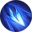

[Tier list](https://boostmlbb.ru/en/heroes/)[News & guides](https://boostmlbb.ru/en/news/)

Tier B

# Brody

Marksman · Gold Lane

Win rate

49.99%

Pick rate

0.82%

Ban rate

1.48%

**#66 of 133 by win rate**All ranks · 30 days to 23 November 2026

[Build](https://boostmlbb.ru/#build)[Counters](https://boostmlbb.ru/#draft)[Skills](https://boostmlbb.ru/#skills)[Stats](https://boostmlbb.ru/#ranks)[Lore](https://boostmlbb.ru/#lore)

Burst · Finisher · Difficulty 50/100

## Build

Most picked in ranked · Gold Lane

Core items

Blade of the HeptaseasSky PiercerMalefic Gun

Emblem and talents

FighterRuptureTenacityQuantum Charge

Battle spell

Flicker

Wins with this build **57.27%**Picked in **7.80%** of matches

Alternative builds (2)

Core items

Blade of the HeptaseasSky PiercerMalefic Gun

Emblem and talents

FighterRuptureMaster AssassinQuantum Charge

Battle spell

Flicker

Wins with this build **56.27%**Picked in **2.55%** of matches

Core items

Blade of the HeptaseasSky PiercerMalefic Gun

Emblem and talents

AssassinRuptureTenacityQuantum Charge

Battle spell

Flicker

Wins with this build **53.41%**Picked in **19.18%** of matches

## Counters and teammates

### Counters

[Karina](https://boostmlbb.ru/en/heroes/karina.html)[Belerick](https://boostmlbb.ru/en/heroes/belerick.html)[Irithel](https://boostmlbb.ru/en/heroes/irithel.html)[Natalia](https://boostmlbb.ru/en/heroes/natalia.html)[Joy](https://boostmlbb.ru/en/heroes/joy.html)

### Strong against

[Masha](https://boostmlbb.ru/en/heroes/masha.html)

### Teammates

Win rate change as a duo

[Harith+4.52 pp](https://boostmlbb.ru/en/heroes/harith.html)[Floryn+1.82 pp](https://boostmlbb.ru/en/heroes/floryn.html)[Estes+1.71 pp](https://boostmlbb.ru/en/heroes/estes.html)[Popol and Kupa+1.58 pp](https://boostmlbb.ru/en/heroes/popol-and-kupa.html)

## Skills

Level-up priority · Torn-Apart Memory → Abyss Impact → Corrosive Strike

Passive**Abyss Corrosion**

With his Basic Attacks resonated with the Abyss Power within his body, Brody is able to move while winding up his Basic Attacks (which will be interrupted when casting skills), at the cost of having longer Basic Attack Animation and lower Attack Speed Bonus. Each Basic Attack deals (+140% Total Physical Attack) (+45\*Hero Level) Physical Damage (of which the damage scaling with level cannot be critical), increases Movement Speed by 30% (which will decay rapidly in 1.2s), and applies 1 stack of Abyss Mark on the enemy, capped at 4 stacks.
Each stack of Abyss Mark increases Brody's damage against the target by 5% and his Movement Speed by 5%.

Skill 1**Abyss Impact**

**Cooldown 4 Mana Cost: 50 s**

Brody launches a shockwave in the target direction, dealing 200 (+170% Total Physical Attack) Physical Damage and slowing enemies by 30% for 1.2s while applying one stack of Abyss Mark.
For each enemy hit by the shockwave, they take an extra 5% slow and one extra Abyss Mark stack (capped at 45% slow and 4 stacks).

Skill 2**Corrosive Strike**

**Cooldown 8 Mana Cost: 90 s**

Brody dashes to an enemy, dealing 200 (+70% Total Physical Attack) Physical Damage to the target, stunning the target for 0.8s, and applying 1 stack of Abyss Mark on the target.
Upon hitting the target, he is able to move one more time in the movement direction, gaining 45% Movement Speed that will decay rapidly in 1.2s.

Ultimate**Torn-Apart Memory**

**Cooldown 32 Mana Cost: 120 s**

Brody locks onto all enemies within 8 unit(s), dealing 216 (+165% Extra Physical Attack) Physical Damage to them.
For each target with Abyss Mark stacks, all stacks are consumed, dealing additional Physical Damage equal to 94 (+72% Extra Physical Attack) (+ 4% of the target's lost ) per stack.

## Win rate by rank

-   Epic**49.78%**
-   Legend**49.90%**
-   Mythic**49.77%**
-   Mythical Honor**50.18%**
-   Mythical Glory**49.97%**

## Lore

A ranger of the frontier with a right arm seeped in darkness, he channels pain into arrows to strike down invaders; he is the "Lone Star" that pierces the nights of the Barren Lands.

[Read the full story ↗](https://play.mobilelegends.com/lore/hero/Brody)Official Mobile Legends site

[Hero stats on the game site](https://www.mobilelegends.com/hero/detail?heroid=100)

[Hero boost pricing](https://boostmlbb.ru/en/order.html?type=hero)

## Frequently asked questions

Who counters Brody in MLBB?

Over the last 30 days the toughest opponents are Karina, Belerick, Irithel, Natalia and Joy.

What is Brody’s win rate right now?

49.99% over the last 30 days across all ranks and 49.97% in Mythical Glory, as of 23 November 2026.

What role and lane does Brody play?

Marksman, played in the Gold Lane.

Is Brody strong in the current meta?

Tier B: #66 of 133 heroes by 30-day win rate and #13 among marksmen.

What is the best build for Brody?

The most popular ranked build: Blade of the Heptaseas, Sky Piercer and Malefic Gun as core items, the Fighter emblem with Rupture, Tenacity and Quantum Charge, and Flicker. It wins 57.27% of matches.
