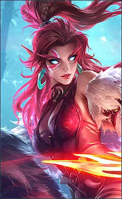

[Tier list](https://boostmlbb.ru/en/heroes/)[Items](https://boostmlbb.ru/en/items/)[News & guides](https://boostmlbb.ru/en/news/)

# Brody

B

MarksmanGold Lane

Win rate

49.9%

Pick rate

1.0%

Ban rate

1.0%

[Overview](https://boostmlbb.ru/#overview)[Build](https://boostmlbb.ru/#build)[Skills](https://boostmlbb.ru/#skills)[Counters](https://boostmlbb.ru/#draft)[Lore](https://boostmlbb.ru/#lore)

## Overview

### Attributes

-   Durability**40**
-   Offense**70**
-   Control**50**
-   Difficulty**50**

-   Burst
-   Finisher

### Win rate by rank, 30 days

1.  **49.7%**Epic
2.  **49.9%**Legend
3.  **49.7%**Mythic
4.  **50.2%**Honor
5.  **50.0%**Glory

Dashed line: 50% win rate

### More marksmen on this lane

[Obsidia](https://boostmlbb.ru/en/heroes/obsidia.html)[Bruno](https://boostmlbb.ru/en/heroes/bruno.html)[Clint](https://boostmlbb.ru/en/heroes/clint.html)[Hanabi](https://boostmlbb.ru/en/heroes/hanabi.html)[Moskov](https://boostmlbb.ru/en/heroes/moskov.html)[Claude](https://boostmlbb.ru/en/heroes/claude.html)[Miya](https://boostmlbb.ru/en/heroes/miya.html)[Melissa](https://boostmlbb.ru/en/heroes/melissa.html)

### Places in the rankings

-   [Best MLBB marksmen**6 of 23**](https://boostmlbb.ru/en/heroes/best-marksman.html)

## Build

Build 1Build 2Build 3

Win rate

53.4%

Pick rate

19.2%

#### Core items

-   [

    

    Blade of the Heptaseas

    ](https://boostmlbb.ru/en/items/blade-of-the-heptaseas.html)
-   [

    

    Sky Piercer

    ](https://boostmlbb.ru/en/items/sky-piercer.html)
-   [

    

    Malefic Gun

    ](https://boostmlbb.ru/en/items/malefic-gun.html)

#### Spell

Flicker

#### Emblem and talents

Assassin

-   

    Rupture

-   

    Tenacity

-   

    Quantum Charge

Win rate

57.3%

Pick rate

7.8%

#### Core items

-   [

    

    Blade of the Heptaseas

    ](https://boostmlbb.ru/en/items/blade-of-the-heptaseas.html)
-   [

    

    Sky Piercer

    ](https://boostmlbb.ru/en/items/sky-piercer.html)
-   [

    

    Malefic Gun

    ](https://boostmlbb.ru/en/items/malefic-gun.html)

#### Spell

Flicker

#### Emblem and talents

Fighter

-   

    Rupture

-   

    Tenacity

-   

    Quantum Charge

Win rate

56.3%

Pick rate

2.5%

#### Core items

-   [

    

    Blade of the Heptaseas

    ](https://boostmlbb.ru/en/items/blade-of-the-heptaseas.html)
-   [

    

    Sky Piercer

    ](https://boostmlbb.ru/en/items/sky-piercer.html)
-   [

    

    Malefic Gun

    ](https://boostmlbb.ru/en/items/malefic-gun.html)

#### Spell

Flicker

#### Emblem and talents

Fighter

-   

    Rupture

-   

    Master Assassin

-   

    Quantum Charge

## Skills

Level-up**Torn-Apart Memory**_›_**Abyss Impact**_›_**Corrosive Strike**

Passive**Abyss Corrosion**Skill 1**Abyss Impact**Skill 2**Corrosive Strike**Ultimate**Torn-Apart Memory**

Passive

### Abyss Corrosion

With his Basic Attacks resonated with the Abyss Power within his body, Brody is able to move while winding up his Basic Attacks (which will be interrupted when casting skills), at the cost of having longer Basic Attack Animation and lower Attack Speed Bonus. Each Basic Attack deals (+140% Total Physical Attack) (+45 × hero level) Physical Damage (of which the damage scaling with level cannot be critical), increases Movement Speed by 30% (which will decay rapidly in 1.2s), and applies 1 stack of Abyss Mark on the enemy, capped at 4 stacks.

Each stack of Abyss Mark increases Brody's damage against the target by 5% and his Movement Speed by 5%.

Skill 1

### Abyss Impact

Cooldown **4 Mana Cost: 50 s**

Brody launches a shockwave in the target direction, dealing 200 (+170% Total Physical Attack) Physical Damage and slowing enemies by 30% for 1.2s while applying one stack of Abyss Mark.

For each enemy hit by the shockwave, they take an extra 5% slow and one extra Abyss Mark stack (capped at 45% slow and 4 stacks).

Skill 2

### Corrosive Strike

Cooldown **8 Mana Cost: 90 s**

Brody dashes to an enemy, dealing 200 (+70% Total Physical Attack) Physical Damage to the target, stunning the target for 0.8s, and applying 1 stack of Abyss Mark on the target.

Upon hitting the target, he is able to move one more time in the movement direction, gaining 45% Movement Speed that will decay rapidly in 1.2s.

Ultimate

### Torn-Apart Memory

Cooldown **32 Mana Cost: 120 s**

Brody locks onto all enemies within 8 unit(s), dealing 216 (+165% Extra Physical Attack) Physical Damage to them.

For each target with Abyss Mark stacks, all stacks are consumed, dealing additional Physical Damage equal to 94 (+72% Extra Physical Attack) (+ 4% of the target's lost ) per stack.

## Counters

### Counters

Beat this hero

[Karina](https://boostmlbb.ru/en/heroes/karina.html)[Belerick](https://boostmlbb.ru/en/heroes/belerick.html)[Irithel](https://boostmlbb.ru/en/heroes/irithel.html)[Natalia](https://boostmlbb.ru/en/heroes/natalia.html)[Joy](https://boostmlbb.ru/en/heroes/joy.html)

### Easy targets

This hero beats them

[Masha](https://boostmlbb.ru/en/heroes/masha.html)

## Lore

> A ranger of the frontier with a right arm seeped in darkness, he channels pain into arrows to strike down invaders; he is the "Lone Star" that pierces the nights of the Barren Lands.

[Read the full story ↗](https://play.mobilelegends.com/lore/hero/Brody)Official Mobile Legends site [Hero stats on the game site ↗](https://www.mobilelegends.com/hero/detail?heroid=100)

**Rank up on Brody**The calculator shows the price

[Calculate price](https://boostmlbb.ru/en/order.html?type=hero)

## Frequently asked questions

Who counters Brody in MLBB?

Over the last 30 days the toughest opponents are Karina, Belerick, Irithel, Natalia and Joy.

What is Brody’s win rate right now?

49.91% at Mythical Glory over the last 7 days and 49.98% across all ranks over 30 days, as of 25 November 2026.

What role and lane does Brody play?

Marksman, played in the Gold Lane.

Is Brody strong in the current meta?

Tier B, #42 of 133 heroes and #6 among marksmen. The tier counts how often the hero is picked and banned and how well it wins at Mythical Glory over 7 days: banned in 1.0% of matches, 49.9% win rate. In professional games over the last month the hero is drafted in 15.1% of them.

What is the best build for Brody?

The most popular ranked build: Blade of the Heptaseas, Sky Piercer and Malefic Gun as core items, the Assassin emblem with Rupture, Tenacity and Quantum Charge, and Flicker. It wins 53.41% of matches.
