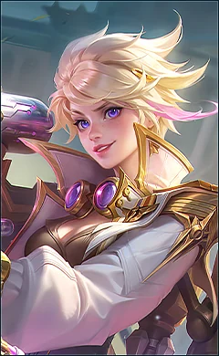
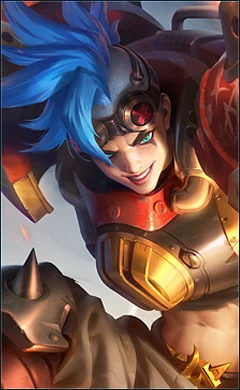

[Tier list](https://boostmlbb.ru/en/heroes/)[Items](https://boostmlbb.ru/en/items/)[Skins](https://boostmlbb.ru/en/skins/)[News & guides](https://boostmlbb.ru/en/news/)

# Chang'e

C

MageMid Lane

Win rate

46.0%

Pick rate

0.4%

Ban rate

0.1%

[Overview](https://boostmlbb.ru/#overview)[Build](https://boostmlbb.ru/#build)[How to play](https://boostmlbb.ru/#howto)[Skills](https://boostmlbb.ru/#skills)[Counters](https://boostmlbb.ru/#draft)[Skins](https://boostmlbb.ru/#skins)[Lore](https://boostmlbb.ru/#lore)

## Overview

### Attributes

-   Durability**40**
-   Offense**80**
-   Control**20**
-   Difficulty**40**

-   Poke
-   Burst

### Win rate by rank, 30 days

1.  **51.2%**Epic
2.  **49.9%**Legend
3.  **48.8%**Mythic
4.  **47.7%**Honor
5.  **45.9%**Glory

Dashed line: 50% win rate

### More mages on this lane

[Kimmy](https://boostmlbb.ru/en/heroes/kimmy.html)[Eudora](https://boostmlbb.ru/en/heroes/eudora.html)[Zhuxin](https://boostmlbb.ru/en/heroes/zhuxin.html)[Valir](https://boostmlbb.ru/en/heroes/valir.html)[Zetian](https://boostmlbb.ru/en/heroes/zetian.html)[Lylia](https://boostmlbb.ru/en/heroes/lylia.html)[Xavier](https://boostmlbb.ru/en/heroes/xavier.html)[Lunox](https://boostmlbb.ru/en/heroes/lunox.html)

### Places in the rankings

-   [Best MLBB mages**30 of 32**](https://boostmlbb.ru/en/heroes/best-mage.html)
-   [Best MLBB mid laners**27 of 29**](https://boostmlbb.ru/en/heroes/best-mid.html)

## Build

Build 1Build 2Build 3

Win rate

54.3%

Pick rate

4.4%

#### Core items

-   [

    

    Lightning Truncheon

    ](https://boostmlbb.ru/en/items/lightning-truncheon.html)
-   [

    

    Glowing Wand

    ](https://boostmlbb.ru/en/items/glowing-wand.html)
-   [

    

    Divine Glaive

    ](https://boostmlbb.ru/en/items/divine-glaive.html)

#### Spell

Flicker

#### Emblem and talents

Mage

-   

    Thrill

-   

    Bargain Hunter

-   

    Impure Rage

Win rate

52.1%

Pick rate

4.0%

#### Core items

-   [

    

    Sky Piercer

    ](https://boostmlbb.ru/en/items/sky-piercer.html)
-   [

    

    Glowing Wand

    ](https://boostmlbb.ru/en/items/glowing-wand.html)
-   [

    

    Divine Glaive

    ](https://boostmlbb.ru/en/items/divine-glaive.html)

#### Spell

Flicker

#### Emblem and talents

Mage

-   

    Thrill

-   

    Bargain Hunter

-   

    Impure Rage

Win rate

50.6%

Pick rate

2.1%

#### Core items

-   [

    

    Sky Piercer

    ](https://boostmlbb.ru/en/items/sky-piercer.html)
-   [

    

    Glowing Wand

    ](https://boostmlbb.ru/en/items/glowing-wand.html)
-   [

    

    Divine Glaive

    ](https://boostmlbb.ru/en/items/divine-glaive.html)

#### Spell

Flameshot

#### Emblem and talents

Mage

-   

    Thrill

-   

    Bargain Hunter

-   

    Impure Rage

## How to play Chang'e

### Chang'e combos

#### Teamfight

1.  2
2.  1
3.  Ult

In teamfights, get the shield from Chang'e's 2nd Skill, then use her 1st Skill to poke enemies, and follow up with her Ultimate if the 1st Skill was on target. Chang'e needs to move around during her Ultimate to keep herself safe and make sure the meteors can hit the target.

#### Laning

1.  2
2.  Attack
3.  1
4.  Ult

In the laning phase, get the buff from Chang'e's 2nd Skill first, then mark the enemy with her Basic Attacks. Cast her 1st Skill to slow down low HP enemy, and finish them off with her Ultimate.

### When strongest

Stronger late: 51.5% after minute 20. Do not take risks early, farm and fight together with your team.

1.  **45.8**10–12
2.  **46.5**12–14
3.  **47.0**14–16
4.  **49.9**16–18
5.  **51.3**18–20
6.  **51.5**20+

Win rate % by match length in minutes, all ranks. Dashed line: 50%

### Level-up priority

1.  Meteor Shower
2.  Starmoon Shockwave
3.  Crescent Moon

## Skills

Passive**Trouble Maker**Skill 1**Starmoon Shockwave**Skill 2**Crescent Moon**Ultimate**Meteor Shower**

Passive

### Trouble Maker

Each time Chang'e deals damage to an enemy, she leaves a mark on them that reduces their Movement Speed by 1% (up to 20%).

Skill 1

### Starmoon Shockwave

Cooldown **7 Mana Cost: 60 s**

Chang'e sends an energy sphere in the target direction, dealing 350 (+130% Total Magic Power) Magic Damage to enemies in its path and slowing them by 10% for 1.5s.

**Crescent Moon:** The Crescent Moon sends 4 extra energy spheres along with Chang'e's, each dealing 20% damage and slowing enemies hit. The slow effect can stack (up to 20%).

Skill 2

### Crescent Moon

Cooldown **12 Mana Cost: 60 s**

Chang'e summons the Crescent Moon, gaining a permanent 300 (+150% Total Magic Power) shield and 10% Movement Speed until the shield is broken. Each time she casts a skill, she gains an extra 50% Movement Speed that decays over 2.5s.

**Crescent Moon:** Enhances her Basic Attacks to deal 20 (+35% Total Magic Power) extra Magic Damage 2 times.

Each time Chang'e deals Magic Damage with her Basic Attacks or skills, this skill's cooldown is reduced by 0.2s.

Ultimate

### Meteor Shower

Cooldown **24 Mana Cost: 120 s**

Chang'e gains 10% Movement Speed for 4s. During this time, she fires 30 meteors in the target direction, each dealing 60 (+21% Total Magic Power) Magic Damage to the first enemy hit. This skill deals 100% extra damage to minions and creeps.

**Crescent Moon:** Fires meteors alongside Chang'e, each dealing 33% damage.

## Chang'e counters

### Who counters Chang'e

[Diggie](https://boostmlbb.ru/en/heroes/diggie.html)[Balmond](https://boostmlbb.ru/en/heroes/balmond.html)[Martis](https://boostmlbb.ru/en/heroes/martis.html)[X.Borg](https://boostmlbb.ru/en/heroes/x-borg.html)[Alpha](https://boostmlbb.ru/en/heroes/alpha.html)

### Who Chang'e counters

[Claude](https://boostmlbb.ru/en/heroes/claude.html)[Gloo](https://boostmlbb.ru/en/heroes/gloo.html)[Popol and Kupa](https://boostmlbb.ru/en/heroes/popol-and-kupa.html)[Lolita](https://boostmlbb.ru/en/heroes/lolita.html)

## Chang'e skins

[Golden OsmanthusCommon · 2026](https://boostmlbb.ru/en/skins/change/golden-osmanthus.html)[Moonglow TroupeExceptional · 2025](https://boostmlbb.ru/en/skins/change/moonglow-troupe.html)[Tech TensaiGrand · 2024](https://boostmlbb.ru/en/skins/change/tech-tensai.html)[New MoonDeluxe · 2023](https://boostmlbb.ru/en/skins/change/new-moon.html)[Moon ArtistGrand · 2022](https://boostmlbb.ru/en/skins/change/moon-artist.html)[Vine CradleDeluxe · 2021](https://boostmlbb.ru/en/skins/change/vine-cradle.html)[Strawberry ParfaitExceptional · 2020](https://boostmlbb.ru/en/skins/change/strawberry-parfait.html)[Lunar MagicExquisite · 2020](https://boostmlbb.ru/en/skins/change/lunar-magic.html)[Floral ElfoExceptional · 2019](https://boostmlbb.ru/en/skins/change/floral-elfo.html)[Crimson MoonCommon · 2019](https://boostmlbb.ru/en/skins/change/crimson-moon.html)[MoonstruckCommon · 2018](https://boostmlbb.ru/en/skins/change/moonstruck.html)

[All 11 Chang'e skins: prices and how to get them](https://boostmlbb.ru/en/skins/change.html)

## Lore

> Naughty and cute disciple of the Great Dragon.

[Read the full story ↗](https://kazukiofficial.com/stories/chang-e)Kazuki Official [Hero stats on the game site ↗](https://www.mobilelegends.com/hero/detail?heroid=61)

**Rank up on Chang'e**The calculator shows the price

[Calculate price](https://boostmlbb.ru/en/order.html?type=hero)

## Frequently asked questions

Who counters Chang'e in MLBB?

Over the last 30 days the toughest opponents are Diggie, Balmond, Martis, X.Borg and Alpha.

How do you play Chang'e?

Level "Starmoon Shockwave" first and take the ultimate whenever it is available. Stronger late: 51.5% after minute 20. Do not take risks early, farm and fight together with your team. Teamfight combo: In teamfights, get the shield from Chang'e's 2nd Skill, then use her 1st Skill to poke enemies, and follow up with her Ultimate if the 1st Skill was on target. Chang'e needs to move around during her Ultimate to keep herself safe and make sure the meteors can hit the target.

What is Chang'e’s win rate right now?

46.04% at Mythical Glory over the last 7 days and 48.21% across all ranks over 30 days, as of 25 November 2026.

What role and lane does Chang'e play?

Mage, played in the Mid Lane.

Is Chang'e strong in the current meta?

Tier C, #120 of 133 heroes and #30 among mages. The tier counts how often the hero is picked and banned and how well it wins at Mythical Glory over 7 days: banned in 0.1% of matches, 46.0% win rate. In professional games over the last month the hero is drafted in 0.0% of them.

What is the best build for Chang'e?

The most popular ranked build: Lightning Truncheon, Glowing Wand and Divine Glaive as core items, the Mage emblem with Thrill, Bargain Hunter and Impure Rage, and Flicker. It wins 54.25% of matches.
