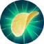

[Tier list](https://boostmlbb.ru/en/heroes/)[Items](https://boostmlbb.ru/en/items/)[Skins](https://boostmlbb.ru/en/skins/)[News & guides](https://boostmlbb.ru/en/news/)

[Tier list](https://boostmlbb.ru/en/heroes/)

# Chip

D

TankSupportRoam

Win rate

48.2%

Pick rate

0.1%

Ban rate

0.2%

[Overview](https://boostmlbb.ru/#overview)[Build](https://boostmlbb.ru/#build)[How to play](https://boostmlbb.ru/#howto)[Skills](https://boostmlbb.ru/#skills)[Counters](https://boostmlbb.ru/#draft)[Skins](https://boostmlbb.ru/#skins)[Lore](https://boostmlbb.ru/#lore)

## Overview

### Attributes

-   Durability**80**
-   Offense**20**
-   Control**60**
-   Difficulty**50**

-   Support
-   Crowd Control

### Win rate by rank, 30 days

1.  **46.9%**Epic
2.  **47.1%**Legend
3.  **47.3%**Mythic
4.  **47.0%**Honor
5.  **48.1%**Glory

Dashed line: 50% win rate

### More tanks on this lane

[Carmilla](https://boostmlbb.ru/en/heroes/carmilla.html)[Belerick](https://boostmlbb.ru/en/heroes/belerick.html)[Atlas](https://boostmlbb.ru/en/heroes/atlas.html)[Gloo](https://boostmlbb.ru/en/heroes/gloo.html)[Minotaur](https://boostmlbb.ru/en/heroes/minotaur.html)[Khufra](https://boostmlbb.ru/en/heroes/khufra.html)[Tigreal](https://boostmlbb.ru/en/heroes/tigreal.html)[Hilda](https://boostmlbb.ru/en/heroes/hilda.html)

### Places in the rankings

-   [Best MLBB tanks**23 of 25**](https://boostmlbb.ru/en/heroes/best-tank.html)
-   [Best MLBB roamers**32 of 34**](https://boostmlbb.ru/en/heroes/best-roam.html)

## Build

Build 1Build 2Build 3

Win rate

53.0%

Pick rate

8.5%

#### Core items

-   [

    

    Fleeting Time

    ](https://boostmlbb.ru/en/items/fleeting-time.html)
-   [

    

    Chastise Pauldron

    ](https://boostmlbb.ru/en/items/chastise-pauldron.html)
-   [

    

    Antique Cuirass

    ](https://boostmlbb.ru/en/items/antique-cuirass.html)

#### Spell

Flicker

#### Emblem and talents

Support

-   

    Inspire

-   

    Tenacity

-   

    Concussive Blast

Win rate

53.2%

Pick rate

3.1%

#### Core items

-   [

    

    Fleeting Time

    ](https://boostmlbb.ru/en/items/fleeting-time.html)
-   [

    

    Chastise Pauldron

    ](https://boostmlbb.ru/en/items/chastise-pauldron.html)
-   [

    

    Antique Cuirass

    ](https://boostmlbb.ru/en/items/antique-cuirass.html)

#### Spell

Flicker

#### Emblem and talents

Support

-   

    Inspire

-   

    Wilderness Blessing

-   

    Concussive Blast

Win rate

53.4%

Pick rate

1.4%

#### Core items

-   [

    

    Fleeting Time

    ](https://boostmlbb.ru/en/items/fleeting-time.html)
-   [

    

    Oracle

    ](https://boostmlbb.ru/en/items/oracle.html)
-   [

    

    Chastise Pauldron

    ](https://boostmlbb.ru/en/items/chastise-pauldron.html)

#### Spell

Petrify

#### Emblem and talents

Support

-   

    Inspire

-   

    Wilderness Blessing

-   

    Concussive Blast

## How to play Chip

### Chip combos

#### Teamfight

1.  2
2.  Attack
3.  3
4.  1
5.  Attack

In teamfights, use Chip's 2nd Skill preemptively to build up speed, then hit a target with his Basic Attack and deploy the Main Portal with his Ultimate. Follow up with his 1st Skill on the enemy and another Basic Attack to stun them while the Main Portal's delayed effect slows them, and continue the fight as allies portal in.

#### Laning

1.  2
2.  Attack
3.  1
4.  Attack

When ganking, use Chip's 2nd Skill to quickly get behind the target and knock them into your team with the enhanced Basic Attack, then follow up with his 1st Skill and another Basic Attack to stun them.

### When strongest

Stronger late: 49.5% after minute 20. Do not take risks early, farm and fight together with your team.

1.  **46.0**10–12
2.  **47.5**12–14
3.  **48.3**14–16
4.  **48.0**16–18
5.  **48.0**18–20
6.  **49.5**20+

Win rate % by match length in minutes, all ranks. Dashed line: 50%

### Level-up priority

1.  Shortcut
2.  Crash Course
3.  Overtime

## Skills

Passive**Snack Time!**Skill 1**Crash Course**Skill 2**Overtime**Skill 3**Shortcut**Ultimate**Why Walk?**

Passive

### Snack Time!

While out of combat, Chip takes a bite of potato chips every 2s. After 4 bites, he finishes a bag and recovers HP equal to 300 (+ 45% of his lost ).

After finishing a bag, Chip cannot eat again for 5s. (His bite count is retained if he enters combat before finishing the bag.)

Skill 1

### Crash Course

Cooldown **5.5 Mana Cost: 40 s**

Chip rams his hovercraft into the ground, dealing Magic Damage equal to 100 plus 4% of the target's and applying Chip's Mark on enemy units hit. Chip gains a 300 (+60% Total Magic Power) Shield upon hitting an enemy hero, which increases by 40% for each additional enemy hero hit. Chip's next Basic Attack will become ranged and also hit all nearby enemies with Chip's Mark, detonating the mark to deal 150 (+30% Total Magic Power) Magic Damage and stun each target for 0.6s.

Skill 2

### Overtime

Cooldown **13 Mana Cost: 75 s**

Chip rushes for 2s, gaining up to 65% extra Movement Speed, after which he maintains the max speed for 2s.

Chip's next Basic Attack will cause him to charge at the enemy, dealing 200 (+30% Total Magic Power) Magic Damage and knocking them back slightly.

Skill 3

### Shortcut

Cooldown **70 Mana Cost: 110 s**

Chip drops the Main Portal on an enemy hero, dealing 200 (+60% Total Magic Power) Magic Damage and briefly slowing them by 25%. The Main Portal deals 2 times the damage and immobilizes them for 1s after a delay. Meanwhile, he creates Connecting Portals near allied heroes 10 units away and behind the allied Base. The Main Portal and Connecting Portals last up to 15s.

**Connecting Portal:** Heroes (on both teams) can teleport from Connecting Portals to the Main Portal, and allied heroes gain Burst Movement Speed for 1.5s and a 500 shield.

**Main Portal:** The Main Portal inherits 70% of Chip's attributes. Heroes can stand on the Main Portal for 2s to return to the Connecting Portal they came from. Casting skills or launching Basic Attacks will reset the stand time.

Ultimate

### Why Walk?

Chip has 4 fixed Beacons on the map when the battle starts. Use this skill to teleport to any other Beacon. (This skill cannot be used in combat.)

## Chip counters

### Who counters Chip

[Zilong](https://boostmlbb.ru/en/heroes/zilong.html)[Helcurt](https://boostmlbb.ru/en/heroes/helcurt.html)[Selena](https://boostmlbb.ru/en/heroes/selena.html)[Mathilda](https://boostmlbb.ru/en/heroes/mathilda.html)[Valentina](https://boostmlbb.ru/en/heroes/valentina.html)

### Who Chip counters

[Vexana](https://boostmlbb.ru/en/heroes/vexana.html)[Carmilla](https://boostmlbb.ru/en/heroes/carmilla.html)[Alice](https://boostmlbb.ru/en/heroes/alice.html)[Balmond](https://boostmlbb.ru/en/heroes/balmond.html)[Martis](https://boostmlbb.ru/en/heroes/martis.html)[Odette](https://boostmlbb.ru/en/heroes/odette.html)

## Chip skins

[Nexus EngineerCommon · 2024](https://boostmlbb.ru/en/skins/chip/nexus-engineer.html)[Badlands HiatusCommon · 2024](https://boostmlbb.ru/en/skins/chip/badlands-hiatus.html)

[All 2 Chip skins: prices and how to get them](https://boostmlbb.ru/en/skins/chip.html)

## Lore

> A carefree, genetically enhanced fox that wields advanced portal technology.

[Read the full story ↗](https://play.mobilelegends.com/lore/hero/Chip)Official Mobile Legends site [Hero stats on the game site ↗](https://www.mobilelegends.com/hero/detail?heroid=124)

**Rank up on Chip**The calculator shows the price

[Calculate price](https://boostmlbb.ru/en/order.html?type=hero)

## Frequently asked questions

Who counters Chip in MLBB?

Over the last 30 days the toughest opponents are Zilong, Helcurt, Selena, Mathilda and Valentina.

How do you play Chip?

Level "Shortcut" first and take the ultimate whenever it is available. Stronger late: 49.5% after minute 20. Do not take risks early, farm and fight together with your team. Teamfight combo: In teamfights, use Chip's 2nd Skill preemptively to build up speed, then hit a target with his Basic Attack and deploy the Main Portal with his Ultimate. Follow up with his 1st Skill on the enemy and another Basic Attack to stun them while the Main Portal's delayed effect slows them, and continue the fight as allies portal in.

What is Chip’s win rate right now?

48.17% at Mythical Glory over the last 7 days and 47.61% across all ranks over 30 days, as of 26 November 2026.

What role and lane does Chip play?

Tank and support, played on roam.

Is Chip strong in the current meta?

Tier D, #129 of 133 heroes and #23 among tanks. The tier counts how often the hero is picked and banned and how well it wins at Mythical Glory over 7 days: banned in 0.2% of matches, 48.2% win rate. In professional games over the last month the hero is drafted in 1.8% of them.

What is the best build for Chip?

The most popular ranked build: Fleeting Time, Chastise Pauldron and Antique Cuirass as core items, the Support emblem with Inspire, Tenacity and Concussive Blast, and Flicker. It wins 52.99% of matches.
