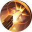

[Home](https://boostmlbb.ru/en/) / [Heroes](https://boostmlbb.ru/en/heroes/)

Tier B

# Clint in Mobile Legends: build, counters and stats

Marksman, Gold Lane. Wins 50.33% of matches over the last 30 days: #55 of 133 heroes.

[Boost on this hero](https://boostmlbb.ru/en/order.html?type=hero)[All heroes](https://boostmlbb.ru/en/heroes/)

Hero statsTier B

**Clint**Ban 0.61% · Pick 0.72%

Counters

Win rate, 30 days**50.33%**

**50.33%**win rate, 30 days

**0.72%**pick rate

**0.61%**ban rate

**50.58%**wins in Mythical Glory

## Clint build

The most picked setup for Gold Lane Clint in ranked games across all ranks, from the in-game Academy. The win rate is for matches played with this exact build.

Core items

Endless BattleSky PiercerMalefic Gun

Emblem and talents

FighterThrillWeapons MasterQuantum Charge

Battle spell

Flicker

Wins with this build **55.55%**Picked in **3.61%** of matches

### Other popular setups

-   FlickerAssassinRupture · Weapons Master · Quantum Charge**51.90%**
-   FlickerAssassinRupture · Weapons Master · Quantum Charge**55.94%**

## Clint skills

Official skill descriptions from MOONTON with cooldowns and tags.

Level-up priority: **Grenade Bombardment** → **Quick Draw** → **Trapping Recoil**

-   

    **Double Shot**Passive

    After each skill cast, Clint's next Basic Attack within 4s penetrates a line of enemies, dealing 150 (+100% Total Physical Attack) Physical Damage. This damage can trigger Attack Effects, and the part affected by can Crit.

-   

    **Quick Draw**Skill 1CD 8 Mana Cost: 50 s

    Clint rapidly fires 5 bullets in the target direction, each dealing 250 (+85% Total Physical Attack) Physical Damage to the enemy hit.
    The bullets spread evenly across a fan-shaped area. Enemies hit by multiple bullets take reduced damage from each bullet after the first.

-   

    **Trapping Recoil**Skill 2CD 10 Mana Cost: 80 s

    Clint shoots a trap net in the target direction, slightly jumping back while dealing 140 (+30% Total Physical Attack) (+150% Total Magic Power) Physical Damage to the first enemy hit and immobilizing them for 1.2s.
    Successfully hitting an enemy reduces the cooldown of this skill by 40%.

-   

    **Grenade Bombardment**UltimateCD 1.5 Mana Cost: 50 s

    Clint launches a grenade in the target direction that explodes on the first enemy hit, dealing 280 (+100% Total Physical Attack) Physical Damage and slowing them by 50% for 0.5s.
    Clint gains a grenade charge every 10s (up to 3).

## Role and lane

Places are by win rate over the last 30 days among heroes of the same role or lane.

-   Role**Marksman**
-   Lane**Gold Lane**
-   Among marksmen**#9 of 23**
-   In the Gold Lane**#8 of 21**
-   Speciality**Finisher, Burst**
-   Difficulty**Medium (60/100)**

## Who counters Clint

Clint loses to these heroes most often. The number under each icon is that hero’s own win rate. 3 of the 5 counters are tanks.

[Lolita53.30%](https://boostmlbb.ru/en/heroes/lolita.html)[Karina48.60%](https://boostmlbb.ru/en/heroes/karina.html)[Belerick51.83%](https://boostmlbb.ru/en/heroes/belerick.html)[Baxia45.97%](https://boostmlbb.ru/en/heroes/baxia.html)[Lunox50.64%](https://boostmlbb.ru/en/heroes/lunox.html)

## Who Clint is strong against

Clint is one of the toughest opponents for these heroes.

[Fanny42.64%](https://boostmlbb.ru/en/heroes/fanny.html)

## Best teammates for Clint

With these heroes on the same team Clint wins more often. The number is the gain in win rate, in percentage points.

[Harith+4.78 pts](https://boostmlbb.ru/en/heroes/harith.html)[Popol and Kupa+2.21 pts](https://boostmlbb.ru/en/heroes/popol-and-kupa.html)[Roger+1.78 pts](https://boostmlbb.ru/en/heroes/roger.html)[Masha+1.21 pts](https://boostmlbb.ru/en/heroes/masha.html)

## Win rate by rank

Best result in Mythical Honor (50.88%), weakest in Epic (47.48%). Last 30 days.

-   Epic**47.48%**
-   Legend**49.35%**
-   Mythic**50.05%**
-   Mythical Honor**50.88%**
-   Mythical Glory**50.58%**

## Place in the meta

Clint sits in tier B of our win-rate tier list and ranks 55 of 133 heroes. In Mythical Glory the result is almost the same: 50.58%. See the full [tier list](https://boostmlbb.ru/en/news/mlbb-meta-tier-list/) and the [patch breakdown](https://boostmlbb.ru/en/news/mlbb-current-patch/).

## Other Gold Lane heroes

The strongest by win rate over the last 30 days.

[Bruno53.78%](https://boostmlbb.ru/en/heroes/bruno.html)[Obsidia53.20%](https://boostmlbb.ru/en/heroes/obsidia.html)[Irithel52.74%](https://boostmlbb.ru/en/heroes/irithel.html)[Hanabi52.66%](https://boostmlbb.ru/en/heroes/hanabi.html)[Popol and Kupa52.09%](https://boostmlbb.ru/en/heroes/popol-and-kupa.html)[Natan51.32%](https://boostmlbb.ru/en/heroes/natan.html)

## Lore

«A fearless gunslinger and sheriff, carving his own justice into the sands with grit and unwavering resolve.»

Clint’s full backstory is on MOONTON’s official lore site. The hero card with skills and the game’s own tips is on mobilelegends.com; voice lines, skins and patch history are collected by the MLBB Wiki.

[Read the lore](https://play.mobilelegends.com/lore/hero/Clint)[Official hero card](https://www.mobilelegends.com/hero/detail?heroid=13)[MLBB Wiki](https://mobile-legends.fandom.com/wiki/Clint)

## Boost on Clint

The booster plays only this hero, so the hero rating grows with your rank.

[Calculate the price](https://boostmlbb.ru/en/order.html?type=hero)

Statistics: official MOONTON hero ranking (mobilelegends.com/rank), last 30 days, updated 23 November 2026 and refreshed daily. Roles and lanes: the official hero page. Builds, skills and teammates: MOONTON in-game Academy data via the Rone Arena API (ridwaanhall / RoneAI).

## Frequently asked questions

Who counters Clint in MLBB?

Over the last 30 days the toughest opponents are Lolita, Karina, Belerick, Baxia and Lunox.

What is Clint’s win rate right now?

50.33% over the last 30 days across all ranks and 50.58% in Mythical Glory, as of 23 November 2026.

What role and lane does Clint play?

Marksman, played in the Gold Lane.

Is Clint strong in the current meta?

Tier B: #55 of 133 heroes by 30-day win rate and #9 among marksmen.

What is the best build for Clint?

The most popular ranked build: Endless Battle, Sky Piercer and Malefic Gun as core items, the Fighter emblem with Thrill, Weapons Master and Quantum Charge, and Flicker. It wins 55.55% of matches.

MLBB Boost editorial team · Updated 23 November 2026
