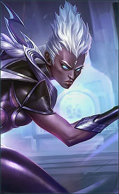

[Tier list](https://boostmlbb.ru/en/heroes/)[Items](https://boostmlbb.ru/en/items/)[News & guides](https://boostmlbb.ru/en/news/)

# Esmeralda

A

TankMageEXP Lane

Win rate

46.5%

Pick rate

0.9%

Ban rate

1.3%

[Overview](https://boostmlbb.ru/#overview)[Build](https://boostmlbb.ru/#build)[Skills](https://boostmlbb.ru/#skills)[Counters](https://boostmlbb.ru/#draft)[Lore](https://boostmlbb.ru/#lore)

## Overview

### Attributes

-   Durability**90**
-   Offense**30**
-   Control**60**
-   Difficulty**70**

-   Regen
-   Mixed Damage

### Win rate by rank, 30 days

1.  **48.3%**Epic
2.  **48.2%**Legend
3.  **47.9%**Mythic
4.  **47.1%**Honor
5.  **46.3%**Glory

Dashed line: 50% win rate

### More tanks on this lane

[Masha](https://boostmlbb.ru/en/heroes/masha.html)[Alice](https://boostmlbb.ru/en/heroes/alice.html)[Gloo](https://boostmlbb.ru/en/heroes/gloo.html)[Barats](https://boostmlbb.ru/en/heroes/barats.html)[Uranus](https://boostmlbb.ru/en/heroes/uranus.html)[Hilda](https://boostmlbb.ru/en/heroes/hilda.html)[Gatotkaca](https://boostmlbb.ru/en/heroes/gatotkaca.html)[Edith](https://boostmlbb.ru/en/heroes/edith.html)

### Places in the rankings

-   [Best MLBB mages**2 of 32**](https://boostmlbb.ru/en/heroes/best-mage.html)
-   [Best MLBB tanks**6 of 25**](https://boostmlbb.ru/en/heroes/best-tank.html)

## Build

Build 1Build 2Build 3

Win rate

55.5%

Pick rate

8.5%

#### Core items

-   [

    

    Enchanted Talisman

    ](https://boostmlbb.ru/en/items/enchanted-talisman.html)
-   [

    

    Oracle

    ](https://boostmlbb.ru/en/items/oracle.html)
-   [

    

    Dominance Ice

    ](https://boostmlbb.ru/en/items/dominance-ice.html)

#### Spell

Vengeance

#### Emblem and talents

Support

-   

    Inspire

-   

    Festival of Blood

-   

    Impure Rage

Win rate

57.0%

Pick rate

5.5%

#### Core items

-   [

    

    Enchanted Talisman

    ](https://boostmlbb.ru/en/items/enchanted-talisman.html)
-   [

    

    Oracle

    ](https://boostmlbb.ru/en/items/oracle.html)
-   [

    

    Dominance Ice

    ](https://boostmlbb.ru/en/items/dominance-ice.html)

#### Spell

Sprint

#### Emblem and talents

Support

-   

    Inspire

-   

    Festival of Blood

-   

    Impure Rage

Win rate

58.6%

Pick rate

4.4%

#### Core items

-   [

    

    Enchanted Talisman

    ](https://boostmlbb.ru/en/items/enchanted-talisman.html)
-   [

    

    Oracle

    ](https://boostmlbb.ru/en/items/oracle.html)
-   [

    

    Dominance Ice

    ](https://boostmlbb.ru/en/items/dominance-ice.html)

#### Spell

Purify

#### Emblem and talents

Support

-   

    Inspire

-   

    Festival of Blood

-   

    Impure Rage

## Skills

Level-up**Falling Starmoon**_›_**Stardust Dance**_›_**Frostmoon Shield**

Passive**Starmoon Casket**Skill 1**Frostmoon Shield**Skill 2**Stardust Dance**Ultimate**Falling Starmoon**

Passive

### Starmoon Casket

Esmeralda manipulates Stardust and Frostmoon: Stardust deals Physical Damage while Frostmoon deals Magic Damage and gives the target a shield equal to 135% of Frostmoon's damage dealt. Each Basic Attack deals (+100% Total Physical Attack) Physical Damage and 100 (+75% Total Magic Power) Magic Damage.

The damage dealt by Esmeralda ignores all shield effects and gradually converts her shield into HP.

Skill 1

### Frostmoon Shield

Cooldown **8 Mana Cost: 40 s**

Esmeralda gains a 500 (+150% Total Magic Power) shield and 40% Movement Speed that rapidly decays over 4s. Meanwhile, she gradually transforms the shields of nearby enemies into her own shield, capped at 50% of her .

Skill 2

### Stardust Dance

Cooldown **4.5 Mana Cost: 35 s**

Esmeralda waves Stardust and Frostmoon, dealing 240 (+60% Total Physical Attack) Physical Damage and 300 (+120% Total Magic Power) Magic Damage to nearby enemies. Each time she deals damage to a hero, the cooldown of Frostmoon Shield is reduced by 1.5s (damaging non-hero units grants a 0.5s reduction) and the enemy's Movement Speed is reduced by 20% for 1.5s.

Ultimate

### Falling Starmoon

Cooldown **30 Mana Cost: 100 s**

Esmeralda coheres the power of Astrospace into her two weapons - Stardust and Frostmoon. The longer this skill is channeled, the longer the cast range.

**Use Again:** Esmeralda casts Stardust at the target location, dealing 350 (+90% Total Physical Attack) Physical Damage, and then blinks to the target location and casts Frostmoon, dealing 350 (+140% Total Magic Power) Magic Damage and immobilizing enemies in the area for 1s.

## Counters

### Counters

Beat this hero

[Lolita](https://boostmlbb.ru/en/heroes/lolita.html)[Mathilda](https://boostmlbb.ru/en/heroes/mathilda.html)[Marcel](https://boostmlbb.ru/en/heroes/marcel.html)[Jawhead](https://boostmlbb.ru/en/heroes/jawhead.html)[Aldous](https://boostmlbb.ru/en/heroes/aldous.html)

### Easy targets

This hero beats them

[Dyrroth](https://boostmlbb.ru/en/heroes/dyrroth.html)[Guinevere](https://boostmlbb.ru/en/heroes/guinevere.html)[Julian](https://boostmlbb.ru/en/heroes/julian.html)[Karrie](https://boostmlbb.ru/en/heroes/karrie.html)[Lunox](https://boostmlbb.ru/en/heroes/lunox.html)[Natan](https://boostmlbb.ru/en/heroes/natan.html)

## Lore

> A mysterious astrologer.

[Read the full story ↗](https://kazukiofficial.com/stories/esmeralda)Kazuki Official [Hero stats on the game site ↗](https://www.mobilelegends.com/hero/detail?heroid=81)

**Rank up on Esmeralda**The calculator shows the price

[Calculate price](https://boostmlbb.ru/en/order.html?type=hero)

## Frequently asked questions

Who counters Esmeralda in MLBB?

Over the last 30 days the toughest opponents are Lolita, Mathilda, Marcel, Jawhead and Aldous.

What is Esmeralda’s win rate right now?

46.49% at Mythical Glory over the last 7 days and 47.03% across all ranks over 30 days, as of 25 November 2026.

What role and lane does Esmeralda play?

Tank and mage, played in the EXP Lane.

Is Esmeralda strong in the current meta?

Tier A, #14 of 133 heroes and #6 among tanks. The tier counts how often the hero is picked and banned and how well it wins at Mythical Glory over 7 days: banned in 1.3% of matches, 46.5% win rate. In professional games over the last month the hero is drafted in 76.4% of them.

What is the best build for Esmeralda?

The most popular ranked build: Enchanted Talisman, Oracle and Dominance Ice as core items, the Support emblem with Inspire, Festival of Blood and Impure Rage, and Vengeance. It wins 55.48% of matches.
