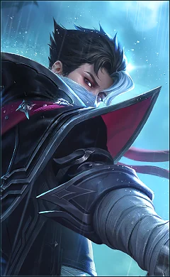

[Tier list](https://boostmlbb.ru/en/heroes/)[Items](https://boostmlbb.ru/en/items/)[Skins](https://boostmlbb.ru/en/skins/)[News & guides](https://boostmlbb.ru/en/news/)

[Tier list](https://boostmlbb.ru/en/heroes/)

# Fanny

B

AssassinJungle

Win rate

43.0%

Pick rate

0.8%

Ban rate

1.6%

[Overview](https://boostmlbb.ru/#overview)[Build](https://boostmlbb.ru/#build)[How to play](https://boostmlbb.ru/#howto)[Skills](https://boostmlbb.ru/#skills)[Counters](https://boostmlbb.ru/#draft)[Skins](https://boostmlbb.ru/#skins)[Lore](https://boostmlbb.ru/#lore)

## Overview

### Attributes

-   Durability**60**
-   Offense**70**
-   Control**10**
-   Difficulty**100**

-   Chase
-   Finisher

### More assassins on this lane

[Nolan](https://boostmlbb.ru/en/heroes/nolan.html)[Hirara](https://boostmlbb.ru/en/heroes/hirara.html)[Saber](https://boostmlbb.ru/en/heroes/saber.html)[Harley](https://boostmlbb.ru/en/heroes/harley.html)[Ling](https://boostmlbb.ru/en/heroes/ling.html)[Karina](https://boostmlbb.ru/en/heroes/karina.html)[Yi Sun-shin](https://boostmlbb.ru/en/heroes/yi-sun-shin.html)[Gusion](https://boostmlbb.ru/en/heroes/gusion.html)

### Places in the rankings

-   [Best MLBB junglers**12 of 37**](https://boostmlbb.ru/en/heroes/best-jungle.html)
-   [Best MLBB assassins**10 of 29**](https://boostmlbb.ru/en/heroes/best-assassin.html)

## Build

Build 1Build 2Build 3

Win rate

47.9%

Pick rate

2.2%

#### Core items

-   [

    

    Blade of the Heptaseas

    ](https://boostmlbb.ru/en/items/blade-of-the-heptaseas.html)
-   [

    

    Malefic Roar

    ](https://boostmlbb.ru/en/items/malefic-roar.html)
-   [

    

    Rose Gold Meteor

    ](https://boostmlbb.ru/en/items/rose-gold-meteor.html)

#### Spell

Retribution

#### Emblem and talents

Assassin

-   

    Rupture

-   

    Festival of Blood

-   

    Lethal Ignition

Win rate

44.8%

Pick rate

2.0%

#### Core items

-   [

    

    Blade of the Heptaseas

    ](https://boostmlbb.ru/en/items/blade-of-the-heptaseas.html)
-   [

    

    Malefic Roar

    ](https://boostmlbb.ru/en/items/malefic-roar.html)
-   [

    

    Rose Gold Meteor

    ](https://boostmlbb.ru/en/items/rose-gold-meteor.html)

#### Spell

Retribution

#### Emblem and talents

Assassin

-   

    Swift

-   

    Festival of Blood

-   

    Lethal Ignition

Win rate

45.4%

Pick rate

1.8%

#### Core items

-   [

    

    Blade of the Heptaseas

    ](https://boostmlbb.ru/en/items/blade-of-the-heptaseas.html)
-   [

    

    Malefic Roar

    ](https://boostmlbb.ru/en/items/malefic-roar.html)
-   [

    

    Rose Gold Meteor

    ](https://boostmlbb.ru/en/items/rose-gold-meteor.html)

#### Spell

Retribution

#### Emblem and talents

Assassin

-   

    Rupture

-   

    Festival of Blood

-   

    Impure Rage

## How to play Fanny

### Fanny combos

#### Teamfight

1.  2
2.  Ult

In teamfights, use Fanny's 2nd Skill repeatedly to move around and use her 1st Skill when in the middle of the enemy. Look for low HP enemies to finish off with her Ultimate.

#### Laning

1.  2
2.  1
3.  2
4.  Ult

In the laning phase, use Fanny's 2nd Skill at walls to quickly maneuver around and use her 1st Skill when near the enemy. Keep using her 2nd Skill to pass through the enemy to automatically trigger her 1st Skill, and use her Ultimate to secure kills.

### When strongest

Stronger late: 47.3% after minute 20. Do not take risks early, farm and fight together with your team.

1.  **34.5**10–12
2.  **40.4**12–14
3.  **42.6**14–16
4.  **45.9**16–18
5.  **46.4**18–20
6.  **47.3**20+

Win rate % by match length in minutes, all ranks. Dashed line: 50%

### Level-up priority

1.  Cut Throat
2.  Steel Cable
3.  Tornado Strike

## Skills

Passive**Air Superiority**Skill 1**Tornado Strike**Skill 2**Steel Cable**Ultimate**Cut Throat**

Passive

### Air Superiority

While flying, Fanny deals 10%-20% extra damage to enemies hit based on her flying speed and applies 1 stack of Prey Mark with each hit (up to 2 stacks).

Her subsequent skill hits on marked enemy heroes restore 8 energy per stack. Energy restoration is reduced when multiple enemy heroes are hit within a short period.

Skill 1

### Tornado Strike

Cooldown **3.5 Energy Cost: 12 s**

Fanny whirls her blades, dealing 275 (+85% Total Physical Attack) Physical Damage to nearby enemies.

Skill 2

### Steel Cable

Cooldown **0 Energy Cost: 19 s**

Fanny shoots a cable in the target direction, pulling herself toward the first obstacle it hits. She can recast this skill within 2s as long as she has enough energy. Each successive cast during this period costs 2 less energy.

While flying, Fanny automatically casts Tornado Strike when she hits an enemy if she has enough Energy.

Ultimate

### Cut Throat

Cooldown **35 Energy Cost: 12 s**

Fanny leaps at the target enemy hero or Creep with her blades, dealing 400 (+200% Extra Physical Attack) Physical Damage. Each stack of Prey Mark on the target increases this damage by 30%.

## Fanny counters

### Who counters Fanny

[Granger](https://boostmlbb.ru/en/heroes/granger.html)[Gloo](https://boostmlbb.ru/en/heroes/gloo.html)[Yve](https://boostmlbb.ru/en/heroes/yve.html)[Atlas](https://boostmlbb.ru/en/heroes/atlas.html)[Clint](https://boostmlbb.ru/en/heroes/clint.html)

### Who Fanny counters

[Badang](https://boostmlbb.ru/en/heroes/badang.html)[Chou](https://boostmlbb.ru/en/heroes/chou.html)[Franco](https://boostmlbb.ru/en/heroes/franco.html)[Moskov](https://boostmlbb.ru/en/heroes/moskov.html)[Lukas](https://boostmlbb.ru/en/heroes/lukas.html)[Kalea](https://boostmlbb.ru/en/heroes/kalea.html)[Zilong](https://boostmlbb.ru/en/heroes/zilong.html)[Bruno](https://boostmlbb.ru/en/heroes/bruno.html)

## Fanny skins

[P.ACE FannyDeluxe · 2025](https://boostmlbb.ru/en/skins/fanny/p-ace-fanny.html)[MikasaGrand · 2023](https://boostmlbb.ru/en/skins/fanny/mikasa.html)[Heart AfloatDeluxe · 2022](https://boostmlbb.ru/en/skins/fanny/heart-afloat.html)[Blade of KibouGrand · 2022](https://boostmlbb.ru/en/skins/fanny/blade-of-kibou.html)[Imperial WarriorCommon · 2021](https://boostmlbb.ru/en/skins/fanny/imperial-warrior.html)[Christmas CarnivalExceptional · 2020](https://boostmlbb.ru/en/skins/fanny/christmas-carnival.html)[Lightborn - RangerDeluxe · 2019](https://boostmlbb.ru/en/skins/fanny/lightborn-ranger.html)[LifeguardExceptional · 2019](https://boostmlbb.ru/en/skins/fanny/lifeguard.html)[Royal CavalryExceptional · 2018](https://boostmlbb.ru/en/skins/fanny/royal-cavalry.html)[SkylarkExquisite · 2018](https://boostmlbb.ru/en/skins/fanny/skylark.html)[Punk PrincessCommon · 2017](https://boostmlbb.ru/en/skins/fanny/punk-princess.html)[Campus YouthCommon · 2016](https://boostmlbb.ru/en/skins/fanny/campus-youth.html)

[All 13 Fanny skins: prices and how to get them](https://boostmlbb.ru/en/skins/fanny.html)

## Lore

> A blade dancer in the battlefield.

[Read the full story ↗](https://play.mobilelegends.com/lore/hero/Fanny)Official Mobile Legends site [Hero stats on the game site ↗](https://www.mobilelegends.com/hero/detail?heroid=17)

**Rank up on Fanny**The calculator shows the price

[Calculate price](https://boostmlbb.ru/en/order.html?type=hero)

## Frequently asked questions

Who counters Fanny in MLBB?

Over the last 30 days the toughest opponents are Granger, Gloo, Yve, Atlas and Clint.

How do you play Fanny?

Level "Steel Cable" first and take the ultimate whenever it is available. Stronger late: 47.3% after minute 20. Do not take risks early, farm and fight together with your team. Teamfight combo: In teamfights, use Fanny's 2nd Skill repeatedly to move around and use her 1st Skill when in the middle of the enemy. Look for low HP enemies to finish off with her Ultimate.

What is Fanny’s win rate right now?

42.97% at Mythical Glory over the last 7 days and 42.76% across all ranks over 30 days, as of 27 November 2026.

What role and lane does Fanny play?

Assassin, played in the jungle.

Is Fanny strong in the current meta?

Tier B, #46 of 133 heroes and #10 among assassins. The tier counts how often the hero is picked and banned and how well it wins at Mythical Glory over 7 days: banned in 1.6% of matches, 43.0% win rate. In professional games over the last month the hero is drafted in 32.2% of them.

What is the best build for Fanny?

The most popular ranked build: Blade of the Heptaseas, Malefic Roar and Rose Gold Meteor as core items, the Assassin emblem with Rupture, Festival of Blood and Lethal Ignition, and Retribution. It wins 47.94% of matches.
