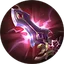

[Home](https://boostmlbb.ru/en/) / [Heroes](https://boostmlbb.ru/en/heroes/)

Tier B

# Faramis in Mobile Legends: build, counters and stats

Mage and support, Mid Lane or Roam. Wins 50.83% of matches over the last 30 days: #47 of 133 heroes.

[Boost on this hero](https://boostmlbb.ru/en/order.html?type=hero)[All heroes](https://boostmlbb.ru/en/heroes/)

Hero statsTier B

**Faramis**Ban 0.36% · Pick 0.10%

Counters

Win rate, 30 days**50.83%**

**50.83%**win rate, 30 days

**0.10%**pick rate

**0.36%**ban rate

**51.35%**wins in Mythical Glory

## Faramis build

The most picked setup for Mid Lane Faramis in ranked games across all ranks, from the in-game Academy. The win rate is for matches played with this exact build.

Core items

Glowing WandLightning TruncheonDivine Glaive

Emblem and talents

MageRuptureWeapons MasterLethal Ignition

Battle spell

Flicker

Wins with this build **57.71%**Picked in **2.60%** of matches

### Other popular setups

-   PurifyMageRupture · Wilderness Blessing · Lethal Ignition**54.26%**
-   FlickerAssassinRupture · Weapons Master · Impure Rage**58.56%**

## Faramis skills

Official skill descriptions from MOONTON with cooldowns and tags.

Level-up priority: **Nether Realm** → **Ghost Bursters** → **Shadow Stampede**

-   

    **Vicious Retrieval**Passive

    When Faramis's skills deal damage to enemy heroes and summoned units, they leave behind Soul Fragments. Absorbing a Soul Fragment recovers 100 (+50% Total Magic Power) HP and grants 2 (up to 40 stacks).
    Upon death, he consumes the absorbed Soul Fragments to reduce the respawn timer, each reducing the timer by 3% (up to 90%).
    He can gain up to 1 Soul Fragment from the same enemy hero using skills every 4s. Enemies that die around Faramis also have a chance to drop Soul Fragments.

-   

    **Shadow Stampede**Skill 1CD 15 Mana Cost: 85 s

    Faramis enters the Shadow state for 3s, gaining 70% Movement Speed, 25 , and 20% Cooldown Reduction of this skill. He also gains the ability to move through terrain. Enemy heroes he touches take 250 (+60% Total Magic Power) Magic Damage and are marked with a Nether Mark. Upon leaving the Shadow state, Faramis pulls all the marked enemy heroes toward him, dealing 250 (+60% Total Magic Power) Magic Damage.
    Use Again: Ends the Shadow state early to pull marked enemy heroes toward him.
    Soul Fragment absorption range is increased while this skill is active.

-   

    **Ghost Bursters**Skill 2CD 6 Mana Cost: 60 s

    Faramis gathers Nether energy in a fan-shaped area ahead, dealing 330 (+144% Total Magic Power) Magic Damage to enemies within. The energy will then split and bounce to nearby enemies, dealing 200 (+86% Total Magic Power) Magic Damage (splits up to 2 time(s) on enemy hero hits and 1 time(s) on non-enemy hero hits).

-   

    **Nether Realm**UltimateCD 90 Mana Cost: 150 s

    Faramis turns his surroundings into the Nether Realm for 6s. Allied heroes within (including himself) enter the Specter state, gaining 400 (+ 10 (+5% Total Magic Power)%) extra HP and 50% extra Movement Speed for 1s. When the Specter state breaks, heroes within clear all debuffs and enter a brief Resurrection state for 1.3s. The Specter state immediately ends if the allied hero leaves the Nether Realm.

## Role and lane

Places are by win rate over the last 30 days among heroes of the same role or lane.

-   Role**Mage and support**
-   Lane**Mid Lane or Roam**
-   Among mages**#12 of 32**
-   Among supports**#9 of 15**
-   In the Mid Lane**#11 of 29**
-   On roam**#16 of 34**
-   Speciality**Guard, Charge**
-   Difficulty**Medium (50/100)**

## Who counters Faramis

Faramis loses to these heroes most often. The number under each icon is that hero’s own win rate. 2 of the 5 counters are assassins.

[Gloo53.45%](https://boostmlbb.ru/en/heroes/gloo.html)[Wanwan47.59%](https://boostmlbb.ru/en/heroes/wanwan.html)[Sun53.72%](https://boostmlbb.ru/en/heroes/sun.html)[Ling52.54%](https://boostmlbb.ru/en/heroes/ling.html)[Karina48.60%](https://boostmlbb.ru/en/heroes/karina.html)

## Who Faramis is strong against

Faramis is one of the toughest opponents for these heroes.

[Angela49.99%](https://boostmlbb.ru/en/heroes/angela.html)[Floryn54.07%](https://boostmlbb.ru/en/heroes/floryn.html)[Alice50.70%](https://boostmlbb.ru/en/heroes/alice.html)[Xavier51.68%](https://boostmlbb.ru/en/heroes/xavier.html)[Julian49.95%](https://boostmlbb.ru/en/heroes/julian.html)[Estes52.75%](https://boostmlbb.ru/en/heroes/estes.html)[Odette49.69%](https://boostmlbb.ru/en/heroes/odette.html)[Edith52.67%](https://boostmlbb.ru/en/heroes/edith.html)[Luo Yi47.35%](https://boostmlbb.ru/en/heroes/luo-yi.html)

## Best teammates for Faramis

With these heroes on the same team Faramis wins more often. The number is the gain in win rate, in percentage points.

[Kaja+2.78 pts](https://boostmlbb.ru/en/heroes/kaja.html)[Kalea+2.26 pts](https://boostmlbb.ru/en/heroes/kalea.html)[Moskov+2.07 pts](https://boostmlbb.ru/en/heroes/moskov.html)[Saber+1.96 pts](https://boostmlbb.ru/en/heroes/saber.html)

## Win rate by rank

Best result in Mythical Glory (51.35%), weakest in Epic (48.59%). Last 30 days.

-   Epic**48.59%**
-   Legend**48.95%**
-   Mythic**49.59%**
-   Mythical Honor**50.75%**
-   Mythical Glory**51.35%**

## Place in the meta

Faramis sits in tier B of our win-rate tier list and ranks 47 of 133 heroes. The hero is picked in under 0.5% of matches, so the win rate can swing a lot. In Mythical Glory the win rate is higher: 51.35% against 50.83% across all ranks, a 0.52-point gap. See the full [tier list](https://boostmlbb.ru/en/news/mlbb-meta-tier-list/) and the [patch breakdown](https://boostmlbb.ru/en/news/mlbb-current-patch/).

## Other Mid Lane heroes

The strongest by win rate over the last 30 days.

[Valir54.11%](https://boostmlbb.ru/en/heroes/valir.html)[Gord52.61%](https://boostmlbb.ru/en/heroes/gord.html)[Zhask52.54%](https://boostmlbb.ru/en/heroes/zhask.html)[Yve52.26%](https://boostmlbb.ru/en/heroes/yve.html)[Cyclops51.68%](https://boostmlbb.ru/en/heroes/cyclops.html)[Xavier51.68%](https://boostmlbb.ru/en/heroes/xavier.html)

## Lore

«A necromancer in Necrokeep who's determined to find a cure for the Mist.»

Faramis’s full backstory is on MOONTON’s official lore site. The hero card with skills and the game’s own tips is on mobilelegends.com; voice lines, skins and patch history are collected by the MLBB Wiki.

[Read the lore](https://play.mobilelegends.com/lore/hero/Faramis)[Official hero card](https://www.mobilelegends.com/hero/detail?heroid=76)[MLBB Wiki](https://mobile-legends.fandom.com/wiki/Faramis)

## Boost on Faramis

The booster plays only this hero, so the hero rating grows with your rank.

[Calculate the price](https://boostmlbb.ru/en/order.html?type=hero)

Statistics: official MOONTON hero ranking (mobilelegends.com/rank), last 30 days, updated 23 November 2026 and refreshed daily. Roles and lanes: the official hero page. Builds, skills and teammates: MOONTON in-game Academy data via the Rone Arena API (ridwaanhall / RoneAI).

## Frequently asked questions

Who counters Faramis in MLBB?

Over the last 30 days the toughest opponents are Gloo, Wanwan, Sun, Ling and Karina.

What is Faramis’s win rate right now?

50.83% over the last 30 days across all ranks and 51.35% in Mythical Glory, as of 23 November 2026.

What role and lane does Faramis play?

Mage and support, played in the Mid Lane or on roam.

Is Faramis strong in the current meta?

Tier B: #47 of 133 heroes by 30-day win rate and #12 among mages.

What is the best build for Faramis?

The most popular ranked build: Glowing Wand, Lightning Truncheon and Divine Glaive as core items, the Mage emblem with Rupture, Weapons Master and Lethal Ignition, and Flicker. It wins 57.71% of matches.

MLBB Boost editorial team · Updated 23 November 2026
