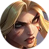

[Home](https://boostmlbb.ru/en/) / [Heroes](https://boostmlbb.ru/en/heroes/)

Tier B

# Freya in Mobile Legends: build, counters and stats

Fighter, EXP Lane or Jungle. Wins 49.32% of matches over the last 30 days: #84 of 133 heroes.

[Boost on this hero](https://boostmlbb.ru/en/order.html?type=hero)[All heroes](https://boostmlbb.ru/en/heroes/)

Hero statsTier B

**Freya**Ban 4.76% · Pick 0.89%

Counters

Win rate, 30 days**49.32%**

**49.32%**win rate, 30 days

**0.89%**pick rate

**4.76%**ban rate

**51.07%**wins in Mythical Glory

## Freya build

The most picked setup for EXP Lane Freya in ranked games across all ranks, from the in-game Academy. The win rate is for matches played with this exact build.

Core items

Golden StaffWar AxeEndless Battle

Emblem and talents

FighterThrillFestival of BloodWar Cry

Battle spell

Vengeance

Wins with this build **60.37%**Picked in **5.61%** of matches

### Other popular setups

-   VengeanceFighterThrill · Festival of Blood · War Cry**60.06%**
-   VengeanceFighterThrill · Festival of Blood · War Cry**57.95%**

## Freya skills

Official skill descriptions from MOONTON with cooldowns and tags.

Level-up priority: **Valkyrie Descent** → **Valkyrie Slash** → **Leap of Faith**

-   

    **Power of Einherjar**Passive

    Freya gains 1 Sacred Orb stack(s) with each Basic Attack (up to 6 stacks). Consuming 1 stack(s) of Sacred Orb grants Freya 100% Attack Speed for her next Basic Attack and recovers 20 (+3\*Hero Level) (+20% Total Physical Attack) HP (up to 6 stacks).
    While out of combat, Sacred Orb stacks are gradually restored.

-   

    **Leap of Faith**Skill 1CD 8 s

    Freya leaps to the target area and strikes the ground with her shield, gaining 500 (+100% Total Physical Attack) shield and dealing 200 (+80% Extra Physical Attack) Physical Damage to enemies within while knocking them airborne for 0.4s.

-   

    **Valkyrie Slash**Skill 2CD 0.396 s

    Freya charges forward and slashes, dealing 150 (+50% Total Physical Attack) Physical Damage and slowing enemies by 30% for 0.5s. This skill has no base cooldown but consumes 2 Sacred Orbs per cast.
    This skill deals 50% damage to creeps.

-   

    **Valkyrie Descent**UltimateCD 60 s

    Freya dives toward the target area, gaining Control Immunity. She deals 300 (+75% Total Physical Attack) Physical Damage to enemies along her path and in the landing area. Enemies hit are slowed by 40% for 2s.
    Upon landing, Freya enters the Valkyrie state for 10s and gains 30 Movement Speed. Her Basic Attacks deal 100 (+70% Total Physical Attack) Splash Damage (only the bonus Physical Damage can Crit).

## Role and lane

Places are by win rate over the last 30 days among heroes of the same role or lane.

-   Role**Fighter**
-   Lane**EXP Lane or Jungle**
-   Among fighters**#27 of 44**
-   In the EXP Lane**#27 of 42**
-   In the jungle**#20 of 37**
-   Speciality**Chase, Damage**
-   Difficulty**Easy (40/100)**

## Who counters Freya

Freya loses to these heroes most often. The number under each icon is that hero’s own win rate. 2 of the 5 counters are tanks.

[Masha60.40%](https://boostmlbb.ru/en/heroes/masha.html)[Yve52.26%](https://boostmlbb.ru/en/heroes/yve.html)[Lolita53.30%](https://boostmlbb.ru/en/heroes/lolita.html)[Kagura51.09%](https://boostmlbb.ru/en/heroes/kagura.html)[Ling52.54%](https://boostmlbb.ru/en/heroes/ling.html)

## Who Freya is strong against

Freya is one of the toughest opponents for these heroes.

[Franco41.58%](https://boostmlbb.ru/en/heroes/franco.html)[Minsitthar52.08%](https://boostmlbb.ru/en/heroes/minsitthar.html)[Phoveus48.21%](https://boostmlbb.ru/en/heroes/phoveus.html)

## Best teammates for Freya

With these heroes on the same team Freya wins more often. The number is the gain in win rate, in percentage points.

[Zhuxin+2.99 pts](https://boostmlbb.ru/en/heroes/zhuxin.html)[Chip+2.25 pts](https://boostmlbb.ru/en/heroes/chip.html)[Harith+2.17 pts](https://boostmlbb.ru/en/heroes/harith.html)[Yve+2.16 pts](https://boostmlbb.ru/en/heroes/yve.html)

## Win rate by rank

Best result in Mythical Glory (51.07%), weakest in Epic (47.34%). Last 30 days.

-   Epic**47.34%**
-   Legend**47.52%**
-   Mythic**48.19%**
-   Mythical Honor**48.53%**
-   Mythical Glory**51.07%**

## Place in the meta

Freya sits in tier B of our win-rate tier list and ranks 84 of 133 heroes. In Mythical Glory the win rate is higher: 51.07% against 49.32% across all ranks, a 1.75-point gap. See the full [tier list](https://boostmlbb.ru/en/news/mlbb-meta-tier-list/) and the [patch breakdown](https://boostmlbb.ru/en/news/mlbb-current-patch/).

## Other EXP Lane heroes

The strongest by win rate over the last 30 days.

[Masha60.40%](https://boostmlbb.ru/en/heroes/masha.html)[Argus56.78%](https://boostmlbb.ru/en/heroes/argus.html)[Sun53.72%](https://boostmlbb.ru/en/heroes/sun.html)[Aulus53.46%](https://boostmlbb.ru/en/heroes/aulus.html)[Gloo53.45%](https://boostmlbb.ru/en/heroes/gloo.html)[Edith52.67%](https://boostmlbb.ru/en/heroes/edith.html)

## Lore

«The Valkyrie who guards the Northern Vale.»

Freya’s full backstory is on MOONTON’s official lore site. The hero card with skills and the game’s own tips is on mobilelegends.com; voice lines, skins and patch history are collected by the MLBB Wiki.

[Read the lore](https://play.mobilelegends.com/lore/hero/FreyaValkyrie?is_preview=1)[Official hero card](https://www.mobilelegends.com/hero/detail?heroid=22)[MLBB Wiki](https://mobile-legends.fandom.com/wiki/Freya)

## Boost on Freya

The booster plays only this hero, so the hero rating grows with your rank.

[Calculate the price](https://boostmlbb.ru/en/order.html?type=hero)

Statistics: official MOONTON hero ranking (mobilelegends.com/rank), last 30 days, updated 23 November 2026 and refreshed daily. Roles and lanes: the official hero page. Builds, skills and teammates: MOONTON in-game Academy data via the Rone Arena API (ridwaanhall / RoneAI).

## Frequently asked questions

Who counters Freya in MLBB?

Over the last 30 days the toughest opponents are Masha, Yve, Lolita, Kagura and Ling.

What is Freya’s win rate right now?

49.32% over the last 30 days across all ranks and 51.07% in Mythical Glory, as of 23 November 2026.

What role and lane does Freya play?

Fighter, played in the EXP Lane or in the jungle.

Is Freya strong in the current meta?

Tier B: #84 of 133 heroes by 30-day win rate and #27 among fighters.

What is the best build for Freya?

The most popular ranked build: Golden Staff, War Axe and Endless Battle as core items, the Fighter emblem with Thrill, Festival of Blood and War Cry, and Vengeance. It wins 60.37% of matches.

MLBB Boost editorial team · Updated 23 November 2026
