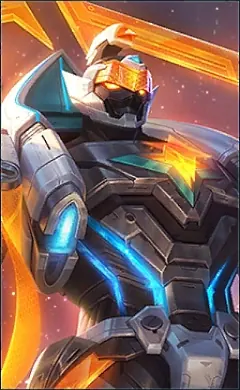

[Tier list](https://boostmlbb.ru/en/heroes/)[Items](https://boostmlbb.ru/en/items/)[Skins](https://boostmlbb.ru/en/skins/)[News & guides](https://boostmlbb.ru/en/news/)

[Tier list](https://boostmlbb.ru/en/heroes/)

# Gatotkaca

C

TankFighterEXP LaneRoam

Win rate

44.2%

Pick rate

0.3%

Ban rate

0.1%

[Overview](https://boostmlbb.ru/#overview)[Build](https://boostmlbb.ru/#build)[How to play](https://boostmlbb.ru/#howto)[Skills](https://boostmlbb.ru/#skills)[Counters](https://boostmlbb.ru/#draft)[Skins](https://boostmlbb.ru/#skins)[Lore](https://boostmlbb.ru/#lore)

## Overview

### Attributes

-   Durability**90**
-   Offense**30**
-   Control**90**
-   Difficulty**40**

-   Crowd Control
-   Burst

### More tanks on this lane

[Masha](https://boostmlbb.ru/en/heroes/masha.html)[Carmilla](https://boostmlbb.ru/en/heroes/carmilla.html)[Belerick](https://boostmlbb.ru/en/heroes/belerick.html)[Atlas](https://boostmlbb.ru/en/heroes/atlas.html)[Alice](https://boostmlbb.ru/en/heroes/alice.html)[Esmeralda](https://boostmlbb.ru/en/heroes/esmeralda.html)[Gloo](https://boostmlbb.ru/en/heroes/gloo.html)[Barats](https://boostmlbb.ru/en/heroes/barats.html)

### Places in the rankings

-   [Best MLBB fighters**27 of 44**](https://boostmlbb.ru/en/heroes/best-fighter.html)
-   [Best MLBB tanks**15 of 25**](https://boostmlbb.ru/en/heroes/best-tank.html)
-   [Best MLBB roamers**20 of 34**](https://boostmlbb.ru/en/heroes/best-roam.html)

## Build

Build 1Build 2Build 3

Win rate

55.0%

Pick rate

3.1%

#### Core items

-   [

    

    Concentrated Energy

    ](https://boostmlbb.ru/en/items/concentrated-energy.html)
-   [

    

    Queen's Wings

    ](https://boostmlbb.ru/en/items/queens-wings.html)
-   [

    

    Sky Piercer

    ](https://boostmlbb.ru/en/items/sky-piercer.html)

#### Spell

Vengeance

#### Emblem and talents

Mage

-   

    Thrill

-   

    Bargain Hunter

-   

    Impure Rage

Win rate

57.3%

Pick rate

1.9%

#### Core items

-   [

    

    Thunder Belt

    ](https://boostmlbb.ru/en/items/thunder-belt.html)
-   [

    

    Dominance Ice

    ](https://boostmlbb.ru/en/items/dominance-ice.html)
-   [

    

    Queen's Wings

    ](https://boostmlbb.ru/en/items/queens-wings.html)

#### Spell

Revitalize

#### Emblem and talents

Tank

-   

    Vitality

-   

    Tenacity

-   

    Concussive Blast

Win rate

50.8%

Pick rate

1.8%

#### Core items

-   [

    

    Dominance Ice

    ](https://boostmlbb.ru/en/items/dominance-ice.html)
-   [

    

    Antique Cuirass

    ](https://boostmlbb.ru/en/items/antique-cuirass.html)
-   [

    

    Radiant Armor

    ](https://boostmlbb.ru/en/items/radiant-armor.html)

#### Spell

Revitalize

#### Emblem and talents

Tank

-   

    Vitality

-   

    Tenacity

-   

    Concussive Blast

## How to play Gatotkaca

### Gatotkaca combos

#### Teamfight

1.  Ult
2.  2
3.  1
4.  Attack

In teamfights, use Gatotkaca's Ultimate to dive into the enemy team, then use his 2nd Skill to taunt them, and slow them with his 1st Skill before finishing with Basic Attacks.

#### Laning

1.  2
2.  1
3.  Attack

In the laning phase, use Gatotkaca's 2nd Skill to CC the enemy by charging up to extend the range while aiming, then follow up with his 1st Skill and Basic Attacks.

### When strongest

Stronger late: 48.0% after minute 20. Do not take risks early, farm and fight together with your team.

1.  **41.5**10–12
2.  **45.0**12–14
3.  **47.2**14–16
4.  **47.8**16–18
5.  **47.9**18–20
6.  **48.0**20+

Win rate % by match length in minutes, all ranks. Dashed line: 50%

### Level-up priority

1.  Avatar of the Guardian
2.  Blast Iron Fist
3.  Unbreakable

## Skills

Passive**Steel Bones**Skill 1**Blast Iron Fist**Skill 2**Unbreakable**Ultimate**Avatar of the Guardian**

Passive

### Steel Bones

Gatotkaca gains equal to 2% of his lost HP (up to 200). He gains 5 Rage (up to 100) for every 300 damage taken (calculated before reduction).

Upon reaching 25 Rage, Gatotkaca's next Basic Attack is enhanced, consuming all Rage to deal (+100% Total Physical Attack) (+200% Total Magic Power) (+ 8.2-11 \* Consumed Rage) Magic Damage (scales with hero level) and recover (8 \* Consumed Rage) HP.

Skill 1

### Blast Iron Fist

Cooldown **8 s**

Gatotkaca slams the ground, creating a shattered zone in the target direction while dealing 200 (+150% Total Magic Power) Magic Damage to enemies within. Enemies in the shattered zone will take 100 (+20% Total Magic Power) Magic Damage per second and be slowed by 30%.

Skill 2

### Unbreakable

Cooldown **12 s**

Gatotkaca begins channeling, then sprints in the target direction with a battle cry, taunting enemies on the path to attack him, dealing 200 (+100% Total Magic Power) Magic Damage for 0.9 - 1.5s. The taunt duration and sprint distance scale with the channel time. Canceling the skill reduces 50% of the remaining cooldown.

Ultimate

### Avatar of the Guardian

Gatotkaca jumps to the target location, dealing 500 (+300% Total Magic Power) Magic Damage to nearby enemies and knocking them airborne for 1s. Enemies near the center of the area will be knocked airborne for a longer duration, while enemies on the fringes will be pulled to the center.

The camera will move with the skill indicator but won't grant extra sight.

## Gatotkaca counters

### Who counters Gatotkaca

[Odette](https://boostmlbb.ru/en/heroes/odette.html)[Saber](https://boostmlbb.ru/en/heroes/saber.html)[Miya](https://boostmlbb.ru/en/heroes/miya.html)[Zilong](https://boostmlbb.ru/en/heroes/zilong.html)[Argus](https://boostmlbb.ru/en/heroes/argus.html)

### Who Gatotkaca counters

[Lesley](https://boostmlbb.ru/en/heroes/lesley.html)[Uranus](https://boostmlbb.ru/en/heroes/uranus.html)

## Gatotkaca skins

[Nutcracker MonarchExceptional · 2024](https://boostmlbb.ru/en/skins/gatotkaca/nutcracker-monarch.html)[Tide PreserverDeluxe · 2024](https://boostmlbb.ru/en/skins/gatotkaca/tide-preserver.html)[SparkCommon · 2019](https://boostmlbb.ru/en/skins/gatotkaca/spark.html)[SentinelExquisite · 2018](https://boostmlbb.ru/en/skins/gatotkaca/sentinel.html)[Arhat KingCommon · 2018](https://boostmlbb.ru/en/skins/gatotkaca/arhat-king.html)[Mighty GuardianCommon · 2017](https://boostmlbb.ru/en/skins/gatotkaca/mighty-guardian.html)[Solar Spark](https://boostmlbb.ru/en/skins/gatotkaca/solar-spark.html)

[All 7 Gatotkaca skins: prices and how to get them](https://boostmlbb.ru/en/skins/gatotkaca.html)

## Lore

> Warrior from the Arcadhem universe.

[Read the full story ↗](https://kazukiofficial.com/stories/gatotkaca)Kazuki Official [Hero stats on the game site ↗](https://www.mobilelegends.com/hero/detail?heroid=41)

**Rank up on Gatotkaca**The calculator shows the price

[Calculate price](https://boostmlbb.ru/en/order.html?type=hero)

## Frequently asked questions

Who counters Gatotkaca in MLBB?

Over the last 30 days the toughest opponents are Odette, Saber, Miya, Zilong and Argus.

How do you play Gatotkaca?

Level "Blast Iron Fist" first and take the ultimate whenever it is available. Stronger late: 48.0% after minute 20. Do not take risks early, farm and fight together with your team. Teamfight combo: In teamfights, use Gatotkaca's Ultimate to dive into the enemy team, then use his 2nd Skill to taunt them, and slow them with his 1st Skill before finishing with Basic Attacks.

What is Gatotkaca’s win rate right now?

44.24% at Mythical Glory over the last 7 days and 45.39% across all ranks over 30 days, as of 27 November 2026.

What role and lane does Gatotkaca play?

Tank and fighter, played in the EXP Lane or on roam.

Is Gatotkaca strong in the current meta?

Tier C, #89 of 133 heroes and #15 among tanks. The tier counts how often the hero is picked and banned and how well it wins at Mythical Glory over 7 days: banned in 0.1% of matches, 44.2% win rate. In professional games over the last month the hero is drafted in 16.3% of them.

What is the best build for Gatotkaca?

The most popular ranked build: Concentrated Energy, Queen's Wings and Sky Piercer as core items, the Mage emblem with Thrill, Bargain Hunter and Impure Rage, and Vengeance. It wins 55.05% of matches.
