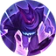

[Tier list](https://boostmlbb.ru/en/heroes/)[Items](https://boostmlbb.ru/en/items/)[Skins](https://boostmlbb.ru/en/skins/)[News & guides](https://boostmlbb.ru/en/news/)

# Gloo

A

TankEXP LaneRoam

Win rate

50.0%

Pick rate

0.7%

Ban rate

35.7%

[Overview](https://boostmlbb.ru/#overview)[Build](https://boostmlbb.ru/#build)[How to play](https://boostmlbb.ru/#howto)[Skills](https://boostmlbb.ru/#skills)[Counters](https://boostmlbb.ru/#draft)[Skins](https://boostmlbb.ru/#skins)[Lore](https://boostmlbb.ru/#lore)

## Overview

### Attributes

-   Durability**100**
-   Offense**30**
-   Control**100**
-   Difficulty**60**

-   Regen
-   Control

### Win rate by rank, 30 days

1.  **55.5%**Epic
2.  **55.9%**Legend
3.  **55.5%**Mythic
4.  **54.1%**Honor
5.  **51.3%**Glory

Dashed line: 50% win rate

### More tanks on this lane

[Masha](https://boostmlbb.ru/en/heroes/masha.html)[Carmilla](https://boostmlbb.ru/en/heroes/carmilla.html)[Belerick](https://boostmlbb.ru/en/heroes/belerick.html)[Atlas](https://boostmlbb.ru/en/heroes/atlas.html)[Alice](https://boostmlbb.ru/en/heroes/alice.html)[Esmeralda](https://boostmlbb.ru/en/heroes/esmeralda.html)[Barats](https://boostmlbb.ru/en/heroes/barats.html)[Minotaur](https://boostmlbb.ru/en/heroes/minotaur.html)

### Places in the rankings

-   [Best MLBB tanks**7 of 25**](https://boostmlbb.ru/en/heroes/best-tank.html)
-   [Best MLBB roamers**6 of 34**](https://boostmlbb.ru/en/heroes/best-roam.html)

## Build

Build 1Build 2Build 3

Win rate

58.0%

Pick rate

14.8%

#### Core items

-   [

    

    Cursed Helmet

    ](https://boostmlbb.ru/en/items/cursed-helmet.html)
-   [

    

    Glowing Wand

    ](https://boostmlbb.ru/en/items/glowing-wand.html)
-   [

    

    Oracle

    ](https://boostmlbb.ru/en/items/oracle.html)

#### Spell

Flameshot

#### Emblem and talents

Common

-   

    Agility

-   

    Wilderness Blessing

-   

    Brave Smite

Win rate

60.4%

Pick rate

5.9%

#### Core items

-   [

    

    Cursed Helmet

    ](https://boostmlbb.ru/en/items/cursed-helmet.html)
-   [

    

    Glowing Wand

    ](https://boostmlbb.ru/en/items/glowing-wand.html)
-   [

    

    Oracle

    ](https://boostmlbb.ru/en/items/oracle.html)

#### Spell

Flicker

#### Emblem and talents

Common

-   

    Agility

-   

    Wilderness Blessing

-   

    Brave Smite

Win rate

61.4%

Pick rate

3.4%

#### Core items

-   [

    

    Cursed Helmet

    ](https://boostmlbb.ru/en/items/cursed-helmet.html)
-   [

    

    Glowing Wand

    ](https://boostmlbb.ru/en/items/glowing-wand.html)
-   [

    

    Oracle

    ](https://boostmlbb.ru/en/items/oracle.html)

#### Spell

Flameshot

#### Emblem and talents

Common

-   

    Agility

-   

    Wilderness Blessing

-   

    Impure Rage

## How to play Gloo

### Gloo combos

#### Teamfight

1.  1
2.  2
3.  1
4.  Ult
5.  Ult
6.  1
7.  2

In teamfights, Gloo can use his 1st + 2nd skill combo to close in on the enemy and immobilize them. Then his 1st Skill and Ultimate to add more Sticky stacks to enemy heroes, and attach himself with his Ultimate to the enemy hero with max Sticky stacks. Once ready, Gloo can use the combo to deal damage and move the host out of position. Finally, he can use the refreshed 1st Skill and his Basic Attacks to finish off the host.

#### Laning

1.  1
2.  2
3.  1

In the laning phase, Gloo should use his 1st Skill to attack the target enemy and create a Goo, then he can use his 2nd Skill to target the Goo to bring the target to its location and trigger an explosion. Touching the Goo will also reset Gloo's 1st Skill, allowing him to use it again to deal damage.

### When strongest

Stronger late: 51.9% at 16–18 minutes. Do not take risks early, farm and fight together with your team.

1.  **48.6**10–12
2.  **50.8**12–14
3.  **52.1**14–16
4.  **51.9**16–18
5.  **51.6**18–20
6.  **50.9**20+

Win rate % by match length in minutes, all ranks. Dashed line: 50%

### Level-up priority

1.  Grab, Grab
2.  Slam, Slam
3.  Spread, Spread

## Skills

Passive**Stick, Stick**Skill 1**Slam, Slam**Skill 2**Spread, Spread**Ultimate**Grab, Grab**

Passive

### Stick, Stick

Gloo's skills apply a stack of Sticky to enemies on hit, decreasing their Movement Speed by 4% for 6s (up to 5 stacks).

Each Sticky stack on an attacker reduces their damage dealt to Gloo by 3%.

Skill 1

### Slam, Slam

Cooldown **10 Mana Cost: 25 s**

Gloo reaches out and slams the ground, dealing 80 (+80% Total Magic Power) Magic Damage to enemies hit.

A Goo is left at the end location, which explodes after 3s, dealing 230 (+11% Extra Max HP) Magic Damage to nearby enemies and immobilizing them for 0.6s.

Touching the Goo detonates it immediately and resets this skill's cooldown. Gloo also recovers 2.5% if the explosion hits an enemy (doubled if it hits an enemy hero).

Skill 2

### Spread, Spread

Cooldown **12 Mana Cost: 80 s**

Gloo splits into Goos, dealing 100 (+80% Total Magic Power) Magic Damage to enemies in a fan-shaped area and immobilizing them for 0.5s. For the next 4s, Gloo gains 10% Movement Speed and deals 80 (+15% Total Magic Power) Magic Damage every 0.25s to enemies it touches.

If this skill hits a Goo, Gloo charges toward it, dragging enemies in its path along for a distance.

Ultimate

### Grab, Grab

Unlocked when an enemy hero reaches max Sticky stacks. Gloo attaches itself to the target for up to 9s, recovering 20% .

While attached, Gloo's Basic Attacks deal 30 (+50% Total Magic Power) (+6% Extra Max HP) Magic Damage, and it transfers 60% of the damage it takes (excluding Turret damage) to the host. If the host dies while Gloo is attached, this skill's cooldown is reduced to 5s.

## Gloo counters

### Who counters Gloo

[Aamon](https://boostmlbb.ru/en/heroes/aamon.html)[Johnson](https://boostmlbb.ru/en/heroes/johnson.html)[Jawhead](https://boostmlbb.ru/en/heroes/jawhead.html)[Nana](https://boostmlbb.ru/en/heroes/nana.html)[Chang'e](https://boostmlbb.ru/en/heroes/change.html)

### Who Gloo counters

[Vexana](https://boostmlbb.ru/en/heroes/vexana.html)[Carmilla](https://boostmlbb.ru/en/heroes/carmilla.html)[Alice](https://boostmlbb.ru/en/heroes/alice.html)[Moskov](https://boostmlbb.ru/en/heroes/moskov.html)[Xavier](https://boostmlbb.ru/en/heroes/xavier.html)[Aulus](https://boostmlbb.ru/en/heroes/aulus.html)[Ling](https://boostmlbb.ru/en/heroes/ling.html)[Yu Zhong](https://boostmlbb.ru/en/heroes/yu-zhong.html)[Fanny](https://boostmlbb.ru/en/heroes/fanny.html)[Masha](https://boostmlbb.ru/en/heroes/masha.html)

## Gloo skins

[PatrickDeluxe · 2025](https://boostmlbb.ru/en/skins/gloo/patrick.html)[JellymanExceptional · 2023](https://boostmlbb.ru/en/skins/gloo/jellyman.html)[Verdant EnchanterCommon · 2021](https://boostmlbb.ru/en/skins/gloo/verdant-enchanter.html)[Abominable Snowgloo](https://boostmlbb.ru/en/skins/gloo/abominable-snowgloo.html)

[All 4 Gloo skins: prices and how to get them](https://boostmlbb.ru/en/skins/gloo.html)

## Lore

> A magical amalgamation of cute, mischievous creatures that dwells deep in the Shadow Swamp.

[Read the full story ↗](https://play.mobilelegends.com/lore/hero/Gloo)Official Mobile Legends site [Hero stats on the game site ↗](https://www.mobilelegends.com/hero/detail?heroid=104)

**Rank up on Gloo**The calculator shows the price

[Calculate price](https://boostmlbb.ru/en/order.html?type=hero)

## Frequently asked questions

Who counters Gloo in MLBB?

Over the last 30 days the toughest opponents are Aamon, Johnson, Jawhead, Nana and Chang'e.

How do you play Gloo?

Level "Slam, Slam" first and take the ultimate whenever it is available. Stronger late: 51.9% at 16–18 minutes. Do not take risks early, farm and fight together with your team. Teamfight combo: In teamfights, Gloo can use his 1st + 2nd skill combo to close in on the enemy and immobilize them. Then his 1st Skill and Ultimate to add more Sticky stacks to enemy heroes, and attach himself with his Ultimate to the enemy hero with max Sticky stacks. Once ready, Gloo can use the combo to deal damage and move the host out of position. Finally, he can use the refreshed 1st Skill and his Basic Attacks to finish off the host.

What is Gloo’s win rate right now?

50.01% at Mythical Glory over the last 7 days and 53.17% across all ranks over 30 days, as of 25 November 2026.

What role and lane does Gloo play?

Tank, played in the EXP Lane or on roam.

Is Gloo strong in the current meta?

Tier A, #18 of 133 heroes and #7 among tanks. The tier counts how often the hero is picked and banned and how well it wins at Mythical Glory over 7 days: banned in 35.7% of matches, 50.0% win rate. In professional games over the last month the hero is drafted in 26.6% of them.

What is the best build for Gloo?

The most popular ranked build: Cursed Helmet, Glowing Wand and Oracle as core items, the Common emblem with Agility, Wilderness Blessing and Brave Smite, and Flameshot. It wins 57.95% of matches.
