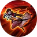
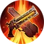
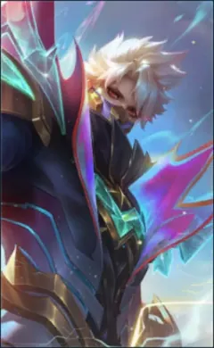

[Tier list](https://boostmlbb.ru/en/heroes/)

# Granger

C

MarksmanGold Lane

Win rate

44.0%

Pick rate

1.4%

Ban rate

1.0%

[Overview](https://boostmlbb.ru/#overview)[Build](https://boostmlbb.ru/#build)[How to play](https://boostmlbb.ru/#howto)[Skills](https://boostmlbb.ru/#skills)[Counters](https://boostmlbb.ru/#draft)[Skins](https://boostmlbb.ru/#skins)[Lore](https://boostmlbb.ru/#lore)

## Overview

### Attributes

-   Durability**30**
-   Offense**70**
-   Control**10**
-   Difficulty**30**

-   Burst
-   Finisher

### More marksmen on this lane

[Obsidia](https://boostmlbb.ru/en/heroes/obsidia.html)[Bruno](https://boostmlbb.ru/en/heroes/bruno.html)[Clint](https://boostmlbb.ru/en/heroes/clint.html)[Brody](https://boostmlbb.ru/en/heroes/brody.html)[Hanabi](https://boostmlbb.ru/en/heroes/hanabi.html)[Moskov](https://boostmlbb.ru/en/heroes/moskov.html)[Claude](https://boostmlbb.ru/en/heroes/claude.html)[Miya](https://boostmlbb.ru/en/heroes/miya.html)

### Places in the rankings

-   [Best MLBB marksmen**18 of 23**](https://boostmlbb.ru/en/heroes/best-marksman.html)

## Build

Build 1Build 2Build 3

Win rate

46.3%

Pick rate

27.6%

#### Core items

-   [

    

    Hunter Strike

    ](https://boostmlbb.ru/en/items/hunter-strike.html)
-   [

    

    Sky Piercer

    ](https://boostmlbb.ru/en/items/sky-piercer.html)
-   [

    

    Malefic Roar

    ](https://boostmlbb.ru/en/items/malefic-roar.html)

#### Spell

Flicker

#### Emblem and talents

Assassin

-   

    Thrill

-   

    Festival of Blood

-   

    Impure Rage

Win rate

45.6%

Pick rate

13.5%

#### Core items

-   [

    

    Hunter Strike

    ](https://boostmlbb.ru/en/items/hunter-strike.html)
-   [

    

    Sky Piercer

    ](https://boostmlbb.ru/en/items/sky-piercer.html)
-   [

    

    Malefic Roar

    ](https://boostmlbb.ru/en/items/malefic-roar.html)

#### Spell

Flicker

#### Emblem and talents

Assassin

-   

    Rupture

-   

    Festival of Blood

-   

    Impure Rage

Win rate

39.6%

Pick rate

3.2%

#### Core items

-   [

    

    Hunter Strike

    ](https://boostmlbb.ru/en/items/hunter-strike.html)
-   [

    

    Sky Piercer

    ](https://boostmlbb.ru/en/items/sky-piercer.html)
-   [

    

    Sea Halberd

    ](https://boostmlbb.ru/en/items/sea-halberd.html)

#### Spell

Flicker

#### Emblem and talents

Assassin

-   

    Thrill

-   

    Festival of Blood

-   

    Impure Rage

## How to play Granger

### Granger combos

#### Laning

1.  1
2.  2
3.  1

In the laning phase, use Granger's 1st Skill to poke the enemy. When his energy gets low, use his 2nd Skill to replenish it and continue to poke with his 1st Skill.

#### Teamfight

1.  Ult
2.  1
3.  Ult
4.  2
5.  1

In teamfights, use Granger's Ultimate to poke from a safe distance and continue the attack with his 1st Skill. When the 1st Skill ends, use his Ultimate again for more damage and to reposition. If enemies get close, use his 2nd Skill to create distance and continue dealing damage with his 1st Skill.

### When strongest

Stronger early: 47.3% at 10–12 minutes. Push your lane, take objectives and close the game before the lead fades.

1.  **47.3**10–12
2.  **43.4**12–14
3.  **40.8**14–16
4.  **40.5**16–18
5.  **40.7**18–20
6.  **43.7**20+

Win rate % by match length in minutes, all ranks. Dashed line: 50%

### Level-up priority

1.  Death Sonata
2.  Rhapsody
3.  Rondo

## Skills

Passive**Capriccio**Skill 1**Rhapsody**Skill 2**Rondo**Ultimate**Death Sonata**

Passive

### Capriccio

Granger's unique Demon Hunting Gun and Cannon are powered by Demonic Energy. Both his weapons start with 800 max Energy. His Gun restores 8% Energy per second while his Cannon restores 2% Energy per second. Killing a Minion / Creep permanently increases their max Energy by 6 / 6, and instantly restores their Energy by 5% / 5%, respectively. Each kill or assist on an enemy hero permanently increases both weapons' max Energy by 12 and instantly restores 10% Energy.

Every 1% Cooldown Reduction converts to 2 . Demonic Energy costs are not affected by Energy Cost Reduction.

Skill 1

### Rhapsody

Cooldown **0.3 s**

Granger rapidly fires 6 shot(s) with his Gun, with each shot dealing 60 (+45% Total Physical Attack) Physical Damage and consuming 70 Gun Energy. The last shot is guaranteed to Crit. While firing, Granger's Movement Speed is increased by 10%.

Granger stops firing when he runs out of Energy, or when the skill is cast again. Rhapsody has no cooldown and can be cast once his Gun Energy is over 420.

Skill 2

### Rondo

Cooldown **12 s**

Granger uses his Demon Hunter agility to dash in the target direction, instantly restoring 15% Energy for his Gun.

Rondo can be cast while channeling Rhapsody. Each time Rhapsody hits an enemy, Rondo's Cooldown is reduced by 0.5s.

Ultimate

### Death Sonata

Cooldown **0.6 Energy Cost: 250 s**

Granger fires his Cannon in the target direction, dealing 150 (+110% Total Physical Attack) Physical Damage to the first enemy hero hit and other targets in the blast radius. Targets hit will be briefly slowed. Granger can roll in the Joystick's direction after each shot.

Death Sonata can be cast while firing Rhapsody. Death Sonata has a brief cooldown and consumes 250 of Granger's Cannon Energy per shot.

## Granger counters

### Who counters Granger

[Karina](https://boostmlbb.ru/en/heroes/karina.html)[Beatrix](https://boostmlbb.ru/en/heroes/beatrix.html)[Diggie](https://boostmlbb.ru/en/heroes/diggie.html)[Ixia](https://boostmlbb.ru/en/heroes/ixia.html)[Yve](https://boostmlbb.ru/en/heroes/yve.html)

### Who Granger counters

[Fanny](https://boostmlbb.ru/en/heroes/fanny.html)[Hilda](https://boostmlbb.ru/en/heroes/hilda.html)[Jawhead](https://boostmlbb.ru/en/heroes/jawhead.html)[Akai](https://boostmlbb.ru/en/heroes/akai.html)[Uranus](https://boostmlbb.ru/en/heroes/uranus.html)

## Granger skins

[Lightborn - OverriderDeluxe · 2024](https://boostmlbb.ru/en/skins/granger/lightborn-overrider.html)[Alluring EnigmaDeluxe · 2024](https://boostmlbb.ru/en/skins/granger/alluring-enigma.html)[Exorcist GrangerGrand · 2023](https://boostmlbb.ru/en/skins/granger/exorcist-granger.html)[HellbringerExceptional · 2023](https://boostmlbb.ru/en/skins/granger/hellbringer.html)[MegatronGrand · 2023](https://boostmlbb.ru/en/skins/granger/megatron.html)[Starfall KnightSupreme · 2021](https://boostmlbb.ru/en/skins/granger/starfall-knight.html)[Agent ZExquisite · 2020](https://boostmlbb.ru/en/skins/granger/agent-z.html)[BiosoldierExceptional · 2020](https://boostmlbb.ru/en/skins/granger/biosoldier.html)[Doomsday TerminatorCommon · 2019](https://boostmlbb.ru/en/skins/granger/doomsday-terminator.html)[Bardic WhisperCommon · 2019](https://boostmlbb.ru/en/skins/granger/bardic-whisper.html)[Cosmic Finality](https://boostmlbb.ru/en/skins/granger/cosmic-finality.html)[Thunder Ascendant](https://boostmlbb.ru/en/skins/granger/thunder-ascendant.html)

[All 12 Granger skins: prices and how to get them](https://boostmlbb.ru/en/skins/granger.html)

## Lore

> A mysterious demon hunter that operates outside the conventions of the Church of Light. Always seen with a violin case in hand, he hunts down demons with his two soul-devouring weapons.

[Read the full story ↗](https://kazukiofficial.com/stories/granger)Kazuki Official [Hero stats on the game site ↗](https://www.mobilelegends.com/hero/detail?heroid=79)

**Rank up on Granger**The calculator shows the price

[Calculate price](https://boostmlbb.ru/en/order.html?type=hero)

## Frequently asked questions

Who counters Granger in MLBB?

Over the last 30 days the toughest opponents are Karina, Beatrix, Diggie, Ixia and Yve.

How do you play Granger?

Level "Rhapsody" first and take the ultimate whenever it is available. Stronger early: 47.3% at 10–12 minutes. Push your lane, take objectives and close the game before the lead fades. Teamfight combo: In teamfights, use Granger's Ultimate to poke from a safe distance and continue the attack with his 1st Skill. When the 1st Skill ends, use his Ultimate again for more damage and to reposition. If enemies get close, use his 2nd Skill to create distance and continue dealing damage with his 1st Skill.

What is Granger’s win rate right now?

44.03% at Mythical Glory over the last 7 days and 42.93% across all ranks over 30 days, as of 27 November 2026.

What role and lane does Granger play?

Marksman, played in the Gold Lane.

Is Granger strong in the current meta?

Tier C, #92 of 133 heroes and #18 among marksmen. The tier counts how often the hero is picked and banned and how well it wins at Mythical Glory over 7 days: banned in 1.0% of matches, 44.0% win rate. In professional games over the last month the hero is drafted in 0.6% of them.

What is the best build for Granger?

The most popular ranked build: Hunter Strike, Sky Piercer and Malefic Roar as core items, the Assassin emblem with Thrill, Festival of Blood and Impure Rage, and Flicker. It wins 46.25% of matches.
