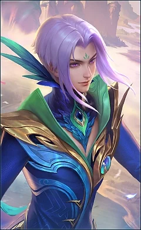

[Tier list](https://boostmlbb.ru/en/heroes/)[Items](https://boostmlbb.ru/en/items/)[Skins](https://boostmlbb.ru/en/skins/)[News & guides](https://boostmlbb.ru/en/news/)

# Gusion

B

AssassinMid LaneJungle

Win rate

48.9%

Pick rate

1.1%

Ban rate

1.8%

[Overview](https://boostmlbb.ru/#overview)[Build](https://boostmlbb.ru/#build)[How to play](https://boostmlbb.ru/#howto)[Skills](https://boostmlbb.ru/#skills)[Counters](https://boostmlbb.ru/#draft)[Skins](https://boostmlbb.ru/#skins)[Lore](https://boostmlbb.ru/#lore)

## Overview

### Attributes

-   Durability**30**
-   Offense**90**
-   Control**10**
-   Difficulty**80**

-   Burst
-   Magic Damage

### Win rate by rank, 30 days

1.  **48.9%**Epic
2.  **48.5%**Legend
3.  **48.4%**Mythic
4.  **48.6%**Honor
5.  **48.8%**Glory

Dashed line: 50% win rate

### More assassins on this lane

[Nolan](https://boostmlbb.ru/en/heroes/nolan.html)[Hirara](https://boostmlbb.ru/en/heroes/hirara.html)[Selena](https://boostmlbb.ru/en/heroes/selena.html)[Saber](https://boostmlbb.ru/en/heroes/saber.html)[Harley](https://boostmlbb.ru/en/heroes/harley.html)[Fanny](https://boostmlbb.ru/en/heroes/fanny.html)[Ling](https://boostmlbb.ru/en/heroes/ling.html)[Kadita](https://boostmlbb.ru/en/heroes/kadita.html)

### Places in the rankings

-   [Best MLBB junglers**17 of 37**](https://boostmlbb.ru/en/heroes/best-jungle.html)
-   [Best MLBB assassins**16 of 29**](https://boostmlbb.ru/en/heroes/best-assassin.html)
-   [Best MLBB mid laners**15 of 29**](https://boostmlbb.ru/en/heroes/best-mid.html)

## Build

Build 1Build 2

Win rate

55.7%

Pick rate

3.2%

#### Core items

-   [

    

    Genius Wand

    ](https://boostmlbb.ru/en/items/genius-wand.html)
-   [

    

    Lightning Truncheon

    ](https://boostmlbb.ru/en/items/lightning-truncheon.html)
-   [

    

    Holy Crystal

    ](https://boostmlbb.ru/en/items/holy-crystal.html)

#### Spell

Petrify

#### Emblem and talents

Mage

-   

    Rupture

-   

    Weapons Master

-   

    Lethal Ignition

Win rate

55.5%

Pick rate

1.2%

#### Core items

-   [

    

    Genius Wand

    ](https://boostmlbb.ru/en/items/genius-wand.html)
-   [

    

    Holy Crystal

    ](https://boostmlbb.ru/en/items/holy-crystal.html)
-   [

    

    Lightning Truncheon

    ](https://boostmlbb.ru/en/items/lightning-truncheon.html)

#### Spell

Petrify

#### Emblem and talents

Assassin

-   

    Rupture

-   

    Pull Yourself Together

-   

    Lethal Ignition

## How to play Gusion

### Gusion combos

#### Teamfight

1.  2
2.  Ult
3.  2
4.  1
5.  1
6.  2
7.  Attack

In teamfights, Gusion should first use his 2nd Skill for damage, then his Ultimate to reset the cooldown for his 2nd Skill. Follow up with his 2nd and 1st Skill combo for more damage. And use his 2nd Skill again to recall all 10 daggers right after moving behind a target with his 1st Skill for massive damage. He can then finish off any remaining low-HP heroes and escape with his Ultimate.

#### Laning

1.  1
2.  2
3.  1
4.  2
5.  Attack

In the laning phase, Gusion can use his 1st Skill to mark the enemies, then use his 2nd Skill to slow them down. Next, he can use his 1st Skill again to move behind a target enemy and use his 2nd Skill again to deal massive damage. And finally, use his Basic Attacks to finish off the target.

### When strongest

Stronger late: 50.9% after minute 20. Do not take risks early, farm and fight together with your team.

1.  **41.2**10–12
2.  **45.5**12–14
3.  **48.1**14–16
4.  **50.1**16–18
5.  **50.5**18–20
6.  **50.9**20+

Win rate % by match length in minutes, all ranks. Dashed line: 50%

### Level-up priority

1.  Incandescence
2.  Shadowblade Slaughter
3.  Sword Spike

## Skills

Passive**Dagger Specialist**Skill 1**Sword Spike**Skill 2**Shadowblade Slaughter**Ultimate**Incandescence**

Passive

### Dagger Specialist

Each skill cast adds a rune to Gusion's dagger (stacks up to 4 times). Each stack enhances Gusion's next Basic Attack to deal additional damage equal to 3% of the target's and recover 50 (+25% Total Magic Power) HP for himself.

Skill 1

### Sword Spike

Cooldown **9 Mana Cost: 50 s**

Gusion throws a dagger in the target direction, dealing 200 (+50% Total Magic Power) Magic Damage to the first enemy hit and marking them.

**Use Again:** Gusion moves behind the marked enemy, dealing 200 (+100% Total Magic Power) Magic Damage to them. This skill cannot be interrupted while Gusion is moving behind the marked enemy.

Skill 2

### Shadowblade Slaughter

Cooldown **9 Mana Cost: 60 s**

Gusion throws a volley of daggers in the target direction, each dealing 100 (+40% Total Magic Power) Magic Damage to enemies hit and slowing them by 6% for 2s (when hit by multiple daggers, the slow effect can stack up to 30%).

**Use Again:** Gusion recalls the daggers, each dealing 65 (+40% Total Magic Power) Magic Damage to enemies in its path.

Ultimate

### Incandescence

Cooldown **24 Mana Cost: 100 s**

Gusion dashes to the target location, resetting the cooldowns of Sword Spike and Shadowblade Slaughter. If Shadowblade Slaughter was cast once before the reset, Gusion can throw another five daggers on his next Shadowblade Slaughter cast, and recall a total of ten daggers afterward.

**Use Again:** Gusion dashes a short distance in the target direction.

## Gusion counters

### Who counters Gusion

[Aamon](https://boostmlbb.ru/en/heroes/aamon.html)[Yve](https://boostmlbb.ru/en/heroes/yve.html)[Valir](https://boostmlbb.ru/en/heroes/valir.html)[X.Borg](https://boostmlbb.ru/en/heroes/x-borg.html)[Natalia](https://boostmlbb.ru/en/heroes/natalia.html)

### Who Gusion counters

[Roger](https://boostmlbb.ru/en/heroes/roger.html)

## Gusion skins

[Desert SpiderExceptional · 2024](https://boostmlbb.ru/en/skins/gusion/desert-spider.html)[K'Grand · 2024](https://boostmlbb.ru/en/skins/gusion/k.html)[Dimension WalkerGrand · 2023](https://boostmlbb.ru/en/skins/gusion/dimension-walker.html)[Soul RevelationDeluxe · 2023](https://boostmlbb.ru/en/skins/gusion/soul-revelation.html)[Cosmic GleamSupreme · 2022](https://boostmlbb.ru/en/skins/gusion/cosmic-gleam.html)[Night OwlExquisite · 2021](https://boostmlbb.ru/en/skins/gusion/night-owl.html)[V.E.N.O.M. Emperor ScorpionDeluxe · 2019](https://boostmlbb.ru/en/skins/gusion/v-e-n-o-m-emperor-scorpion.html)[Dangerous LiaisonExceptional · 2019](https://boostmlbb.ru/en/skins/gusion/dangerous-liaison.html)[Cyber OpsExceptional · 2018](https://boostmlbb.ru/en/skins/gusion/cyber-ops.html)[Hairsty­listCommon · 2018](https://boostmlbb.ru/en/skins/gusion/hairstylist.html)[Moonlight SonataCommon · 2018](https://boostmlbb.ru/en/skins/gusion/moonlight-sonata.html)[Minato Namikaze](https://boostmlbb.ru/en/skins/gusion/minato-namikaze.html)

[All 12 Gusion skins: prices and how to get them](https://boostmlbb.ru/en/skins/gusion.html)

## Lore

> Rebellious son of House Paxley.

[Read the full story ↗](https://play.mobilelegends.com/lore/hero/Gusion)Official Mobile Legends site [Hero stats on the game site ↗](https://www.mobilelegends.com/hero/detail?heroid=56)

**Rank up on Gusion**The calculator shows the price

[Calculate price](https://boostmlbb.ru/en/order.html?type=hero)

## Frequently asked questions

Who counters Gusion in MLBB?

Over the last 30 days the toughest opponents are Aamon, Yve, Valir, X.Borg and Natalia.

How do you play Gusion?

Level "Shadowblade Slaughter" first and take the ultimate whenever it is available. Stronger late: 50.9% after minute 20. Do not take risks early, farm and fight together with your team. Teamfight combo: In teamfights, Gusion should first use his 2nd Skill for damage, then his Ultimate to reset the cooldown for his 2nd Skill. Follow up with his 2nd and 1st Skill combo for more damage. And use his 2nd Skill again to recall all 10 daggers right after moving behind a target with his 1st Skill for massive damage. He can then finish off any remaining low-HP heroes and escape with his Ultimate.

What is Gusion’s win rate right now?

48.91% at Mythical Glory over the last 7 days and 48.64% across all ranks over 30 days, as of 25 November 2026.

What role and lane does Gusion play?

Assassin, played in the Mid Lane or in the jungle.

Is Gusion strong in the current meta?

Tier B, #68 of 133 heroes and #16 among assassins. The tier counts how often the hero is picked and banned and how well it wins at Mythical Glory over 7 days: banned in 1.8% of matches, 48.9% win rate. In professional games over the last month the hero is drafted in 0.0% of them.

What is the best build for Gusion?

The most popular ranked build: Genius Wand, Lightning Truncheon and Holy Crystal as core items, the Mage emblem with Rupture, Weapons Master and Lethal Ignition, and Petrify. It wins 55.72% of matches.
