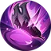
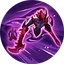

[Home](https://boostmlbb.ru/en/) / [Heroes](https://boostmlbb.ru/en/heroes/)

Tier B

# Hanzo

Assassin · Jungle

**#70 of 133 by win rate**All ranks · 30 days to 23 November 2026

Win rate

49.90%

Pick rate

0.36%

Ban rate

5.82%

Poke · Burst · Difficulty 50/100

[Build](https://boostmlbb.ru/#build)[Counters and teammates](https://boostmlbb.ru/#draft)[Skills](https://boostmlbb.ru/#skills)[Win rate by rank](https://boostmlbb.ru/#ranks)[Lore](https://boostmlbb.ru/#lore)

## Build

Most picked in ranked · Jungle

Core items

Sky PiercerGolden StaffCorrosion Scythe

Emblem and talents

SupportSwiftWilderness BlessingWar Cry

Battle spell

Retribution

Wins with this build **55.42%**Picked in **2.65%** of matches

Alternative builds (2)

Core items

Thunder BeltGolden StaffBrute Force Breastplate

Emblem and talents

SupportInspireWilderness BlessingConcussive Blast

Battle spell

Retribution

Wins with this build **53.88%**Picked in **5.53%** of matches

Core items

Thunder BeltBrute Force BreastplateOracle

Emblem and talents

SupportInspireWilderness BlessingConcussive Blast

Battle spell

Retribution

Wins with this build **52.79%**Picked in **2.80%** of matches

## Counters and teammates

### Counters

[Diggie](https://boostmlbb.ru/en/heroes/diggie.html)[Ixia](https://boostmlbb.ru/en/heroes/ixia.html)[Franco](https://boostmlbb.ru/en/heroes/franco.html)[Balmond](https://boostmlbb.ru/en/heroes/balmond.html)[Alpha](https://boostmlbb.ru/en/heroes/alpha.html)

### Strong against

[Obsidia](https://boostmlbb.ru/en/heroes/obsidia.html)[Kagura](https://boostmlbb.ru/en/heroes/kagura.html)[Ling](https://boostmlbb.ru/en/heroes/ling.html)[Hirara](https://boostmlbb.ru/en/heroes/hirara.html)[Aldous](https://boostmlbb.ru/en/heroes/aldous.html)[Natalia](https://boostmlbb.ru/en/heroes/natalia.html)

### Teammates

Win rate gain when playing together

[Angela+2.17 pp](https://boostmlbb.ru/en/heroes/angela.html)[Hilda+1.63 pp](https://boostmlbb.ru/en/heroes/hilda.html)[Dyrroth+1.60 pp](https://boostmlbb.ru/en/heroes/dyrroth.html)[Aldous+1.55 pp](https://boostmlbb.ru/en/heroes/aldous.html)

## Skills

Level-up priority · Kinjutsu: Pinnacle Ninja → Ninjutsu: Demon Feast → Ninjutsu: Dark Mist

Passive**Ame no Habakiri**

Damage dealt by Hanzo's Basic Attacks and skills inflicts a stack of Dark Ninjutsu on the target, up to 5 stacks. Ninjutsu: Demon Feast can only be cast on targets with full stacks of Dark Ninjutsu.

Skill 1**Ninjutsu: Demon Feast**

The skill can only be used on targets with max stacks of Dark Ninjutsu. When targeting a creep, Hanzo will immediately devour it and digest it over a period of time to recover 20% HP.
When targeting the Turtle, Lord, or enemy heroes, he deals 600 (+120% Extra Physical Attack) Physical Damage, recovers 150 (+80% Total Physical Attack) HP, and reduces this skill's cooldown by 60%.

Skill 2**Ninjutsu: Dark Mist**

**Cooldown 10 s**

Hanzo dashes in the target direction, leaving dark mist in front that deals 90 (+45% Extra Physical Attack) Physical Damage to enemies in the area every 0.5s, up to 5 times (this damage counts as Basic Attack damage but cannot Crit).
The dark mist slows enemies in the area by 40% and grants Hanzo 20% Movement Speed.

Ultimate**Kinjutsu: Pinnacle Ninja**

**Cooldown 36 s**

Hanzo charges into battle as Hanekage, consuming 170 Energy per second. He gains 20 Energy when a non-hero unit dies nearby and 200 Energy when it's a hero. He gains 15 Energy when attacking a hero, and 45 Energy when attacking the Turtle or the Lord. When Energy runs out, Hanzo's body will be slowly drawn to Hanekage's position.
While in Hanekage form, Hanzo's body is invincible, while Hanekage ignores obstacles and gains 50% Movement Speed and 30% Attack Speed.
Use Again or Upon Death: Hanekage returns to Hanzo's body, recovering 360 (+100% Extra Physical Attack) HP and becoming untargetable during the return. If Hanekage is killed, Hanzo will be slowed by 50% and revealed for 6s, and the skill's cooldown will be doubled.

## Win rate by rank

-   Epic**50.77%**
-   Legend**50.90%**
-   Mythic**50.58%**
-   Mythical Honor**50.23%**
-   Mythical Glory**48.83%**

## Lore

Genius ninja in the Shadow Sect who is at the crossroads.

[Hero card](https://www.mobilelegends.com/hero/detail?heroid=69)[MLBB Wiki](https://mobile-legends.fandom.com/wiki/Hanzo)

[Hero boost pricing](https://boostmlbb.ru/en/order.html?type=hero)

## Frequently asked questions

Who counters Hanzo in MLBB?

Over the last 30 days the toughest opponents are Diggie, Ixia, Franco, Balmond and Alpha.

What is Hanzo’s win rate right now?

49.90% over the last 30 days across all ranks and 48.83% in Mythical Glory, as of 23 November 2026.

What role and lane does Hanzo play?

Assassin, played in the jungle.

Is Hanzo strong in the current meta?

Tier B: #70 of 133 heroes by 30-day win rate and #10 among assassins.

What is the best build for Hanzo?

The most popular ranked build: Sky Piercer, Golden Staff and Corrosion Scythe as core items, the Support emblem with Swift, Wilderness Blessing and War Cry, and Retribution. It wins 55.42% of matches.
