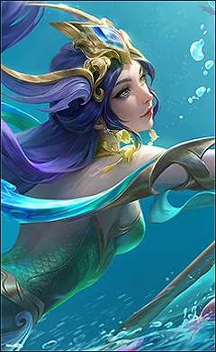
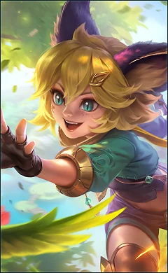

[Tier list](https://boostmlbb.ru/en/heroes/)[Items](https://boostmlbb.ru/en/items/)[Skins](https://boostmlbb.ru/en/skins/)[News & guides](https://boostmlbb.ru/en/news/)

[Tier list](https://boostmlbb.ru/en/heroes/)

# Harley

B

AssassinMageMid LaneJungle

Win rate

48.8%

Pick rate

0.7%

Ban rate

0.8%

[Overview](https://boostmlbb.ru/#overview)[Build](https://boostmlbb.ru/#build)[How to play](https://boostmlbb.ru/#howto)[Skills](https://boostmlbb.ru/#skills)[Counters](https://boostmlbb.ru/#draft)[Skins](https://boostmlbb.ru/#skins)[Lore](https://boostmlbb.ru/#lore)

## Overview

### Attributes

-   Durability**30**
-   Offense**90**
-   Control**10**
-   Difficulty**40**

-   Burst
-   Poke

### Win rate by rank, 30 days

1.  **48.0%**Epic
2.  **48.1%**Legend
3.  **48.2%**Mythic
4.  **48.1%**Honor
5.  **48.5%**Glory

Dashed line: 50% win rate

### More assassins on this lane

[Nolan](https://boostmlbb.ru/en/heroes/nolan.html)[Hirara](https://boostmlbb.ru/en/heroes/hirara.html)[Selena](https://boostmlbb.ru/en/heroes/selena.html)[Saber](https://boostmlbb.ru/en/heroes/saber.html)[Fanny](https://boostmlbb.ru/en/heroes/fanny.html)[Ling](https://boostmlbb.ru/en/heroes/ling.html)[Kadita](https://boostmlbb.ru/en/heroes/kadita.html)[Karina](https://boostmlbb.ru/en/heroes/karina.html)

### Places in the rankings

-   [Best MLBB junglers**11 of 37**](https://boostmlbb.ru/en/heroes/best-jungle.html)
-   [Best MLBB mages**11 of 32**](https://boostmlbb.ru/en/heroes/best-mage.html)
-   [Best MLBB assassins**9 of 29**](https://boostmlbb.ru/en/heroes/best-assassin.html)
-   [Best MLBB mid laners**9 of 29**](https://boostmlbb.ru/en/heroes/best-mid.html)

## Build

Build 1Build 2Build 3

Win rate

49.0%

Pick rate

1.4%

#### Core items

-   [

    

    Concentrated Energy

    ](https://boostmlbb.ru/en/items/concentrated-energy.html)
-   [

    

    Genius Wand

    ](https://boostmlbb.ru/en/items/genius-wand.html)
-   [

    

    Glowing Wand

    ](https://boostmlbb.ru/en/items/glowing-wand.html)

#### Spell

Flameshot

#### Emblem and talents

Assassin

-   

    Rupture

-   

    Seasoned Hunter

-   

    Impure Rage

Win rate

48.8%

Pick rate

1.1%

#### Core items

-   [

    

    Genius Wand

    ](https://boostmlbb.ru/en/items/genius-wand.html)
-   [

    

    Lightning Truncheon

    ](https://boostmlbb.ru/en/items/lightning-truncheon.html)
-   [

    

    Glowing Wand

    ](https://boostmlbb.ru/en/items/glowing-wand.html)

#### Spell

Flameshot

#### Emblem and talents

Assassin

-   

    Rupture

-   

    Bargain Hunter

-   

    Lethal Ignition

Win rate

45.1%

Pick rate

1.0%

#### Core items

-   [

    

    Sky Piercer

    ](https://boostmlbb.ru/en/items/sky-piercer.html)
-   [

    

    Genius Wand

    ](https://boostmlbb.ru/en/items/genius-wand.html)
-   [

    

    Lightning Truncheon

    ](https://boostmlbb.ru/en/items/lightning-truncheon.html)

#### Spell

Flameshot

#### Emblem and talents

Assassin

-   

    Rupture

-   

    Seasoned Hunter

-   

    Lethal Ignition

## How to play Harley

### Harley combos

#### Teamfight

1.  2
2.  Ult
3.  1
4.  2

In teamfights, use Harley's 2nd Skill to find a good position to land his Ultimate. Then cast his Ultimate at the target, and follow up with his 1st Skill before moving back to safety with his 2nd Skill.

#### Laning

1.  2
2.  1
3.  Attack
4.  2

In the laning phase, first use Harley's 2nd Skill to get a good angle to cast his 1st Skill, and follow up with Basic Attacks. Then use his 2nd Skill again to get back to safety.

### When strongest

Stronger late: 49.1% after minute 20. Do not take risks early, farm and fight together with your team.

1.  **31.9**10–12
2.  **39.0**12–14
3.  **43.5**14–16
4.  **46.3**16–18
5.  **47.5**18–20
6.  **49.1**20+

Win rate % by match length in minutes, all ranks. Dashed line: 50%

### Level-up priority

1.  Deadly Magic
2.  Poker Trick
3.  Space Escape

## Skills

Passive**Magic Master**Skill 1**Poker Trick**Skill 2**Space Escape**Ultimate**Deadly Magic**

Passive

### Magic Master

Harley's mastery of magic allows his Basic Attacks and skills to reduce the enemy's by 2 and increase his Attack Speed by 5% - 10% (scales with hero level) for 3s on hit. This effect stacks up to 10 times.

Harley's Basic Attacks deal 60 (+50% Total Physical Attack)(+60% Total Magic Power) Magic Damage.

Skill 1

### Poker Trick

Cooldown **6 Mana Cost: 55 s**

Harley throws 3 waves of cards, 3 cards per wave. Each card deals 120 (+25% Total Magic Power) Magic Damage to enemies.

After the same target is hit 3 time(s), the damage will decay to 50% on subsequent hits.

Skill 2

### Space Escape

Cooldown **9 Mana Cost: 75 s**

Harley blinks in the designated direction, leaving a magic hat at his starting location. His Movement Speed increases by 60% for 2s, then rapidly decays to normal over 4s.

**Use Again:** Return to the hat's location.

Ultimate

### Deadly Magic

Cooldown **36 Mana Cost: 120 s**

Harley casts a magic ring of fire at an enemy hero, dealing 200 (+60% Total Magic Power) Magic Damage and a 40% slow effect that decays to 15% after 1.5s. The ring will stay around the target, during which Harley can hit the ring to damage the target. The ring will explode after 4s, dealing Magic Damage equal to 200 (+50% Total Magic Power) plus 30% of the damage taken by the target while the ring was active.

## Harley counters

### Who counters Harley

[Alice](https://boostmlbb.ru/en/heroes/alice.html)[Valir](https://boostmlbb.ru/en/heroes/valir.html)[Melissa](https://boostmlbb.ru/en/heroes/melissa.html)[Joy](https://boostmlbb.ru/en/heroes/joy.html)[Gord](https://boostmlbb.ru/en/heroes/gord.html)

### Who Harley counters

[Sun](https://boostmlbb.ru/en/heroes/sun.html)[Hilda](https://boostmlbb.ru/en/heroes/hilda.html)[Popol and Kupa](https://boostmlbb.ru/en/heroes/popol-and-kupa.html)[Roger](https://boostmlbb.ru/en/heroes/roger.html)[Lolita](https://boostmlbb.ru/en/heroes/lolita.html)

## Harley skins

[Dreaming KoiExceptional · 2026](https://boostmlbb.ru/en/skins/harley/dreaming-koi.html)[Star MagicianCommon · 2024](https://boostmlbb.ru/en/skins/harley/star-magician.html)[Pulsar ProdigyExceptional · 2023](https://boostmlbb.ru/en/skins/harley/pulsar-prodigy.html)[Dream CasterExquisite · 2021](https://boostmlbb.ru/en/skins/harley/dream-caster.html)[V.E.N.O.M. OctopusDeluxe · 2019](https://boostmlbb.ru/en/skins/harley/v-e-n-o-m-octopus.html)[Great InventorDeluxe · 2018](https://boostmlbb.ru/en/skins/harley/great-inventor.html)[RefereeExceptional · 2018](https://boostmlbb.ru/en/skins/harley/referee.html)[Royal MagisterExceptional · 2018](https://boostmlbb.ru/en/skins/harley/royal-magister.html)[Naughty JokerCommon · 2017](https://boostmlbb.ru/en/skins/harley/naughty-joker.html)

[All 9 Harley skins: prices and how to get them](https://boostmlbb.ru/en/skins/harley.html)

## Lore

> The young mage whose powers awakened once thrust into danger and who now arrives at the Magic Academy to study.

[Read the full story ↗](https://play.mobilelegends.com/lore/hero/Harley)Official Mobile Legends site [Hero stats on the game site ↗](https://www.mobilelegends.com/hero/detail?heroid=42)

**Rank up on Harley**The calculator shows the price

[Calculate price](https://boostmlbb.ru/en/order.html?type=hero)

## Frequently asked questions

Who counters Harley in MLBB?

Over the last 30 days the toughest opponents are Alice, Valir, Melissa, Joy and Gord.

How do you play Harley?

Level "Poker Trick" first and take the ultimate whenever it is available. Stronger late: 49.1% after minute 20. Do not take risks early, farm and fight together with your team. Teamfight combo: In teamfights, use Harley's 2nd Skill to find a good position to land his Ultimate. Then cast his Ultimate at the target, and follow up with his 1st Skill before moving back to safety with his 2nd Skill.

What is Harley’s win rate right now?

48.77% at Mythical Glory over the last 7 days and 48.26% across all ranks over 30 days, as of 25 November 2026.

What role and lane does Harley play?

Assassin and mage, played in the Mid Lane or in the jungle.

Is Harley strong in the current meta?

Tier B, #44 of 133 heroes and #9 among assassins. The tier counts how often the hero is picked and banned and how well it wins at Mythical Glory over 7 days: banned in 0.8% of matches, 48.8% win rate. In professional games over the last month the hero is drafted in 22.9% of them.

What is the best build for Harley?

The most popular ranked build: Concentrated Energy, Genius Wand and Glowing Wand as core items, the Assassin emblem with Rupture, Seasoned Hunter and Impure Rage, and Flameshot. It wins 48.97% of matches.
