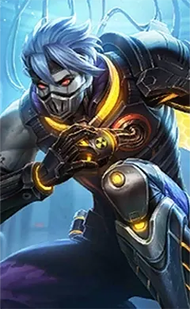

[Tier list](https://boostmlbb.ru/en/heroes/)

# Hayabusa

C

AssassinJungle

Win rate

48.4%

Pick rate

0.7%

Ban rate

0.6%

[Overview](https://boostmlbb.ru/#overview)[Build](https://boostmlbb.ru/#build)[How to play](https://boostmlbb.ru/#howto)[Skills](https://boostmlbb.ru/#skills)[Counters](https://boostmlbb.ru/#draft)[Skins](https://boostmlbb.ru/#skins)[Lore](https://boostmlbb.ru/#lore)

## Overview

### Attributes

-   Durability**40**
-   Offense**50**
-   Control**10**
-   Difficulty**60**

-   Chase
-   Burst

### More assassins on this lane

[Nolan](https://boostmlbb.ru/en/heroes/nolan.html)[Hirara](https://boostmlbb.ru/en/heroes/hirara.html)[Saber](https://boostmlbb.ru/en/heroes/saber.html)[Harley](https://boostmlbb.ru/en/heroes/harley.html)[Fanny](https://boostmlbb.ru/en/heroes/fanny.html)[Ling](https://boostmlbb.ru/en/heroes/ling.html)[Karina](https://boostmlbb.ru/en/heroes/karina.html)[Yi Sun-shin](https://boostmlbb.ru/en/heroes/yi-sun-shin.html)

### Places in the rankings

-   [Best MLBB junglers**19 of 37**](https://boostmlbb.ru/en/heroes/best-jungle.html)
-   [Best MLBB assassins**17 of 29**](https://boostmlbb.ru/en/heroes/best-assassin.html)

## Build

Build 1Build 2Build 3

Win rate

51.4%

Pick rate

14.0%

#### Core items

-   [

    

    Hunter Strike

    ](https://boostmlbb.ru/en/items/hunter-strike.html)
-   [

    

    War Axe

    ](https://boostmlbb.ru/en/items/war-axe.html)
-   [

    

    Malefic Roar

    ](https://boostmlbb.ru/en/items/malefic-roar.html)

#### Spell

Retribution

#### Emblem and talents

Assassin

-   

    Thrill

-   

    Seasoned Hunter

-   

    War Cry

Win rate

55.1%

Pick rate

12.7%

#### Core items

-   [

    

    Hunter Strike

    ](https://boostmlbb.ru/en/items/hunter-strike.html)
-   [

    

    Sky Piercer

    ](https://boostmlbb.ru/en/items/sky-piercer.html)
-   [

    

    War Axe

    ](https://boostmlbb.ru/en/items/war-axe.html)

#### Spell

Retribution

#### Emblem and talents

Assassin

-   

    Thrill

-   

    Seasoned Hunter

-   

    War Cry

Win rate

52.0%

Pick rate

7.9%

#### Core items

-   [

    

    Hunter Strike

    ](https://boostmlbb.ru/en/items/hunter-strike.html)
-   [

    

    Sky Piercer

    ](https://boostmlbb.ru/en/items/sky-piercer.html)
-   [

    

    Malefic Roar

    ](https://boostmlbb.ru/en/items/malefic-roar.html)

#### Spell

Retribution

#### Emblem and talents

Assassin

-   

    Thrill

-   

    Seasoned Hunter

-   

    War Cry

## How to play Hayabusa

### Hayabusa combos

#### Teamfight

1.  2
2.  1
3.  2
4.  Ult
5.  1
6.  2

In teamfights, Hayabusa should use his 2nd Skill to hit an enemy with his phantom, then use his 1st and 2nd Skill on the target to apply Shadow Mark before unleashing his Ultimate. Afterwards, use his 1st Skill to finish off the enemy and escape with his 2nd Skill.

#### Laning

1.  2
2.  1
3.  2
4.  2
5.  1
6.  Ult

In the laning phase, use Hayabusa's 2nd Skill to hit the enemy with a phantom, then strike with his 1st Skill, and use his 2nd Skill to blink away. Wait until Hayabusa's 1st Skill is off cooldown, then blink back to the enemy with his 2nd Skill and strike again with his 1st Skill followed by his Ultimate to secure the kill.

### When strongest

Even through the game, from 47.8% to 49.0%. Pick fights by your items rather than the clock.

1.  **48.9**10–12
2.  **48.3**12–14
3.  **47.8**14–16
4.  **48.0**16–18
5.  **48.3**18–20
6.  **49.0**20+

Win rate % by match length in minutes, all ranks. Dashed line: 50%

### Level-up priority

1.  Ougi: Shadow Kill
2.  Ninjutsu: Phantom Shuriken
3.  Ninjutsu: Quad Shadow

## Skills

Passive**Ninjutsu: Trace of Shadow**Skill 1**Ninjutsu: Phantom Shuriken**Skill 2**Ninjutsu: Quad Shadow**Ultimate**Ougi: Shadow Kill**

Passive

### Ninjutsu: Trace of Shadow

Hayabusa's attacks apply a stack of Shadow Mark on hit (up to 4 stacks). Each stack lasts 6s and increases Hayabusa's damage to the enemy by 5%.

Skill 1

### Ninjutsu: Phantom Shuriken

Cooldown **4 Energy Cost: 30 s**

**Passive:** Hayabusa permanently gains 3% Spell Vamp.

**Active:** Hayabusa throws three returning shurikens in the target direction, each dealing 220 (+75% Extra Physical Attack) Physical Damage to enemies hit and slowing them by 35% for 2s. Subsequent hits on the same enemy deal 70% less damage (only 50% less to creeps). He also restores 10 Energy when hitting non-minion enemies.

Skill 2

### Ninjutsu: Quad Shadow

Cooldown **16 Energy Cost: 25 s**

Hayabusa dashes in the target direction and releases four phantoms that travel in separate directions. The phantoms will remain at the end of their paths or attach themselves to the first enemy hero hit, dealing 130 (+30% Extra Physical Attack) Physical Damage and slowing them by 40% for 2s. Hayabusa will immediately stop if he hits an enemy hero during the dash.

**Use Again:** Hayabusa teleports to a phantom's location and reduces the cooldown of Ninjutsu: Phantom Shuriken by 1s. If the phantom is attached to an enemy hero, he also deals 130 (+30% Extra Physical Attack) Physical Damage to the enemy.

Ultimate

### Ougi: Shadow Kill

Cooldown **40 s**

Hayabusa blends into the shadows and launches 6 single-target attacks on enemies in the area, each dealing 130 (+30% Extra Physical Attack) Physical Damage.

The attacks prioritize enemies with Shadow Mark and each will consume a mark to deal 90 (+40% Extra Physical Attack) extra Physical Damage. Shadow Kill does not apply Shadow Mark.

## Hayabusa counters

### Who counters Hayabusa

[Aamon](https://boostmlbb.ru/en/heroes/aamon.html)[Yve](https://boostmlbb.ru/en/heroes/yve.html)[Zhuxin](https://boostmlbb.ru/en/heroes/zhuxin.html)[Nolan](https://boostmlbb.ru/en/heroes/nolan.html)[Karrie](https://boostmlbb.ru/en/heroes/karrie.html)

### Who Hayabusa counters

[Badang](https://boostmlbb.ru/en/heroes/badang.html)

## Hayabusa skins

[Kitsune's ShadowExceptional · 2026](https://boostmlbb.ru/en/skins/hayabusa/kitsune-s-shadow.html)[Kakashi HatakeGrand · 2025](https://boostmlbb.ru/en/skins/hayabusa/kakashi-hatake.html)[Exorcist HayabusaGrand · 2024](https://boostmlbb.ru/en/skins/hayabusa/exorcist-hayabusa.html)[Techie NinjaCommon · 2022](https://boostmlbb.ru/en/skins/hayabusa/techie-ninja.html)[ShuraGrand · 2021](https://boostmlbb.ru/en/skins/hayabusa/shura.html)[Biological WeaponExceptional · 2020](https://boostmlbb.ru/en/skins/hayabusa/biological-weapon.html)[Shadow of ObscurityExquisite · 2019](https://boostmlbb.ru/en/skins/hayabusa/shadow-of-obscurity.html)[Sushi MasterExceptional · 2019](https://boostmlbb.ru/en/skins/hayabusa/sushi-master.html)[Experiment 21Exquisite · 2018](https://boostmlbb.ru/en/skins/hayabusa/experiment-21.html)[Future EnforcerCommon · 2017](https://boostmlbb.ru/en/skins/hayabusa/future-enforcer.html)[Spacetime ShadowCommon · 2016](https://boostmlbb.ru/en/skins/hayabusa/spacetime-shadow.html)

[All 11 Hayabusa skins: prices and how to get them](https://boostmlbb.ru/en/skins/hayabusa.html)

## Lore

> The young leader of the Shadow Sect who wields his blade through moonless nights, walking the path of nindo without fear.

[Read the full story ↗](https://play.mobilelegends.com/lore/hero/Hayabusa)Official Mobile Legends site [Hero stats on the game site ↗](https://www.mobilelegends.com/hero/detail?heroid=21)

**Rank up on Hayabusa**The calculator shows the price

[Calculate price](https://boostmlbb.ru/en/order.html?type=hero)

## Frequently asked questions

Who counters Hayabusa in MLBB?

Over the last 30 days the toughest opponents are Aamon, Yve, Zhuxin, Nolan and Karrie.

How do you play Hayabusa?

Level "Ninjutsu: Phantom Shuriken" first and take the ultimate whenever it is available. Even through the game, from 47.8% to 49.0%. Pick fights by your items rather than the clock. Teamfight combo: In teamfights, Hayabusa should use his 2nd Skill to hit an enemy with his phantom, then use his 1st and 2nd Skill on the target to apply Shadow Mark before unleashing his Ultimate. Afterwards, use his 1st Skill to finish off the enemy and escape with his 2nd Skill.

What is Hayabusa’s win rate right now?

48.40% at Mythical Glory over the last 7 days and 48.19% across all ranks over 30 days, as of 27 November 2026.

What role and lane does Hayabusa play?

Assassin, played in the jungle.

Is Hayabusa strong in the current meta?

Tier C, #79 of 133 heroes and #17 among assassins. The tier counts how often the hero is picked and banned and how well it wins at Mythical Glory over 7 days: banned in 0.6% of matches, 48.4% win rate. In professional games over the last month the hero is drafted in 3.1% of them.

What is the best build for Hayabusa?

The most popular ranked build: Hunter Strike, War Axe and Malefic Roar as core items, the Assassin emblem with Thrill, Seasoned Hunter and War Cry, and Retribution. It wins 51.40% of matches.
