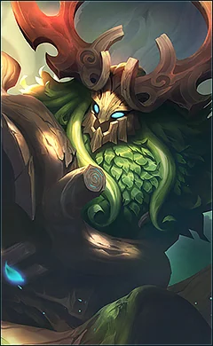

[Tier list](https://boostmlbb.ru/en/heroes/)[Items](https://boostmlbb.ru/en/items/)[Skins](https://boostmlbb.ru/en/skins/)[News & guides](https://boostmlbb.ru/en/news/)

# Hilda

C

TankFighterEXP LaneRoam

Win rate

48.7%

Pick rate

0.4%

Ban rate

4.0%

[Overview](https://boostmlbb.ru/#overview)[Build](https://boostmlbb.ru/#build)[How to play](https://boostmlbb.ru/#howto)[Skills](https://boostmlbb.ru/#skills)[Counters](https://boostmlbb.ru/#draft)[Skins](https://boostmlbb.ru/#skins)[Lore](https://boostmlbb.ru/#lore)

## Overview

### Attributes

-   Durability**90**
-   Offense**40**
-   Control**40**
-   Difficulty**10**

-   Damage
-   Regen

### Win rate by rank, 30 days

1.  **54.9%**Epic
2.  **53.5%**Legend
3.  **52.5%**Mythic
4.  **49.9%**Honor
5.  **47.9%**Glory

Dashed line: 50% win rate

### More tanks on this lane

[Masha](https://boostmlbb.ru/en/heroes/masha.html)[Carmilla](https://boostmlbb.ru/en/heroes/carmilla.html)[Belerick](https://boostmlbb.ru/en/heroes/belerick.html)[Atlas](https://boostmlbb.ru/en/heroes/atlas.html)[Alice](https://boostmlbb.ru/en/heroes/alice.html)[Esmeralda](https://boostmlbb.ru/en/heroes/esmeralda.html)[Gloo](https://boostmlbb.ru/en/heroes/gloo.html)[Barats](https://boostmlbb.ru/en/heroes/barats.html)

### Places in the rankings

-   [Best MLBB fighters**22 of 44**](https://boostmlbb.ru/en/heroes/best-fighter.html)
-   [Best MLBB tanks**14 of 25**](https://boostmlbb.ru/en/heroes/best-tank.html)
-   [Best MLBB roamers**19 of 34**](https://boostmlbb.ru/en/heroes/best-roam.html)

## Build

Build 1Build 2Build 3

Win rate

58.2%

Pick rate

6.8%

#### Core items

-   [

    

    Thunder Belt

    ](https://boostmlbb.ru/en/items/thunder-belt.html)
-   [

    

    Dominance Ice

    ](https://boostmlbb.ru/en/items/dominance-ice.html)
-   [

    

    Oracle

    ](https://boostmlbb.ru/en/items/oracle.html)

#### Spell

Revitalize

#### Emblem and talents

Tank

-   

    Agility

-   

    Wilderness Blessing

-   

    Concussive Blast

Win rate

59.0%

Pick rate

2.9%

#### Core items

-   [

    

    Thunder Belt

    ](https://boostmlbb.ru/en/items/thunder-belt.html)
-   [

    

    Dominance Ice

    ](https://boostmlbb.ru/en/items/dominance-ice.html)
-   [

    

    Chastise Pauldron

    ](https://boostmlbb.ru/en/items/chastise-pauldron.html)

#### Spell

Revitalize

#### Emblem and talents

Tank

-   

    Thrill

-   

    Wilderness Blessing

-   

    Concussive Blast

Win rate

58.4%

Pick rate

2.5%

#### Core items

-   [

    

    Thunder Belt

    ](https://boostmlbb.ru/en/items/thunder-belt.html)
-   [

    

    Dominance Ice

    ](https://boostmlbb.ru/en/items/dominance-ice.html)
-   [

    

    Oracle

    ](https://boostmlbb.ru/en/items/oracle.html)

#### Spell

Revitalize

#### Emblem and talents

Support

-   

    Thrill

-   

    Wilderness Blessing

-   

    Concussive Blast

## How to play Hilda

### Hilda combos

#### Teamfight

1.  Ult
2.  2
3.  1
4.  Attack

In teamfights, Hilda should use her Ultimate to dive the back-row heroes, then use her 2nd Skill to deal damage and chase the enemy down with her 1st Skill.

#### Laning

1.  1
2.  Attack
3.  2
4.  Ult

In the laning phase, Hilda can use her 1st Skill to close in on a target enemy, and slow them with her Enhanced Basic Attack. She can then follow up with her 2nd Skill to chip away at her target and finish with her Ultimate.

### When strongest

Stronger late: 51.5% at 16–18 minutes. Do not take risks early, farm and fight together with your team.

1.  **45.2**10–12
2.  **49.1**12–14
3.  **51.6**14–16
4.  **51.5**16–18
5.  **51.3**18–20
6.  **51.1**20+

Win rate % by match length in minutes, all ranks. Dashed line: 50%

### Level-up priority

1.  Power of Wildness
2.  Art of Hunting
3.  Combat Ritual

## Skills

Passive**Blessing of Wilderness**Skill 1**Combat Ritual**Skill 2**Art of Hunting**Ultimate**Power of Wildness**

Passive

### Blessing of Wilderness

Hilda recovers 2% HP per second while in the bush. Entering a bush enhances her next Basic Attack, which deals 110 (+130% Total Physical Attack)(+12 × hero level) Physical Damage to the target, reduces the target's Movement Speed by 40%, and deals 40 (+100% Total Physical Attack)(+10 × hero level) Physical Damage to enemies behind the target. After using the enhanced Basic Attack, this effect enters a 6s cooldown.

Hilda's Basic Attack and skills apply a Wilderness Mark on hit, which lasts up to 4s and stacks up to 6 times. Each stack reduces the enemy hero's by 3%.

Skill 1

### Combat Ritual

Cooldown **10 s**

Hilda gains 60% Movement Speed for 3s and receives a shield that absorbs damage equal to 10% , lasting 3s.

Skill 2

### Art of Hunting

Cooldown **7 s**

Hilda locks onto an enemy target, dealing 200 (+90% Total Physical Attack) Physical Damage per hit. This skill can be cast up to 3 times. The 2nd attack deals extra damage to nearby enemies. The 3rd attack deals damage to the target and nearby enemies, knocking them back briefly.

Ultimate

### Power of Wildness

Cooldown **32 s**

Hilda launches a powerful slash at the target enemy, dealing 600 (+250% Extra Physical Attack) Physical Damage and stunning them for 0.2s. Nearby enemies take 60% of the damage.

Each stack of Wilderness Mark increases Power of Wildness's damage by 2.5% of the target's . At max stacks, the extra damage increases to 20% of the target's .

## Hilda counters

### Who counters Hilda

[Granger](https://boostmlbb.ru/en/heroes/granger.html)[Yin](https://boostmlbb.ru/en/heroes/yin.html)[Helcurt](https://boostmlbb.ru/en/heroes/helcurt.html)[Harley](https://boostmlbb.ru/en/heroes/harley.html)[Saber](https://boostmlbb.ru/en/heroes/saber.html)

### Who Hilda counters

[Carmilla](https://boostmlbb.ru/en/heroes/carmilla.html)[Kimmy](https://boostmlbb.ru/en/heroes/kimmy.html)[Aamon](https://boostmlbb.ru/en/heroes/aamon.html)

## Hilda skins

[Guardian Battalion2026](https://boostmlbb.ru/en/skins/hilda/guardian-battalion.html)[Bass CrazeExceptional · 2021](https://boostmlbb.ru/en/skins/hilda/bass-craze.html)[AriesDeluxe · 2019](https://boostmlbb.ru/en/skins/hilda/aries.html)[Sacred GuardCommon · 2018](https://boostmlbb.ru/en/skins/hilda/sacred-guard.html)[Flower of the WastesCommon · 2017](https://boostmlbb.ru/en/skins/hilda/flower-of-the-wastes.html)[Power of WildnessCommon · 2017](https://boostmlbb.ru/en/skins/hilda/power-of-wildness.html)

[All 6 Hilda skins: prices and how to get them](https://boostmlbb.ru/en/skins/hilda.html)

## Lore

> Inheritor of the Power of the Megalith.

[Read the full story ↗](https://play.mobilelegends.com/lore/hero/Hilda)Official Mobile Legends site [Hero stats on the game site ↗](https://www.mobilelegends.com/hero/detail?heroid=35)

**Rank up on Hilda**The calculator shows the price

[Calculate price](https://boostmlbb.ru/en/order.html?type=hero)

## Frequently asked questions

Who counters Hilda in MLBB?

Over the last 30 days the toughest opponents are Granger, Yin, Helcurt, Harley and Saber.

How do you play Hilda?

Level "Art of Hunting" first and take the ultimate whenever it is available. Stronger late: 51.5% at 16–18 minutes. Do not take risks early, farm and fight together with your team. Teamfight combo: In teamfights, Hilda should use her Ultimate to dive the back-row heroes, then use her 2nd Skill to deal damage and chase the enemy down with her 1st Skill.

What is Hilda’s win rate right now?

48.67% at Mythical Glory over the last 7 days and 51.07% across all ranks over 30 days, as of 25 November 2026.

What role and lane does Hilda play?

Tank and fighter, played in the EXP Lane or on roam.

Is Hilda strong in the current meta?

Tier C, #77 of 133 heroes and #14 among tanks. The tier counts how often the hero is picked and banned and how well it wins at Mythical Glory over 7 days: banned in 4.0% of matches, 48.7% win rate. In professional games over the last month the hero is drafted in 3.5% of them.

What is the best build for Hilda?

The most popular ranked build: Thunder Belt, Dominance Ice and Oracle as core items, the Tank emblem with Agility, Wilderness Blessing and Concussive Blast, and Revitalize. It wins 58.16% of matches.
