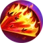

[Tier list](https://boostmlbb.ru/en/heroes/)

# Hirara

S

AssassinJungle

Win rate

49.5%

Pick rate

0.8%

Ban rate

84.4%

[Overview](https://boostmlbb.ru/#overview)[Build](https://boostmlbb.ru/#build)[How to play](https://boostmlbb.ru/#howto)[Skills](https://boostmlbb.ru/#skills)[Counters](https://boostmlbb.ru/#draft)[Skins](https://boostmlbb.ru/#skins)[Lore](https://boostmlbb.ru/#lore)

## Overview

### Attributes

-   Durability**40**
-   Offense**70**
-   Control**40**
-   Difficulty**60**

-   Chase
-   Finisher

### More assassins on this lane

[Nolan](https://boostmlbb.ru/en/heroes/nolan.html)[Saber](https://boostmlbb.ru/en/heroes/saber.html)[Harley](https://boostmlbb.ru/en/heroes/harley.html)[Fanny](https://boostmlbb.ru/en/heroes/fanny.html)[Ling](https://boostmlbb.ru/en/heroes/ling.html)[Karina](https://boostmlbb.ru/en/heroes/karina.html)[Yi Sun-shin](https://boostmlbb.ru/en/heroes/yi-sun-shin.html)[Gusion](https://boostmlbb.ru/en/heroes/gusion.html)

### Places in the rankings

-   [Best MLBB junglers**2 of 37**](https://boostmlbb.ru/en/heroes/best-jungle.html)
-   [Best MLBB assassins**2 of 29**](https://boostmlbb.ru/en/heroes/best-assassin.html)

## Build

Build 1Build 2Build 3

Win rate

56.1%

Pick rate

16.6%

#### Core items

-   [

    

    Hunter Strike

    ](https://boostmlbb.ru/en/items/hunter-strike.html)
-   [

    

    Sky Piercer

    ](https://boostmlbb.ru/en/items/sky-piercer.html)
-   [

    

    War Axe

    ](https://boostmlbb.ru/en/items/war-axe.html)

#### Spell

Retribution

#### Emblem and talents

Assassin

-   

    Thrill

-   

    Seasoned Hunter

-   

    Impure Rage

Win rate

57.0%

Pick rate

9.3%

#### Core items

-   [

    

    Hunter Strike

    ](https://boostmlbb.ru/en/items/hunter-strike.html)
-   [

    

    Sky Piercer

    ](https://boostmlbb.ru/en/items/sky-piercer.html)
-   [

    

    War Axe

    ](https://boostmlbb.ru/en/items/war-axe.html)

#### Spell

Retribution

#### Emblem and talents

Assassin

-   

    Thrill

-   

    Seasoned Hunter

-   

    Killing Spree

Win rate

52.6%

Pick rate

6.8%

#### Core items

-   [

    

    Hunter Strike

    ](https://boostmlbb.ru/en/items/hunter-strike.html)
-   [

    

    War Axe

    ](https://boostmlbb.ru/en/items/war-axe.html)
-   [

    

    Queen's Wings

    ](https://boostmlbb.ru/en/items/queens-wings.html)

#### Spell

Retribution

#### Emblem and talents

Assassin

-   

    Thrill

-   

    Seasoned Hunter

-   

    Killing Spree

## How to play Hirara

### Hirara combos

#### Jungle

1.  1
2.  Ult
3.  1

In the laning phase, use Hirara's 1st Skill to close in, then use a 1st + 2nd Combo Skill to immobilize the target. Follow up with a 2nd + 1st Combo Skill to deal heavy damage and dash away to safety.

#### Teamfight

1.  1
2.  Ult
3.  1
4.  Ult

In teamfights, wait for the enemy backline to become isolated and use Hirara's 1st Skill to dive in. Use a 1st + 2nd Combo Skill to deal damage and apply CC, then follow up with a 2nd + 1st Combo Skill to burst the target down and dash out of the enemy formation. Finally, use her 2nd Skill to deal additional damage.

### When strongest

Stronger early: 51.8% at 10–12 minutes. Push your lane, take objectives and close the game before the lead fades.

1.  **51.8**10–12
2.  **50.8**12–14
3.  **49.7**14–16
4.  **49.1**16–18
5.  **48.9**18–20
6.  **49.1**20+

Win rate % by match length in minutes, all ranks. Dashed line: 50%

### Level-up priority

1.  Kaerazu
2.  Meisen-e

## Skills

Passive**Twin Fans: Ukifune**Skill 1**Meisen-e**Ultimate**Kaerazu**

Passive

### Twin Fans: Ukifune

Hirara has only two skills, representing her two weapons: Meisen-e and Kaerazu. Drag one skill onto the other to cast a combo skill.

Hirara has 2 Crimson / Death Energy. Casting a combo skill consumes 1 Crimson / Death Energy. Energy recovery time is the same as the cooldown of Meisen-e. Consuming Energy interrupts the recovery process.

Hirara only deals 30 (+4 × hero level)% damage to minions.

Skill 1

### Meisen-e

Cooldown **10 s**

Hirara rides the waves using Meisen-e, performing up to two joystick dashes (the first dash goes in her facing direction). She deals 150 (+50% Extra Physical Attack) Physical Damage to enemies hit.

Ultimate

### Kaerazu

Cooldown **5 s**

Hirara uses Kaerazu to unleash the Crimson Maple, dealing 165 (+42% Extra Physical Attack) Physical Damage to enemies in a fan-shaped area.

After a short delay, she deals damage again at the target location, dealing 2 times the initial Crimson Maple damage.

## Hirara counters

### Who counters Hirara

[Karina](https://boostmlbb.ru/en/heroes/karina.html)[Hanzo](https://boostmlbb.ru/en/heroes/hanzo.html)[X.Borg](https://boostmlbb.ru/en/heroes/x-borg.html)[Yin](https://boostmlbb.ru/en/heroes/yin.html)[Sun](https://boostmlbb.ru/en/heroes/sun.html)

## Hirara skins

[Gilded EmbersCommon · 2026](https://boostmlbb.ru/en/skins/hirara/gilded-embers.html)

[All 1 Hirara skin: prices and how to get them](https://boostmlbb.ru/en/skins/hirara.html)

## Lore

> A geisha ninja from the Scarlet Shadow, armed with dual fans and adorned in crimson maple and the meisen. In her twisted mind, death is the ultimate salvation.

[Read the full story ↗](https://kazukiofficial.com/stories/hirara)Kazuki Official [Hero stats on the game site ↗](https://www.mobilelegends.com/hero/detail?heroid=133)

**Rank up on Hirara**The calculator shows the price

[Calculate price](https://boostmlbb.ru/en/order.html?type=hero)

## Frequently asked questions

Who counters Hirara in MLBB?

Over the last 30 days the toughest opponents are Karina, Hanzo, X.Borg, Yin and Sun.

How do you play Hirara?

Level "Meisen-e" first and take the ultimate whenever it is available. Stronger early: 51.8% at 10–12 minutes. Push your lane, take objectives and close the game before the lead fades. Teamfight combo: In teamfights, wait for the enemy backline to become isolated and use Hirara's 1st Skill to dive in. Use a 1st + 2nd Combo Skill to deal damage and apply CC, then follow up with a 2nd + 1st Combo Skill to burst the target down and dash out of the enemy formation. Finally, use her 2nd Skill to deal additional damage.

What is Hirara’s win rate right now?

49.54% at Mythical Glory over the last 7 days and 50.03% across all ranks over 30 days, as of 27 November 2026.

What role and lane does Hirara play?

Assassin, played in the jungle.

Is Hirara strong in the current meta?

Tier S, #4 of 133 heroes and #2 among assassins. The tier counts how often the hero is picked and banned and how well it wins at Mythical Glory over 7 days: banned in 84.4% of matches, 49.5% win rate. In professional games over the last month the hero is drafted in 65.0% of them.

What is the best build for Hirara?

The most popular ranked build: Hunter Strike, Sky Piercer and War Axe as core items, the Assassin emblem with Thrill, Seasoned Hunter and Impure Rage, and Retribution. It wins 56.09% of matches.
