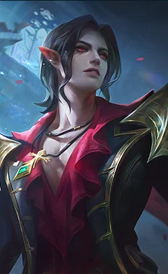

[Tier list](https://boostmlbb.ru/en/heroes/)[Items](https://boostmlbb.ru/en/items/)[Skins](https://boostmlbb.ru/en/skins/)[News & guides](https://boostmlbb.ru/en/news/)

# Hylos

D

TankRoam

Win rate

47.0%

Pick rate

0.2%

Ban rate

0.1%

[Overview](https://boostmlbb.ru/#overview)[Build](https://boostmlbb.ru/#build)[How to play](https://boostmlbb.ru/#howto)[Skills](https://boostmlbb.ru/#skills)[Counters](https://boostmlbb.ru/#draft)[Skins](https://boostmlbb.ru/#skins)[Lore](https://boostmlbb.ru/#lore)

## Overview

### Attributes

-   Durability**100**
-   Offense**20**
-   Control**80**
-   Difficulty**50**

-   Guard
-   Initiator

### Win rate by rank, 30 days

1.  **51.4%**Epic
2.  **50.7%**Legend
3.  **49.8%**Mythic
4.  **48.5%**Honor
5.  **46.6%**Glory

Dashed line: 50% win rate

### More tanks on this lane

[Carmilla](https://boostmlbb.ru/en/heroes/carmilla.html)[Belerick](https://boostmlbb.ru/en/heroes/belerick.html)[Atlas](https://boostmlbb.ru/en/heroes/atlas.html)[Gloo](https://boostmlbb.ru/en/heroes/gloo.html)[Minotaur](https://boostmlbb.ru/en/heroes/minotaur.html)[Khufra](https://boostmlbb.ru/en/heroes/khufra.html)[Tigreal](https://boostmlbb.ru/en/heroes/tigreal.html)[Hilda](https://boostmlbb.ru/en/heroes/hilda.html)

### Places in the rankings

-   [Best MLBB tanks**20 of 25**](https://boostmlbb.ru/en/heroes/best-tank.html)
-   [Best MLBB roamers**26 of 34**](https://boostmlbb.ru/en/heroes/best-roam.html)

## Build

Build 1Build 2Build 3

Win rate

55.0%

Pick rate

5.9%

#### Core items

-   [

    

    Thunder Belt

    ](https://boostmlbb.ru/en/items/thunder-belt.html)
-   [

    

    Clock of Destiny

    ](https://boostmlbb.ru/en/items/clock-of-destiny.html)
-   [

    

    Dominance Ice

    ](https://boostmlbb.ru/en/items/dominance-ice.html)

#### Spell

Revitalize

#### Emblem and talents

Tank

-   

    Firmness

-   

    Tenacity

-   

    Concussive Blast

Win rate

55.0%

Pick rate

5.4%

#### Core items

-   [

    

    Thunder Belt

    ](https://boostmlbb.ru/en/items/thunder-belt.html)
-   [

    

    Clock of Destiny

    ](https://boostmlbb.ru/en/items/clock-of-destiny.html)
-   [

    

    Dominance Ice

    ](https://boostmlbb.ru/en/items/dominance-ice.html)

#### Spell

Revitalize

#### Emblem and talents

Tank

-   

    Firmness

-   

    Weapons Master

-   

    Concussive Blast

Win rate

55.0%

Pick rate

1.3%

#### Core items

-   [

    

    Chastise Pauldron

    ](https://boostmlbb.ru/en/items/chastise-pauldron.html)
-   [

    

    Athena's Shield

    ](https://boostmlbb.ru/en/items/athenas-shield.html)
-   [

    

    Antique Cuirass

    ](https://boostmlbb.ru/en/items/antique-cuirass.html)

#### Spell

Revitalize

#### Emblem and talents

Tank

-   

    Agility

-   

    Wilderness Blessing

-   

    Concussive Blast

## How to play Hylos

### Hylos combos

#### Teamfight

1.  Ult
2.  1
3.  2
4.  Attack

In teamfights, use Hylos' Ultimate to create a pathway into the enemy team and then his 1st Skill to get in and stun an enemy. At the same time, use his 2nd Skill and Basic Attacks to deal continuous damage.

#### Laning

1.  1
2.  2
3.  Attack

In the laning phase, Hylos should use his 1st Skill to get close and stun the enemy, then follow up with his 2nd Skill and Basic Attacks to deal damage.

### When strongest

Stronger late: 51.2% at 18–20 minutes. Do not take risks early, farm and fight together with your team.

1.  **43.0**10–12
2.  **46.8**12–14
3.  **49.4**14–16
4.  **50.9**16–18
5.  **51.2**18–20
6.  **51.0**20+

Win rate % by match length in minutes, all ranks. Dashed line: 50%

### Level-up priority

1.  Glorious Pathway
2.  Ring of Punishment
3.  Law and Order

## Skills

Passive**Thickened Blood**Skill 1**Law and Order**Skill 2**Ring of Punishment**Ultimate**Glorious Pathway**

Passive

### Thickened Blood

Hylos gains 1 extra Max Mana for every 2.5 Extra gained.

When out of Mana, he can consume HP to cast skills.

Skill 1

### Law and Order

Cooldown **12 s**

Hylos gains 50% Movement Speed and causes his next Basic Attack within 3s to deal 300 (+80% Total Magic Power) Magic Damage to the target, knocking back and stunning them for 1s.

The extra Movement Speed rapidly decays over the duration and vanishes after the next Basic Attack.

Skill 2

### Ring of Punishment

Cooldown **1 s**

Hylos releases the Ring of Punishment, dealing 100 (+20% Total Magic Power) Magic Damage to nearby enemies per second while slowing them by 4% and reducing their Attack Speed by 7.5% for 2.5s (up to 8 stacks). Each stack also increases the enemy's damage taken from the Ring of Punishment by 5%. The Ring of Punishment consumes 30 Mana per second when it's active.

**Use Again:** Hylos cancels the Ring of Punishment.

Ultimate

### Glorious Pathway

Cooldown **40 s**

Hylos creates a huge pathway in the target direction, reducing enemies' Movement Speed by 75% for 1s. The pathway lasts 6s.

When on the pathway, Hylos gains Slow Immunity and recovers 3% per second. Allied heroes moving along the pathway gain 60% extra Movement Speed, while enemy heroes on the pathway will be slowed by 25%.

## Hylos counters

### Who counters Hylos

[Zilong](https://boostmlbb.ru/en/heroes/zilong.html)[Layla](https://boostmlbb.ru/en/heroes/layla.html)[Yin](https://boostmlbb.ru/en/heroes/yin.html)[Nana](https://boostmlbb.ru/en/heroes/nana.html)[Saber](https://boostmlbb.ru/en/heroes/saber.html)

### Who Hylos counters

[Valir](https://boostmlbb.ru/en/heroes/valir.html)[Kimmy](https://boostmlbb.ru/en/heroes/kimmy.html)[Rafaela](https://boostmlbb.ru/en/heroes/rafaela.html)[Cici](https://boostmlbb.ru/en/heroes/cici.html)[Cecilion](https://boostmlbb.ru/en/heroes/cecilion.html)[X.Borg](https://boostmlbb.ru/en/heroes/x-borg.html)[Karrie](https://boostmlbb.ru/en/heroes/karrie.html)[Zhuxin](https://boostmlbb.ru/en/heroes/zhuxin.html)[Yve](https://boostmlbb.ru/en/heroes/yve.html)

## Hylos skins

[Lord of the TundraDeluxe · 2025](https://boostmlbb.ru/en/skins/hylos/lord-of-the-tundra.html)[Bloodhoof MarauderCommon · 2024](https://boostmlbb.ru/en/skins/hylos/bloodhoof-marauder.html)[Iron SteedDeluxe · 2021](https://boostmlbb.ru/en/skins/hylos/iron-steed.html)[Jungle WatcherCommon · 2019](https://boostmlbb.ru/en/skins/hylos/jungle-watcher.html)[Phantom SeerExceptional · 2018](https://boostmlbb.ru/en/skins/hylos/phantom-seer.html)[Abyssal ShamanCommon · 2018](https://boostmlbb.ru/en/skins/hylos/abyssal-shaman.html)

[All 6 Hylos skins: prices and how to get them](https://boostmlbb.ru/en/skins/hylos.html)

## Lore

> Centaur guarding the Misty Mountains.

[Read the full story ↗](https://play.mobilelegends.com/lore/hero/hylos)Official Mobile Legends site [Hero stats on the game site ↗](https://www.mobilelegends.com/hero/detail?heroid=49)

**Rank up on Hylos**The calculator shows the price

[Calculate price](https://boostmlbb.ru/en/order.html?type=hero)

## Frequently asked questions

Who counters Hylos in MLBB?

Over the last 30 days the toughest opponents are Zilong, Layla, Yin, Nana and Saber.

How do you play Hylos?

Level "Ring of Punishment" first and take the ultimate whenever it is available. Stronger late: 51.2% at 18–20 minutes. Do not take risks early, farm and fight together with your team. Teamfight combo: In teamfights, use Hylos' Ultimate to create a pathway into the enemy team and then his 1st Skill to get in and stun an enemy. At the same time, use his 2nd Skill and Basic Attacks to deal continuous damage.

What is Hylos’s win rate right now?

47.02% at Mythical Glory over the last 7 days and 48.54% across all ranks over 30 days, as of 25 November 2026.

What role and lane does Hylos play?

Tank, played on roam.

Is Hylos strong in the current meta?

Tier D, #117 of 133 heroes and #20 among tanks. The tier counts how often the hero is picked and banned and how well it wins at Mythical Glory over 7 days: banned in 0.1% of matches, 47.0% win rate. In professional games over the last month the hero is drafted in 2.5% of them.

What is the best build for Hylos?

The most popular ranked build: Thunder Belt, Clock of Destiny and Dominance Ice as core items, the Tank emblem with Firmness, Tenacity and Concussive Blast, and Revitalize. It wins 54.95% of matches.
