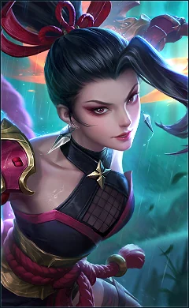

[Tier list](https://boostmlbb.ru/en/heroes/)[Items](https://boostmlbb.ru/en/items/)[Skins](https://boostmlbb.ru/en/skins/)[News & guides](https://boostmlbb.ru/en/news/)

# Ixia

C

MarksmanGold Lane

Win rate

50.5%

Pick rate

0.8%

Ban rate

0.5%

[Overview](https://boostmlbb.ru/#overview)[Build](https://boostmlbb.ru/#build)[How to play](https://boostmlbb.ru/#howto)[Skills](https://boostmlbb.ru/#skills)[Counters](https://boostmlbb.ru/#draft)[Skins](https://boostmlbb.ru/#skins)[Lore](https://boostmlbb.ru/#lore)

## Overview

### Attributes

-   Durability**30**
-   Offense**70**
-   Control**50**
-   Difficulty**30**

-   Finisher
-   Damage

### Win rate by rank, 30 days

1.  **49.3%**Epic
2.  **50.0%**Legend
3.  **50.2%**Mythic
4.  **49.8%**Honor
5.  **50.5%**Glory

Dashed line: 50% win rate

### More marksmen on this lane

[Obsidia](https://boostmlbb.ru/en/heroes/obsidia.html)[Bruno](https://boostmlbb.ru/en/heroes/bruno.html)[Clint](https://boostmlbb.ru/en/heroes/clint.html)[Brody](https://boostmlbb.ru/en/heroes/brody.html)[Hanabi](https://boostmlbb.ru/en/heroes/hanabi.html)[Moskov](https://boostmlbb.ru/en/heroes/moskov.html)[Claude](https://boostmlbb.ru/en/heroes/claude.html)[Miya](https://boostmlbb.ru/en/heroes/miya.html)

### Places in the rankings

-   [Best MLBB marksmen**14 of 23**](https://boostmlbb.ru/en/heroes/best-marksman.html)

## Build

Build 1Build 2Build 3

Win rate

56.1%

Pick rate

8.2%

#### Core items

-   [

    

    Sea Halberd

    ](https://boostmlbb.ru/en/items/sea-halberd.html)
-   [

    

    Corrosion Scythe

    ](https://boostmlbb.ru/en/items/corrosion-scythe.html)
-   [

    

    Sky Piercer

    ](https://boostmlbb.ru/en/items/sky-piercer.html)
-   [

    

    Malefic Gun

    ](https://boostmlbb.ru/en/items/malefic-gun.html)

#### Spell

Flicker

#### Emblem and talents

Marksman

-   

    Thrill

-   

    Weapons Master

-   

    War Cry

Win rate

54.5%

Pick rate

6.2%

#### Core items

-   [

    

    Sea Halberd

    ](https://boostmlbb.ru/en/items/sea-halberd.html)
-   [

    

    Sky Piercer

    ](https://boostmlbb.ru/en/items/sky-piercer.html)
-   [

    

    Corrosion Scythe

    ](https://boostmlbb.ru/en/items/corrosion-scythe.html)

#### Spell

Flicker

#### Emblem and talents

Marksman

-   

    Thrill

-   

    Weapons Master

-   

    War Cry

Win rate

54.6%

Pick rate

6.1%

#### Core items

-   [

    

    Sea Halberd

    ](https://boostmlbb.ru/en/items/sea-halberd.html)
-   [

    

    Corrosion Scythe

    ](https://boostmlbb.ru/en/items/corrosion-scythe.html)
-   [

    

    Sky Piercer

    ](https://boostmlbb.ru/en/items/sky-piercer.html)

#### Spell

Flicker

#### Emblem and talents

Marksman

-   

    Thrill

-   

    Weapons Master

-   

    War Cry

## How to play Ixia

### Ixia combos

#### Teamfight

1.  Ult
2.  Attack
3.  2
4.  1

Choose the perfect location that can secure herself and cast the Ultimate to rain down her attacks on as many enemies as possible. Keep tapping Basic Attack while using her 2nd Skill and 1st Skill to control enemies and deal extra damage.

#### Laning

1.  2
2.  1
3.  Attack

Ixia can pull enemies to the center line with her 2nd Skill and follow up with her 1st Skill to deal damage. Use the Movement Speed boost provided by her 1st Skill to chase down enemies.

### When strongest

Stronger early: 57.7% at 10–12 minutes. Push your lane, take objectives and close the game before the lead fades.

1.  **57.7**10–12
2.  **52.2**12–14
3.  **49.7**14–16
4.  **47.8**16–18
5.  **47.4**18–20
6.  **47.0**20+

Win rate % by match length in minutes, all ranks. Dashed line: 50%

### Level-up priority

1.  Full Barrage
2.  Dual Beam
3.  Star Helix

## Skills

Passive**Siphon Starlium**Skill 1**Dual Beam**Skill 2**Star Helix**Ultimate**Full Barrage**

Passive

### Siphon Starlium

Ixia's Basic Attacks and skills apply a stack of Starlium Charge to enemies on hit. When Ixia performs a Basic Attack on an enemy with two stacks of Starlium Charge, the attack consumes the stacks and is replaced by Siphon Starlium, dealing (+150% Total Physical Attack) +(+10 × hero level) Physical Damage to the target. Ixia recovers HP equal to the damage dealt (only 10 % against non-hero units) and slows the target by 25% for 1s.

Siphon Starlium can hit all enemies in front of Ixia within her Basic Attack range, but it cannot Crit.

Ixia's Basic Attacks cannot trigger Lifesteal.

Skill 1

### Dual Beam

Cooldown **4 Mana Cost: 35 s**

Ixia fires 2 Starlium-charged energy beams along the ground in the target direction, dealing 100 (+70% Total Physical Attack) Physical Damage to enemies in a rectangular area. When hitting enemy heroes, Ixia gains 50% Movement Speed for 2s.

Enemies hit by both beams will take double damage.

Skill 2

### Star Helix

Cooldown **11 Mana Cost: 65 s**

Ixia unleashes a canister of Starlium energy in the target direction, knocking back nearby enemies. After a short delay, it pulls enemies in range to the center line and deals 200 (+60% Total Physical Attack) Physical Damage.

Ultimate

### Full Barrage

Cooldown **42 Mana Cost: 120 s**

Ixia reassembles her weapon into 6 smaller weapons and enters the Full Barrage state for 4s. In this state, Ixia's Basic Attacks and skills can hit enemies in the large fan-shaped area in front of her, but not outside it. Ixia's Basic Attacks can hit up to 6 enemy units (prioritizes heroes), and Siphon Starlium will fire simultaneously with her normal Basic Attacks.

## Ixia counters

### Who counters Ixia

[Estes](https://boostmlbb.ru/en/heroes/estes.html)[Cyclops](https://boostmlbb.ru/en/heroes/cyclops.html)[Rafaela](https://boostmlbb.ru/en/heroes/rafaela.html)[Lolita](https://boostmlbb.ru/en/heroes/lolita.html)[Floryn](https://boostmlbb.ru/en/heroes/floryn.html)

### Who Ixia counters

[Selena](https://boostmlbb.ru/en/heroes/selena.html)[Granger](https://boostmlbb.ru/en/heroes/granger.html)[Chou](https://boostmlbb.ru/en/heroes/chou.html)[Claude](https://boostmlbb.ru/en/heroes/claude.html)[Kadita](https://boostmlbb.ru/en/heroes/kadita.html)[Yin](https://boostmlbb.ru/en/heroes/yin.html)[Benedetta](https://boostmlbb.ru/en/heroes/benedetta.html)[Hanzo](https://boostmlbb.ru/en/heroes/hanzo.html)[Wanwan](https://boostmlbb.ru/en/heroes/wanwan.html)

## Ixia skins

[Dynamic StreakExceptional · 2024](https://boostmlbb.ru/en/skins/ixia/dynamic-streak.html)[Shifting SandCommon · 2023](https://boostmlbb.ru/en/skins/ixia/shifting-sand.html)

[All 2 Ixia skins: prices and how to get them](https://boostmlbb.ru/en/skins/ixia.html)

## Lore

> The leader of Bad Soul and self-proclaimed inventor, she wields a homemade weapon powered by a stolen Starlium reactor.

[Read the full story ↗](https://play.mobilelegends.com/lore/hero/Lxia)Official Mobile Legends site [Hero stats on the game site ↗](https://www.mobilelegends.com/hero/detail?heroid=121)

**Rank up on Ixia**The calculator shows the price

[Calculate price](https://boostmlbb.ru/en/order.html?type=hero)

## Frequently asked questions

Who counters Ixia in MLBB?

Over the last 30 days the toughest opponents are Estes, Cyclops, Rafaela, Lolita and Floryn.

How do you play Ixia?

Level "Dual Beam" first and take the ultimate whenever it is available. Stronger early: 57.7% at 10–12 minutes. Push your lane, take objectives and close the game before the lead fades. Teamfight combo: Choose the perfect location that can secure herself and cast the Ultimate to rain down her attacks on as many enemies as possible. Keep tapping Basic Attack while using her 2nd Skill and 1st Skill to control enemies and deal extra damage.

What is Ixia’s win rate right now?

50.55% at Mythical Glory over the last 7 days and 50.11% across all ranks over 30 days, as of 25 November 2026.

What role and lane does Ixia play?

Marksman, played in the Gold Lane.

Is Ixia strong in the current meta?

Tier C, #74 of 133 heroes and #14 among marksmen. The tier counts how often the hero is picked and banned and how well it wins at Mythical Glory over 7 days: banned in 0.5% of matches, 50.5% win rate. In professional games over the last month the hero is drafted in 0.0% of them.

What is the best build for Ixia?

The most popular ranked build: Sea Halberd, Corrosion Scythe, Sky Piercer and Malefic Gun as core items, the Marksman emblem with Thrill, Weapons Master and War Cry, and Flicker. It wins 56.12% of matches.
