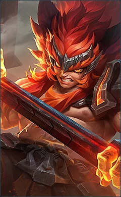

[Tier list](https://boostmlbb.ru/en/heroes/)[Items](https://boostmlbb.ru/en/items/)[Skins](https://boostmlbb.ru/en/skins/)[News & guides](https://boostmlbb.ru/en/news/)

[Tier list](https://boostmlbb.ru/en/heroes/)

# Jawhead

C

FighterEXP LaneRoam

Win rate

47.5%

Pick rate

0.3%

Ban rate

0.1%

[Overview](https://boostmlbb.ru/#overview)[Build](https://boostmlbb.ru/#build)[How to play](https://boostmlbb.ru/#howto)[Skills](https://boostmlbb.ru/#skills)[Counters](https://boostmlbb.ru/#draft)[Skins](https://boostmlbb.ru/#skins)[Lore](https://boostmlbb.ru/#lore)

## Overview

### Attributes

-   Durability**60**
-   Offense**30**
-   Control**60**
-   Difficulty**60**

-   Charge
-   Burst

### Win rate by rank, 30 days

1.  **47.6%**Epic
2.  **48.3%**Legend
3.  **48.6%**Mythic
4.  **47.8%**Honor
5.  **47.2%**Glory

Dashed line: 50% win rate

### More fighters on this lane

[Freya](https://boostmlbb.ru/en/heroes/freya.html)[Kalea](https://boostmlbb.ru/en/heroes/kalea.html)[Aulus](https://boostmlbb.ru/en/heroes/aulus.html)[Paquito](https://boostmlbb.ru/en/heroes/paquito.html)[Sun](https://boostmlbb.ru/en/heroes/sun.html)[Lukas](https://boostmlbb.ru/en/heroes/lukas.html)[Cici](https://boostmlbb.ru/en/heroes/cici.html)[Sora](https://boostmlbb.ru/en/heroes/sora.html)

### Places in the rankings

-   [Best MLBB fighters**41 of 44**](https://boostmlbb.ru/en/heroes/best-fighter.html)
-   [Best MLBB roamers**29 of 34**](https://boostmlbb.ru/en/heroes/best-roam.html)

## Build

Build 1Build 2Build 3

Win rate

57.0%

Pick rate

4.4%

#### Core items

-   [

    

    Blade of the Heptaseas

    ](https://boostmlbb.ru/en/items/blade-of-the-heptaseas.html)
-   [

    

    Hunter Strike

    ](https://boostmlbb.ru/en/items/hunter-strike.html)
-   [

    

    Malefic Roar

    ](https://boostmlbb.ru/en/items/malefic-roar.html)

#### Spell

Flicker

#### Emblem and talents

Assassin

-   

    Agility

-   

    Master Assassin

-   

    Lethal Ignition

Win rate

55.3%

Pick rate

4.0%

#### Core items

-   [

    

    Blade of the Heptaseas

    ](https://boostmlbb.ru/en/items/blade-of-the-heptaseas.html)
-   [

    

    Hunter Strike

    ](https://boostmlbb.ru/en/items/hunter-strike.html)
-   [

    

    Malefic Roar

    ](https://boostmlbb.ru/en/items/malefic-roar.html)

#### Spell

Petrify

#### Emblem and talents

Assassin

-   

    Agility

-   

    Master Assassin

-   

    Lethal Ignition

Win rate

50.5%

Pick rate

3.0%

#### Core items

-   [

    

    Hunter Strike

    ](https://boostmlbb.ru/en/items/hunter-strike.html)
-   [

    

    Sea Halberd

    ](https://boostmlbb.ru/en/items/sea-halberd.html)
-   [

    

    Dominance Ice

    ](https://boostmlbb.ru/en/items/dominance-ice.html)

#### Spell

Flicker

#### Emblem and talents

Assassin

-   

    Agility

-   

    Seasoned Hunter

-   

    Killing Spree

## How to play Jawhead

### Jawhead combos

#### Teamfight

1.  2
2.  1
3.  Ult
4.  2

In teamfights, use Jawhead's 2nd Skill for the Movement Speed and start up his 1st Skill then immediately charge into a target using his Ultimate. Finally, use his 2nd Skill to toss the enemy back.

#### Laning

1.  2
2.  1
3.  Attack
4.  2

In the laning phase, use Jawhead's 2nd Skill to get close to the enemy, then follow up with his 1st Skill and Basic Attacks to deal continuous damage. When the enemy tries to run, use his 2nd Skill again to toss them back.

### When strongest

Even through the game, from 48.6% to 50.2%. Pick fights by your items rather than the clock.

1.  **48.7**10–12
2.  **49.4**12–14
3.  **50.2**14–16
4.  **49.6**16–18
5.  **48.8**18–20
6.  **48.6**20+

Win rate % by match length in minutes, all ranks. Dashed line: 50%

### Level-up priority

1.  Unstoppable Force
2.  Smart Missiles
3.  Ejector

## Skills

Passive**Mecha Suppression**Skill 1**Smart Missiles**Skill 2**Ejector**Ultimate**Unstoppable Force**

Passive

### Mecha Suppression

Each time Jawhead deals damage to an enemy hero or a Creep, he inflicts a stack of Mecha Suppression on them for 3s (up to 6 stacks). Each stack of Mecha Suppression increases all damage dealt to the target by 2% (limited to 50% for Creeps).

Skill 1

### Smart Missiles

Cooldown **5 Mana Cost: 60 s**

Jawhead launches up to 12 missiles at random nearby enemies over 5s, each missile dealing 135 (+30% Total Physical Attack) Physical Damage to the enemy hit.

Skill 2

### Ejector

Cooldown **15 Mana Cost: 80 s**

Jawhead gains 30% Movement Speed and a 500 (+100% Total Physical Attack) shield for 5s.

**Use Again:** Jawhead flings the nearest unit (prioritizes heroes) to the target location, dealing 300 (+80% Total Physical Attack) Physical Damage to enemies in the area and stunning them for 0.5s. Can be used on allied heroes and they will not take damage.

Ultimate

### Unstoppable Force

Cooldown **35 Mana Cost: 120 s**

Jawhead charges into the target enemy hero, dealing 350 (+150% Total Physical Attack) Physical Damage and briefly stunning them. Enemies around the target are knocked back and dealt the same amount of damage. Jawhead is immune to control effects during the charge.

## Jawhead counters

### Who counters Jawhead

[Arlott](https://boostmlbb.ru/en/heroes/arlott.html)[Nolan](https://boostmlbb.ru/en/heroes/nolan.html)[Saber](https://boostmlbb.ru/en/heroes/saber.html)[Granger](https://boostmlbb.ru/en/heroes/granger.html)[Helcurt](https://boostmlbb.ru/en/heroes/helcurt.html)

### Who Jawhead counters

[Sun](https://boostmlbb.ru/en/heroes/sun.html)[Esmeralda](https://boostmlbb.ru/en/heroes/esmeralda.html)[Gloo](https://boostmlbb.ru/en/heroes/gloo.html)[Popol and Kupa](https://boostmlbb.ru/en/heroes/popol-and-kupa.html)

## Jawhead skins

[Proto GuardianDeluxe · 2025](https://boostmlbb.ru/en/skins/jawhead/proto-guardian.html)[Victory LoaderCommon · 2024](https://boostmlbb.ru/en/skins/jawhead/victory-loader.html)[Cyber RangerExceptional · 2023](https://boostmlbb.ru/en/skins/jawhead/cyber-ranger.html)[Candy BearExceptional · 2021](https://boostmlbb.ru/en/skins/jawhead/candy-bear.html)[Samurai MechExquisite · 2020](https://boostmlbb.ru/en/skins/jawhead/samurai-mech.html)[Foo Quar­terbackCommon · 2019](https://boostmlbb.ru/en/skins/jawhead/foo-quarterback.html)[The NutcrackerExceptional · 2019](https://boostmlbb.ru/en/skins/jawhead/the-nutcracker.html)[Space ExplorerExceptional · 2018](https://boostmlbb.ru/en/skins/jawhead/space-explorer.html)[Girl ScoutCommon · 2018](https://boostmlbb.ru/en/skins/jawhead/girl-scout.html)

[All 9 Jawhead skins: prices and how to get them](https://boostmlbb.ru/en/skins/jawhead.html)

## Lore

> Intelligent robot used to protect little Ailee.

[Read the full story ↗](https://kazukiofficial.com/stories/jawhead)Kazuki Official [Hero stats on the game site ↗](https://www.mobilelegends.com/hero/detail?heroid=54)

**Rank up on Jawhead**The calculator shows the price

[Calculate price](https://boostmlbb.ru/en/order.html?type=hero)

## Frequently asked questions

Who counters Jawhead in MLBB?

Over the last 30 days the toughest opponents are Arlott, Nolan, Saber, Granger and Helcurt.

How do you play Jawhead?

Level "Smart Missiles" first and take the ultimate whenever it is available. Even through the game, from 48.6% to 50.2%. Pick fights by your items rather than the clock. Teamfight combo: In teamfights, use Jawhead's 2nd Skill for the Movement Speed and start up his 1st Skill then immediately charge into a target using his Ultimate. Finally, use his 2nd Skill to toss the enemy back.

What is Jawhead’s win rate right now?

47.53% at Mythical Glory over the last 7 days and 47.91% across all ranks over 30 days, as of 25 November 2026.

What role and lane does Jawhead play?

Fighter, played in the EXP Lane or on roam.

Is Jawhead strong in the current meta?

Tier C, #121 of 133 heroes and #41 among fighters. The tier counts how often the hero is picked and banned and how well it wins at Mythical Glory over 7 days: banned in 0.1% of matches, 47.5% win rate. In professional games over the last month the hero is drafted in 0.0% of them.

What is the best build for Jawhead?

The most popular ranked build: Blade of the Heptaseas, Hunter Strike and Malefic Roar as core items, the Assassin emblem with Agility, Master Assassin and Lethal Ignition, and Flicker. It wins 56.97% of matches.
