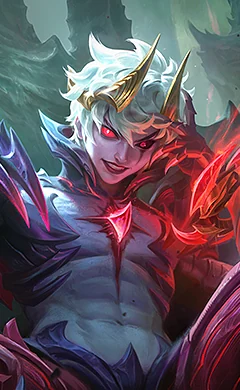

[Tier list](https://boostmlbb.ru/en/heroes/)[News & guides](https://boostmlbb.ru/en/news/)

# Johnson

C

TankSupportRoam

Win rate

47.9%

Pick rate

0.5%

Ban rate

0.6%

[Overview](https://boostmlbb.ru/#overview)[Build](https://boostmlbb.ru/#build)[Skills](https://boostmlbb.ru/#skills)[Counters](https://boostmlbb.ru/#draft)[Lore](https://boostmlbb.ru/#lore)

## Overview

### Attributes

-   Durability**80**
-   Offense**30**
-   Control**90**
-   Difficulty**60**

-   Support
-   Crowd Control

### Win rate by rank, 30 days

1.  **52.6%**Epic
2.  **50.9%**Legend
3.  **49.9%**Mythic
4.  **48.1%**Honor
5.  **46.9%**Glory

Dashed line: 50% win rate

### More tanks on this lane

[Carmilla](https://boostmlbb.ru/en/heroes/carmilla.html)[Belerick](https://boostmlbb.ru/en/heroes/belerick.html)[Atlas](https://boostmlbb.ru/en/heroes/atlas.html)[Gloo](https://boostmlbb.ru/en/heroes/gloo.html)[Minotaur](https://boostmlbb.ru/en/heroes/minotaur.html)[Khufra](https://boostmlbb.ru/en/heroes/khufra.html)[Tigreal](https://boostmlbb.ru/en/heroes/tigreal.html)[Hilda](https://boostmlbb.ru/en/heroes/hilda.html)

## Build

Build 1Build 2Build 3

Win rate

55.6%

Pick rate

4.4%

#### Core items

-   

    Dominance Ice

-   

    Antique Cuirass

-   

    Blade Armor

#### Spell

Sprint

#### Emblem and talents

Tank

-   

    Inspire

-   

    Pull Yourself Together

-   

    Concussive Blast

Win rate

56.7%

Pick rate

1.7%

#### Core items

-   

    Dominance Ice

-   

    Antique Cuirass

-   

    Blade Armor

#### Spell

Sprint

#### Emblem and talents

Tank

-   

    Agility

-   

    Wilderness Blessing

-   

    Concussive Blast

Win rate

52.4%

Pick rate

1.5%

#### Core items

-   

    Fleeting Time

-   

    Dominance Ice

-   

    Athena's Shield

#### Spell

Petrify

#### Emblem and talents

Tank

-   

    Firmness

-   

    Tenacity

-   

    Concussive Blast

## Skills

Level-up**Full Throttle**_›_**Electromagnetic Waves**_›_**Impact Wrench**

Passive**Electro Airbag**Skill 1**Impact Wrench**Skill 2**Electromagnetic Waves**Ultimate**Full Throttle**

Passive

### Electro Airbag

When Johnson's HP drops below 30%, he gains a 300 (+700% Total Physical Defense) shield for 10s. Cooldown: 100s.

Skill 1

### Impact Wrench

Cooldown **8 s**

Johnson throws his wrench toward the target location, dealing 120 (+220% Total Physical Defense) Magic Damage to enemies in its path. Enemies around the landing point are stunned for 0.8s.

Skill 2

### Electromagnetic Waves

Cooldown **10 s**

Johnson raises his shield, continuously dealing 120 (+60% Total Magic Power) Magic Damage to enemies in a fan-shaped area in the target direction, reducing their Movement Speed and by 10% (stacks up to 3 times) for 2s.

While his shield is raised, Johnson can perform Basic Attacks and cast skills.

Ultimate

### Full Throttle

Cooldown **36 s**

**Passive:** Johnson's is increased by 10%.

**Active:** Johnson transforms into a car. Nearby allied heroes can use Hop In to ride with him (only 1 at a time). When the car hits an enemy hero, it explodes and deals 300 (+240% Total Physical Defense)–450 (+360% Total Physical Defense) Magic Damage to nearby enemies, stunning them for 0.5–1s (scales with driving time). It also creates an electrified zone at the location that continuously deals 60 (+20% Total Magic Power) Magic Damage and slows enemies within.

Johnson's location is revealed to enemies for 3s when he casts this skill.

## Counters

### Counters

Beat this hero

[Layla](https://boostmlbb.ru/en/heroes/layla.html)[Zilong](https://boostmlbb.ru/en/heroes/zilong.html)[Saber](https://boostmlbb.ru/en/heroes/saber.html)[Valentina](https://boostmlbb.ru/en/heroes/valentina.html)[Dyrroth](https://boostmlbb.ru/en/heroes/dyrroth.html)

### Easy targets

This hero beats them

[Belerick](https://boostmlbb.ru/en/heroes/belerick.html)[Carmilla](https://boostmlbb.ru/en/heroes/carmilla.html)[Minotaur](https://boostmlbb.ru/en/heroes/minotaur.html)[Atlas](https://boostmlbb.ru/en/heroes/atlas.html)[Claude](https://boostmlbb.ru/en/heroes/claude.html)[Kadita](https://boostmlbb.ru/en/heroes/kadita.html)[Gloo](https://boostmlbb.ru/en/heroes/gloo.html)[Lancelot](https://boostmlbb.ru/en/heroes/lancelot.html)[Lylia](https://boostmlbb.ru/en/heroes/lylia.html)[Grock](https://boostmlbb.ru/en/heroes/grock.html)

## Lore

> A super cyborg who can transform into a car and lead his teammates into battle.

[Read the full story ↗](https://play.mobilelegends.com/lore/hero/Johnson)Official Mobile Legends site [Hero stats on the game site ↗](https://www.mobilelegends.com/hero/detail?heroid=32)

**Rank up on Johnson**The calculator shows the price

[Calculate price](https://boostmlbb.ru/en/order.html?type=hero)

## Frequently asked questions

Who counters Johnson in MLBB?

Over the last 30 days the toughest opponents are Layla, Zilong, Saber, Valentina and Dyrroth.

What is Johnson’s win rate right now?

47.85% at Mythical Glory over the last 7 days and 49.28% across all ranks over 30 days, as of 24 November 2026.

What role and lane does Johnson play?

Tank and support, played on roam.

Is Johnson strong in the current meta?

Tier C, #103 of 133 heroes and #17 among tanks. The tier counts how often the hero is picked and banned and how well it wins at Mythical Glory over 7 days: banned in 0.6% of matches, 47.9% win rate. In professional games over the last month the hero is drafted in 0.0% of them.

What is the best build for Johnson?

The most popular ranked build: Dominance Ice, Antique Cuirass and Blade Armor as core items, the Tank emblem with Inspire, Pull Yourself Together and Concussive Blast, and Sprint. It wins 55.57% of matches.
