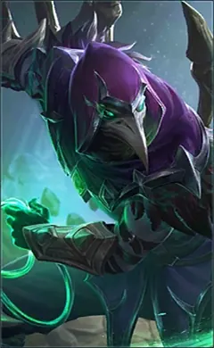

[Tier list](https://boostmlbb.ru/en/heroes/)[Items](https://boostmlbb.ru/en/items/)[Skins](https://boostmlbb.ru/en/skins/)[News & guides](https://boostmlbb.ru/en/news/)

[Tier list](https://boostmlbb.ru/en/heroes/)

# Kaja

B

SupportRoam

Win rate

49.6%

Pick rate

0.9%

Ban rate

30.9%

[Overview](https://boostmlbb.ru/#overview)[Build](https://boostmlbb.ru/#build)[How to play](https://boostmlbb.ru/#howto)[Skills](https://boostmlbb.ru/#skills)[Counters](https://boostmlbb.ru/#draft)[Skins](https://boostmlbb.ru/#skins)[Lore](https://boostmlbb.ru/#lore)

## Overview

### Attributes

-   Durability**80**
-   Offense**20**
-   Control**70**
-   Difficulty**60**

-   Initiator
-   Charge

### Win rate by rank, 30 days

1.  **48.5%**Epic
2.  **48.7%**Legend
3.  **49.7%**Mythic
4.  **50.1%**Honor
5.  **49.8%**Glory

Dashed line: 50% win rate

### More supports on this lane

[Marcel](https://boostmlbb.ru/en/heroes/marcel.html)[Estes](https://boostmlbb.ru/en/heroes/estes.html)[Floryn](https://boostmlbb.ru/en/heroes/floryn.html)[Rafaela](https://boostmlbb.ru/en/heroes/rafaela.html)[Angela](https://boostmlbb.ru/en/heroes/angela.html)[Diggie](https://boostmlbb.ru/en/heroes/diggie.html)

### Places in the rankings

-   [Best MLBB roamers**9 of 34**](https://boostmlbb.ru/en/heroes/best-roam.html)

## Build

Build 1Build 2Build 3

Win rate

55.8%

Pick rate

14.2%

#### Core items

-   [

    

    Thunder Belt

    ](https://boostmlbb.ru/en/items/thunder-belt.html)
-   [

    

    Fleeting Time

    ](https://boostmlbb.ru/en/items/fleeting-time.html)
-   [

    

    Dominance Ice

    ](https://boostmlbb.ru/en/items/dominance-ice.html)

#### Spell

Flicker

#### Emblem and talents

Support

-   

    Agility

-   

    Wilderness Blessing

-   

    Quantum Charge

Win rate

53.6%

Pick rate

10.1%

#### Core items

-   [

    

    Thunder Belt

    ](https://boostmlbb.ru/en/items/thunder-belt.html)
-   [

    

    Fleeting Time

    ](https://boostmlbb.ru/en/items/fleeting-time.html)
-   [

    

    Dominance Ice

    ](https://boostmlbb.ru/en/items/dominance-ice.html)

#### Spell

Flicker

#### Emblem and talents

Support

-   

    Agility

-   

    Pull Yourself Together

-   

    Quantum Charge

Win rate

55.1%

Pick rate

2.8%

#### Core items

-   [

    

    Thunder Belt

    ](https://boostmlbb.ru/en/items/thunder-belt.html)
-   [

    

    Fleeting Time

    ](https://boostmlbb.ru/en/items/fleeting-time.html)
-   [

    

    Brute Force Breastplate

    ](https://boostmlbb.ru/en/items/brute-force-breastplate.html)

#### Spell

Flicker

#### Emblem and talents

Support

-   

    Inspire

-   

    Wilderness Blessing

-   

    Quantum Charge

## How to play Kaja

### Kaja combos

#### Teamfight

1.  2
2.  1
3.  Ult

For initiating teamfights, use Kaja's 2nd Skill to soar, use the terrain to reposition. Follow up with his 1st Skill to slow and reduce their damage, then immediately cast his Ultimate and let the team clean up.

#### Laning

1.  1
2.  2
3.  Attack

In the laning phase, use Kaja's 1st Skill to poke and recover HP. If the enemy engages, use his 2nd Skill to take off, then kite with his aerial Basic Attacks. Kite when attacked, attack when they're out of steam.

### When strongest

Stronger early: 53.2% at 10–12 minutes. Push your lane, take objectives and close the game before the lead fades.

1.  **53.2**10–12
2.  **51.1**12–14
3.  **48.6**14–16
4.  **47.9**16–18
5.  **48.1**18–20
6.  **48.3**20+

Win rate % by match length in minutes, all ranks. Dashed line: 50%

### Level-up priority

1.  Divine Binding
2.  Ring of Order
3.  Soaring Wings

## Skills

Passive**Wings of Lightning**Skill 1**Ring of Order**Skill 2**Soaring Wings**Ultimate**Divine Binding**

Passive

### Wings of Lightning

Kaja's skill damage applies the Paralysis effect to enemy units, briefly slowing heroes or summoned units and reducing their damage by 8% for 5s.

Skill 1

### Ring of Order

Cooldown **5.5 s**

Kaja summons a ring of Primal Lightning that expands and returns to him.

Enemies hit take 160 (+70% Total Magic Power) Magic Damage and recover 78 (+45% Total Magic Power) HP to Kaja. Healing from subsequent hits is reduced to 33%.

Skill 2

### Soaring Wings

Cooldown **14 s**

Kaja dashes to the target area, gaining Control Immunity during the dash. On arrival, he deals 250 (+120% Total Magic Power) Magic Damage, knocking back and stunning nearby enemies for 0.5s, then enters the Soaring state.

The Soaring state lasts 6.6s. During this time, he ignores obstacles and gains 15% Movement Speed, but his turn radius is restricted. He can use Basic Attacks while moving, dealing 100 (+25% Total Magic Power) (+ 2% target's ) Magic Damage to surrounding enemies. Each Basic Attack hit extends the Soaring state by 0.2s.

Upon entering the Soaring state, the cooldown of Soaring Wings is reduced to 4s (unaffected by Cooldown Reduction). Hitting an enemy with Soaring Wings extends the Soaring state by 2.6s.

Ultimate

### Divine Binding

Cooldown **70 s**

Kaja hurls a Primal Lightning Lasso at the target area. After a 0.5s delay, all enemy heroes remaining in the area take 360 (+80% Total Magic Power) Magic Damage and are trapped for 2.5s.

While active, Kaja can drag the lasso, shrinking its radius and pulling enemies at the boundary along with him (does not interrupt their skills).

## Kaja counters

### Who counters Kaja

[Valir](https://boostmlbb.ru/en/heroes/valir.html)[Akai](https://boostmlbb.ru/en/heroes/akai.html)[Grock](https://boostmlbb.ru/en/heroes/grock.html)[Baxia](https://boostmlbb.ru/en/heroes/baxia.html)[Beatrix](https://boostmlbb.ru/en/heroes/beatrix.html)

### Who Kaja counters

[Odette](https://boostmlbb.ru/en/heroes/odette.html)[Lunox](https://boostmlbb.ru/en/heroes/lunox.html)[Zhask](https://boostmlbb.ru/en/heroes/zhask.html)

## Kaja skins

[Inferno TaskmasterDeluxe · 2023](https://boostmlbb.ru/en/skins/kaja/inferno-taskmaster.html)[Crow MagicianCommon · 2020](https://boostmlbb.ru/en/skins/kaja/crow-magician.html)[SkyblockerExquisite · 2019](https://boostmlbb.ru/en/skins/kaja/skyblocker.html)[Horror WhiplashCommon · 2019](https://boostmlbb.ru/en/skins/kaja/horror-whiplash.html)[KaminariExceptional · 2019](https://boostmlbb.ru/en/skins/kaja/kaminari.html)[Com­mandmentCommon · 2018](https://boostmlbb.ru/en/skins/kaja/commandment.html)

[All 6 Kaja skins: prices and how to get them](https://boostmlbb.ru/en/skins/kaja.html)

## Lore

> Leader of Nazar who guards the Celestial Palace.

[Read the full story ↗](https://kazukiofficial.com/stories/kaja)Kazuki Official [Hero stats on the game site ↗](https://www.mobilelegends.com/hero/detail?heroid=62)

**Rank up on Kaja**The calculator shows the price

[Calculate price](https://boostmlbb.ru/en/order.html?type=hero)

## Frequently asked questions

Who counters Kaja in MLBB?

Over the last 30 days the toughest opponents are Valir, Akai, Grock, Baxia and Beatrix.

How do you play Kaja?

Level "Ring of Order" first and take the ultimate whenever it is available. Stronger early: 53.2% at 10–12 minutes. Push your lane, take objectives and close the game before the lead fades. Teamfight combo: For initiating teamfights, use Kaja's 2nd Skill to soar, use the terrain to reposition. Follow up with his 1st Skill to slow and reduce their damage, then immediately cast his Ultimate and let the team clean up.

What is Kaja’s win rate right now?

49.58% at Mythical Glory over the last 7 days and 49.75% across all ranks over 30 days, as of 25 November 2026.

What role and lane does Kaja play?

Support, played on roam.

Is Kaja strong in the current meta?

Tier B, #30 of 133 heroes and #6 among supports. The tier counts how often the hero is picked and banned and how well it wins at Mythical Glory over 7 days: banned in 30.9% of matches, 49.6% win rate. In professional games over the last month the hero is drafted in 0.7% of them.

What is the best build for Kaja?

The most popular ranked build: Thunder Belt, Fleeting Time and Dominance Ice as core items, the Support emblem with Agility, Wilderness Blessing and Quantum Charge, and Flicker. It wins 55.84% of matches.
