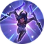

[Home](https://boostmlbb.ru/en/) / [Heroes](https://boostmlbb.ru/en/heroes/)

Tier C

# Karina

Assassin · Jungle

**#100 of 133 by win rate**All ranks · 30 days to 23 November 2026

Win rate

48.60%

Pick rate

0.91%

Ban rate

4.55%

Finisher · Magic Damage · Difficulty 50/100

[Build](https://boostmlbb.ru/#build)[Counters and teammates](https://boostmlbb.ru/#draft)[Skills](https://boostmlbb.ru/#skills)[Win rate by rank](https://boostmlbb.ru/#ranks)[Lore](https://boostmlbb.ru/#lore)

## Build

Most picked in ranked · Jungle

Core items

Sky PiercerStarlium ScytheHoly Crystal

Emblem and talents

MageThrillWeapons MasterKilling Spree

Battle spell

Retribution

Wins with this build **57.00%**Picked in **2.75%** of matches

Alternative builds (2)

Core items

Starlium ScytheHoly CrystalConcentrated Energy

Emblem and talents

MageThrillWeapons MasterKilling Spree

Battle spell

Retribution

Wins with this build **57.71%**Picked in **4.39%** of matches

Core items

Sky PiercerStarlium ScytheHoly Crystal

Emblem and talents

MageThrillSeasoned HunterKilling Spree

Battle spell

Retribution

Wins with this build **56.72%**Picked in **3.37%** of matches

## Counters and teammates

### Counters

[Natalia](https://boostmlbb.ru/en/heroes/natalia.html)[Kimmy](https://boostmlbb.ru/en/heroes/kimmy.html)[Marcel](https://boostmlbb.ru/en/heroes/marcel.html)[Ling](https://boostmlbb.ru/en/heroes/ling.html)[Helcurt](https://boostmlbb.ru/en/heroes/helcurt.html)

### Strong against

[Granger](https://boostmlbb.ru/en/heroes/granger.html)[Paquito](https://boostmlbb.ru/en/heroes/paquito.html)[Brody](https://boostmlbb.ru/en/heroes/brody.html)[Clint](https://boostmlbb.ru/en/heroes/clint.html)[Sora](https://boostmlbb.ru/en/heroes/sora.html)[Hirara](https://boostmlbb.ru/en/heroes/hirara.html)[Lunox](https://boostmlbb.ru/en/heroes/lunox.html)[Ruby](https://boostmlbb.ru/en/heroes/ruby.html)[Harith](https://boostmlbb.ru/en/heroes/harith.html)[Faramis](https://boostmlbb.ru/en/heroes/faramis.html)

### Teammates

Win rate gain when playing together

[Chip+2.30 pp](https://boostmlbb.ru/en/heroes/chip.html)[Benedetta+1.46 pp](https://boostmlbb.ru/en/heroes/benedetta.html)[Wanwan+1.13 pp](https://boostmlbb.ru/en/heroes/wanwan.html)[Zetian+1.03 pp](https://boostmlbb.ru/en/heroes/zetian.html)

## Skills

Level-up priority · Shadow Assault → Dance of Death → Dance of Blades

Passive**Shadow Combo**

Karina's third consecutive attack against the same enemy deals 100 (+ 5 (+2.5% Total Magic Power)% target's Lost ) extra True Damage.
If the target is an enemy hero, this attack also reduces the cooldowns of her non-Ultimate skills by 1.5s.
Damage dealt to creeps is capped at 2000 True Damage.

Skill 1**Dance of Blades**

**Cooldown 6 Mana Cost: 50 s**

Karina enters the Dance of Blades state for up to 3.5s, gaining 45% Movement Speed and blocking all Basic Attacks. Blocked attacks trigger a counterattack that deals 100 (+30% Total Magic Power) Magic Damage to the attacker (firing a Shadowblade at ranged attackers or triggering Dance of Blades against melee attackers).
This effect has a 0.4s cooldown).
Casting a Basic Attack or Shadow Assault ends the Dance of Blades state, empowering Karina's next Basic Attack to deal 160 (+60% Total Magic Power) critical Magic Damage and slow the target by 45% for 1s.

Skill 2**Dance of Death**

**Cooldown 6 Mana Cost: 60 s**

Karina launches a spinning slash, dealing 375 (+125% Total Magic Power) Magic Damage to nearby enemies.

Ultimate**Shadow Assault**

**Cooldown 34 Mana Cost: 100 s**

Karina dashes to the enemy hero, dealing 350 (+160% Total Magic Power) Magic Damage, applying a Shadow Sigil to the target, and leaving a Shadowform behind them.
The Shadow Sigil and Shadowform both last 5s. If the target dies during this time, this skill's cooldown resets immediately.
Use Again: Karina dashes back to the Shadowform's location, dealing 150 (+50% Total Magic Power) Magic Damage to enemies along the way.

## Win rate by rank

-   Epic**49.89%**
-   Legend**48.95%**
-   Mythic**48.87%**
-   Mythical Honor**48.23%**
-   Mythical Glory**48.29%**

## Lore

Killer from the Dark Elf tribe who is fighting to rescue her sister Selena.

[Read the lore](https://play.mobilelegends.com/lore/hero/Karina)[Hero card](https://www.mobilelegends.com/hero/detail?heroid=8)[MLBB Wiki](https://mobile-legends.fandom.com/wiki/Karina)

[Hero boost pricing](https://boostmlbb.ru/en/order.html?type=hero)

## Frequently asked questions

Who counters Karina in MLBB?

Over the last 30 days the toughest opponents are Natalia, Kimmy, Marcel, Ling and Helcurt.

What is Karina’s win rate right now?

48.60% over the last 30 days across all ranks and 48.29% in Mythical Glory, as of 23 November 2026.

What role and lane does Karina play?

Assassin, played in the jungle.

Is Karina strong in the current meta?

Tier C: #100 of 133 heroes by 30-day win rate and #19 among assassins.

What is the best build for Karina?

The most popular ranked build: Sky Piercer, Starlium Scythe and Holy Crystal as core items, the Mage emblem with Thrill, Weapons Master and Killing Spree, and Retribution. It wins 57.00% of matches.
