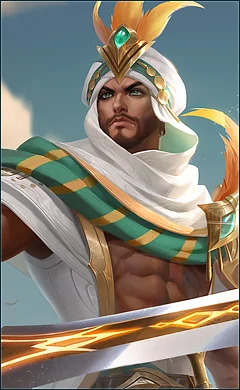
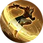
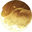

[Tier list](https://boostmlbb.ru/en/heroes/)[Items](https://boostmlbb.ru/en/items/)[News & guides](https://boostmlbb.ru/en/news/)

# Khaleed

D

FighterEXP LaneRoam

Win rate

48.9%

Pick rate

0.1%

Ban rate

0.1%

[Overview](https://boostmlbb.ru/#overview)[Build](https://boostmlbb.ru/#build)[Skills](https://boostmlbb.ru/#skills)[Counters](https://boostmlbb.ru/#draft)[Lore](https://boostmlbb.ru/#lore)

## Overview

### Attributes

-   Durability**80**
-   Offense**50**
-   Control**50**
-   Difficulty**50**

-   Damage
-   Regen

### Win rate by rank, 30 days

1.  **52.4%**Epic
2.  **52.8%**Legend
3.  **52.0%**Mythic
4.  **51.3%**Honor
5.  **48.6%**Glory

Dashed line: 50% win rate

### More fighters on this lane

[Freya](https://boostmlbb.ru/en/heroes/freya.html)[Kalea](https://boostmlbb.ru/en/heroes/kalea.html)[Aulus](https://boostmlbb.ru/en/heroes/aulus.html)[Paquito](https://boostmlbb.ru/en/heroes/paquito.html)[Sun](https://boostmlbb.ru/en/heroes/sun.html)[Lukas](https://boostmlbb.ru/en/heroes/lukas.html)[Cici](https://boostmlbb.ru/en/heroes/cici.html)[Sora](https://boostmlbb.ru/en/heroes/sora.html)

### Places in the rankings

-   [Best MLBB fighters**39 of 44**](https://boostmlbb.ru/en/heroes/best-fighter.html)
-   [Best MLBB roamers**25 of 34**](https://boostmlbb.ru/en/heroes/best-roam.html)

## Build

Build 1Build 2Build 3

Win rate

55.7%

Pick rate

4.0%

#### Core items

-   [

    

    Thunder Belt

    ](https://boostmlbb.ru/en/items/thunder-belt.html)
-   [

    

    Dominance Ice

    ](https://boostmlbb.ru/en/items/dominance-ice.html)
-   [

    

    Chastise Pauldron

    ](https://boostmlbb.ru/en/items/chastise-pauldron.html)

#### Spell

Flicker

#### Emblem and talents

Tank

-   

    Thrill

-   

    Wilderness Blessing

-   

    Concussive Blast

Win rate

54.3%

Pick rate

2.3%

#### Core items

-   [

    

    Thunder Belt

    ](https://boostmlbb.ru/en/items/thunder-belt.html)
-   [

    

    Dominance Ice

    ](https://boostmlbb.ru/en/items/dominance-ice.html)
-   [

    

    Blade Armor

    ](https://boostmlbb.ru/en/items/blade-armor.html)

#### Spell

Flicker

#### Emblem and talents

Tank

-   

    Thrill

-   

    Wilderness Blessing

-   

    Concussive Blast

Win rate

58.5%

Pick rate

1.9%

#### Core items

-   [

    

    Thunder Belt

    ](https://boostmlbb.ru/en/items/thunder-belt.html)
-   [

    

    Dominance Ice

    ](https://boostmlbb.ru/en/items/dominance-ice.html)
-   [

    

    Chastise Pauldron

    ](https://boostmlbb.ru/en/items/chastise-pauldron.html)

#### Spell

Revitalize

#### Emblem and talents

Tank

-   

    Thrill

-   

    Wilderness Blessing

-   

    Concussive Blast

## Skills

Level-up**Raging Sandstorm**_›_**Desert Tornado**_›_**Quicksand Guard**

Passive**Sand Walk**Skill 1**Desert Tornado**Skill 2**Quicksand Guard**Ultimate**Raging Sandstorm**

Passive

### Sand Walk

Khaleed accumulates Desert Power while moving. After Desert Power is fully charged, he will glide on sand, increasing Movement Speed by 35%, making his next Basic Attack deal 50 (+140% Total Physical Attack) Physical Damage to the target (cannot Crit), and reducing the target's Movement Speed by 40% for 1.5s.

Skill 1

### Desert Tornado

Cooldown **6.5 s**

Khaleed whirls his scimitar, dealing 175 (+130% Total Physical Attack) Physical Damage to enemies in the area and pulling them toward him. This skill can be used up to 3 time(s) in a row.

This skill deals 60% damage to Minions and Creeps.

Skill 2

### Quicksand Guard

Cooldown **18 s**

Khaleed protects himself with quicksand, restoring HP equal to 60 + 5% of his and 10 Desert Power every 0.5s. He also gains 25% Damage Reduction for up to 4s.

While channeling, quicksand appears beneath him, slowing the enemy by 60%.

This is a Focused Cast. Other control effects will interrupt this skill.

Ultimate

### Raging Sandstorm

Cooldown **46 s**

Khaleed rides the sandstorm and charges toward a designated location, dealing 100 (+50% Total Physical Attack) Physical Damage to enemies along the way and knocking them toward his destination. Khaleed is immune to control effects during this process.

Upon reaching the destination, Khaleed will smash the ground, dealing 450 (+160% Total Physical Attack) Physical Damage to enemies in the area and stunning them for 1s, and fully charge his Desert Power.

## Counters

### Counters

Beat this hero

[Yin](https://boostmlbb.ru/en/heroes/yin.html)[Helcurt](https://boostmlbb.ru/en/heroes/helcurt.html)[Hanabi](https://boostmlbb.ru/en/heroes/hanabi.html)[Vale](https://boostmlbb.ru/en/heroes/vale.html)[Johnson](https://boostmlbb.ru/en/heroes/johnson.html)

### Easy targets

This hero beats them

[Kalea](https://boostmlbb.ru/en/heroes/kalea.html)[Fredrinn](https://boostmlbb.ru/en/heroes/fredrinn.html)

## Lore

> A sand-walking intrepid Clan leader.

[Read the full story ↗](https://play.mobilelegends.com/lore/hero/Khaleed)Official Mobile Legends site [Hero stats on the game site ↗](https://www.mobilelegends.com/hero/detail?heroid=98)

**Rank up on Khaleed**The calculator shows the price

[Calculate price](https://boostmlbb.ru/en/order.html?type=hero)

## Frequently asked questions

Who counters Khaleed in MLBB?

Over the last 30 days the toughest opponents are Yin, Helcurt, Hanabi, Vale and Johnson.

What is Khaleed’s win rate right now?

48.89% at Mythical Glory over the last 7 days and 50.26% across all ranks over 30 days, as of 25 November 2026.

What role and lane does Khaleed play?

Fighter, played in the EXP Lane or on roam.

Is Khaleed strong in the current meta?

Tier D, #116 of 133 heroes and #39 among fighters. The tier counts how often the hero is picked and banned and how well it wins at Mythical Glory over 7 days: banned in 0.1% of matches, 48.9% win rate. In professional games over the last month the hero is drafted in 3.0% of them.

What is the best build for Khaleed?

The most popular ranked build: Thunder Belt, Dominance Ice and Chastise Pauldron as core items, the Tank emblem with Thrill, Wilderness Blessing and Concussive Blast, and Flicker. It wins 55.68% of matches.
