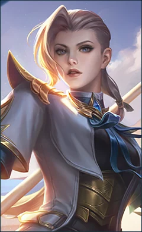

[Tier list](https://boostmlbb.ru/en/heroes/)[Items](https://boostmlbb.ru/en/items/)[Skins](https://boostmlbb.ru/en/skins/)[News & guides](https://boostmlbb.ru/en/news/)

# Khufra

B

TankRoam

Win rate

54.8%

Pick rate

0.6%

Ban rate

4.0%

[Overview](https://boostmlbb.ru/#overview)[Build](https://boostmlbb.ru/#build)[How to play](https://boostmlbb.ru/#howto)[Skills](https://boostmlbb.ru/#skills)[Counters](https://boostmlbb.ru/#draft)[Skins](https://boostmlbb.ru/#skins)[Lore](https://boostmlbb.ru/#lore)

## Overview

### Attributes

-   Durability**90**
-   Offense**20**
-   Control**100**
-   Difficulty**60**

-   Initiator
-   Crowd Control

### Win rate by rank, 30 days

1.  **55.1%**Epic
2.  **54.6%**Legend
3.  **54.8%**Mythic
4.  **55.2%**Honor
5.  **54.6%**Glory

Dashed line: 50% win rate

### More tanks on this lane

[Carmilla](https://boostmlbb.ru/en/heroes/carmilla.html)[Belerick](https://boostmlbb.ru/en/heroes/belerick.html)[Atlas](https://boostmlbb.ru/en/heroes/atlas.html)[Gloo](https://boostmlbb.ru/en/heroes/gloo.html)[Minotaur](https://boostmlbb.ru/en/heroes/minotaur.html)[Tigreal](https://boostmlbb.ru/en/heroes/tigreal.html)[Hilda](https://boostmlbb.ru/en/heroes/hilda.html)[Gatotkaca](https://boostmlbb.ru/en/heroes/gatotkaca.html)

### Places in the rankings

-   [Best MLBB tanks**11 of 25**](https://boostmlbb.ru/en/heroes/best-tank.html)
-   [Best MLBB roamers**16 of 34**](https://boostmlbb.ru/en/heroes/best-roam.html)

## Build

Build 1Build 2Build 3

Win rate

61.7%

Pick rate

8.9%

#### Core items

-   [

    

    Thunder Belt

    ](https://boostmlbb.ru/en/items/thunder-belt.html)
-   [

    

    Dominance Ice

    ](https://boostmlbb.ru/en/items/dominance-ice.html)
-   [

    

    Cursed Helmet

    ](https://boostmlbb.ru/en/items/cursed-helmet.html)

#### Spell

Flicker

#### Emblem and talents

Tank

-   

    Agility

-   

    Wilderness Blessing

-   

    Concussive Blast

Win rate

60.9%

Pick rate

7.3%

#### Core items

-   [

    

    Thunder Belt

    ](https://boostmlbb.ru/en/items/thunder-belt.html)
-   [

    

    Dominance Ice

    ](https://boostmlbb.ru/en/items/dominance-ice.html)
-   [

    

    Chastise Pauldron

    ](https://boostmlbb.ru/en/items/chastise-pauldron.html)

#### Spell

Flicker

#### Emblem and talents

Tank

-   

    Agility

-   

    Wilderness Blessing

-   

    Concussive Blast

Win rate

59.2%

Pick rate

4.5%

#### Core items

-   [

    

    Thunder Belt

    ](https://boostmlbb.ru/en/items/thunder-belt.html)
-   [

    

    Dominance Ice

    ](https://boostmlbb.ru/en/items/dominance-ice.html)
-   [

    

    Antique Cuirass

    ](https://boostmlbb.ru/en/items/antique-cuirass.html)

#### Spell

Flicker

#### Emblem and talents

Tank

-   

    Agility

-   

    Wilderness Blessing

-   

    Concussive Blast

## How to play Khufra

### Khufra combos

#### Teamfight

1.  1
2.  Ult
3.  2

In teamfights, Khufra should open with his 1st Skill, then his Ultimate for area control, follow up with his 2nd Skill to prevent the enemy from escaping with their dash or blink skills.

#### Laning

1.  1
2.  Attack
3.  2

In the laning phase, Khufra uses his 1st Skill to aim while charging before launching himself to CC the enemy target. He then deals damage and slows the target with his enhanced Basic Attack and follows up with his 2nd Skill to keep the target slowed.

### When strongest

Even through the game, from 54.1% to 55.5%. Pick fights by your items rather than the clock.

1.  **54.4**10–12
2.  **54.8**12–14
3.  **55.5**14–16
4.  **55.5**16–18
5.  **55.1**18–20
6.  **54.1**20+

Win rate % by match length in minutes, all ranks. Dashed line: 50%

### Level-up priority

1.  Tyrant's Rage
2.  Bouncing Ball
3.  Tyrant's Revenge

## Skills

Passive**Spell Curse**Skill 1**Tyrant's Revenge**Skill 2**Bouncing Ball**Ultimate**Tyrant's Rage**

Passive

### Spell Curse

Khufra activates the Spell Curse left by Esmeralda every 8s, enhancing his next Basic Attack. The enhanced Basic Attack gains extra attack range and deals 100 (+120% Total Physical Attack) (+ 6% target's ) Magic Damage. He also slows the target by 30% for 1.5s and recovers 8% of his on hit.

Each time Khufra applies a control effect to an enemy hero with his skill, the cooldown of Spell Curse is reduced by 4s.

Skill 1

### Tyrant's Revenge

Cooldown **15 Mana Cost: 80 s**

Khufra pulls the bandages on his arms to launch himself in the specified direction, dealing 50 (+ 7 (+1.5% Extra Physical Attack)% of his ) Physical Damage to all enemies on the path. When blinking to the furthest distance or encountering the first enemy hero, Khufra will immediately stop, dealing 50 (+ 7 (+1.5% Extra Physical Attack)% of his ) Physical Damage to nearby enemies and knocking them airborne for up to 1s.

Skill 2

### Bouncing Ball

Cooldown **10 Mana Cost: 70 s**

Khufra uses bandages to wrap himself into a Bouncing Ball, increasing his by 30%. Enemies trying to use mobility skills to move across Khufra will be knocked airborne.

Each time the Bouncing Ball hits the ground, it deals 50 (+ 3 (+2% Extra Physical Attack)% of his ) Magic Damage to nearby enemies and slows them by 80% for 0.2s.

Ultimate

### Tyrant's Rage

Cooldown **50 Mana Cost: 150 s**

Khufra pushes back all enemy targets around him toward his front (this skill can only be interrupted by Suppression), dealing 300 (+100% Total Physical Attack) Physical Damage and slowing them down for 1.25s. If the enemies are knocked against walls, extra Physical Damage equal to 150% of this skill's damage will be inflicted upon them, and they will be stunned, instead of slowed.

## Khufra counters

### Who counters Khufra

[Silvanna](https://boostmlbb.ru/en/heroes/silvanna.html)[Wanwan](https://boostmlbb.ru/en/heroes/wanwan.html)[Alucard](https://boostmlbb.ru/en/heroes/alucard.html)[Natalia](https://boostmlbb.ru/en/heroes/natalia.html)[Mathilda](https://boostmlbb.ru/en/heroes/mathilda.html)

### Who Khufra counters

[Minotaur](https://boostmlbb.ru/en/heroes/minotaur.html)[Yi Sun-shin](https://boostmlbb.ru/en/heroes/yi-sun-shin.html)[Martis](https://boostmlbb.ru/en/heroes/martis.html)[Bane](https://boostmlbb.ru/en/heroes/bane.html)[Zhuxin](https://boostmlbb.ru/en/heroes/zhuxin.html)

## Khufra skins

[Cursed ScrollDeluxe · 2025](https://boostmlbb.ru/en/skins/khufra/cursed-scroll.html)[Iron HookCommon · 2023](https://boostmlbb.ru/en/skins/khufra/iron-hook.html)[Gentleman ThiefExceptional · 2023](https://boostmlbb.ru/en/skins/khufra/gentleman-thief.html)[ApophisCommon · 2023](https://boostmlbb.ru/en/skins/khufra/apophis.html)[Dreadful ClownExceptional · 2021](https://boostmlbb.ru/en/skins/khufra/dreadful-clown.html)[Volcanic OverlordExquisite · 2020](https://boostmlbb.ru/en/skins/khufra/volcanic-overlord.html)[Desert OwlCommon · 2019](https://boostmlbb.ru/en/skins/khufra/desert-owl.html)

[All 7 Khufra skins: prices and how to get them](https://boostmlbb.ru/en/skins/khufra.html)

## Lore

> Sealed ancient tyrant.

[Read the full story ↗](https://kazukiofficial.com/stories/khufra)Kazuki Official [Hero stats on the game site ↗](https://www.mobilelegends.com/hero/detail?heroid=78)

**Rank up on Khufra**The calculator shows the price

[Calculate price](https://boostmlbb.ru/en/order.html?type=hero)

## Frequently asked questions

Who counters Khufra in MLBB?

Over the last 30 days the toughest opponents are Silvanna, Wanwan, Alucard, Natalia and Mathilda.

How do you play Khufra?

Level "Bouncing Ball" first and take the ultimate whenever it is available. Even through the game, from 54.1% to 55.5%. Pick fights by your items rather than the clock. Teamfight combo: In teamfights, Khufra should open with his 1st Skill, then his Ultimate for area control, follow up with his 2nd Skill to prevent the enemy from escaping with their dash or blink skills.

What is Khufra’s win rate right now?

54.84% at Mythical Glory over the last 7 days and 54.73% across all ranks over 30 days, as of 25 November 2026.

What role and lane does Khufra play?

Tank, played on roam.

Is Khufra strong in the current meta?

Tier B, #48 of 133 heroes and #11 among tanks. The tier counts how often the hero is picked and banned and how well it wins at Mythical Glory over 7 days: banned in 4.0% of matches, 54.8% win rate. In professional games over the last month the hero is drafted in 3.6% of them.

What is the best build for Khufra?

The most popular ranked build: Thunder Belt, Dominance Ice and Cursed Helmet as core items, the Tank emblem with Agility, Wilderness Blessing and Concussive Blast, and Flicker. It wins 61.74% of matches.
