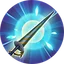

[Home](https://boostmlbb.ru/en/) / [Heroes](https://boostmlbb.ru/en/heroes/)

Tier D

# Lancelot in Mobile Legends: build, counters and stats

Assassin, Jungle. Wins 43.13% of matches over the last 30 days: #130 of 133 heroes.

[Boost on this hero](https://boostmlbb.ru/en/order.html?type=hero)[All heroes](https://boostmlbb.ru/en/heroes/)

Hero statsTier D

**Lancelot**Ban 0.47% · Pick 0.51%

Counters

Win rate, 30 days**43.13%**

**43.13%**win rate, 30 days

**0.51%**pick rate

**0.47%**ban rate

**42.31%**wins in Mythical Glory

## Lancelot build

The most picked setup for jungle Lancelot in ranked games across all ranks, from the in-game Academy. The win rate is for matches played with this exact build.

Core items

War AxeBrute Force BreastplateEndless Battle

Emblem and talents

FighterThrillSeasoned HunterKilling Spree

Battle spell

Retribution

Wins with this build **48.19%**Picked in **6.70%** of matches

### Other popular setups

-   RetributionAssassinThrill · Seasoned Hunter · Killing Spree**50.05%**
-   RetributionAssassinThrill · Seasoned Hunter · Killing Spree**49.02%**

## Lancelot skills

Official skill descriptions from MOONTON with cooldowns and tags.

Level-up priority: **Phantom Execution** → **Thorned Rose** → **Puncture**

-   

    **Soul Cutter**Passive

    Each time Lancelot charges, his damage is increased by 7.5% for 4s, up to 30%.

-   

    **Puncture**Skill 1CD 14 Mana Cost: 40 s

    Lancelot charges in the target direction, dealing 150 (+50% Total Physical Attack) Physical Damage to enemies in his path and marking the first unmarked enemy hit with Sword Mark for 3s.
    If a new Sword Mark is applied, this skill's cooldown resets.

-   

    **Thorned Rose**Skill 2CD 11 Mana Cost: 60 s

    Lancelot strikes in the target direction 3 times, each time dealing 220 (+120% Extra Physical Attack) Physical Damage to enemies hit (damage is reduced when multiple enemies are hit). He's untargetable during this process. Enemies in the center of the area take all the 3 hits and are slowed by 20% for 0.5s. The slow effect can stack.

-   

    **Phantom Execution**UltimateCD 36 Mana Cost: 100 s

    After a short delay, Lancelot performs an executioner's strike in the target direction, dealing 350 (+170% Total Physical Attack) Physical Damage to enemies hit. He is invincible throughout the process.

## Role and lane

Places are by win rate over the last 30 days among heroes of the same role or lane.

-   Role**Assassin**
-   Lane**Jungle**
-   Among assassins**#28 of 29**
-   In the jungle**#36 of 37**
-   Speciality**Chase, Burst**
-   Difficulty**Medium (50/100)**

## Who counters Lancelot

Lancelot loses to these heroes most often. The number under each icon is that hero’s own win rate. 3 of the 5 counters are fighters.

[Atlas51.42%](https://boostmlbb.ru/en/heroes/atlas.html)[Yin49.62%](https://boostmlbb.ru/en/heroes/yin.html)[Alpha48.85%](https://boostmlbb.ru/en/heroes/alpha.html)[Johnson49.25%](https://boostmlbb.ru/en/heroes/johnson.html)[X.Borg49.96%](https://boostmlbb.ru/en/heroes/x-borg.html)

## Who Lancelot is strong against

Lancelot is one of the toughest opponents for these heroes.

[Angela49.99%](https://boostmlbb.ru/en/heroes/angela.html)

## Best teammates for Lancelot

With these heroes on the same team Lancelot wins more often. The number is the gain in win rate, in percentage points.

[Angela+3.22 pts](https://boostmlbb.ru/en/heroes/angela.html)[Dyrroth+1.17 pts](https://boostmlbb.ru/en/heroes/dyrroth.html)[Argus+1.11 pts](https://boostmlbb.ru/en/heroes/argus.html)[Hanabi+0.75 pts](https://boostmlbb.ru/en/heroes/hanabi.html)

## Win rate by rank

Best result in Epic (45.34%), weakest in Mythical Glory (42.31%). Last 30 days.

-   Epic**45.34%**
-   Legend**44.12%**
-   Mythic**43.14%**
-   Mythical Honor**43.19%**
-   Mythical Glory**42.31%**

## Place in the meta

Lancelot sits in tier D of our win-rate tier list and ranks 130 of 133 heroes. In Mythical Glory the win rate is lower: 42.31% against 43.13% across all ranks, a 0.82-point gap. See the full [tier list](https://boostmlbb.ru/en/news/mlbb-meta-tier-list/) and the [patch breakdown](https://boostmlbb.ru/en/news/mlbb-current-patch/).

## Other Jungle heroes

The strongest by win rate over the last 30 days.

[Sun53.72%](https://boostmlbb.ru/en/heroes/sun.html)[Aulus53.46%](https://boostmlbb.ru/en/heroes/aulus.html)[Ling52.54%](https://boostmlbb.ru/en/heroes/ling.html)[Popol and Kupa52.09%](https://boostmlbb.ru/en/heroes/popol-and-kupa.html)[Lukas51.97%](https://boostmlbb.ru/en/heroes/lukas.html)[Bane51.61%](https://boostmlbb.ru/en/heroes/bane.html)

## Lore

«Prodigal son and genius swordsman of House Baroque.»

Lancelot’s full backstory is on MOONTON’s official lore site. The hero card with skills and the game’s own tips is on mobilelegends.com; voice lines, skins and patch history are collected by the MLBB Wiki.

[Read the lore](https://play.mobilelegends.com/lore/hero/Lancelot)[Official hero card](https://www.mobilelegends.com/hero/detail?heroid=47)[MLBB Wiki](https://mobile-legends.fandom.com/wiki/Lancelot)

## Boost on Lancelot

The booster plays only this hero, so the hero rating grows with your rank.

[Calculate the price](https://boostmlbb.ru/en/order.html?type=hero)

Statistics: official MOONTON hero ranking (mobilelegends.com/rank), last 30 days, updated 23 November 2026 and refreshed daily. Roles and lanes: the official hero page. Builds, skills and teammates: MOONTON in-game Academy data via the Rone Arena API (ridwaanhall / RoneAI).

## Frequently asked questions

Who counters Lancelot in MLBB?

Over the last 30 days the toughest opponents are Atlas, Yin, Alpha, Johnson and X.Borg.

What is Lancelot’s win rate right now?

43.13% over the last 30 days across all ranks and 42.31% in Mythical Glory, as of 23 November 2026.

What role and lane does Lancelot play?

Assassin, played in the jungle.

Is Lancelot strong in the current meta?

Tier D: #130 of 133 heroes by 30-day win rate and #28 among assassins.

What is the best build for Lancelot?

The most popular ranked build: War Axe, Brute Force Breastplate and Endless Battle as core items, the Fighter emblem with Thrill, Seasoned Hunter and Killing Spree, and Retribution. It wins 48.19% of matches.

MLBB Boost editorial team · Updated 23 November 2026
