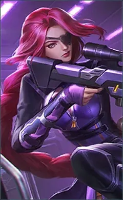

[Tier list](https://boostmlbb.ru/en/heroes/)[Items](https://boostmlbb.ru/en/items/)[Skins](https://boostmlbb.ru/en/skins/)[News & guides](https://boostmlbb.ru/en/news/)

[Tier list](https://boostmlbb.ru/en/heroes/)

# Lesley

B

AssassinMarksmanGold Lane

Win rate

48.7%

Pick rate

2.0%

Ban rate

5.5%

[Overview](https://boostmlbb.ru/#overview)[Build](https://boostmlbb.ru/#build)[How to play](https://boostmlbb.ru/#howto)[Skills](https://boostmlbb.ru/#skills)[Counters](https://boostmlbb.ru/#draft)[Skins](https://boostmlbb.ru/#skins)[Lore](https://boostmlbb.ru/#lore)

## Overview

### Attributes

-   Durability**10**
-   Offense**70**
-   Control**20**
-   Difficulty**50**

-   Finisher
-   Burst

### Places in the rankings

-   [Best MLBB marksmen**4 of 23**](https://boostmlbb.ru/en/heroes/best-marksman.html)
-   [Best MLBB assassins**8 of 29**](https://boostmlbb.ru/en/heroes/best-assassin.html)

## Build

Build 1Build 2Build 3

Win rate

57.0%

Pick rate

6.3%

#### Core items

-   [

    

    Berserker's Fury

    ](https://boostmlbb.ru/en/items/berserkers-fury.html)
-   [

    

    Malefic Gun

    ](https://boostmlbb.ru/en/items/malefic-gun.html)
-   [

    

    Blade of Despair

    ](https://boostmlbb.ru/en/items/blade-of-despair.html)

#### Spell

Flicker

#### Emblem and talents

Marksman

-   

    Fatal

-   

    Weapons Master

-   

    Quantum Charge

Win rate

52.8%

Pick rate

5.3%

#### Core items

-   [

    

    Berserker's Fury

    ](https://boostmlbb.ru/en/items/berserkers-fury.html)
-   [

    

    Malefic Gun

    ](https://boostmlbb.ru/en/items/malefic-gun.html)
-   [

    

    Sea Halberd

    ](https://boostmlbb.ru/en/items/sea-halberd.html)

#### Spell

Flicker

#### Emblem and talents

Marksman

-   

    Fatal

-   

    Weapons Master

-   

    Quantum Charge

Win rate

51.0%

Pick rate

3.1%

#### Core items

-   [

    

    Berserker's Fury

    ](https://boostmlbb.ru/en/items/berserkers-fury.html)
-   [

    

    Malefic Gun

    ](https://boostmlbb.ru/en/items/malefic-gun.html)
-   [

    

    Sea Halberd

    ](https://boostmlbb.ru/en/items/sea-halberd.html)

#### Spell

Flicker

#### Emblem and talents

Marksman

-   

    Fatal

-   

    Weapons Master

-   

    Lethal Ignition

## How to play Lesley

### Lesley combos

#### Teamfight

1.  1
2.  Attack
3.  2
4.  Attack
5.  Ult

In teamfights, Lesley can repeatedly use her 1st Skill to deal more damage with her enhanced Basic Attack while moving. When the enemy hero is close, Lesley can use her 2nd Skill and the enhanced Basic Attack for the counterattack, and use his Ultimate to start reaping.

#### Laning

1.  Attack
2.  1
3.  Attack
4.  Ult

In the laning phase, once Lesley reaches full energy, and her enhanced Basic Attack is activated, wait for the opportunity to use the enhanced Basic Attack to hit the enemy hero. Then use her 1st Skill to reactivate the enhanced Basic Attack and hit the enemy again, and finally, use her Ultimate to finish off the enemy.

### When strongest

Stronger late: 54.6% after minute 20. Do not take risks early, farm and fight together with your team.

1.  **41.1**10–12
2.  **45.8**12–14
3.  **47.9**14–16
4.  **50.2**16–18
5.  **52.8**18–20
6.  **54.6**20+

Win rate % by match length in minutes, all ranks. Dashed line: 50%

### Level-up priority

1.  Ultimate Snipe
2.  Master of Camouflage
3.  Tactical Grenade

## Skills

Passive**Lethal Shot**Skill 1**Master of Camouflage**Skill 2**Tactical Grenade**Ultimate**Ultimate Snipe**

Passive

### Lethal Shot

If Lesley doesn't take damage for 5s, her next Basic Attack gains extra range and 50% Crit Chance and deals 100 (+100% Total Physical Attack) True Damage (20% extra damage against minions).

Each point of fixed Physical Penetration and each 1% Physical Penetration Lesley acquires is converted into 1% Crit Damage, but her base Crit Damage is reduced to 130%.

Lesley's Basic Attack restores 5 points of energy and her Lethal Shot doubles the amount of energy restored. The Lethal Shot effect will activate immediately after Lesley uses a skill.

Skill 1

### Master of Camouflage

Cooldown **3.5 Energy Cost: 30 s**

Lesley enters the Camouflage state, gaining double Energy Regen, 40% extra Movement Speed, and 85 extra .

The state lasts 3s or until Lesley takes or deals damage. Enemies can detect Lesley's position through distortions of their surroundings.

Skill 2

### Tactical Grenade

Cooldown **10 Energy Cost: 40 s**

Lesley throws a tactical grenade in the target direction while jumping back slightly, dealing 150 (+50% Total Physical Attack) Physical Damage to enemies in a fan-shaped area and knocking them back.

Lesley can cast this skill during Ultimate Snipe to cancel the state and immediately fire a Fatal Bullet at the target. The attack is only triggered when there are unfired Fatal Bullets left.

Ultimate

### Ultimate Snipe

Cooldown **40 s**

**Passive:** Lesley's Crit Chance is increased by 10%.

**Active:** Lesley locks onto an enemy hero and fires 4 Fatal Bullets in succession. Each bullet deals 250 (+80% Extra Physical Attack) (+ 5% of the target's lost ) Physical Damage and restores 10 Energy on hit. Bullets can be blocked by other enemy heroes.

If this skill is interrupted, each remaining bullet reduces this skill's cooldown by 10%.

## Lesley counters

### Who counters Lesley

[Claude](https://boostmlbb.ru/en/heroes/claude.html)[Marcel](https://boostmlbb.ru/en/heroes/marcel.html)[Bruno](https://boostmlbb.ru/en/heroes/bruno.html)[Gatotkaca](https://boostmlbb.ru/en/heroes/gatotkaca.html)[Belerick](https://boostmlbb.ru/en/heroes/belerick.html)

### Who Lesley counters

[Tigreal](https://boostmlbb.ru/en/heroes/tigreal.html)[Masha](https://boostmlbb.ru/en/heroes/masha.html)

## Lesley skins

[Meowkin HunterDeluxe · 2025](https://boostmlbb.ru/en/skins/lesley/meowkin-hunter.html)[Duchess of TidesDeluxe · 2025](https://boostmlbb.ru/en/skins/lesley/duchess-of-tides.html)[Deadeye SpectreGrand · 2024](https://boostmlbb.ru/en/skins/lesley/deadeye-spectre.html)[Hawk-eyed SniperExquisite · 2021](https://boostmlbb.ru/en/skins/lesley/hawk-eyed-sniper.html)[Falcon MistressExquisite · 2021](https://boostmlbb.ru/en/skins/lesley/falcon-mistress.html)[Lethal LadyExceptional · 2020](https://boostmlbb.ru/en/skins/lesley/lethal-lady.html)[Angelic AgentSupreme · 2019](https://boostmlbb.ru/en/skins/lesley/angelic-agent.html)[Dangerous LoveExceptional · 2019](https://boostmlbb.ru/en/skins/lesley/dangerous-love.html)[Stellaris GhostExquisite · 2018](https://boostmlbb.ru/en/skins/lesley/stellaris-ghost.html)[Cheer­gunnerExceptional · 2018](https://boostmlbb.ru/en/skins/lesley/cheergunner.html)[Royal MusketeerCommon · 2018](https://boostmlbb.ru/en/skins/lesley/royal-musketeer.html)[General RosaCommon · 2018](https://boostmlbb.ru/en/skins/lesley/general-rosa.html)

[All 12 Lesley skins: prices and how to get them](https://boostmlbb.ru/en/skins/lesley.html)

## Lore

> Adopted daughter of House Vance, a clandestine sniper.

[Read the full story ↗](https://kazukiofficial.com/stories/lesley)Kazuki Official [Hero stats on the game site ↗](https://www.mobilelegends.com/hero/detail?heroid=53)

**Rank up on Lesley**The calculator shows the price

[Calculate price](https://boostmlbb.ru/en/order.html?type=hero)

## Frequently asked questions

Who counters Lesley in MLBB?

Over the last 30 days the toughest opponents are Claude, Marcel, Bruno, Gatotkaca and Belerick.

How do you play Lesley?

Level "Master of Camouflage" first and take the ultimate whenever it is available. Stronger late: 54.6% after minute 20. Do not take risks early, farm and fight together with your team. Teamfight combo: In teamfights, Lesley can repeatedly use her 1st Skill to deal more damage with her enhanced Basic Attack while moving. When the enemy hero is close, Lesley can use her 2nd Skill and the enhanced Basic Attack for the counterattack, and use his Ultimate to start reaping.

What is Lesley’s win rate right now?

48.74% at Mythical Glory over the last 7 days and 48.34% across all ranks over 30 days, as of 27 November 2026.

What role and lane does Lesley play?

Assassin and marksman, played in the Gold Lane.

Is Lesley strong in the current meta?

Tier B, #38 of 133 heroes and #8 among assassins. The tier counts how often the hero is picked and banned and how well it wins at Mythical Glory over 7 days: banned in 5.5% of matches, 48.7% win rate. In professional games over the last month the hero is drafted in 6.8% of them.

What is the best build for Lesley?

The most popular ranked build: Berserker's Fury, Malefic Gun and Blade of Despair as core items, the Marksman emblem with Fatal, Weapons Master and Quantum Charge, and Flicker. It wins 56.95% of matches.
