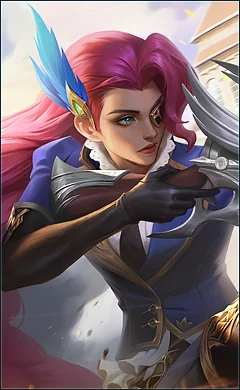

[Tier list](https://boostmlbb.ru/en/heroes/)[News & guides](https://boostmlbb.ru/en/news/)

# Lesley

B

AssassinMarksmanGold Lane

Adopted daughter of House Vance, a clandestine sniper.

Win rate

48.8%

all ranks 48.3%

Pick rate

2.0%

all ranks 1.8%

Ban rate

5.0%

all ranks 8.5%

#34 in the tier list · #5 among assassins · Mythical Glory, 7 days, to 23 November

[Overview](https://boostmlbb.ru/#overview)[Build](https://boostmlbb.ru/#build)[Skills](https://boostmlbb.ru/#skills)[Counters](https://boostmlbb.ru/#draft)[Lore](https://boostmlbb.ru/#lore)

## Overview

### Attributes

-   Durability**10**
-   Offense**70**
-   Control**20**
-   Difficulty**50**

-   Finisher
-   Burst

### Win rate by rank, 30 days

1.  **47.6%**Epic
2.  **48.1%**Legend
3.  **48.4%**Mythic
4.  **48.3%**Honor
5.  **48.5%**Glory

Dashed line: 50% win rate

## Build

Gold Lane · from ranked matches

Build 153.1%Build 257.2%Build 350.9%

### Core items

Berserker's Fury

Malefic Gun

Sea Halberd

### Emblem

Marksman

Fatal

Weapons Master

Quantum Charge

### Spell

Flicker

Win rate

53.1%

Pick rate

5.6%

### Core items

Berserker's Fury

Malefic Gun

Blade of Despair

### Emblem

Marksman

Fatal

Weapons Master

Quantum Charge

### Spell

Flicker

Win rate

57.2%

Pick rate

4.8%

### Core items

Berserker's Fury

Malefic Gun

Sea Halberd

### Emblem

Marksman

Fatal

Weapons Master

Lethal Ignition

### Spell

Flicker

Win rate

50.9%

Pick rate

3.7%

## Skills

Level-up**Ultimate Snipe**_›_**Master of Camouflage**_›_**Tactical Grenade**

PassiveSkill 1Skill 2Ultimate

Passive

### Lethal Shot

If Lesley doesn't take damage for 5s, her next Basic Attack gains extra range and 50% Crit Chance and deals 100 (+100% Total Physical Attack) True Damage (20% extra damage against minions).

Each point of fixed Physical Penetration and each 1% Physical Penetration Lesley acquires is converted into 1% Crit Damage, but her base Crit Damage is reduced to 130%.

Lesley's Basic Attack restores 5 points of energy and her Lethal Shot doubles the amount of energy restored. The Lethal Shot effect will activate immediately after Lesley uses a skill.

Skill 1

### Master of Camouflage

Cooldown **3.5 Energy Cost: 30 s**

Lesley enters the Camouflage state, gaining double Energy Regen, 40% extra Movement Speed, and 85 extra .

The state lasts 3s or until Lesley takes or deals damage. Enemies can detect Lesley's position through distortions of their surroundings.

Skill 2

### Tactical Grenade

Cooldown **10 Energy Cost: 40 s**

Lesley throws a tactical grenade in the target direction while jumping back slightly, dealing 150 (+50% Total Physical Attack) Physical Damage to enemies in a fan-shaped area and knocking them back.

Lesley can cast this skill during Ultimate Snipe to cancel the state and immediately fire a Fatal Bullet at the target. The attack is only triggered when there are unfired Fatal Bullets left.

Ultimate

### Ultimate Snipe

Cooldown **40 s**

**Passive:** Lesley's Crit Chance is increased by 10%.

**Active:** Lesley locks onto an enemy hero and fires 4 Fatal Bullets in succession. Each bullet deals 250 (+80% Extra Physical Attack) (+ 5% of the target's lost ) Physical Damage and restores 10 Energy on hit. Bullets can be blocked by other enemy heroes.

If this skill is interrupted, each remaining bullet reduces this skill's cooldown by 10%.

## Counters and teammates

### Counters

Beat this hero

[Claude](https://boostmlbb.ru/en/heroes/claude.html)[Marcel](https://boostmlbb.ru/en/heroes/marcel.html)[Bruno](https://boostmlbb.ru/en/heroes/bruno.html)[Gatotkaca](https://boostmlbb.ru/en/heroes/gatotkaca.html)[Belerick](https://boostmlbb.ru/en/heroes/belerick.html)

### Easy targets

This hero beats them

[Tigreal](https://boostmlbb.ru/en/heroes/tigreal.html)[Masha](https://boostmlbb.ru/en/heroes/masha.html)

### Teammates

Win rate gain as a duo, pp

[Harith**+3.7**](https://boostmlbb.ru/en/heroes/harith.html)[Popol and Kupa**+2.9**](https://boostmlbb.ru/en/heroes/popol-and-kupa.html)[Roger**+1.9**](https://boostmlbb.ru/en/heroes/roger.html)[Xavier**+1.4**](https://boostmlbb.ru/en/heroes/xavier.html)

## Lore

> Adopted daughter of House Vance, a clandestine sniper.

[Read the full story ↗](https://kazukiofficial.com/stories/lesley)Kazuki Official

[Hero stats on the game site ↗](https://www.mobilelegends.com/hero/detail?heroid=53)

**Rank up on Lesley**The calculator shows the price

[Calculate price](https://boostmlbb.ru/en/order.html?type=hero)

## Frequently asked questions

Who counters Lesley in MLBB?

Over the last 30 days the toughest opponents are Claude, Marcel, Bruno, Gatotkaca and Belerick.

What is Lesley’s win rate right now?

48.84% at Mythical Glory over the last 7 days and 48.31% across all ranks over 30 days, as of 23 November 2026.

What role and lane does Lesley play?

Assassin and marksman, played in the Gold Lane.

Is Lesley strong in the current meta?

Tier B, #34 of 133 heroes and #5 among assassins. The tier counts how often the hero is picked and banned and how well it wins at Mythical Glory over 7 days: banned in 5.0% of matches, 48.8% win rate.

What is the best build for Lesley?

The most popular ranked build: Berserker's Fury, Malefic Gun and Sea Halberd as core items, the Marksman emblem with Fatal, Weapons Master and Quantum Charge, and Flicker. It wins 53.12% of matches.
