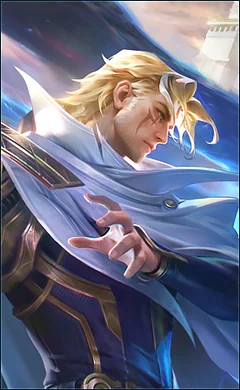

[Tier list](https://boostmlbb.ru/en/heroes/)[Items](https://boostmlbb.ru/en/items/)[Skins](https://boostmlbb.ru/en/skins/)[News & guides](https://boostmlbb.ru/en/news/)

[Tier list](https://boostmlbb.ru/en/heroes/)

# Ling

B

AssassinJungle

Win rate

51.8%

Pick rate

0.9%

Ban rate

0.7%

[Overview](https://boostmlbb.ru/#overview)[Build](https://boostmlbb.ru/#build)[How to play](https://boostmlbb.ru/#howto)[Skills](https://boostmlbb.ru/#skills)[Counters](https://boostmlbb.ru/#draft)[Skins](https://boostmlbb.ru/#skins)[Lore](https://boostmlbb.ru/#lore)

## Overview

### Attributes

-   Durability**50**
-   Offense**60**
-   Control**30**
-   Difficulty**60**

-   Chase
-   Burst

### Win rate by rank, 30 days

1.  **54.6%**Epic
2.  **53.8%**Legend
3.  **53.0%**Mythic
4.  **53.1%**Honor
5.  **51.9%**Glory

Dashed line: 50% win rate

### More assassins on this lane

[Nolan](https://boostmlbb.ru/en/heroes/nolan.html)[Hirara](https://boostmlbb.ru/en/heroes/hirara.html)[Saber](https://boostmlbb.ru/en/heroes/saber.html)[Harley](https://boostmlbb.ru/en/heroes/harley.html)[Fanny](https://boostmlbb.ru/en/heroes/fanny.html)[Karina](https://boostmlbb.ru/en/heroes/karina.html)[Yi Sun-shin](https://boostmlbb.ru/en/heroes/yi-sun-shin.html)[Gusion](https://boostmlbb.ru/en/heroes/gusion.html)

### Places in the rankings

-   [Best MLBB junglers**14 of 37**](https://boostmlbb.ru/en/heroes/best-jungle.html)
-   [Best MLBB assassins**11 of 29**](https://boostmlbb.ru/en/heroes/best-assassin.html)

## Build

Build 1Build 2Build 3

Win rate

57.9%

Pick rate

39.1%

#### Core items

-   [

    

    Berserker's Fury

    ](https://boostmlbb.ru/en/items/berserkers-fury.html)
-   [

    

    Haas's Claws

    ](https://boostmlbb.ru/en/items/haas-claws.html)
-   [

    

    Endless Battle

    ](https://boostmlbb.ru/en/items/endless-battle.html)

#### Spell

Retribution

#### Emblem and talents

Assassin

-   

    Fatal

-   

    Seasoned Hunter

-   

    War Cry

Win rate

59.2%

Pick rate

4.7%

#### Core items

-   [

    

    Berserker's Fury

    ](https://boostmlbb.ru/en/items/berserkers-fury.html)
-   [

    

    Haas's Claws

    ](https://boostmlbb.ru/en/items/haas-claws.html)
-   [

    

    Endless Battle

    ](https://boostmlbb.ru/en/items/endless-battle.html)

#### Spell

Retribution

#### Emblem and talents

Marksman

-   

    Fatal

-   

    Seasoned Hunter

-   

    War Cry

Win rate

59.5%

Pick rate

4.5%

#### Core items

-   [

    

    Berserker's Fury

    ](https://boostmlbb.ru/en/items/berserkers-fury.html)
-   [

    

    Haas's Claws

    ](https://boostmlbb.ru/en/items/haas-claws.html)
-   [

    

    Endless Battle

    ](https://boostmlbb.ru/en/items/endless-battle.html)

#### Spell

Retribution

#### Emblem and talents

Assassin

-   

    Fatal

-   

    Seasoned Hunter

-   

    Killing Spree

## How to play Ling

### Ling combos

#### Teamfight

1.  1
2.  2
3.  Attack
4.  Ult
5.  2

In teamfights, Ling should move onto the wall with his 1st Skill, then use his 2nd Skill to land on enemy back-row heroes. Once landed, Ling should attack the target heroes with his Basic Attacks, and then cast his Ultimate to avoid incoming damage. He should then follow his targets when in the air to deal damage and knock them airborne. He can then dash with his 2nd Skill between the Tempest Blades to reset its cooldown and restore Lightness Points.

#### Laning

1.  1
2.  2
3.  Attack
4.  2

In the laning phase, Ling should use his 1st Skill to leap onto the wall, and strike down with his 2nd Skill to deal damage to the target enemy and slow them. Follow up with Ling's Basic Attacks and his 2nd Skill to chase down the enemy hero.

### When strongest

Stronger late: 56.4% at 18–20 minutes. Do not take risks early, farm and fight together with your team.

1.  **44.6**10–12
2.  **50.7**12–14
3.  **53.1**14–16
4.  **55.3**16–18
5.  **56.4**18–20
6.  **56.4**20+

Win rate % by match length in minutes, all ranks. Dashed line: 50%

### Level-up priority

1.  Tempest of Blades
2.  Defiant Sword
3.  Finch Poise

## Skills

Passive**Cloud Walker**Skill 1**Finch Poise**Skill 2**Defiant Sword**Ultimate**Tempest of Blades**

Passive

### Cloud Walker

Ling's superb Lightness Skill allows him to leap among walls. He gains 4 extra Lightness Points per second when he's on a wall and 5 extra Lightness Points each time he deals damage.

Ling gains 1.6 times Crit Chance from all sources but only has 140% Crit Damage.

Skill 1

### Finch Poise

**Passive:** Ling's Crit Chance is increased by 2.5%.

**Active:** Ling leaps onto the designated wall and enters the Half-Stealth state, restoring Lightness Points faster and gaining 30% Movement Speed. Taking damage causes him to leave Half-Stealth. Being controlled makes him fall to the ground and slows him by 30% for 2s. When he uses this skill to jump from one wall to another, it does not trigger cooldown and refreshes Half-Stealth.

Skill 2

### Defiant Sword

Cooldown **2.5 Energy Cost: 35 s**

Ling charges in the target direction and stabs nearby enemies, dealing them 300 (+50% Total Physical Attack) Physical Damage.

If Ling casts this skill when he's on the wall (no energy cost), he'll dash to the target location on the ground, dealing 300 (+50% Total Physical Attack) Physical Damage to enemies in the area and slowing them by 30% for 1.5s.

Defiant Sword is regarded as Basic Attack.

Ultimate

### Tempest of Blades

Cooldown **52 s**

Ling leaps into the air, becoming invincible and gaining 10% extra Movement Speed for 1.5s. He ignores obstacles when in the air. He then lands on the ground, dealing 250 (+100% Total Physical Attack) Physical Damage to enemies in the area and slowing them by 40% for 1.5s, knocking those in the center airborne for 1s, and creating a Sword Field for 8s.

Four Tempest of Blades will also appear on the edge of the Sword Field. Ling can touch them to reduce the cooldown of Finch Poise by 4s, reset the cooldown of Defiant Sword, and gain 25 Lightness Points.

## Ling counters

### Who counters Ling

[Gloo](https://boostmlbb.ru/en/heroes/gloo.html)[X.Borg](https://boostmlbb.ru/en/heroes/x-borg.html)[Hanzo](https://boostmlbb.ru/en/heroes/hanzo.html)[Atlas](https://boostmlbb.ru/en/heroes/atlas.html)[Silvanna](https://boostmlbb.ru/en/heroes/silvanna.html)

### Who Ling counters

[Saber](https://boostmlbb.ru/en/heroes/saber.html)[Floryn](https://boostmlbb.ru/en/heroes/floryn.html)[Freya](https://boostmlbb.ru/en/heroes/freya.html)[Karina](https://boostmlbb.ru/en/heroes/karina.html)[Lukas](https://boostmlbb.ru/en/heroes/lukas.html)[Cyclops](https://boostmlbb.ru/en/heroes/cyclops.html)[Bruno](https://boostmlbb.ru/en/heroes/bruno.html)[Melissa](https://boostmlbb.ru/en/heroes/melissa.html)[Natalia](https://boostmlbb.ru/en/heroes/natalia.html)[Faramis](https://boostmlbb.ru/en/heroes/faramis.html)

## Ling skins

[Neobeast LingGrand · 2025](https://boostmlbb.ru/en/skins/ling/neobeast-ling.html)[Cosmo GuardExceptional · 2024](https://boostmlbb.ru/en/skins/ling/cosmo-guard.html)[Night ShadeDeluxe · 2024](https://boostmlbb.ru/en/skins/ling/night-shade.html)[Lord ShenGrand · 2022](https://boostmlbb.ru/en/skins/ling/lord-shen.html)[M-World LingDeluxe · 2022](https://boostmlbb.ru/en/skins/ling/m-world-ling.html)[Serene PlumeExquisite · 2021](https://boostmlbb.ru/en/skins/ling/serene-plume.html)[Street PunkExceptional · 2020](https://boostmlbb.ru/en/skins/ling/street-punk.html)[Fiery DanceCommon · 2019](https://boostmlbb.ru/en/skins/ling/fiery-dance.html)

[All 8 Ling skins: prices and how to get them](https://boostmlbb.ru/en/skins/ling.html)

## Lore

> A graceful, free-soaring Finch and the Oriental Fighter who inherited the Vermilion Bird's power.

[Read the full story ↗](https://play.mobilelegends.com/lore/hero/Ling)Official Mobile Legends site [Hero stats on the game site ↗](https://www.mobilelegends.com/hero/detail?heroid=84)

**Rank up on Ling**The calculator shows the price

[Calculate price](https://boostmlbb.ru/en/order.html?type=hero)

## Frequently asked questions

Who counters Ling in MLBB?

Over the last 30 days the toughest opponents are Gloo, X.Borg, Hanzo, Atlas and Silvanna.

How do you play Ling?

Level "Defiant Sword" first and take the ultimate whenever it is available. Stronger late: 56.4% at 18–20 minutes. Do not take risks early, farm and fight together with your team. Teamfight combo: In teamfights, Ling should move onto the wall with his 1st Skill, then use his 2nd Skill to land on enemy back-row heroes. Once landed, Ling should attack the target heroes with his Basic Attacks, and then cast his Ultimate to avoid incoming damage. He should then follow his targets when in the air to deal damage and knock them airborne. He can then dash with his 2nd Skill between the Tempest Blades to reset its cooldown and restore Lightness Points.

What is Ling’s win rate right now?

51.77% at Mythical Glory over the last 7 days and 52.51% across all ranks over 30 days, as of 25 November 2026.

What role and lane does Ling play?

Assassin, played in the jungle.

Is Ling strong in the current meta?

Tier B, #61 of 133 heroes and #11 among assassins. The tier counts how often the hero is picked and banned and how well it wins at Mythical Glory over 7 days: banned in 0.7% of matches, 51.8% win rate. In professional games over the last month the hero is drafted in 0.0% of them.

What is the best build for Ling?

The most popular ranked build: Berserker's Fury, Haas's Claws and Endless Battle as core items, the Assassin emblem with Fatal, Seasoned Hunter and War Cry, and Retribution. It wins 57.91% of matches.
