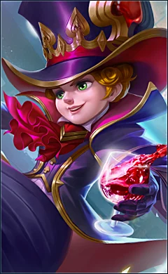

[Tier list](https://boostmlbb.ru/en/heroes/)[News & guides](https://boostmlbb.ru/en/news/)

# Lolita

D

TankSupportRoam

Win rate

52.4%

Pick rate

0.1%

Ban rate

0.2%

[Overview](https://boostmlbb.ru/#overview)[Build](https://boostmlbb.ru/#build)[Skills](https://boostmlbb.ru/#skills)[Counters](https://boostmlbb.ru/#draft)[Lore](https://boostmlbb.ru/#lore)

## Overview

### Attributes

-   Durability**100**
-   Offense**10**
-   Control**90**
-   Difficulty**50**

-   Guard
-   Crowd Control

### Win rate by rank, 30 days

1.  **54.2%**Epic
2.  **55.3%**Legend
3.  **54.7%**Mythic
4.  **53.8%**Honor
5.  **51.8%**Glory

Dashed line: 50% win rate

### More tanks on this lane

[Carmilla](https://boostmlbb.ru/en/heroes/carmilla.html)[Belerick](https://boostmlbb.ru/en/heroes/belerick.html)[Atlas](https://boostmlbb.ru/en/heroes/atlas.html)[Gloo](https://boostmlbb.ru/en/heroes/gloo.html)[Minotaur](https://boostmlbb.ru/en/heroes/minotaur.html)[Khufra](https://boostmlbb.ru/en/heroes/khufra.html)[Tigreal](https://boostmlbb.ru/en/heroes/tigreal.html)[Hilda](https://boostmlbb.ru/en/heroes/hilda.html)

### Places in the rankings

-   [Best MLBB tanks**22 of 25**](https://boostmlbb.ru/en/heroes/best-tank.html)
-   [Best MLBB roamers**30 of 34**](https://boostmlbb.ru/en/heroes/best-roam.html)

## Build

Build 1Build 2Build 3

Win rate

60.9%

Pick rate

2.3%

#### Core items

-   

    Flask of the Oasis

-   

    Dominance Ice

-   

    Radiant Armor

#### Spell

Revitalize

#### Emblem and talents

Support

-   

    Firmness

-   

    Tenacity

-   

    Concussive Blast

Win rate

59.4%

Pick rate

2.0%

#### Core items

-   

    Flask of the Oasis

-   

    Chastise Pauldron

-   

    Guardian Helmet

#### Spell

Revitalize

#### Emblem and talents

Tank

-   

    Vitality

-   

    Tenacity

-   

    Focusing Mark

Win rate

58.4%

Pick rate

1.5%

#### Core items

-   

    Flask of the Oasis

-   

    Chastise Pauldron

-   

    Guardian Helmet

#### Spell

Revitalize

#### Emblem and talents

Tank

-   

    Firmness

-   

    Pull Yourself Together

-   

    Focusing Mark

## Skills

Level-up**Noumenon Blast**_›_**Power Charge**_›_**Guardian's Reflection**

Passive**Noumenon Energy Core**Skill 1**Power Charge**Skill 2**Guardian's Reflection**Ultimate**Noumenon Blast**

Passive

### Noumenon Energy Core

Every 6s to 3s (scales with Noumenon Blast level), the Noumenon Energy Core grants Lolita 20 (+2.5% Max HP) (+20% Total Magic Power) shield. When Lolita casts a skill, the Noumenon Energy Core grants Lolita and nearby allied heroes an extra shield. This shield can stack up to 3 times and lasts 30s.

Skill 1

### Power Charge

Cooldown **10 Mana Cost: 70 s**

Lolita dashes in the target direction. Her next Basic Attack within 4s will perform a short dash to the target, dealing 400 (+100% Total Physical Attack) Physical Damage and stunning them for 0.5s. This damage is doubled against Minions.

Skill 2

### Guardian's Reflection

Cooldown **15 Mana Cost: 90 s**

Lolita raises her shield and reflects all incoming ranged Basic Attacks and Projectiles in the direction of the shield for 3s. The shield will break after taking 1000 (+15% Max HP) damage.

The damage and effects from the Unique Passives of an attacker's equipment will not apply to the shield and will not be reflected. This skill can be interrupted by high level control effects.

Ultimate

### Noumenon Blast

Cooldown **55 Mana Cost: 100 s**

**Passive:** Reduces the interval of Noumenon Energy Core by 1s each time this skill is upgraded.

**Active:** Lolita begins charging for 2s while slowing enemies in a fan-shaped area by 60%. When the charging is complete or is stopped, Lolita slams her hammer on the ground, dealing up to 600 (+100% Total Physical Attack) Physical Damage to enemies in the area and stunning them for up to 2s (damage and stun duration scale with charge time).

**Use Again:** Lolita immediately stops charging and slams her hammer on the ground.

## Counters

### Counters

Beat this hero

[Cyclops](https://boostmlbb.ru/en/heroes/cyclops.html)[Edith](https://boostmlbb.ru/en/heroes/edith.html)[Chang'e](https://boostmlbb.ru/en/heroes/change.html)[Bane](https://boostmlbb.ru/en/heroes/bane.html)[Harley](https://boostmlbb.ru/en/heroes/harley.html)

### Easy targets

This hero beats them

[Nana](https://boostmlbb.ru/en/heroes/nana.html)[Zetian](https://boostmlbb.ru/en/heroes/zetian.html)[Vexana](https://boostmlbb.ru/en/heroes/vexana.html)[Minotaur](https://boostmlbb.ru/en/heroes/minotaur.html)[Atlas](https://boostmlbb.ru/en/heroes/atlas.html)[Freya](https://boostmlbb.ru/en/heroes/freya.html)[Esmeralda](https://boostmlbb.ru/en/heroes/esmeralda.html)[Claude](https://boostmlbb.ru/en/heroes/claude.html)[Kadita](https://boostmlbb.ru/en/heroes/kadita.html)[Kagura](https://boostmlbb.ru/en/heroes/kagura.html)

## Lore

> Member of the Eruditio Rangers and protector of the Leviathan workshop.

[Read the full story ↗](https://play.mobilelegends.com/lore/hero/Lolita)Official Mobile Legends site [Hero stats on the game site ↗](https://www.mobilelegends.com/hero/detail?heroid=20)

**Rank up on Lolita**The calculator shows the price

[Calculate price](https://boostmlbb.ru/en/order.html?type=hero)

## Frequently asked questions

Who counters Lolita in MLBB?

Over the last 30 days the toughest opponents are Cyclops, Edith, Chang'e, Bane and Harley.

What is Lolita’s win rate right now?

52.35% at Mythical Glory over the last 7 days and 53.29% across all ranks over 30 days, as of 25 November 2026.

What role and lane does Lolita play?

Tank and support, played on roam.

Is Lolita strong in the current meta?

Tier D, #122 of 133 heroes and #22 among tanks. The tier counts how often the hero is picked and banned and how well it wins at Mythical Glory over 7 days: banned in 0.2% of matches, 52.4% win rate. In professional games over the last month the hero is drafted in 0.0% of them.

What is the best build for Lolita?

The most popular ranked build: Flask of the Oasis, Dominance Ice and Radiant Armor as core items, the Support emblem with Firmness, Tenacity and Concussive Blast, and Revitalize. It wins 60.85% of matches.
