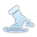

[Home](https://boostmlbb.ru/en/) / [Heroes](https://boostmlbb.ru/en/heroes/)

Tier S

# Masha

Tank and fighter · EXP Lane

**#1 of 133 by win rate**All ranks · 30 days to 23 November 2026

Win rate

60.40%

Pick rate

0.52%

Ban rate

40.89%

Push · Damage · Difficulty 30/100

[Build](https://boostmlbb.ru/#build)[Counters and teammates](https://boostmlbb.ru/#draft)[Skills](https://boostmlbb.ru/#skills)[Win rate by rank](https://boostmlbb.ru/#ranks)[Lore](https://boostmlbb.ru/#lore)

## Build

Most picked in ranked · EXP Lane

Core items

Thunder BeltCorrosion ScytheGuardian Helmet

Emblem and talents

TankSwiftWilderness BlessingWar Cry

Battle spell

Petrify

Wins with this build **63.70%**Picked in **6.35%** of matches

Alternative builds (2)

Core items

Thunder BeltCorrosion ScytheGuardian Helmet

Emblem and talents

TankSwiftWilderness BlessingWar Cry

Battle spell

Flicker

Wins with this build **64.66%**Picked in **1.89%** of matches

Core items

Thunder BeltCorrosion ScytheGuardian Helmet

Emblem and talents

TankSwiftBargain HunterWar Cry

Battle spell

Petrify

Wins with this build **65.08%**Picked in **1.77%** of matches

## Counters and teammates

### Counters

[Gloo](https://boostmlbb.ru/en/heroes/gloo.html)[Eudora](https://boostmlbb.ru/en/heroes/eudora.html)[Lesley](https://boostmlbb.ru/en/heroes/lesley.html)[Cici](https://boostmlbb.ru/en/heroes/cici.html)[Brody](https://boostmlbb.ru/en/heroes/brody.html)

### Strong against

[Freya](https://boostmlbb.ru/en/heroes/freya.html)[Bruno](https://boostmlbb.ru/en/heroes/bruno.html)

### Teammates

Win rate gain when playing together

[Bane+1.86 pp](https://boostmlbb.ru/en/heroes/bane.html)[Guinevere+1.66 pp](https://boostmlbb.ru/en/heroes/guinevere.html)[X.Borg+1.60 pp](https://boostmlbb.ru/en/heroes/x-borg.html)[Saber+1.52 pp](https://boostmlbb.ru/en/heroes/saber.html)

## Skills

Level-up priority · Savage Maul → Claw Strike → Feral Swipe

Passive**Primal Pact**

Bear's Blessing: Masha has 3 HP bars, each inheriting 50% of her Equipment HP bonuses. Each time an HP bar breaks, she removes control effects on herself and blocks one instance of damage. Dealing damage to enemy heroes or creeps builds Feral, which converts into HP after she leaves combat.
Power of Wildness: When Masha's skills damage an enemy hero, a Wound appears on a random side of the target. Breaking a Wound with a Basic Attack puts her into the Feral state.
Feral State: For 3s, Masha gains 15 (+1\*Hero Level)% Resilience, Attack Speed, and Movement Speed. Her next 3 Basic Attacks become fan-shaped claw strikes, dealing extra Physical Damage equal to 3 (+0.5% Extra Physical Attack) (+0.2\*Hero Level)% to enemies in the area (not against Turrets) and recovering 4 (+0.4\*Hero Level)% HP.
Breaking another Wound during the Feral state refreshes the state's duration. Up to 6 claw strikes can be stored.

Skill 1**Feral Swipe**

**Cooldown 8 s**

Masha releases energy forward, dealing 250 (+55% Total Physical Attack) Physical Damage to enemies in its path. It deals 150% damage to minions.

Skill 2**Claw Strike**

**Cooldown 9 s**

Masha dashes in the target direction, dealing 120 (+80% Extra Physical Attack) Physical Damage and reducing enemy heroes' Movement Speed by 50% for 1s on hit.
Whenever an HP bar is depleted, the cooldown of Claw Strike resets.

Ultimate**Savage Maul**

**Cooldown 42 s**

Masha charges toward an enemy hero, dealing 300 (+50% Extra Max HP) Physical Damage and stunning them for 1s while knocking back nearby enemies.

## Win rate by rank

-   Epic**54.74%**
-   Legend**58.09%**
-   Mythic**59.63%**
-   Mythical Honor**61.09%**
-   Mythical Glory**60.75%**

## Lore

Guardian of the Direbears.

[Read the lore](https://play.mobilelegends.com/lore/hero/Masha)[Hero card](https://www.mobilelegends.com/hero/detail?heroid=88)[MLBB Wiki](https://mobile-legends.fandom.com/wiki/Masha)

[Hero boost pricing](https://boostmlbb.ru/en/order.html?type=hero)

## Frequently asked questions

Who counters Masha in MLBB?

Over the last 30 days the toughest opponents are Gloo, Eudora, Lesley, Cici and Brody.

What is Masha’s win rate right now?

60.40% over the last 30 days across all ranks and 60.75% in Mythical Glory, as of 23 November 2026.

What role and lane does Masha play?

Tank and fighter, played in the EXP Lane.

Is Masha strong in the current meta?

Tier S: #1 of 133 heroes by 30-day win rate and #1 among tanks.

What is the best build for Masha?

The most popular ranked build: Thunder Belt, Corrosion Scythe and Guardian Helmet as core items, the Tank emblem with Swift, Wilderness Blessing and War Cry, and Petrify. It wins 63.70% of matches.
