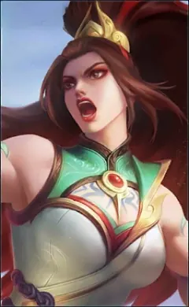

[Tier list](https://boostmlbb.ru/en/heroes/)[Items](https://boostmlbb.ru/en/items/)[Skins](https://boostmlbb.ru/en/skins/)[News & guides](https://boostmlbb.ru/en/news/)

# Masha

S

TankFighterEXP Lane

Win rate

58.8%

Pick rate

0.7%

Ban rate

67.2%

[Overview](https://boostmlbb.ru/#overview)[Build](https://boostmlbb.ru/#build)[How to play](https://boostmlbb.ru/#howto)[Skills](https://boostmlbb.ru/#skills)[Counters](https://boostmlbb.ru/#draft)[Skins](https://boostmlbb.ru/#skins)[Lore](https://boostmlbb.ru/#lore)

## Overview

### Attributes

-   Durability**50**
-   Offense**70**
-   Control**30**
-   Difficulty**30**

-   Push
-   Damage

### Win rate by rank, 30 days

1.  **54.5%**Epic
2.  **57.8%**Legend
3.  **59.4%**Mythic
4.  **61.0%**Honor
5.  **60.5%**Glory

Dashed line: 50% win rate

### More tanks on this lane

[Alice](https://boostmlbb.ru/en/heroes/alice.html)[Esmeralda](https://boostmlbb.ru/en/heroes/esmeralda.html)[Gloo](https://boostmlbb.ru/en/heroes/gloo.html)[Barats](https://boostmlbb.ru/en/heroes/barats.html)[Uranus](https://boostmlbb.ru/en/heroes/uranus.html)[Hilda](https://boostmlbb.ru/en/heroes/hilda.html)[Gatotkaca](https://boostmlbb.ru/en/heroes/gatotkaca.html)[Edith](https://boostmlbb.ru/en/heroes/edith.html)

### Places in the rankings

-   [Best MLBB fighters**1 of 44**](https://boostmlbb.ru/en/heroes/best-fighter.html)
-   [Best MLBB tanks**1 of 25**](https://boostmlbb.ru/en/heroes/best-tank.html)

## Build

Build 1Build 2Build 3

Win rate

63.7%

Pick rate

6.3%

#### Core items

-   [

    

    Thunder Belt

    ](https://boostmlbb.ru/en/items/thunder-belt.html)
-   [

    

    Corrosion Scythe

    ](https://boostmlbb.ru/en/items/corrosion-scythe.html)
-   [

    

    Guardian Helmet

    ](https://boostmlbb.ru/en/items/guardian-helmet.html)

#### Spell

Petrify

#### Emblem and talents

Tank

-   

    Swift

-   

    Wilderness Blessing

-   

    War Cry

Win rate

64.7%

Pick rate

1.9%

#### Core items

-   [

    

    Thunder Belt

    ](https://boostmlbb.ru/en/items/thunder-belt.html)
-   [

    

    Corrosion Scythe

    ](https://boostmlbb.ru/en/items/corrosion-scythe.html)
-   [

    

    Guardian Helmet

    ](https://boostmlbb.ru/en/items/guardian-helmet.html)

#### Spell

Flicker

#### Emblem and talents

Tank

-   

    Swift

-   

    Wilderness Blessing

-   

    War Cry

Win rate

65.1%

Pick rate

1.8%

#### Core items

-   [

    

    Thunder Belt

    ](https://boostmlbb.ru/en/items/thunder-belt.html)
-   [

    

    Corrosion Scythe

    ](https://boostmlbb.ru/en/items/corrosion-scythe.html)
-   [

    

    Guardian Helmet

    ](https://boostmlbb.ru/en/items/guardian-helmet.html)

#### Spell

Petrify

#### Emblem and talents

Tank

-   

    Swift

-   

    Bargain Hunter

-   

    War Cry

## How to play Masha

### Masha combos

#### Laning

1.  2
2.  Attack
3.  1
4.  Attack

In the laning phase, use Masha's 2nd Skill to close in and Basic Attack to inflict Wounds. Slow the target with the 1st Skill, then continue attacking to trigger the Enhanced Basic Attack, and keep up the pressure!

#### Teamfight

1.  Ult
2.  Attack
3.  2
4.  Attack
5.  Attack
6.  Attack
7.  Attack

In teamfights, use Masha's Ultimate to dive a squishy target. Follow with an Enhanced Basic Attack, then 2nd Skill to inflict Wounds on multiple enemies, and AoE them down with repeated Basic Attacks.

### When strongest

Even through the game, from 56.4% to 58.8%. Pick fights by your items rather than the clock.

1.  **56.5**10–12
2.  **57.9**12–14
3.  **58.4**14–16
4.  **58.8**16–18
5.  **58.6**18–20
6.  **56.4**20+

Win rate % by match length in minutes, all ranks. Dashed line: 50%

### Level-up priority

1.  Savage Maul
2.  Claw Strike
3.  Feral Swipe

## Skills

Passive**Primal Pact**Skill 1**Feral Swipe**Skill 2**Claw Strike**Ultimate**Savage Maul**

Passive

### Primal Pact

**Bear's Blessing:** Masha has 3 HP bars, each inheriting 50% of her Equipment HP bonuses. Each time an HP bar breaks, she removes control effects on herself and blocks one instance of damage. Dealing damage to enemy heroes or creeps builds Feral, which converts into HP after she leaves combat.

**Power of Wildness:** When Masha's skills damage an enemy hero, a Wound appears on a random side of the target. Breaking a Wound with a Basic Attack puts her into the Feral state.

**Feral State:** For 3s, Masha gains 15 (+1 × hero level)% Resilience, Attack Speed, and Movement Speed. Her next 3 Basic Attacks become fan-shaped claw strikes, dealing extra Physical Damage equal to 3 (+0.5% Extra Physical Attack) (+0.2 × hero level)% to enemies in the area (not against Turrets) and recovering 4 (+0.4 × hero level)% HP.

Breaking another Wound during the Feral state refreshes the state's duration. Up to 6 claw strikes can be stored.

Skill 1

### Feral Swipe

Cooldown **8 s**

Masha releases energy forward, dealing 250 (+55% Total Physical Attack) Physical Damage to enemies in its path. It deals 150% damage to minions.

Skill 2

### Claw Strike

Cooldown **9 s**

Masha dashes in the target direction, dealing 120 (+80% Extra Physical Attack) Physical Damage and reducing enemy heroes' Movement Speed by 50% for 1s on hit.

Whenever an HP bar is depleted, the cooldown of Claw Strike resets.

Ultimate

### Savage Maul

Cooldown **42 s**

Masha charges toward an enemy hero, dealing 300 (+50% Extra Max HP) Physical Damage and stunning them for 1s while knocking back nearby enemies.

## Masha counters

### Who counters Masha

[Gloo](https://boostmlbb.ru/en/heroes/gloo.html)[Eudora](https://boostmlbb.ru/en/heroes/eudora.html)[Lesley](https://boostmlbb.ru/en/heroes/lesley.html)[Brody](https://boostmlbb.ru/en/heroes/brody.html)[Cici](https://boostmlbb.ru/en/heroes/cici.html)

### Who Masha counters

[Freya](https://boostmlbb.ru/en/heroes/freya.html)[Bruno](https://boostmlbb.ru/en/heroes/bruno.html)

## Masha skins

[Mai ShiranuiGrand · 2024](https://boostmlbb.ru/en/skins/masha/mai-shiranui.html)[Rogue TalonExceptional · 2022](https://boostmlbb.ru/en/skins/masha/rogue-talon.html)[Spirited GauntletCommon · 2020](https://boostmlbb.ru/en/skins/masha/spirited-gauntlet.html)[Dragon ArmorDeluxe · 2020](https://boostmlbb.ru/en/skins/masha/dragon-armor.html)[Combat MaidenExceptional · 2020](https://boostmlbb.ru/en/skins/masha/combat-maiden.html)[Winter GuardCommon · 2019](https://boostmlbb.ru/en/skins/masha/winter-guard.html)

[All 6 Masha skins: prices and how to get them](https://boostmlbb.ru/en/skins/masha.html)

## Lore

> Guardian of the Direbears.

[Read the full story ↗](https://play.mobilelegends.com/lore/hero/Masha)Official Mobile Legends site [Hero stats on the game site ↗](https://www.mobilelegends.com/hero/detail?heroid=88)

**Rank up on Masha**The calculator shows the price

[Calculate price](https://boostmlbb.ru/en/order.html?type=hero)

## Frequently asked questions

Who counters Masha in MLBB?

Over the last 30 days the toughest opponents are Gloo, Eudora, Lesley, Brody and Cici.

How do you play Masha?

Level "Claw Strike" first and take the ultimate whenever it is available. Even through the game, from 56.4% to 58.8%. Pick fights by your items rather than the clock. Teamfight combo: In teamfights, use Masha's Ultimate to dive a squishy target. Follow with an Enhanced Basic Attack, then 2nd Skill to inflict Wounds on multiple enemies, and AoE them down with repeated Basic Attacks.

What is Masha’s win rate right now?

58.81% at Mythical Glory over the last 7 days and 60.21% across all ranks over 30 days, as of 25 November 2026.

What role and lane does Masha play?

Tank and fighter, played in the EXP Lane.

Is Masha strong in the current meta?

Tier S, #1 of 133 heroes and #1 among tanks. The tier counts how often the hero is picked and banned and how well it wins at Mythical Glory over 7 days: banned in 67.2% of matches, 58.8% win rate. In professional games over the last month the hero is drafted in 100.0% of them.

What is the best build for Masha?

The most popular ranked build: Thunder Belt, Corrosion Scythe and Guardian Helmet as core items, the Tank emblem with Swift, Wilderness Blessing and War Cry, and Petrify. It wins 63.70% of matches.
