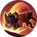

[Home](https://boostmlbb.ru/en/) / [Heroes](https://boostmlbb.ru/en/heroes/)

Tier S

# Minotaur

Tank and support · Roam

**#10 of 133 by win rate**All ranks · 30 days to 23 November 2026

Win rate

53.77%

Pick rate

1.00%

Ban rate

8.43%

Crowd Control · · Difficulty 30/100

[Build](https://boostmlbb.ru/#build)[Counters and teammates](https://boostmlbb.ru/#draft)[Skills](https://boostmlbb.ru/#skills)[Win rate by rank](https://boostmlbb.ru/#ranks)[Lore](https://boostmlbb.ru/#lore)

## Build

Most picked in ranked · Roam

Core items

Flask of the OasisDominance IceAthena's Shield

Emblem and talents

SupportVitalityWilderness BlessingConcussive Blast

Battle spell

Revitalize

Wins with this build **60.47%**Picked in **4.33%** of matches

Alternative builds (2)

Core items

Flask of the OasisDominance IceChastise Pauldron

Emblem and talents

TankFirmnessPull Yourself TogetherConcussive Blast

Battle spell

Flicker

Wins with this build **57.83%**Picked in **2.01%** of matches

Core items

Flask of the OasisDominance IceChastise Pauldron

Emblem and talents

SupportVitalityPull Yourself TogetherConcussive Blast

Battle spell

Revitalize

Wins with this build **63.50%**Picked in **2.77%** of matches

## Counters and teammates

### Counters

[Lolita](https://boostmlbb.ru/en/heroes/lolita.html)[Silvanna](https://boostmlbb.ru/en/heroes/silvanna.html)[Johnson](https://boostmlbb.ru/en/heroes/johnson.html)[Cyclops](https://boostmlbb.ru/en/heroes/cyclops.html)[Khufra](https://boostmlbb.ru/en/heroes/khufra.html)

### Strong against

[Beatrix](https://boostmlbb.ru/en/heroes/beatrix.html)

### Teammates

Win rate gain when playing together

[Saber+3.29 pp](https://boostmlbb.ru/en/heroes/saber.html)[Kalea+2.52 pp](https://boostmlbb.ru/en/heroes/kalea.html)[Natalia+2.04 pp](https://boostmlbb.ru/en/heroes/natalia.html)[Arlott+1.87 pp](https://boostmlbb.ru/en/heroes/arlott.html)

## Skills

Level-up priority · Minoan Fury → Despair Stomp → Motivation Roar

Passive**Rage Incarnate**

After casting a skill, Minotaur gains Motivation, recovering HP equal to 5 (+1\*Hero Level)% of damage taken from enemy heroes for 3s.
Enraged State: Motivation HP recovery is increased to 200%.

Skill 1**Despair Stomp**

**Cooldown 12 s**

Minotaur jumps to the target location, dealing 325 (+60% Total Physical Attack) Physical Damage to enemies in the area and briefly knocking them airborne. Enemies hit will also be slowed by 40% while Minotaur enhances his Basic Attacks to deal 25 (+5% Max HP) extra Physical Damage for 2s.
Enraged: Increases the AOE range and the damage dealt by 25 (+5% Max HP) Physical Damage.

Skill 2**Motivation Roar**

**Cooldown 10 s**

Minotaur heals himself and the nearby ally with the lowest HP, recovering 220 (+60% Total Magic Power) HP for both. He also recovers an additional 8% of his lost .
Enraged: Minotaur heals himself and all nearby allied heroes.

Ultimate**Minoan Fury**

**Cooldown 60 s**

Minotaur enters Enraged state and smashes the ground 3 times. The first 2 hits deal 180 (+85% Total Physical Attack) Physical Damage to nearby enemies and slow them by 60%, while the final hit deals 200 (+85% Total Physical Attack) True Damage and knocks targets airborne for 0.8s. Minotaur is immune to control effects during this attack.
The Enraged state lasts 12s and enhances Minotaur's skills for the duration.

## Win rate by rank

-   Epic**54.01%**
-   Legend**54.96%**
-   Mythic**54.88%**
-   Mythical Honor**54.24%**
-   Mythical Glory**53.12%**

## Lore

Minoan prince determined to restore his homeland.

[Hero card](https://www.mobilelegends.com/hero/detail?heroid=19)[MLBB Wiki](https://mobile-legends.fandom.com/wiki/Minotaur)

[Hero boost pricing](https://boostmlbb.ru/en/order.html?type=hero)

## Frequently asked questions

Who counters Minotaur in MLBB?

Over the last 30 days the toughest opponents are Lolita, Silvanna, Johnson, Cyclops and Khufra.

What is Minotaur’s win rate right now?

53.77% over the last 30 days across all ranks and 53.12% in Mythical Glory, as of 23 November 2026.

What role and lane does Minotaur play?

Tank and support, played on roam.

Is Minotaur strong in the current meta?

Tier S: #10 of 133 heroes by 30-day win rate and #3 among tanks.

What is the best build for Minotaur?

The most popular ranked build: Flask of the Oasis, Dominance Ice and Athena's Shield as core items, the Support emblem with Vitality, Wilderness Blessing and Concussive Blast, and Revitalize. It wins 60.47% of matches.
