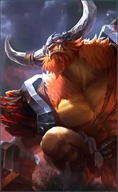

[Tier list](https://boostmlbb.ru/en/heroes/)[Items](https://boostmlbb.ru/en/items/)[Skins](https://boostmlbb.ru/en/skins/)[News & guides](https://boostmlbb.ru/en/news/)

[Tier list](https://boostmlbb.ru/en/heroes/)

# Minotaur

A

TankSupportRoam

Win rate

53.6%

Pick rate

1.3%

Ban rate

10.3%

[Overview](https://boostmlbb.ru/#overview)[Build](https://boostmlbb.ru/#build)[How to play](https://boostmlbb.ru/#howto)[Skills](https://boostmlbb.ru/#skills)[Counters](https://boostmlbb.ru/#draft)[Skins](https://boostmlbb.ru/#skins)[Lore](https://boostmlbb.ru/#lore)

## Overview

### Attributes

-   Durability**100**
-   Offense**10**
-   Control**80**
-   Difficulty**30**

-   Crowd Control

### Win rate by rank, 30 days

1.  **53.9%**Epic
2.  **54.9%**Legend
3.  **54.9%**Mythic
4.  **54.4%**Honor
5.  **53.2%**Glory

Dashed line: 50% win rate

### More tanks on this lane

[Carmilla](https://boostmlbb.ru/en/heroes/carmilla.html)[Belerick](https://boostmlbb.ru/en/heroes/belerick.html)[Atlas](https://boostmlbb.ru/en/heroes/atlas.html)[Gloo](https://boostmlbb.ru/en/heroes/gloo.html)[Khufra](https://boostmlbb.ru/en/heroes/khufra.html)[Tigreal](https://boostmlbb.ru/en/heroes/tigreal.html)[Hilda](https://boostmlbb.ru/en/heroes/hilda.html)[Gatotkaca](https://boostmlbb.ru/en/heroes/gatotkaca.html)

### Places in the rankings

-   [Best MLBB tanks**9 of 25**](https://boostmlbb.ru/en/heroes/best-tank.html)
-   [Best MLBB roamers**8 of 34**](https://boostmlbb.ru/en/heroes/best-roam.html)

## Build

Build 1Build 2Build 3

Win rate

60.5%

Pick rate

4.8%

#### Core items

-   [

    

    Flask of the Oasis

    ](https://boostmlbb.ru/en/items/flask-of-the-oasis.html)
-   [

    

    Dominance Ice

    ](https://boostmlbb.ru/en/items/dominance-ice.html)
-   [

    

    Athena's Shield

    ](https://boostmlbb.ru/en/items/athenas-shield.html)

#### Spell

Revitalize

#### Emblem and talents

Support

-   

    Vitality

-   

    Wilderness Blessing

-   

    Concussive Blast

Win rate

63.4%

Pick rate

3.0%

#### Core items

-   [

    

    Flask of the Oasis

    ](https://boostmlbb.ru/en/items/flask-of-the-oasis.html)
-   [

    

    Dominance Ice

    ](https://boostmlbb.ru/en/items/dominance-ice.html)
-   [

    

    Chastise Pauldron

    ](https://boostmlbb.ru/en/items/chastise-pauldron.html)

#### Spell

Revitalize

#### Emblem and talents

Support

-   

    Vitality

-   

    Pull Yourself Together

-   

    Concussive Blast

Win rate

58.3%

Pick rate

1.8%

#### Core items

-   [

    

    Flask of the Oasis

    ](https://boostmlbb.ru/en/items/flask-of-the-oasis.html)
-   [

    

    Dominance Ice

    ](https://boostmlbb.ru/en/items/dominance-ice.html)
-   [

    

    Athena's Shield

    ](https://boostmlbb.ru/en/items/athenas-shield.html)

#### Spell

Flicker

#### Emblem and talents

Support

-   

    Vitality

-   

    Wilderness Blessing

-   

    Concussive Blast

## How to play Minotaur

### Minotaur combos

#### Teamfight

1.  1
2.  Ult
3.  1
4.  Attack
5.  2

In teamfights, use Minotaur's 1st Skill to jump in and knock enemies airborne, then use his Ultimate to keep them CC'd and enter Enraged state. Use his 1st Skill to knock enemies airborne again and continue with Basic Attacks. Use his 2nd Skill when he or his team needs healing.

#### Laning

1.  1
2.  Attack
3.  2

In the laning phase, use Minotaur's 1st Skill to knock the enemy airborne and reduce their Defense, then deal damage with his enhanced Basic Attacks. Use his 2nd Skill to heal him and his teammate to come out ahead in the trade.

### When strongest

Stronger early: 55.6% at 10–12 minutes. Push your lane, take objectives and close the game before the lead fades.

1.  **55.6**10–12
2.  **54.5**12–14
3.  **54.6**14–16
4.  **53.6**16–18
5.  **52.9**18–20
6.  **51.0**20+

Win rate % by match length in minutes, all ranks. Dashed line: 50%

### Level-up priority

1.  Minoan Fury
2.  Despair Stomp
3.  Motivation Roar

## Skills

Passive**Rage Incarnate**Skill 1**Despair Stomp**Skill 2**Motivation Roar**Ultimate**Minoan Fury**

Passive

### Rage Incarnate

After casting a skill, Minotaur gains Motivation, recovering HP equal to 5 (+1 × hero level)% of damage taken from enemy heroes for 3s.

**Enraged State:** Motivation HP recovery is increased to 200%.

Skill 1

### Despair Stomp

Cooldown **12 s**

Minotaur jumps to the target location, dealing 325 (+60% Total Physical Attack) Physical Damage to enemies in the area and briefly knocking them airborne. Enemies hit will also be slowed by 40% while Minotaur enhances his Basic Attacks to deal 25 (+5% Max HP) extra Physical Damage for 2s.

**Enraged:** Increases the AOE range and the damage dealt by 25 (+5% Max HP) Physical Damage.

Skill 2

### Motivation Roar

Cooldown **10 s**

Minotaur heals himself and the nearby ally with the lowest HP, recovering 220 (+60% Total Magic Power) HP for both. He also recovers an additional 8% of his lost .

**Enraged:** Minotaur heals himself and all nearby allied heroes.

Ultimate

### Minoan Fury

Cooldown **60 s**

Minotaur enters Enraged state and smashes the ground 3 times. The first 2 hits deal 180 (+85% Total Physical Attack) Physical Damage to nearby enemies and slow them by 60%, while the final hit deals 200 (+85% Total Physical Attack) True Damage and knocks targets airborne for 0.8s. Minotaur is immune to control effects during this attack.

The Enraged state lasts 12s and enhances Minotaur's skills for the duration.

## Minotaur counters

### Who counters Minotaur

[Lolita](https://boostmlbb.ru/en/heroes/lolita.html)[Silvanna](https://boostmlbb.ru/en/heroes/silvanna.html)[Cyclops](https://boostmlbb.ru/en/heroes/cyclops.html)[Johnson](https://boostmlbb.ru/en/heroes/johnson.html)[Khufra](https://boostmlbb.ru/en/heroes/khufra.html)

### Who Minotaur counters

[Beatrix](https://boostmlbb.ru/en/heroes/beatrix.html)

## Minotaur skins

[Nether OverseerDeluxe · 2026](https://boostmlbb.ru/en/skins/minotaur/nether-overseer.html)[Dread­noughtExceptional · 2023](https://boostmlbb.ru/en/skins/minotaur/dreadnought.html)[TaurusDeluxe · 2019](https://boostmlbb.ru/en/skins/minotaur/taurus.html)[Sacred HammerCommon · 2018](https://boostmlbb.ru/en/skins/minotaur/sacred-hammer.html)[OrbiterCommon · 2018](https://boostmlbb.ru/en/skins/minotaur/orbiter.html)[Bursting YamaCommon · 2016](https://boostmlbb.ru/en/skins/minotaur/bursting-yama.html)

[All 6 Minotaur skins: prices and how to get them](https://boostmlbb.ru/en/skins/minotaur.html)

## Lore

> Minoan prince determined to restore his homeland.

[Read the full story ↗](https://kazukiofficial.com/stories/minotaur)Kazuki Official [Hero stats on the game site ↗](https://www.mobilelegends.com/hero/detail?heroid=19)

**Rank up on Minotaur**The calculator shows the price

[Calculate price](https://boostmlbb.ru/en/order.html?type=hero)

## Frequently asked questions

Who counters Minotaur in MLBB?

Over the last 30 days the toughest opponents are Lolita, Silvanna, Cyclops, Johnson and Khufra.

How do you play Minotaur?

Level "Despair Stomp" first and take the ultimate whenever it is available. Stronger early: 55.6% at 10–12 minutes. Push your lane, take objectives and close the game before the lead fades. Teamfight combo: In teamfights, use Minotaur's 1st Skill to jump in and knock enemies airborne, then use his Ultimate to keep them CC'd and enter Enraged state. Use his 1st Skill to knock enemies airborne again and continue with Basic Attacks. Use his 2nd Skill when he or his team needs healing.

What is Minotaur’s win rate right now?

53.60% at Mythical Glory over the last 7 days and 53.78% across all ranks over 30 days, as of 27 November 2026.

What role and lane does Minotaur play?

Tank and support, played on roam.

Is Minotaur strong in the current meta?

Tier A, #26 of 133 heroes and #9 among tanks. The tier counts how often the hero is picked and banned and how well it wins at Mythical Glory over 7 days: banned in 10.3% of matches, 53.6% win rate. In professional games over the last month the hero is drafted in 11.3% of them.

What is the best build for Minotaur?

The most popular ranked build: Flask of the Oasis, Dominance Ice and Athena's Shield as core items, the Support emblem with Vitality, Wilderness Blessing and Concussive Blast, and Revitalize. It wins 60.54% of matches.
