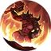

[Home](https://boostmlbb.ru/en/) / [Heroes](https://boostmlbb.ru/en/heroes/)

Tier S

# Minotaur in Mobile Legends: build, counters and stats

Tank and support, Roam. Wins 53.77% of matches over the last 30 days: #10 of 133 heroes.

[Boost on this hero](https://boostmlbb.ru/en/order.html?type=hero)[All heroes](https://boostmlbb.ru/en/heroes/)

Hero statsTier S

**Minotaur**Ban 8.43% · Pick 1.00%

Counters

Win rate, 30 days**53.77%**

**53.77%**win rate, 30 days

**1.00%**pick rate

**8.43%**ban rate

**53.12%**wins in Mythical Glory

## Minotaur build

The most picked setup for roam Minotaur in ranked games across all ranks, from the in-game Academy. The win rate is for matches played with this exact build.

Core items

Flask of the OasisDominance IceAthena's Shield

Emblem and talents

SupportVitalityWilderness BlessingConcussive Blast

Battle spell

Revitalize

Wins with this build **60.47%**Picked in **4.33%** of matches

### Other popular setups

-   FlickerTankFirmness · Pull Yourself Together · Concussive Blast**57.83%**
-   RevitalizeSupportVitality · Pull Yourself Together · Concussive Blast**63.50%**

## Minotaur skills

Official skill descriptions from MOONTON with cooldowns and tags.

Level-up priority: **Minoan Fury** → **Despair Stomp** → **Motivation Roar**

-   

    **Rage Incarnate**Passive

    After casting a skill, Minotaur gains Motivation, recovering HP equal to 5 (+1\*Hero Level)% of damage taken from enemy heroes for 3s.
    Enraged State: Motivation HP recovery is increased to 200%.

-   

    **Despair Stomp**Skill 1CD 12 s

    Minotaur jumps to the target location, dealing 325 (+60% Total Physical Attack) Physical Damage to enemies in the area and briefly knocking them airborne. Enemies hit will also be slowed by 40% while Minotaur enhances his Basic Attacks to deal 25 (+5% Max HP) extra Physical Damage for 2s.
    Enraged: Increases the AOE range and the damage dealt by 25 (+5% Max HP) Physical Damage.

-   

    **Motivation Roar**Skill 2CD 10 s

    Minotaur heals himself and the nearby ally with the lowest HP, recovering 220 (+60% Total Magic Power) HP for both. He also recovers an additional 8% of his lost .
    Enraged: Minotaur heals himself and all nearby allied heroes.

-   

    **Minoan Fury**UltimateCD 60 s

    Minotaur enters Enraged state and smashes the ground 3 times. The first 2 hits deal 180 (+85% Total Physical Attack) Physical Damage to nearby enemies and slow them by 60%, while the final hit deals 200 (+85% Total Physical Attack) True Damage and knocks targets airborne for 0.8s. Minotaur is immune to control effects during this attack.
    The Enraged state lasts 12s and enhances Minotaur's skills for the duration.

## Role and lane

Places are by win rate over the last 30 days among heroes of the same role or lane.

-   Role**Tank and support**
-   Lane**Roam**
-   Among tanks**#3 of 25**
-   Among supports**#5 of 15**
-   On roam**#6 of 34**
-   Speciality**Crowd Control,**
-   Difficulty**Easy (30/100)**

## Who counters Minotaur

Minotaur loses to these heroes most often. The number under each icon is that hero’s own win rate. 3 of the 5 counters are tanks.

[Lolita53.30%](https://boostmlbb.ru/en/heroes/lolita.html)[Silvanna51.36%](https://boostmlbb.ru/en/heroes/silvanna.html)[Johnson49.25%](https://boostmlbb.ru/en/heroes/johnson.html)[Cyclops51.68%](https://boostmlbb.ru/en/heroes/cyclops.html)[Khufra54.72%](https://boostmlbb.ru/en/heroes/khufra.html)

## Who Minotaur is strong against

Minotaur is one of the toughest opponents for these heroes.

[Beatrix50.35%](https://boostmlbb.ru/en/heroes/beatrix.html)

## Best teammates for Minotaur

With these heroes on the same team Minotaur wins more often. The number is the gain in win rate, in percentage points.

[Saber+3.29 pts](https://boostmlbb.ru/en/heroes/saber.html)[Kalea+2.52 pts](https://boostmlbb.ru/en/heroes/kalea.html)[Natalia+2.04 pts](https://boostmlbb.ru/en/heroes/natalia.html)[Arlott+1.87 pts](https://boostmlbb.ru/en/heroes/arlott.html)

## Win rate by rank

Best result in Legend (54.96%), weakest in Mythical Glory (53.12%). Last 30 days.

-   Epic**54.01%**
-   Legend**54.96%**
-   Mythic**54.88%**
-   Mythical Honor**54.24%**
-   Mythical Glory**53.12%**

## Place in the meta

Minotaur sits in tier S of our win-rate tier list and ranks 10 of 133 heroes. In Mythical Glory the win rate is lower: 53.12% against 53.77% across all ranks, a 0.65-point gap. See the full [tier list](https://boostmlbb.ru/en/news/mlbb-meta-tier-list/) and the [patch breakdown](https://boostmlbb.ru/en/news/mlbb-current-patch/).

## Other Roam heroes

The strongest by win rate over the last 30 days.

[Marcel57.46%](https://boostmlbb.ru/en/heroes/marcel.html)[Khufra54.72%](https://boostmlbb.ru/en/heroes/khufra.html)[Rafaela54.51%](https://boostmlbb.ru/en/heroes/rafaela.html)[Diggie54.30%](https://boostmlbb.ru/en/heroes/diggie.html)[Floryn54.07%](https://boostmlbb.ru/en/heroes/floryn.html)[Gloo53.45%](https://boostmlbb.ru/en/heroes/gloo.html)

## Lore

«Minoan prince determined to restore his homeland.»

Minotaur’s full backstory is on MOONTON’s official lore site. The hero card with skills and the game’s own tips is on mobilelegends.com; voice lines, skins and patch history are collected by the MLBB Wiki.

[Read the lore](https://www.mobilelegends.com/hero/detail?heroid=19)[Official hero card](https://www.mobilelegends.com/hero/detail?heroid=19)[MLBB Wiki](https://mobile-legends.fandom.com/wiki/Minotaur)

## Boost on Minotaur

The booster plays only this hero, so the hero rating grows with your rank.

[Calculate the price](https://boostmlbb.ru/en/order.html?type=hero)

Statistics: official MOONTON hero ranking (mobilelegends.com/rank), last 30 days, updated 23 November 2026 and refreshed daily. Roles and lanes: the official hero page. Builds, skills and teammates: MOONTON in-game Academy data via the Rone Arena API (ridwaanhall / RoneAI).

## Frequently asked questions

Who counters Minotaur in MLBB?

Over the last 30 days the toughest opponents are Lolita, Silvanna, Johnson, Cyclops and Khufra.

What is Minotaur’s win rate right now?

53.77% over the last 30 days across all ranks and 53.12% in Mythical Glory, as of 23 November 2026.

What role and lane does Minotaur play?

Tank and support, played on roam.

Is Minotaur strong in the current meta?

Tier S: #10 of 133 heroes by 30-day win rate and #3 among tanks.

What is the best build for Minotaur?

The most popular ranked build: Flask of the Oasis, Dominance Ice and Athena's Shield as core items, the Support emblem with Vitality, Wilderness Blessing and Concussive Blast, and Revitalize. It wins 60.47% of matches.

MLBB Boost editorial team · Updated 23 November 2026
