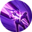
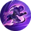
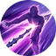

[Home](https://boostmlbb.ru/en/) / [Heroes](https://boostmlbb.ru/en/heroes/)

Tier B

# Moskov in Mobile Legends: build, counters and stats

Marksman, Gold Lane. Wins 50.31% of matches over the last 30 days: #56 of 133 heroes.

[Boost on this hero](https://boostmlbb.ru/en/order.html?type=hero)[All heroes](https://boostmlbb.ru/en/heroes/)

Hero statsTier B

**Moskov**Ban 0.28% · Pick 0.90%

Counters

Win rate, 30 days**50.31%**

**50.31%**win rate, 30 days

**0.90%**pick rate

**0.28%**ban rate

**51.31%**wins in Mythical Glory

## Moskov build

The most picked setup for Gold Lane Moskov in ranked games across all ranks, from the in-game Academy. The win rate is for matches played with this exact build.

Core items

Corrosion ScytheGolden StaffDemon Hunter Sword

Emblem and talents

MarksmanSwiftWeapons MasterQuantum Charge

Battle spell

Flicker

Wins with this build **52.77%**Picked in **4.42%** of matches

### Other popular setups

-   FlickerMarksmanSwift · Bargain Hunter · Quantum Charge**55.51%**
-   FlickerFighterSwift · Bargain Hunter · Quantum Charge**56.55%**

## Moskov skills

Official skill descriptions from MOONTON with cooldowns and tags.

Level-up priority: **Spear of Destruction** → **Abyss Walker** → **Spear of Misery**

-   

    **Spear of Quiescence**Passive

    Moskov's Basic Attacks can penetrate the target and deal (+68% Total Physical Attack)- (+110% Total Physical Attack) Physical Damage to enemies behind them (scales with hero level).
    Each Basic Attack hit reduces the cooldowns of Abyss Walker by 0.8s and Spear of Misery by 0.8s.

-   

    **Abyss Walker**Skill 1CD 10 Mana Cost: 50 s

    Moskov teleports to the target location, increasing his Attack Speed to 1.15 times its normal value for 3s. During this time, his Basic Attacks deal (+10% Total Physical Attack) damage to enemies behind the primary target.

-   

    **Spear of Misery**Skill 2CD 12 Mana Cost: 90 s

    Moskov launches a powerful strike at the target enemy hero or creep, dealing 300 (+60% Total Physical Attack) Physical Damage, knocking them back, and revealing their position for 2s.
    If the target collides with an enemy hero when knocked back, they'll both take 200 (+30% Total Physical Attack) Physical Damage and be stunned for 1.2s. The target is also stunned for the same duration if they collide with a wall.

-   

    **Spear of Destruction**UltimateCD 55 Mana Cost: 130 s

    After a short delay, Moskov throws the Spear of Destruction in the target direction, dealing 340 (+100% Total Physical Attack) Physical Damage to enemies in its path. Enemies behind the first enemy hero hit take 10% extra damage. All enemies hit are slowed by 50% for 1s. The slow duration increases with the spear's travel distance, up to 3s.
    When Spear of Destruction hits an enemy hero, it creates a shadow behind them and resets Abyss Walker's cooldown.
    Use Again: Moskov casts Abyss Walker from the shadow's location (shares a cooldown with Skill 1).

## Role and lane

Places are by win rate over the last 30 days among heroes of the same role or lane.

-   Role**Marksman**
-   Lane**Gold Lane**
-   Among marksmen**#10 of 23**
-   In the Gold Lane**#9 of 21**
-   Speciality**Finisher, Chase**
-   Difficulty**Easy (40/100)**

## Who counters Moskov

Moskov loses to these heroes most often. The number under each icon is that hero’s own win rate. 2 of the 5 counters are tanks.

[Gloo53.45%](https://boostmlbb.ru/en/heroes/gloo.html)[Joy48.79%](https://boostmlbb.ru/en/heroes/joy.html)[Fanny42.64%](https://boostmlbb.ru/en/heroes/fanny.html)[Beatrix50.35%](https://boostmlbb.ru/en/heroes/beatrix.html)[Atlas51.42%](https://boostmlbb.ru/en/heroes/atlas.html)

## Who Moskov is strong against

Moskov is one of the toughest opponents for these heroes.

[Hanabi52.66%](https://boostmlbb.ru/en/heroes/hanabi.html)[Miya49.71%](https://boostmlbb.ru/en/heroes/miya.html)[Martis47.23%](https://boostmlbb.ru/en/heroes/martis.html)

## Best teammates for Moskov

With these heroes on the same team Moskov wins more often. The number is the gain in win rate, in percentage points.

[Harith+2.67 pts](https://boostmlbb.ru/en/heroes/harith.html)[Faramis+2.07 pts](https://boostmlbb.ru/en/heroes/faramis.html)[Masha+1.23 pts](https://boostmlbb.ru/en/heroes/masha.html)[Marcel+1.12 pts](https://boostmlbb.ru/en/heroes/marcel.html)

## Win rate by rank

Best result in Mythical Glory (51.31%), weakest in Epic (46.77%). Last 30 days.

-   Epic**46.77%**
-   Legend**47.84%**
-   Mythic**49.49%**
-   Mythical Honor**50.94%**
-   Mythical Glory**51.31%**

## Place in the meta

Moskov sits in tier B of our win-rate tier list and ranks 56 of 133 heroes. In Mythical Glory the win rate is higher: 51.31% against 50.31% across all ranks, a 1.00-point gap. See the full [tier list](https://boostmlbb.ru/en/news/mlbb-meta-tier-list/) and the [patch breakdown](https://boostmlbb.ru/en/news/mlbb-current-patch/).

## Other Gold Lane heroes

The strongest by win rate over the last 30 days.

[Bruno53.78%](https://boostmlbb.ru/en/heroes/bruno.html)[Obsidia53.20%](https://boostmlbb.ru/en/heroes/obsidia.html)[Irithel52.74%](https://boostmlbb.ru/en/heroes/irithel.html)[Hanabi52.66%](https://boostmlbb.ru/en/heroes/hanabi.html)[Popol and Kupa52.09%](https://boostmlbb.ru/en/heroes/popol-and-kupa.html)[Natan51.32%](https://boostmlbb.ru/en/heroes/natan.html)

## Lore

«A warrior of the desert that embraced the darkness to seek his revenge.»

Moskov’s full backstory is on MOONTON’s official lore site. The hero card with skills and the game’s own tips is on mobilelegends.com; voice lines, skins and patch history are collected by the MLBB Wiki.

[Read the lore](https://play.mobilelegends.com/lore/hero/Moskov)[Official hero card](https://www.mobilelegends.com/hero/detail?heroid=31)[MLBB Wiki](https://mobile-legends.fandom.com/wiki/Moskov)

## Boost on Moskov

The booster plays only this hero, so the hero rating grows with your rank.

[Calculate the price](https://boostmlbb.ru/en/order.html?type=hero)

Statistics: official MOONTON hero ranking (mobilelegends.com/rank), last 30 days, updated 23 November 2026 and refreshed daily. Roles and lanes: the official hero page. Builds, skills and teammates: MOONTON in-game Academy data via the Rone Arena API (ridwaanhall / RoneAI).

## Frequently asked questions

Who counters Moskov in MLBB?

Over the last 30 days the toughest opponents are Gloo, Joy, Fanny, Beatrix and Atlas.

What is Moskov’s win rate right now?

50.31% over the last 30 days across all ranks and 51.31% in Mythical Glory, as of 23 November 2026.

What role and lane does Moskov play?

Marksman, played in the Gold Lane.

Is Moskov strong in the current meta?

Tier B: #56 of 133 heroes by 30-day win rate and #10 among marksmen.

What is the best build for Moskov?

The most popular ranked build: Corrosion Scythe, Golden Staff and Demon Hunter Sword as core items, the Marksman emblem with Swift, Weapons Master and Quantum Charge, and Flicker. It wins 52.77% of matches.

MLBB Boost editorial team · Updated 23 November 2026
