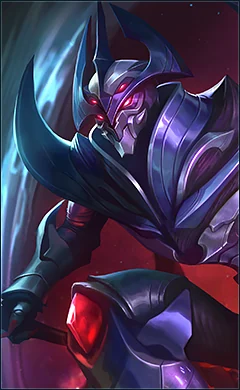

[Tier list](https://boostmlbb.ru/en/heroes/)[Items](https://boostmlbb.ru/en/items/)[News & guides](https://boostmlbb.ru/en/news/)

# Natan

C

MarksmanGold Lane

Win rate

51.5%

Pick rate

0.4%

Ban rate

0.1%

[Overview](https://boostmlbb.ru/#overview)[Build](https://boostmlbb.ru/#build)[Skills](https://boostmlbb.ru/#skills)[Counters](https://boostmlbb.ru/#draft)[Lore](https://boostmlbb.ru/#lore)

## Overview

### Attributes

-   Durability**20**
-   Offense**60**
-   Control**20**
-   Difficulty**30**

-   Burst
-   Magic Damage

### Win rate by rank, 30 days

1.  **50.2%**Epic
2.  **50.6%**Legend
3.  **51.1%**Mythic
4.  **51.7%**Honor
5.  **51.5%**Glory

Dashed line: 50% win rate

### More marksmen on this lane

[Obsidia](https://boostmlbb.ru/en/heroes/obsidia.html)[Bruno](https://boostmlbb.ru/en/heroes/bruno.html)[Clint](https://boostmlbb.ru/en/heroes/clint.html)[Brody](https://boostmlbb.ru/en/heroes/brody.html)[Hanabi](https://boostmlbb.ru/en/heroes/hanabi.html)[Moskov](https://boostmlbb.ru/en/heroes/moskov.html)[Claude](https://boostmlbb.ru/en/heroes/claude.html)[Miya](https://boostmlbb.ru/en/heroes/miya.html)

### Places in the rankings

-   [Best MLBB marksmen**19 of 23**](https://boostmlbb.ru/en/heroes/best-marksman.html)

## Build

Build 1Build 2Build 3

Win rate

54.4%

Pick rate

23.8%

#### Core items

-   [

    

    Feather of Heaven

    ](https://boostmlbb.ru/en/items/feather-of-heaven.html)
-   [

    

    Concentrated Energy

    ](https://boostmlbb.ru/en/items/concentrated-energy.html)
-   [

    

    Windtalker

    ](https://boostmlbb.ru/en/items/windtalker.html)

#### Spell

Aegis

#### Emblem and talents

Fighter

-   

    Swift

-   

    Bargain Hunter

-   

    Weakness Finder

Win rate

55.6%

Pick rate

7.0%

#### Core items

-   [

    

    Feather of Heaven

    ](https://boostmlbb.ru/en/items/feather-of-heaven.html)
-   [

    

    Concentrated Energy

    ](https://boostmlbb.ru/en/items/concentrated-energy.html)
-   [

    

    Windtalker

    ](https://boostmlbb.ru/en/items/windtalker.html)

#### Spell

Purify

#### Emblem and talents

Fighter

-   

    Swift

-   

    Bargain Hunter

-   

    Weakness Finder

Win rate

53.4%

Pick rate

5.2%

#### Core items

-   [

    

    Feather of Heaven

    ](https://boostmlbb.ru/en/items/feather-of-heaven.html)
-   [

    

    Concentrated Energy

    ](https://boostmlbb.ru/en/items/concentrated-energy.html)
-   [

    

    Windtalker

    ](https://boostmlbb.ru/en/items/windtalker.html)

#### Spell

Inspire

#### Emblem and talents

Fighter

-   

    Swift

-   

    Bargain Hunter

-   

    Weakness Finder

## Skills

Level-up**Entropy?**_›_**Superposition**_›_**Interference!**

Passive**Theory of Everything**Skill 1**Superposition**Skill 2**Interference!**Ultimate**Entropy?**

Passive

### Theory of Everything

Natan gains a stack of Entanglement each time he or his Reverse-Clone hits an enemy with a skill (up to 6 stacks). Each stack lasts 2.5s and grants 7.5% Attack Speed and 5% Movement Speed.

Natan's Basic Attack projectiles will return to Natan after reaching the maximum range, dealing an extra 30 (+50% Total Physical Attack) (+60% Total Magic Power) Magic Damage to enemies along the way (inherits a portion of Attack Effects). Hitting an enemy refreshes Entanglement's duration.

Skill 1

### Superposition

Cooldown **8 Mana Cost: 50 s**

Natan shoots a dense mass of energy in the target direction, dealing 225 (+100% Total Physical Attack) (+120% Total Magic Power) Magic Damage to enemies in its path.

Skill 2

### Interference!

Cooldown **12 Mana Cost: 60 s**

Natan launches a Gravitational Attractor in the target direction, dealing 150 (+50% Total Physical Attack) (+60% Total Magic Power) Magic Damage to enemies in its path and knocking them back.

The Attractor detonates upon reaching the maximum range, dealing 30 (+10% Total Physical Attack) (+12% Total Magic Power) Magic Damage to nearby enemies and knocking them back.

Ultimate

### Entropy?

Cooldown **24 Mana Cost: 100 s**

Natan summons a Reverse-Clone that lasts 10s at 6 units away. The Reverse-Clone copies his moves and attacks in reverse and inherits 35% of his Basic Attack and skill damage.

**Use Again:** Natan switches places with the Reverse-Clone.

Each cast reduces other skills' remaining cooldowns by 50%. The Reverse-Clone will disappear if Natan is too far away.

## Counters

### Counters

Beat this hero

[Sun](https://boostmlbb.ru/en/heroes/sun.html)[Gloo](https://boostmlbb.ru/en/heroes/gloo.html)[Zhask](https://boostmlbb.ru/en/heroes/zhask.html)[Esmeralda](https://boostmlbb.ru/en/heroes/esmeralda.html)[Johnson](https://boostmlbb.ru/en/heroes/johnson.html)

### Easy targets

This hero beats them

[Arlott](https://boostmlbb.ru/en/heroes/arlott.html)

## Lore

> The savior who travels through time and space.

[Read the full story ↗](https://play.mobilelegends.com/lore/hero/Natan)Official Mobile Legends site [Hero stats on the game site ↗](https://www.mobilelegends.com/hero/detail?heroid=107)

**Rank up on Natan**The calculator shows the price

[Calculate price](https://boostmlbb.ru/en/order.html?type=hero)

## Frequently asked questions

Who counters Natan in MLBB?

Over the last 30 days the toughest opponents are Sun, Gloo, Zhask, Esmeralda and Johnson.

What is Natan’s win rate right now?

51.48% at Mythical Glory over the last 7 days and 51.34% across all ranks over 30 days, as of 25 November 2026.

What role and lane does Natan play?

Marksman, played in the Gold Lane.

Is Natan strong in the current meta?

Tier C, #94 of 133 heroes and #19 among marksmen. The tier counts how often the hero is picked and banned and how well it wins at Mythical Glory over 7 days: banned in 0.1% of matches, 51.5% win rate. In professional games over the last month the hero is drafted in 1.0% of them.

What is the best build for Natan?

The most popular ranked build: Feather of Heaven, Concentrated Energy and Windtalker as core items, the Fighter emblem with Swift, Bargain Hunter and Weakness Finder, and Aegis. It wins 54.43% of matches.
