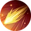
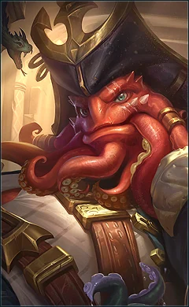

[Tier list](https://boostmlbb.ru/en/heroes/)[Items](https://boostmlbb.ru/en/items/)[Skins](https://boostmlbb.ru/en/skins/)[News & guides](https://boostmlbb.ru/en/news/)

[Tier list](https://boostmlbb.ru/en/heroes/)

# Novaria

B

MageMid Lane

Win rate

48.3%

Pick rate

1.1%

Ban rate

1.9%

[Overview](https://boostmlbb.ru/#overview)[Build](https://boostmlbb.ru/#build)[How to play](https://boostmlbb.ru/#howto)[Skills](https://boostmlbb.ru/#skills)[Counters](https://boostmlbb.ru/#draft)[Skins](https://boostmlbb.ru/#skins)[Lore](https://boostmlbb.ru/#lore)

## Overview

### Attributes

-   Durability**30**
-   Offense**90**
-   Control**30**
-   Difficulty**70**

-   Burst
-   Poke

### Win rate by rank, 30 days

1.  **50.2%**Epic
2.  **50.0%**Legend
3.  **49.7%**Mythic
4.  **49.7%**Honor
5.  **48.8%**Glory

Dashed line: 50% win rate

### More mages on this lane

[Kimmy](https://boostmlbb.ru/en/heroes/kimmy.html)[Eudora](https://boostmlbb.ru/en/heroes/eudora.html)[Zhuxin](https://boostmlbb.ru/en/heroes/zhuxin.html)[Valir](https://boostmlbb.ru/en/heroes/valir.html)[Zetian](https://boostmlbb.ru/en/heroes/zetian.html)[Lylia](https://boostmlbb.ru/en/heroes/lylia.html)[Xavier](https://boostmlbb.ru/en/heroes/xavier.html)[Lunox](https://boostmlbb.ru/en/heroes/lunox.html)

### Places in the rankings

-   [Best MLBB mages**15 of 32**](https://boostmlbb.ru/en/heroes/best-mage.html)
-   [Best MLBB mid laners**13 of 29**](https://boostmlbb.ru/en/heroes/best-mid.html)

## Build

Build 1Build 2Build 3

Win rate

53.7%

Pick rate

3.7%

#### Core items

-   [

    

    Sky Piercer

    ](https://boostmlbb.ru/en/items/sky-piercer.html)
-   [

    

    Lightning Truncheon

    ](https://boostmlbb.ru/en/items/lightning-truncheon.html)
-   [

    

    Holy Crystal

    ](https://boostmlbb.ru/en/items/holy-crystal.html)

#### Spell

Flameshot

#### Emblem and talents

Assassin

-   

    Rupture

-   

    Wilderness Blessing

-   

    Impure Rage

Win rate

56.0%

Pick rate

3.4%

#### Core items

-   [

    

    Glowing Wand

    ](https://boostmlbb.ru/en/items/glowing-wand.html)
-   [

    

    Lightning Truncheon

    ](https://boostmlbb.ru/en/items/lightning-truncheon.html)
-   [

    

    Divine Glaive

    ](https://boostmlbb.ru/en/items/divine-glaive.html)

#### Spell

Flicker

#### Emblem and talents

Mage

-   

    Inspire

-   

    Wilderness Blessing

-   

    Impure Rage

Win rate

53.3%

Pick rate

2.3%

#### Core items

-   [

    

    Sky Piercer

    ](https://boostmlbb.ru/en/items/sky-piercer.html)
-   [

    

    Lightning Truncheon

    ](https://boostmlbb.ru/en/items/lightning-truncheon.html)
-   [

    

    Holy Crystal

    ](https://boostmlbb.ru/en/items/holy-crystal.html)

#### Spell

Flameshot

#### Emblem and talents

Mage

-   

    Inspire

-   

    Weapons Master

-   

    Impure Rage

## How to play Novaria

### Novaria combos

#### Teamfight

1.  Ult
2.  2
3.  2
4.  1

In teamfights, use Novaria's Ultimate to gain vision of the battlefield, then summon an Astral Sphere with her 2nd Skill. After catching the Astral Sphere, launch it to damage the enemy and use her 1st Skill to thwart enemy heroes that try to get close.

#### Laning

1.  2
2.  1
3.  2

In the laning phase, initiate by using Novaria's 2nd Skill to gain extra Movement Speed and summon an Astral Sphere. Then, slow the enemy with her 1st Skill and use her 2nd Skill again to launch the Astral Sphere to deal damage.

### When strongest

Stronger late: 51.7% after minute 20. Do not take risks early, farm and fight together with your team.

1.  **47.6**10–12
2.  **48.0**12–14
3.  **48.3**14–16
4.  **49.6**16–18
5.  **50.8**18–20
6.  **51.7**20+

Win rate % by match length in minutes, all ranks. Dashed line: 50%

### Level-up priority

1.  Astral Echo
2.  Astral Recall
3.  Astral Meteor

## Skills

Passive**Star Trail**Skill 1**Astral Meteor**Skill 2**Astral Recall**Ultimate**Astral Echo**

Passive

### Star Trail

Astral Sphere continuously slows nearby enemies by 20% and reveals their position.

Skill 1

### Astral Meteor

Cooldown **8 Mana Cost: 60 s**

Novaria summons an Astral Sphere at the target location, dealing 75 (+25% Total Magic Power) Magic Damage every 0.33s and continuously slowing enemies (up to 2.5 times). After 2s, the Astral Sphere explodes, dealing 260 (+50% Total Magic Power) (+ 4% target's ) Magic Damage and slowing enemies by 2.5 times.

Skill 2

### Astral Recall

Cooldown **20 Mana Cost: 60 s**

**First Cast:** Novaria summons an Astral Sphere at a distance and draws it toward her. She gains 80% Movement Speed (decays to 30%) and can pass through obstacles.

**Use Again:** Upon catching the Astral Sphere, she can cast Star Shatter to launch it in the target direction within 5s. Upon hitting an enemy hero, it deals 260 (+95% Total Magic Power) (+ 5% target's ) Magic Damage to them and nearby heroes. The damage will increase based on the Astral Sphere's travel distance (draw + launch), up to 2.2 times the original damage.

Ultimate

### Astral Echo

Cooldown **48 Mana Cost: 100 s**

Novaria scatters Astral Echo in the target direction, briefly slowing enemy heroes hit by 50% and applying Astral Ring on them. This increases their hitbox by 2.5 times and reveals their position for 5s.

## Novaria counters

### Who counters Novaria

[Diggie](https://boostmlbb.ru/en/heroes/diggie.html)[Valir](https://boostmlbb.ru/en/heroes/valir.html)[Bane](https://boostmlbb.ru/en/heroes/bane.html)[Hanabi](https://boostmlbb.ru/en/heroes/hanabi.html)[Luo Yi](https://boostmlbb.ru/en/heroes/luo-yi.html)

## Novaria skins

[Dra­gonswornExquisite · 2025](https://boostmlbb.ru/en/skins/novaria/dragonsworn.html)[Sugar GlazeExceptional · 2024](https://boostmlbb.ru/en/skins/novaria/sugar-glaze.html)[Dark StarCommon · 2023](https://boostmlbb.ru/en/skins/novaria/dark-star.html)

[All 3 Novaria skins: prices and how to get them](https://boostmlbb.ru/en/skins/novaria.html)

## Lore

> The young girl who seeks to rebuild the Star Atlas in order to solve the secrets of the Stars.

[Read the full story ↗](https://play.mobilelegends.com/lore/hero/Novaria)Official Mobile Legends site [Hero stats on the game site ↗](https://www.mobilelegends.com/hero/detail?heroid=119)

**Rank up on Novaria**The calculator shows the price

[Calculate price](https://boostmlbb.ru/en/order.html?type=hero)

## Frequently asked questions

Who counters Novaria in MLBB?

Over the last 30 days the toughest opponents are Diggie, Valir, Bane, Hanabi and Luo Yi.

How do you play Novaria?

Level "Astral Recall" first and take the ultimate whenever it is available. Stronger late: 51.7% after minute 20. Do not take risks early, farm and fight together with your team. Teamfight combo: In teamfights, use Novaria's Ultimate to gain vision of the battlefield, then summon an Astral Sphere with her 2nd Skill. After catching the Astral Sphere, launch it to damage the enemy and use her 1st Skill to thwart enemy heroes that try to get close.

What is Novaria’s win rate right now?

48.29% at Mythical Glory over the last 7 days and 49.40% across all ranks over 30 days, as of 26 November 2026.

What role and lane does Novaria play?

Mage, played in the Mid Lane.

Is Novaria strong in the current meta?

Tier B, #60 of 133 heroes and #15 among mages. The tier counts how often the hero is picked and banned and how well it wins at Mythical Glory over 7 days: banned in 1.9% of matches, 48.3% win rate. In professional games over the last month the hero is drafted in 4.5% of them.

What is the best build for Novaria?

The most popular ranked build: Sky Piercer, Lightning Truncheon and Holy Crystal as core items, the Assassin emblem with Rupture, Wilderness Blessing and Impure Rage, and Flameshot. It wins 53.72% of matches.
