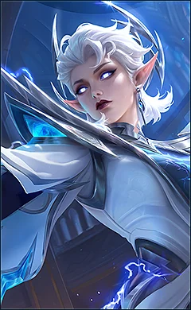
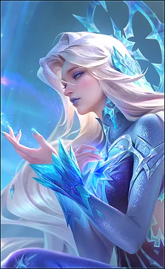
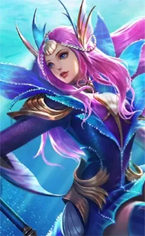

[Tier list](https://boostmlbb.ru/en/heroes/)

# Odette

C

MageMid Lane

Win rate

51.2%

Pick rate

0.4%

Ban rate

0.1%

[Overview](https://boostmlbb.ru/#overview)[Build](https://boostmlbb.ru/#build)[How to play](https://boostmlbb.ru/#howto)[Skills](https://boostmlbb.ru/#skills)[Counters](https://boostmlbb.ru/#draft)[Skins](https://boostmlbb.ru/#skins)[Lore](https://boostmlbb.ru/#lore)

## Overview

### Attributes

-   Durability**30**
-   Offense**100**
-   Control**70**
-   Difficulty**30**

-   Burst
-   Poke

### More mages on this lane

[Kimmy](https://boostmlbb.ru/en/heroes/kimmy.html)[Eudora](https://boostmlbb.ru/en/heroes/eudora.html)[Zhuxin](https://boostmlbb.ru/en/heroes/zhuxin.html)[Valir](https://boostmlbb.ru/en/heroes/valir.html)[Zetian](https://boostmlbb.ru/en/heroes/zetian.html)[Xavier](https://boostmlbb.ru/en/heroes/xavier.html)[Lylia](https://boostmlbb.ru/en/heroes/lylia.html)[Lunox](https://boostmlbb.ru/en/heroes/lunox.html)

### Places in the rankings

-   [Best MLBB mages**23 of 32**](https://boostmlbb.ru/en/heroes/best-mage.html)
-   [Best MLBB mid laners**21 of 29**](https://boostmlbb.ru/en/heroes/best-mid.html)

## Build

Build 1Build 2Build 3

Win rate

52.3%

Pick rate

5.7%

#### Core items

-   [

    

    Genius Wand

    ](https://boostmlbb.ru/en/items/genius-wand.html)
-   [

    

    Divine Glaive

    ](https://boostmlbb.ru/en/items/divine-glaive.html)
-   [

    

    Winter Crown

    ](https://boostmlbb.ru/en/items/winter-crown.html)

#### Spell

Flicker

#### Emblem and talents

Assassin

-   

    Rupture

-   

    Weapons Master

-   

    Impure Rage

Win rate

57.8%

Pick rate

3.4%

#### Core items

-   [

    

    Genius Wand

    ](https://boostmlbb.ru/en/items/genius-wand.html)
-   [

    

    Sky Piercer

    ](https://boostmlbb.ru/en/items/sky-piercer.html)
-   [

    

    Holy Crystal

    ](https://boostmlbb.ru/en/items/holy-crystal.html)

#### Spell

Flicker

#### Emblem and talents

Assassin

-   

    Rupture

-   

    Bargain Hunter

-   

    Lethal Ignition

Win rate

56.0%

Pick rate

1.9%

#### Core items

-   [

    

    Genius Wand

    ](https://boostmlbb.ru/en/items/genius-wand.html)
-   [

    

    Glowing Wand

    ](https://boostmlbb.ru/en/items/glowing-wand.html)
-   [

    

    Holy Crystal

    ](https://boostmlbb.ru/en/items/holy-crystal.html)

#### Spell

Flicker

#### Emblem and talents

Mage

-   

    Rupture

-   

    Weapons Master

-   

    Lethal Ignition

## How to play Odette

### Odette combos

#### Teamfight

1.  2
2.  Ult
3.  Ult
4.  1

In teamfights, initiate with Odette's 2nd Skill to immobilize the enemy and activate her Ultimate to continuously damage the controlled targets. Activate the dash from her Ultimate to reposition when enemies are about to escape, and finish them off with her 1st Skill after her Ultimate ends.

#### Laning

1.  1
2.  2
3.  Ult

In the laning phase, use Odette's 1st Skill to harass the opponent, and immobilize them with her 2nd Skill at the right moment before securing the kill with her Ultimate.

### When strongest

Even through the game, from 49.3% to 51.0%. Pick fights by your items rather than the clock.

1.  **49.3**10–12
2.  **50.0**12–14
3.  **51.0**14–16
4.  **50.3**16–18
5.  **50.1**18–20
6.  **49.8**20+

Win rate % by match length in minutes, all ranks. Dashed line: 50%

### Level-up priority

1.  Swan Song
2.  Avian Authority
3.  Blue Nova

## Skills

Passive**Lakeshore Ambience**Skill 1**Avian Authority**Skill 2**Blue Nova**Ultimate**Swan Song**

Passive

### Lakeshore Ambience

For 8s after casting a skill, Odette's next Basic Attack gains extra range and bounces between enemies (or an enemy and herself), dealing 144-200 (+50% Total Magic Power) Magic Damage per hit.

Odette's skills also trigger this effect on hit (up to 3 stacks).

Skill 1

### Avian Authority

Cooldown **6 Mana Cost: 65 s**

Odette releases a magic swan in the target direction, dealing 300 (+150% Total Magic Power) Magic Damage to enemies hit and slowing them by 30% for 2s.

Skill 2

### Blue Nova

Cooldown **12 Mana Cost: 75 s**

Odette releases a group of magic orbs in the target direction, dealing 250 (+50% Total Magic Power) Magic Damage to the first enemy hit and immobilizing them for 1.5s.

When an orb hits an enemy, it creates another orb that attacks a nearby enemy, prioritizing enemy heroes, dealing 250 (+50% Total Magic Power) Magic Damage and immobilizing them for 1.5s.

Ultimate

### Swan Song

Cooldown **50 Mana Cost: 160 s**

Odette channels a dance, gaining a 1200 (+150% Total Magic Power) shield and dealing up to 2000 (+750% Total Magic Power) Magic Damage to nearby enemies in a large area for 5s. During this time, her Movement Speed is reduced by 40%, but she can move freely.

Use again to cancel. Only high-level control effects can interrupt this skill.

## Odette counters

### Who counters Odette

[Kaja](https://boostmlbb.ru/en/heroes/kaja.html)[Mathilda](https://boostmlbb.ru/en/heroes/mathilda.html)[Faramis](https://boostmlbb.ru/en/heroes/faramis.html)[Chip](https://boostmlbb.ru/en/heroes/chip.html)[Rafaela](https://boostmlbb.ru/en/heroes/rafaela.html)

### Who Odette counters

[Layla](https://boostmlbb.ru/en/heroes/layla.html)[Nana](https://boostmlbb.ru/en/heroes/nana.html)[Vexana](https://boostmlbb.ru/en/heroes/vexana.html)[Alpha](https://boostmlbb.ru/en/heroes/alpha.html)[Thamuz](https://boostmlbb.ru/en/heroes/thamuz.html)[Julian](https://boostmlbb.ru/en/heroes/julian.html)[Aurora](https://boostmlbb.ru/en/heroes/aurora.html)[Gatotkaca](https://boostmlbb.ru/en/heroes/gatotkaca.html)[Vale](https://boostmlbb.ru/en/heroes/vale.html)[Terizla](https://boostmlbb.ru/en/heroes/terizla.html)

## Odette skins

[Song of DevotionExquisite · 2026](https://boostmlbb.ru/en/skins/odette/song-of-devotion.html)[Wisdom of the StarsExceptional · 2024](https://boostmlbb.ru/en/skins/odette/wisdom-of-the-stars.html)[Sage of the CurrentsDeluxe · 2020](https://boostmlbb.ru/en/skins/odette/sage-of-the-currents.html)[Auspicious CharmExceptional · 2019](https://boostmlbb.ru/en/skins/odette/auspicious-charm.html)[VirgoDeluxe · 2019](https://boostmlbb.ru/en/skins/odette/virgo.html)[Mermaid PrincessExquisite · 2018](https://boostmlbb.ru/en/skins/odette/mermaid-princess.html)[Butterfly GoddessExceptional · 2018](https://boostmlbb.ru/en/skins/odette/butterfly-goddess.html)[Christmas CarnivalExceptional · 2018](https://boostmlbb.ru/en/skins/odette/christmas-carnival.html)[Black SwanCommon · 2017](https://boostmlbb.ru/en/skins/odette/black-swan.html)

[All 9 Odette skins: prices and how to get them](https://boostmlbb.ru/en/skins/odette.html)

## Lore

> Innocent princess that grew up in the Swan Castle and genius mage that excels in sword and scepter.

[Read the full story ↗](https://play.mobilelegends.com/lore/hero/Odette)Official Mobile Legends site [Hero stats on the game site ↗](https://www.mobilelegends.com/hero/detail?heroid=46)

**Rank up on Odette**The calculator shows the price

[Calculate price](https://boostmlbb.ru/en/order.html?type=hero)

## Frequently asked questions

Who counters Odette in MLBB?

Over the last 30 days the toughest opponents are Kaja, Mathilda, Faramis, Chip and Rafaela.

How do you play Odette?

Level "Avian Authority" first and take the ultimate whenever it is available. Even through the game, from 49.3% to 51.0%. Pick fights by your items rather than the clock. Teamfight combo: In teamfights, initiate with Odette's 2nd Skill to immobilize the enemy and activate her Ultimate to continuously damage the controlled targets. Activate the dash from her Ultimate to reposition when enemies are about to escape, and finish them off with her 1st Skill after her Ultimate ends.

What is Odette’s win rate right now?

51.17% at Mythical Glory over the last 7 days and 49.77% across all ranks over 30 days, as of 27 November 2026.

What role and lane does Odette play?

Mage, played in the Mid Lane.

Is Odette strong in the current meta?

Tier C, #96 of 133 heroes and #23 among mages. The tier counts how often the hero is picked and banned and how well it wins at Mythical Glory over 7 days: banned in 0.1% of matches, 51.2% win rate. In professional games over the last month the hero is drafted in 0.0% of them.

What is the best build for Odette?

The most popular ranked build: Genius Wand, Divine Glaive and Winter Crown as core items, the Assassin emblem with Rupture, Weapons Master and Impure Rage, and Flicker. It wins 52.33% of matches.
