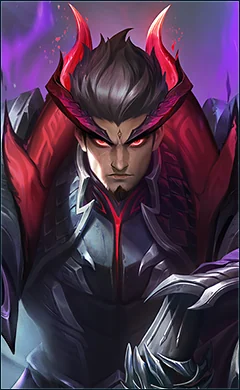

[Tier list](https://boostmlbb.ru/en/heroes/)[Items](https://boostmlbb.ru/en/items/)[Skins](https://boostmlbb.ru/en/skins/)[News & guides](https://boostmlbb.ru/en/news/)

# Paquito

A

FighterAssassinEXP LaneJungle

Win rate

50.1%

Pick rate

1.4%

Ban rate

10.7%

[Overview](https://boostmlbb.ru/#overview)[Build](https://boostmlbb.ru/#build)[How to play](https://boostmlbb.ru/#howto)[Skills](https://boostmlbb.ru/#skills)[Counters](https://boostmlbb.ru/#draft)[Skins](https://boostmlbb.ru/#skins)[Lore](https://boostmlbb.ru/#lore)

## Overview

### Attributes

-   Durability**60**
-   Offense**50**
-   Control**40**
-   Difficulty**90**

-   Chase
-   Damage

### Win rate by rank, 30 days

1.  **49.5%**Epic
2.  **49.5%**Legend
3.  **49.6%**Mythic
4.  **50.5%**Honor
5.  **50.0%**Glory

Dashed line: 50% win rate

### More fighters on this lane

[Freya](https://boostmlbb.ru/en/heroes/freya.html)[Aulus](https://boostmlbb.ru/en/heroes/aulus.html)[Sun](https://boostmlbb.ru/en/heroes/sun.html)[Lukas](https://boostmlbb.ru/en/heroes/lukas.html)[Suyou](https://boostmlbb.ru/en/heroes/suyou.html)[Cici](https://boostmlbb.ru/en/heroes/cici.html)[Sora](https://boostmlbb.ru/en/heroes/sora.html)[Yu Zhong](https://boostmlbb.ru/en/heroes/yu-zhong.html)

### Places in the rankings

-   [Best MLBB junglers**5 of 37**](https://boostmlbb.ru/en/heroes/best-jungle.html)
-   [Best MLBB fighters**5 of 44**](https://boostmlbb.ru/en/heroes/best-fighter.html)
-   [Best MLBB assassins**3 of 29**](https://boostmlbb.ru/en/heroes/best-assassin.html)

## Build

Build 1Build 2Build 3

Win rate

56.3%

Pick rate

5.7%

#### Core items

-   [

    

    Hunter Strike

    ](https://boostmlbb.ru/en/items/hunter-strike.html)
-   [

    

    Sky Piercer

    ](https://boostmlbb.ru/en/items/sky-piercer.html)
-   [

    

    Malefic Roar

    ](https://boostmlbb.ru/en/items/malefic-roar.html)

#### Spell

Flicker

#### Emblem and talents

Assassin

-   

    Rupture

-   

    Master Assassin

-   

    Lethal Ignition

Win rate

53.8%

Pick rate

4.8%

#### Core items

-   [

    

    Hunter Strike

    ](https://boostmlbb.ru/en/items/hunter-strike.html)
-   [

    

    Sea Halberd

    ](https://boostmlbb.ru/en/items/sea-halberd.html)
-   [

    

    Malefic Roar

    ](https://boostmlbb.ru/en/items/malefic-roar.html)

#### Spell

Flicker

#### Emblem and talents

Assassin

-   

    Rupture

-   

    Master Assassin

-   

    Lethal Ignition

Win rate

57.9%

Pick rate

3.0%

#### Core items

-   [

    

    Hunter Strike

    ](https://boostmlbb.ru/en/items/hunter-strike.html)
-   [

    

    Sky Piercer

    ](https://boostmlbb.ru/en/items/sky-piercer.html)
-   [

    

    Malefic Roar

    ](https://boostmlbb.ru/en/items/malefic-roar.html)

#### Spell

Flicker

#### Emblem and talents

Assassin

-   

    Rupture

-   

    Festival of Blood

-   

    Lethal Ignition

## How to play Paquito

### Paquito combos

#### Teamfight

1.  2
2.  1
3.  Ult
4.  2

In teamfights, Paquito can use his 2nd Skill to approach the enemy team, then his 1st Skill to deal damage. He should follow up with his Ultimate to knock the enemy back and enter the Champ Stance. He can finish with his enhanced 2nd Skill to deal heavy damage to the enemies.

#### Laning

1.  1
2.  2
3.  1
4.  2

In the laning phase, Paquito can use his 1st Skill to gain a stack for the Champ Stance before using his 2nd Skill to close in on the enemy hero. He can use his 1st Skill again to deal damage and enter the Champ Stance. He should then hit the enemy hero with the enhanced 2nd Skill.

### When strongest

Stronger early: 51.3% at 10–12 minutes. Push your lane, take objectives and close the game before the lead fades.

1.  **51.3**10–12
2.  **50.2**12–14
3.  **49.4**14–16
4.  **49.4**16–18
5.  **49.0**18–20
6.  **49.4**20+

Win rate % by match length in minutes, all ranks. Dashed line: 50%

### Level-up priority

1.  Knockout Strike
2.  Jab
3.  Heavy Left Punch

## Skills

Passive**Champ Stance**Skill 1**Heavy Left Punch**Skill 2**Jab**Ultimate**Knockout Strike**

Passive

### Champ Stance

Paquito gains a stack each time he casts a skill. At 3 stacks, he enters the Champ Stance and enhances his next skill.

Paquito's enhanced skills have no cooldown and deal (+2 × hero level)% extra damage to minions.

After casting any enhanced skill, Paquito gains 60% Movement Speed and (+2 × hero level)% Damage Reduction for 1.2s.

Skill 1

### Heavy Left Punch

Cooldown **7 s**

Paquito throws a punch in the target direction, dealing 210 (+50% Total Physical Attack) Physical Damage to enemies hit and gaining a 150 (+135% Total Physical Attack) shield.

**Champ Stance:** The damage is increased to 350 (+100% Total Physical Attack) Physical Damage, and the shield value is increased to 140% for 2.5s (normal and enhanced shields can stack).

Skill 2

### Jab

Cooldown **7 s**

Paquito dashes forward and throws a jab, dealing 200 (+165% Total Physical Attack) Physical Damage to enemies in his path and at the destination.

**Champ Stance:** Paquito's jab becomes fiercer, dealing 300 (+210% Total Physical Attack) Physical Damage to enemies hit.

The jab stops upon hitting a hero or creep.

Ultimate

### Knockout Strike

Cooldown **15 s**

Paquito launches an elbow strike at enemies in the target direction, dealing 250 (+50% Total Physical Attack) Physical Damage and knocking them back to the destination.

He then throws a haymaker, dealing 300 (+90% Total Physical Attack) Physical Damage and slowing them by 75% for 1s, before darting backward.

**Champ Stance:** After knocking enemies back to the destination, Paquito launches an uppercut instead, dealing 400 (+120% Total Physical Attack) Physical Damage and knocking them airborne for 0.5s.

## Paquito counters

### Who counters Paquito

[Natalia](https://boostmlbb.ru/en/heroes/natalia.html)[X.Borg](https://boostmlbb.ru/en/heroes/x-borg.html)[Karina](https://boostmlbb.ru/en/heroes/karina.html)[Wanwan](https://boostmlbb.ru/en/heroes/wanwan.html)[Helcurt](https://boostmlbb.ru/en/heroes/helcurt.html)

## Paquito skins

[Fist of GloryDeluxe · 2024](https://boostmlbb.ru/en/skins/paquito/fist-of-glory.html)[Terry BogardGrand · 2024](https://boostmlbb.ru/en/skins/paquito/terry-bogard.html)[Blazing TigerExquisite · 2023](https://boostmlbb.ru/en/skins/paquito/blazing-tiger.html)[Fist of LightExceptional · 2022](https://boostmlbb.ru/en/skins/paquito/fist-of-light.html)[Fulgent PunchExceptional · 2022](https://boostmlbb.ru/en/skins/paquito/fulgent-punch.html)[Underground BoxerExceptional · 2021](https://boostmlbb.ru/en/skins/paquito/underground-boxer.html)[Manny PacquiaoDeluxe · 2021](https://boostmlbb.ru/en/skins/paquito/manny-pacquiao.html)[Death BlowCommon · 2021](https://boostmlbb.ru/en/skins/paquito/death-blow.html)

[All 8 Paquito skins: prices and how to get them](https://boostmlbb.ru/en/skins/paquito.html)

## Lore

> A mortal hero who fights demons with nothing but his fists—and the iron will to protect his tribe.

[Read the full story ↗](https://play.mobilelegends.com/lore/hero/Paquito)Official Mobile Legends site [Hero stats on the game site ↗](https://www.mobilelegends.com/hero/detail?heroid=103)

**Rank up on Paquito**The calculator shows the price

[Calculate price](https://boostmlbb.ru/en/order.html?type=hero)

## Frequently asked questions

Who counters Paquito in MLBB?

Over the last 30 days the toughest opponents are Natalia, X.Borg, Karina, Wanwan and Helcurt.

How do you play Paquito?

Level "Jab" first and take the ultimate whenever it is available. Stronger early: 51.3% at 10–12 minutes. Push your lane, take objectives and close the game before the lead fades. Teamfight combo: In teamfights, Paquito can use his 2nd Skill to approach the enemy team, then his 1st Skill to deal damage. He should follow up with his Ultimate to knock the enemy back and enter the Champ Stance. He can finish with his enhanced 2nd Skill to deal heavy damage to the enemies.

What is Paquito’s win rate right now?

50.14% at Mythical Glory over the last 7 days and 50.01% across all ranks over 30 days, as of 25 November 2026.

What role and lane does Paquito play?

Fighter and assassin, played in the EXP Lane or in the jungle.

Is Paquito strong in the current meta?

Tier A, #11 of 133 heroes and #5 among fighters. The tier counts how often the hero is picked and banned and how well it wins at Mythical Glory over 7 days: banned in 10.7% of matches, 50.1% win rate. In professional games over the last month the hero is drafted in 69.3% of them.

What is the best build for Paquito?

The most popular ranked build: Hunter Strike, Sky Piercer and Malefic Roar as core items, the Assassin emblem with Rupture, Master Assassin and Lethal Ignition, and Flicker. It wins 56.25% of matches.
