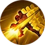

[Tier list](https://boostmlbb.ru/en/heroes/)[News & guides](https://boostmlbb.ru/en/news/)

Tier B

# Paquito

Fighter and assassin · EXP Lane or Jungle

Win rate

50.03%

Pick rate

1.26%

Ban rate

18.13%

**#65 of 133 by win rate**All ranks · 30 days to 23 November 2026

[Build](https://boostmlbb.ru/#build)[Counters](https://boostmlbb.ru/#draft)[Skills](https://boostmlbb.ru/#skills)[Stats](https://boostmlbb.ru/#ranks)[Lore](https://boostmlbb.ru/#lore)

Chase · Damage · Difficulty 90/100

## Build

Most picked in ranked · EXP Lane

Core items

Hunter StrikeSea HalberdMalefic Roar

Emblem and talents

AssassinRuptureMaster AssassinLethal Ignition

Battle spell

Flicker

Wins with this build **53.79%**Picked in **4.84%** of matches

Alternative builds (2)

Core items

Hunter StrikeSky PiercerMalefic Roar

Emblem and talents

AssassinRuptureMaster AssassinLethal Ignition

Battle spell

Flicker

Wins with this build **56.25%**Picked in **5.74%** of matches

Core items

Hunter StrikeSky PiercerMalefic Roar

Emblem and talents

AssassinRuptureFestival of BloodLethal Ignition

Battle spell

Flicker

Wins with this build **57.92%**Picked in **2.97%** of matches

## Counters and teammates

### Counters

[Natalia](https://boostmlbb.ru/en/heroes/natalia.html)[X.Borg](https://boostmlbb.ru/en/heroes/x-borg.html)[Karina](https://boostmlbb.ru/en/heroes/karina.html)[Wanwan](https://boostmlbb.ru/en/heroes/wanwan.html)[Helcurt](https://boostmlbb.ru/en/heroes/helcurt.html)

### Teammates

Win rate change as a duo

[Alice+1.22 pp](https://boostmlbb.ru/en/heroes/alice.html)[Bane+1.10 pp](https://boostmlbb.ru/en/heroes/bane.html)[Sun+0.93 pp](https://boostmlbb.ru/en/heroes/sun.html)[Natan+0.80 pp](https://boostmlbb.ru/en/heroes/natan.html)

## Skills

Level-up priority · Knockout Strike → Jab → Heavy Left Punch

Passive**Champ Stance**

Paquito gains a stack each time he casts a skill. At 3 stacks, he enters the Champ Stance and enhances his next skill.
Paquito's enhanced skills have no cooldown and deal (+2\*Hero Level)% extra damage to minions.
After casting any enhanced skill, Paquito gains 60% Movement Speed and (+2\*Hero Level)% Damage Reduction for 1.2s.

Skill 1**Heavy Left Punch**

**Cooldown 7 s**

Paquito throws a punch in the target direction, dealing 210 (+50% Total Physical Attack) Physical Damage to enemies hit and gaining a 150 (+135% Total Physical Attack) shield.
Champ Stance: The damage is increased to 350 (+100% Total Physical Attack) Physical Damage, and the shield value is increased to 140% for 2.5s (normal and enhanced shields can stack).

Skill 2**Jab**

**Cooldown 7 s**

Paquito dashes forward and throws a jab, dealing 200 (+165% Total Physical Attack) Physical Damage to enemies in his path and at the destination.
Champ Stance: Paquito's jab becomes fiercer, dealing 300 (+210% Total Physical Attack) Physical Damage to enemies hit.
The jab stops upon hitting a hero or creep.

Ultimate**Knockout Strike**

**Cooldown 15 s**

Paquito launches an elbow strike at enemies in the target direction, dealing 250 (+50% Total Physical Attack) Physical Damage and knocking them back to the destination.
He then throws a haymaker, dealing 300 (+90% Total Physical Attack) Physical Damage and slowing them by 75% for 1s, before darting backward.
Champ Stance: After knocking enemies back to the destination, Paquito launches an uppercut instead, dealing 400 (+120% Total Physical Attack) Physical Damage and knocking them airborne for 0.5s.

## Win rate by rank

-   Epic**49.53%**
-   Legend**49.57%**
-   Mythic**49.74%**
-   Mythical Honor**50.51%**
-   Mythical Glory**50.03%**

## Lore

A mortal hero who fights demons with nothing but his fists—and the iron will to protect his tribe.

[Read the full story ↗](https://play.mobilelegends.com/lore/hero/Paquito)Official Mobile Legends site

[Hero stats on the game site](https://www.mobilelegends.com/hero/detail?heroid=103)

[Hero boost pricing](https://boostmlbb.ru/en/order.html?type=hero)

## Frequently asked questions

Who counters Paquito in MLBB?

Over the last 30 days the toughest opponents are Natalia, X.Borg, Karina, Wanwan and Helcurt.

What is Paquito’s win rate right now?

50.03% over the last 30 days across all ranks and 50.03% in Mythical Glory, as of 23 November 2026.

What role and lane does Paquito play?

Fighter and assassin, played in the EXP Lane or in the jungle.

Is Paquito strong in the current meta?

Tier B: #65 of 133 heroes by 30-day win rate and #20 among fighters.

What is the best build for Paquito?

The most popular ranked build: Hunter Strike, Sea Halberd and Malefic Roar as core items, the Assassin emblem with Rupture, Master Assassin and Lethal Ignition, and Flicker. It wins 53.79% of matches.
